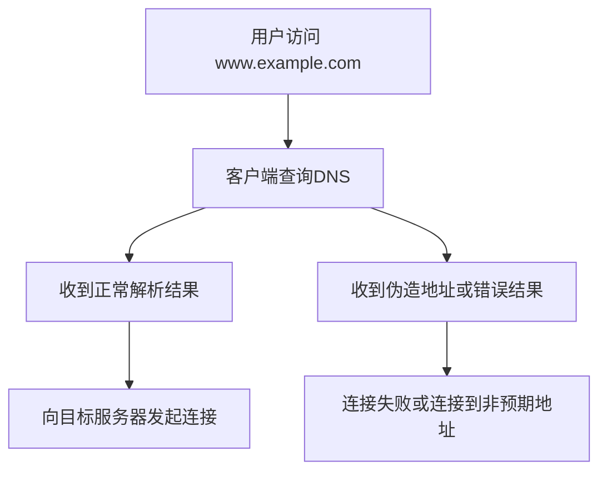
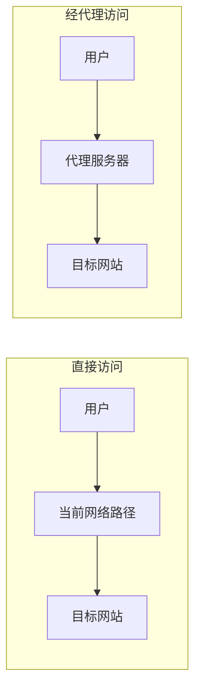
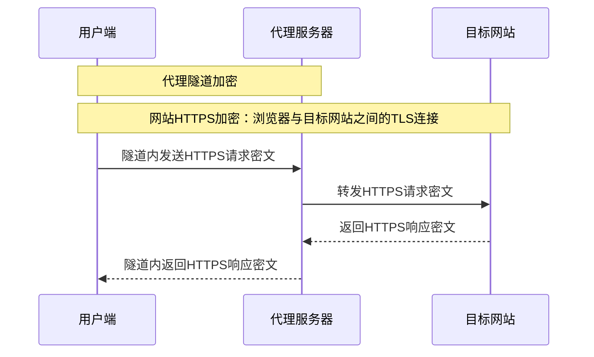
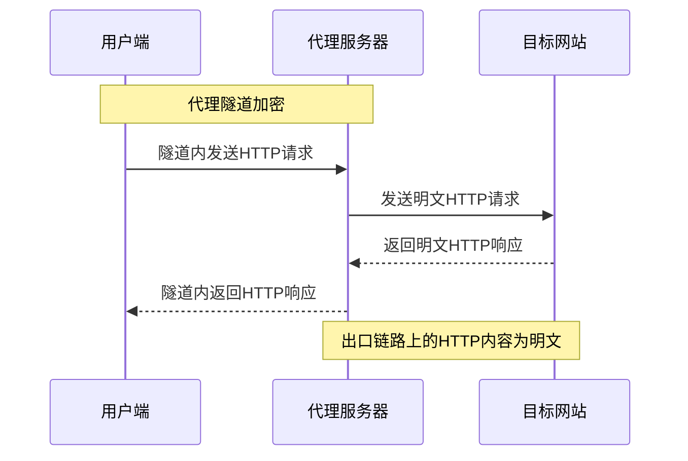
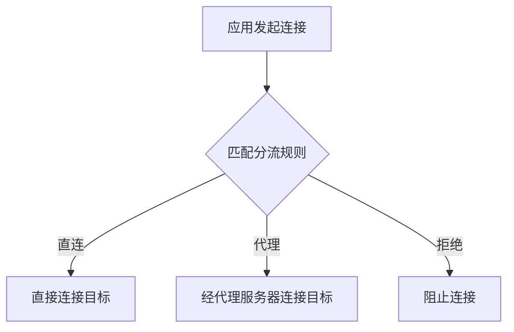

# 第1章 什么是科学上网

为什么有的网站能打开，有的却一直转圈？“代理”和“VPN”又有什么关系？本章从这些常见问题入手。

读完这一章，你会了解：

- **访问限制**：网站打不开，可能有哪些原因？
- **工作原理**：代理如何中转流量，加密保护哪一段？
- **发展时间线**：从传统VPN到现在的代理工具，发生了哪些变化？
- **使用边界**：这些工具能做什么，使用时要注意什么？

## 1.1 互联网访问限制的背景

### 1.1.1 全球互联网的分割现状

互联网通过共同的协议连接不同网络，但这不意味着所有用户都能访问相同的内容。监管政策、版权授权、机构管理和服务商的经营范围等因素，都可能造成访问差异。

**主要表现形式：**

1. **网络审查与过滤**
    - 中国大陆的相关过滤机制常被统称为防火长城（GFW，Great Firewall），并非一台独立设备
    - 可能涉及DNS响应干扰、IP地址封锁、连接重置和流量特征检测等机制
    - 不同地区、运营商、时段和协议的可达性可能不同

2. **地理区域限制（Geo-blocking）**
    - 流媒体平台按地区提供不同内容或限制服务范围，例如Netflix、BBC iPlayer
    - 判断地区时可能同时使用出口IP、账号地区、支付方式和设备定位等信息
    - 更换出口IP不代表一定能访问，也不代表符合平台条款

3. **机构网络管理**
    - 企业、学校可能限制特定网站、应用或外部连接
    - 公共Wi-Fi可能要求先通过登录认证页面，再允许访问互联网
    - 这些限制需要与机构的安全政策和使用授权一并考虑

4. **服务提供方限制**
    - 网站可能主动屏蔽部分地区、数据中心IP或异常请求
    - 账号资格、订阅权限、制裁与出口管制要求也可能影响服务可用性
    - 访问失败不一定意味着网络审查，也可能来自服务本身或网络故障

### 1.1.2 技术实现手段

网络限制可能发生在不同环节，以下机制也可能组合使用。

**DNS响应干扰、劫持与污染**

**可以把DNS理解为“查地址”**：输入网站域名后，设备先查询它对应的IP地址，再发起连接。

- **正常情况**：查到正确地址，连接目标网站。
- **受到干扰**：收到伪造地址、替代地址或错误结果，可能打不开网站，也可能连到其他地址。

这些结果可能来自路径中注入的假响应，也可能来自解析服务自身的策略，具体机制并不相同。

*图1-1 DNS响应受到干扰时的访问过程*

加密DNS通过保护客户端到解析服务之间的查询，减少路径中的窃听和响应篡改。网站能否访问，还取决于后续连接是否受到IP封锁或其他限制。

**IP地址封锁**

- 在网络出口、运营商网络或其他网关按目标IP、地址段等条件过滤流量
- 可能直接丢弃数据包，导致连接超时
- 多个网站共用IP时，可能出现连带影响

**域名与流量特征检测**

- 检查明文HTTP的Host字段、未受ECH保护的TLS服务器名称指示（SNI）等信息
- 深度包检测（DPI，Deep Packet Inspection）还可结合握手特征、包长、时序和连接行为分类流量
- 加密能保护内容，但不会自动隐藏目标IP、流量大小和时间等元数据
- 主动探测是向可疑服务器另行发起连接以验证其行为，与被动观察流量的DPI需要区分

**先记住：网页内容加密了，不代表访问哪个网站也完全隐藏了。**

**补充阅读：SNI和ECH是什么？**

- **ClientHello**：客户端开始TLS握手时发出的消息。
- **SNI**：其中用于指明服务器名称的信息，未受保护时可能暴露目标域名。
- **ECH（Encrypted Client Hello）**：加密内部ClientHello，保护实际目标域名等握手信息。
- **生效条件**：客户端和服务器都要支持，客户端还需获取有效的ECH配置。
- **保护边界**：目标IP、连接时间和流量大小仍可能被观察。

**TCP连接重置及其他干扰**

- 在满足客户端或服务器接受条件时，注入伪造的TCP RST报文可能中断连接
- TCP重置只针对TCP；UDP及基于UDP的QUIC也可能受到丢包、限速或封锁
- 出现RST、超时或连接失败，本身不足以证明发生了审查，需要结合测量和排障判断

### 1.1.3 对普通用户的影响

访问限制或跨境网络质量问题，可能影响：

- **学术研究**：学术搜索、论文数据库和国际协作工具的使用
- **技术开发**：代码托管、软件包仓库、容器镜像和官方文档的获取
- **商业沟通**：邮件、视频会议、客户沟通和海外平台运营
- **信息与文化交流**：新闻、课程、社交和影音服务的访问
- **软件维护**：下载、更新、许可证验证和云端功能的使用

例如，Google Scholar、arXiv、GitHub、Stack Overflow等资源，在不同网络中的访问情况可能不同。

**主站能打开，也不代表所有功能都能用**：下载、登录和API可能使用不同域名，需要分别判断。

## 1.2 科学上网的定义与原理

### 1.2.1 什么是科学上网

**科学上网**是中文互联网中的非正式用语，通常指借助代理、VPN或其他中转技术，访问当前网络环境下受限制的互联网资源。

以代理为例，可以先理解为**“请一台能连接目标的服务器帮你转发数据”**：

- **直接访问**：你的设备直接连接目标网站。
- **经代理访问**：你的设备先连接代理服务器，再由它连接目标网站。

*图1-2 直接访问与经代理访问的路径对比*

这条中转路径能否工作，取决于两件事：**你能连上代理服务器，代理服务器也能连上目标网站**。具体方案的安全性和适用范围，还要看协议、配置和使用条件。

### 1.2.2 基本工作原理

常见方案结合了**流量中转、链路加密和路由选择**，部分方案还加入流量伪装。

**1. 流量中转**

- 客户端将选定的请求交给中转服务器
- 中转服务器代替客户端连接目标，并转发双向数据
- 中转服务器可以位于境内或境外，能否访问目标取决于其网络出口和目标服务的限制
- 目标通常看到中转服务器的出口IP，但账号、Cookie、设备特征等仍可能关联用户身份

**2. 链路加密与网站加密**

- 带加密的代理协议或VPN可以保护客户端到中转服务器之间的通信
- HTTP代理、SOCKS5等协议本身不保证该段连接经过加密；认证也不等于加密
- 访问HTTPS网站时，通常还存在浏览器到目标网站的TLS连接，代理只转发其密文
- 访问明文HTTP网站时，即使前半段有加密隧道，代理出口到网站之间仍可能传输明文

**简化流程图：**

以具有加密隧道的普通转发代理为例，访问HTTPS网站时，请求与响应经过以下过程：

*图1-3 通过加密代理访问HTTPS网站的请求与响应过程*

图中的“用户端”包括浏览器和代理客户端。**这里有两层加密，保护范围不同：**

| 加密方式 | 保护范围 | 代理服务器能看到什么？ |
|---------|---------|---------------------|
| **代理隧道加密** | 用户端 ↔ 代理服务器 | 代理会解除这一层加密，处理需要转发的数据 |
| **网站HTTPS加密** | 浏览器 ↔ 目标网站 | 普通转发代理通常无法读取网页正文，但仍可能掌握目标地址、连接时间和流量大小等信息 |

代理服务器也知道连接它的客户端IP。**使用加密代理不等于匿名。**

**补充阅读：企业HTTPS解密检查**

企业网关若实施HTTPS解密检查，会分别与浏览器、目标网站建立两段TLS连接。这与上图只转发HTTPS密文的普通代理不同。

访问明文HTTP网站时，出口一侧的通信方式有所不同：

*图1-4 通过加密代理访问明文HTTP网站的请求与响应过程*

此时，隧道只保护前半段链路：

- **用户端到代理服务器**：由代理隧道加密保护。
- **代理服务器到HTTP网站**：内容仍是明文，代理及出口路径上的观察者可能读取。

**涉及账号、支付等敏感信息时，应使用HTTPS，并正确验证证书。**

**3. 路由与流量伪装**

- 分流规则决定哪些连接直连、走代理或被拒绝
- TLS、WebSocket、HTTP/2、HTTP/3等可被用作承载方式，但WebSocket本身不提供加密，需区分`ws://`和`wss://`
- 伪装旨在减少可识别特征，效果取决于实现、配置和网络环境，不能保证不可检测

分流通常依据域名、目标IP、应用程序或连接类型等条件匹配规则。图1-5展示了常见的三类处理结果。

*图1-5 分流规则的基本处理流程*

### 1.2.3 与VPN的区别

VPN和应用代理都可以用于跨网络访问，先区分它们的基本思路：

- **VPN（虚拟专用网络）**：在公共网络上建立专用连接，常用于远程办公和网络互联。
- **应用代理**：由中间服务器代替应用连接目标网站或服务。

两者接管流量的方式和配置入口有所不同，具体对比如下：

| 对比维度 | VPN | 应用代理及通用代理工具 |
|---------|-----|---------------------|
| **常见用途** | 企业远程接入、站点互联、流量保护等 | 请求转发、访问控制、调试、跨网络访问等 |
| **处理方式** | 常通过虚拟网络接口或网络层策略承载流量 | 通常由应用配置代理，也可通过TUN等方式接管流量 |
| **流量范围** | 可全隧道，也可分流 | 可按规则分流，也可将接管的流量全部转发 |
| **加密** | 取决于协议与配置；常见安全方案有IPsec、OpenVPN、WireGuard | HTTP/SOCKS5本身不保证加密；Shadowsocks、Trojan等方案另有加密机制 |
| **抗限制能力** | 取决于协议特征、服务器地址和部署方式 | 同样取决于协议、服务器地址和部署方式 |
| **性能** | 受线路、拥塞、加密开销、MTU和设备性能影响 | 同样受线路与实现影响，分流也不保证更快 |
| **代表** | IPsec/IKEv2、OpenVPN、WireGuard | HTTP/SOCKS5代理、Shadowsocks、Trojan；Xray、sing-box等可实现多种方案 |

**容易混淆的三点：**

- **VPN也能分流**：可以转发全部接管的流量，也可以只转发指定流量。
- **L2TP不自带内容加密**：通常与IPsec配合使用。
- **PPTP已不适合新的安全部署**：它存在安全性不足的问题。

**补充阅读：IPsec如何分流？**

IPsec通过安全策略，对不同流量选择保护、绕过或丢弃，参见[RFC 4301](https://www.rfc-editor.org/rfc/rfc4301.html)。

### 1.2.4 技术演进历程

**先看时间线：从远程接入，到轻量代理，再到多协议和分流管理。**

下表选取代表性节点；具体年份标注项目诞生、版本发布或标准发布，时间段用于概括发展趋势。不同方案长期并存，早期技术也仍有适用场景。

| 时间节点 | 代表技术或事件 | 主要变化 |
|---------|---------------|---------|
| **1990年代—2000年代** | IPsec、SSH隧道；OpenVPN于2001年发布 | 通过认证、加密和隧道实现远程接入，主要服务于远程办公和网络互联 |
| **2012年** | Shadowsocks诞生 | 提供轻量的加密代理，便于应用接入和灵活部署 |
| **2015—2019年** | V2Ray于2015年出现；这一时期还有Trojan、Clash等项目发展 | 多协议、TLS承载和规则分流逐渐成为工具的重要功能 |
| **2020年** | Xray项目出现；WireGuard合入Linux 5.6 | 代理生态继续发展，VPN也沿着简化设计、提高效率的方向演进 |
| **2021年** | QUIC发布为RFC 9000 | 将加密、多路复用和连接管理结合在基于UDP的传输中 |
| **2022年** | Shadowsocks 2022；sing-box项目出现 | 更新代理协议的加密设计，并发展整合多种协议与路由功能的通用平台 |
| **2023年** | REALITY、Hysteria 2发布；原版Clash与Clash for Windows停止维护 | 传输安全和QUIC代理继续发展，客户端生态也发生更替 |
| **2023年以来** | mihomo、sing-box等项目继续发展；Hysteria 2、TUIC等QUIC方案并存 | 用户可组合协议、分流规则和客户端，按网络条件选择方案 |

**对初学者来说，记住三条变化就够了：**

- **连接方式更多**：VPN与加密代理并存，分别适用于不同需求。
- **网络适应性更受重视**：出现TLS承载、流量伪装和QUIC代理等方向；能否使用、是否更快，仍取决于线路和配置。
- **使用管理更方便**：规则分流、节点管理、延迟检测和图形界面逐渐完善。

**补充阅读：这些名称分别属于哪一类？**

- **代理协议**：如Shadowsocks、VMess、VLESS、Trojan，规定代理双方如何通信。
- **传输与安全机制**：如WebSocket、TLS、REALITY，承担不同的承载或保护任务；WebSocket本身不提供加密。
- **流控机制**：如XTLS Vision，与代理协议和传输安全机制配合使用。
- **代理核心**：如V2Ray、Xray、sing-box、mihomo，负责协议处理、路由和数据转发。
- **图形客户端**：提供节点管理、规则设置和状态查看界面，背后通常使用代理核心。

Hysteria 2、TUIC利用QUIC承载通信，依赖UDP可达性。在部分高延迟或丢包环境中可能有优势，但并不保证比其他方案更快。

**选工具时，要看项目是否仍在维护，并从官方渠道获取更新。**年份较新，不自动代表更安全、更快或更适合你的网络。

## 1.3 合法性与使用边界

### 1.3.1 法律法规现状

技术用途、联网方式、服务经营资质和数据处理行为，需要分别判断。个人使用、免费提供服务或用于学习，都不能自动证明某种联网方式合法。

**中国大陆的相关规定：**

1. **国际联网管理**
    - [《中华人民共和国计算机信息网络国际联网管理暂行规定》](https://xzfg.moj.gov.cn/front/law/detail?LawID=1713)已于2024年3月10日第二次修订；现行第六条要求直接国际联网使用国家公用电信网提供的国际出入口信道，禁止任何单位和个人自行建立或者使用其他信道进行国际联网
    - 第十四条规定，对违反第六条、第八条和第十条的行为，由公安机关责令停止联网、给予警告，可以并处15000元以下罚款；有违法所得的，没收违法所得。不能仅因“个人自用”就排除责任
    - 条文中的“信道”及其对具体行为的适用，需要结合现行配套规定、事实和主管机关认定，不能仅凭软件是否标注“VPN”判断

2. **服务提供与经营**
    - 提供跨境通信或代理服务可能涉及电信业务许可、国际通信设施与出入口管理等要求
    - 企业内部远程接入、经批准的跨境联网业务，与未经许可向公众经营服务，不能混为一谈
    - 是否收费并非唯一判断因素；免费开放服务也不自动免除责任

3. **内容与数据处理**
    - 还需遵守网络安全、数据安全、个人信息保护及知识产权等规定
    - 涉及工作资料、客户信息或个人信息出境时，应另行核对数据处理和跨境传输要求
    - 学习、科研和商务用途同样需要符合适用的联网与数据管理要求

相关行政法规与法律可分别在司法部国家行政法规库和[国家法律法规数据库](https://flk.npc.gov.cn/)查阅。涉及具体业务时，应结合现行规定、单位制度和专业意见确定适用要求。

**其他司法辖区：**

不同国家和地区的规定各不相同，需要分别确认：

- **工具使用**：当地对VPN、代理服务有哪些要求？
- **服务经营**：向他人提供服务是否需要许可？
- **内容与数据**：访问内容、数据处理是否符合当地规定？

侵权、诈骗和未经授权的访问等行为，仍需依照当地法律承担相应责任。

### 1.3.2 使用边界与风险

跨网络访问的使用边界主要涉及联网渠道、访问行为、数据处理和服务提供等方面：

| 核对事项 | 需要确认的问题 |
|---------|----------------|
| **联网渠道** | 是否通过适用规定允许的渠道，是否获得必要授权？ |
| **访问目的与内容** | 是否涉及违法内容、侵权、诈骗或未经授权的操作？ |
| **组织与数据要求** | 是否符合单位政策、保密要求和适用的数据出境规则？ |
| **服务条款与许可** | 是否符合地区、账号、订阅及版权许可条件？ |
| **服务提供行为** | 对外提供服务是否需要许可，是否承担相应安全与管理义务？ |

**用途正当，不意味着任何联网方式都合规。**有学习或工作需求时，优先考虑以下渠道，并核实适用范围：

- 单位批准的远程接入或合规跨境通信服务。
- 学校、图书馆等机构提供的数据库与远程访问服务。
- 资源提供方的授权渠道。

### 1.3.3 理性使用建议

1. **先核实渠道与授权**
    - 了解当地规定、单位制度和服务条款
    - 工作设备与业务数据使用单位批准的方案
    - 使用符合业务范围与授权要求的联网服务

2. **保护账号和设备**
    - 从官方渠道获取仍受维护的软件，及时安装安全更新
    - 使用独立强密码和多因素认证，不忽略证书告警
    - 不向不明服务商上传订阅凭据、工作资料或安装其根证书

3. **了解服务商的信任边界**
    - 核对运营主体、权限要求、日志政策及可验证的安全信息
    - “不记录日志”的宣传、付费服务或自行搭建都不等于绝对安全
    - 凭据泄露时应撤销并更换；仅定期更换节点不能消除身份关联

4. **正确理解加密保护**
    - 网站HTTPS与代理隧道加密各有作用，不能相互替代
    - 加密DNS只保护相应DNS链路，不能隐藏全部网络活动
    - 分流、IPv6、UDP和DNS是否经过预期路径，需要结合客户端配置验证

## 1.4 为什么需要科学上网

学术研究、软件开发、跨境协作和文化交流，都可能涉及不同地区的网络资源。访问方式的选择需要结合网络可达性、资源授权与具体使用需求。

### 1.4.1 学术与技术需求

**学术研究人员：**

- 访问Web of Science、Scopus等数据库，核对机构订阅与授权
- 查阅arXiv、SSRN等论文资源
- 使用在线文档、论文协作和国际会议工具
- 在有授权的情况下，使用学校或机构提供的远程访问服务

**技术开发者：**

- 访问GitHub等代码托管平台，参与开源协作
- 查阅Stack Overflow、官方文档和技术标准
- 从Docker Hub、GHCR、npm、PyPI、Maven等来源获取镜像和依赖
- 使用Hugging Face等模型与数据集平台
- 使用云端开发、部署及AI辅助工具，同时遵守地区政策、数据使用条款和单位保密要求

资源镜像、机构缓存和离线文档也可能满足需求。选择替代来源时，应确认其可信度、更新情况及文件完整性。

### 1.4.2 商业与工作场景

**跨境业务人员：**

- 管理海外电商、广告及分析平台
- 使用邮件、即时通信与视频会议联系客户
- 查询国际市场资料，参加线上展会

**设计与创意工作者：**

- 访问设计社区、在线协作工具和素材平台
- 下载已获授权的字体、图片、插件及软件更新
- 观看课程，与海外团队协作

商务需求应与跨境联网方案、平台经营地区、账号资格及数据合规分别核对。代理不能替代业务许可，也不应成为绕过单位数据保护要求的方式。

### 1.4.3 信息获取与视野拓展

**多元化信息源：**

- 对比不同媒体、研究机构和公共资料的观点
- 阅读百科、国际组织报告和公开数据
- 对重要结论核实原始来源、发布时间和证据

**知识学习：**

- 使用Coursera、edX、Khan Academy等课程资源
- 阅读专业博客、标准文档和公开课材料
- 核对课程、字幕、付费内容和地区授权的可用性

### 1.4.4 娱乐与文化交流

**影音与文化内容：**

- 访问流媒体、音乐、直播和视频平台
- 内容库、订阅价格和可用功能可能因地区而异
- 服务名称、地区覆盖和访问政策会变化，应以平台官方说明为准

**社交与沟通：**

- 使用X、Instagram、Threads、Reddit、Discord等平台进行交流
- 了解Bluesky、Mastodon等采用不同开放或联邦化架构的平台
- 平台架构不代表匿名保证，仍需了解账号规则、内容政策和隐私设置

**游戏与联机：**

- 下载游戏与更新，连接获准使用的国际服务器
- 中转线路可能改善路由，也可能增加延迟、抖动和丢包
- 普通代理未必支持游戏所需的UDP或全部连接，不能保证具备游戏加速效果

### 1.4.5 隐私保护需求

可信的加密隧道可以改善特定链路的隐私，但它改变了信任关系，并没有让访问过程自动匿名。

| 场景 | 可能提供的保护 | 仍然存在的边界 |
|------|----------------|----------------|
| **公共Wi-Fi** | 隧道可保护被接管流量到服务器之间的链路；HTTPS本身也保护网站通信 | 不能防止钓鱼、设备中毒或用户主动泄露信息 |
| **本地运营商观察** | 对隧道内流量，减少直接暴露目标及内容的机会 | 运营商仍可看到隧道服务器IP、连接时间和流量大小；DNS或分流也可能暴露目标 |
| **目标网站观察** | 通常将源IP替换为代理出口IP | 登录账号、Cookie、浏览器指纹和行为仍可能识别用户 |
| **中转服务商观察** | HTTPS通常使其无法直接读取网站正文 | 服务商仍可能掌握客户端IP、目标地址和连接元数据；明文HTTP内容可能被读取 |
| **广告与跨站追踪** | 更换IP可能减少部分基于IP的关联 | 不会自动清除Cookie、阻断跟踪脚本或消除指纹，应配合浏览器的隐私设置 |

日常隐私保护需要几个环节配合：

- **传输链路**：使用HTTPS，按需使用可信的加密隧道。
- **浏览器**：通过隐私设置减少跨站追踪。
- **账号使用**：注意登录账号带来的身份关联。

---

## 本章小结

科学上网是对特定访问用途的非正式称呼，常见实现包含代理、VPN和流量中转。理解其作用时，要同时区分可达性、加密、匿名性与合规性。

**关键要点：**

1. 访问失败可能来自网络过滤、线路质量、服务故障、地区或账号限制，需要分别判断。
2. 加密能保护内容，但不保证流量不可识别，也不保证服务器始终可达。
3. 代理隧道加密与网站HTTPS是不同层次的保护，VPN和代理都可以具有分流能力。
4. 协议、传输机制、核心程序和图形客户端不是同一概念，应核对各自的兼容性与维护状态。
5. 正当用途不自动使联网方式合规；代理或VPN也不自动提供匿名性。

在接下来的章节中，我们将进一步学习相关网络基础知识和技术原理。

---

**延伸阅读：**

- [RFC 1928：SOCKS Protocol Version 5](https://www.rfc-editor.org/rfc/rfc1928.html)：SOCKS5的功能与协议边界。
- [RFC 4301：Security Architecture for IP](https://www.rfc-editor.org/rfc/rfc4301.html)：IPsec安全策略及选择性流量处理。
- [RFC 8446：TLS 1.3](https://www.rfc-editor.org/rfc/rfc8446.html)：TLS的加密、认证与保护边界。
- [RFC 9000：QUIC](https://www.rfc-editor.org/rfc/rfc9000.html)：基于UDP的安全多路复用传输。
- [RFC 9849：TLS Encrypted Client Hello](https://www.rfc-editor.org/rfc/rfc9849.html)：ECH机制与安全考虑。
- [Xray官方文档：传输配置](https://xtls.github.io/config/transport.html)：区分传输方式与传输安全机制。
- [Hysteria 2官方协议说明](https://github.com/apernet/hysteria/blob/master/PROTOCOL.md)：基于QUIC的代理设计。
- [mihomo官方文档](https://wiki.metacubex.one/)：了解相关工具与当前配置说明。
- [国际联网管理暂行规定（2024年修订，司法部国家行政法规库）](https://xzfg.moj.gov.cn/front/law/detail?LawID=1713)：国际联网信道、管理责任与相关法律责任；其他相关法律可在[国家法律法规数据库](https://flk.npc.gov.cn/)检索。
- [OONI网络测量项目](https://ooni.org/)、[GFW Report](https://gfw.report/)与[Censored Planet](https://censoredplanet.org/)：网络过滤与可达性的测量方法和研究报告。
- [Freedom House：Freedom on the Net](https://freedomhouse.org/report/freedom-net)：互联网访问与使用环境的年度研究报告。

**思考题：**

1. 一个网站无法访问时，如何区分DNS问题、连接阻断、服务故障和账号限制？
2. 加密代理隧道与HTTPS分别保护哪段通信，哪些参与方仍能看到元数据？
3. 为什么“用于学习”“已经加密”和“更换了出口IP”都不足以分别证明合规、安全和匿名？
