# 第2章 网络基础知识

打开一个网站，会用到哪些网络知识？先记住下面这张表，再逐项学习。

| 概念 | 可以怎样理解？ | 例子 |
|------|----------------|------|
| **IP地址** | 网络中的地址，类似门牌号 | `192.168.1.100` |
| **DNS** | 根据域名“查地址” | 查询`www.example.com`对应的IP |
| **HTTP / HTTPS** | 浏览器与网站交互的规则 | 打开网页、提交表单 |
| **TCP / UDP** | 两种基础的数据传输方式 | 网页访问、语音通话 |
| **端口** | 同一个地址上不同服务的入口 | HTTPS常用443端口 |
| **代理** | 帮你转发请求的中间服务器 | 用户 → 代理 → 网站 |
| **加密** | 用密钥保护数据内容 | HTTPS保护登录信息 |

## 2.1 IP地址与DNS解析

### 2.1.1 IP地址基础

**什么是IP地址？**

IP地址（Internet Protocol Address）用于在网络中定位通信对象，可以把它理解为“网络门牌号”。

- **不是设备的永久身份证**：切换网络后，IP可能改变。
- **一台设备可以有多个IP**：例如同时拥有IPv4和IPv6地址。

**IPv4地址**

```text
格式：四组数字，用点分隔
示例：192.168.1.100
每组范围：0—255
地址长度：32位
地址总数：约43亿个（2^32），其中部分用于内网和特殊用途
```

**IPv4的传统分类：A、B、C类等**

旧教材常按下面的方式分类，A、B、C类分别对应不同规模的网络。

| 类别 | 地址范围 | 传统用途 |
|------|----------|----------|
| **A类** | `1.0.0.0—126.255.255.255` | 大型网络，默认网络前缀为`/8` |
| **B类** | `128.0.0.0—191.255.255.255` | 中型网络，默认网络前缀为`/16` |
| **C类** | `192.0.0.0—223.255.255.255` | 小型网络，默认网络前缀为`/24` |
| **D类** | `224.0.0.0—239.255.255.255` | 组播，即向一组接收者发送数据 |
| **E类** | `240.0.0.0—255.255.255.255` | 保留范围，含特殊用途地址 |

**这是历史分类，现代网络主要使用CIDR。** 表中A类不含特殊的`0.0.0.0/8`和`127.0.0.0/8`；A、B、C类中也有私有等特殊地址。

**现在常见的写法：CIDR**

`192.168.1.0/24`表示一个地址块。斜线后的数字表示网络前缀占多少位：

| 写法 | 对应范围 | 地址总数 |
|------|----------|----------|
| `192.168.1.0/24` | `192.168.1.0—192.168.1.255` | 256个 |
| `192.168.0.0/16` | `192.168.0.0—192.168.255.255` | 65,536个 |

**斜线后的数字越大，地址块越小。** 总数不等于可用数量，常见IPv4子网还要保留网络地址和广播地址。

**日常最常遇到的特殊IPv4地址**

| 类型 | 地址范围或示例 | 用途 |
|------|----------------|------|
| **私有IP** | `10.0.0.0/8` | 内网使用 |
| **私有IP** | `172.16.0.0/12`，即`172.16.0.0—172.31.255.255` | 内网使用，并非所有172开头的地址都是私有地址 |
| **私有IP** | `192.168.0.0/16` | 家庭、办公网络中很常见 |
| **回环地址** | `127.0.0.0/8`，常用`127.0.0.1` | 连接本机服务 |
| **链路本地地址** | `169.254.0.0/16` | 常见于设备未获得正常IPv4配置时，仅在当前链路使用 |

另有两类地址：

- **运营商共享地址**：`100.64.0.0/10`，常用于运营商级NAT。
- **文档示例地址**：如`192.0.2.0/24`、`203.0.113.0/24`，不用于真实公网服务。

**IPv6地址**

IPv4地址数量有限，IPv6提供了大得多的地址空间。

```text
格式：通常为八组十六进制数字，用冒号分隔
完整形式：2001:0db8:85a3:0000:0000:8a2e:0370:7334
简写形式：2001:db8:85a3::8a2e:370:7334
地址长度：128位
地址总数：2^128个
```

简写规则：省略每组前导零，连续全零组可写成`::`，一个地址中最多用一次。

| 类型 | 范围或示例 | 用途 |
|------|------------|------|
| **全球单播地址** | 由网络分配 | 可用于公网通信，能否访问仍取决于路由和防火墙 |
| **链路本地地址** | `fe80::/10` | 同一链路内通信 |
| **唯一本地地址（ULA）** | `fc00::/7`，常见以`fd`开头 | 内部网络通信 |
| **回环地址** | `::1` | 连接本机服务 |
| **文档示例地址** | `2001:db8::/32` | 技术文档中的示例 |

**公网IP、内网IP与NAT**

- **内网IP**：在家庭、公司等内部网络中使用，不能直接作为互联网的路由目标。
- **公网IP**：可用于互联网路由，但不代表任何人都能主动连接进来。
- **NAT（网络地址转换）**：家庭IPv4路由器常用它让多台设备共用一个公网出口。

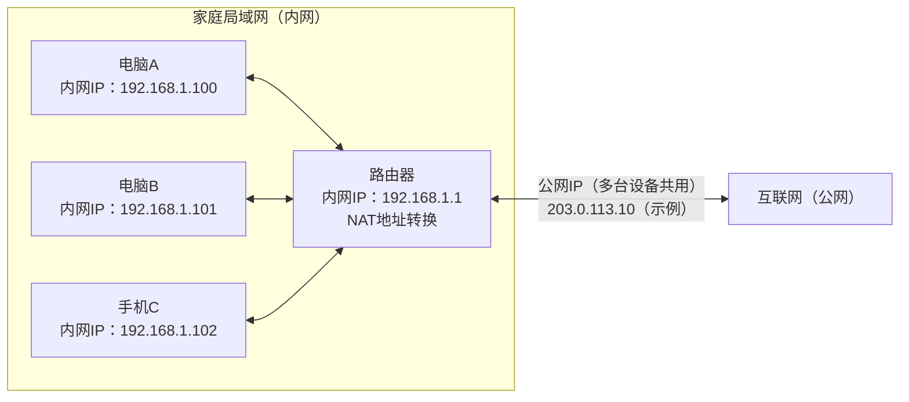

*图2-1 多台设备使用各自的内网IP，经NAT共用一个公网IP（公网IP使用文档示例地址）*

**需要注意：**

- 路由器也可能没有公网IPv4，还需经过运营商的NAT。
- 有公网地址，仍需防火墙等配置允许，外部才能主动连接。
- IPv6通常无需家庭IPv4式NAT；代理和防火墙也要考虑IPv6连接。

### 2.1.2 DNS域名解析系统

**DNS的作用**

DNS（Domain Name System，域名系统）就像“网络通讯录”，帮助设备根据域名查找IP地址。

```text
输入域名：www.example.com
    ↓ DNS查询
获得地址：192.0.2.10（示例）
    ↓
浏览器尝试连接该地址
```

同一域名可能返回多个IP，也可能随地区、时间变化。

**DNS解析过程**

1. **查已有结果**：缓存或hosts文件可能直接提供地址，顺序依实现而定。
2. **查询DNS服务**：没有结果时，交给“递归解析器”。
3. **必要时逐级查找**：依次询问根、顶级域、权威服务器，如下图。
4. **返回并缓存**：TTL规定记录最多可以缓存多久。

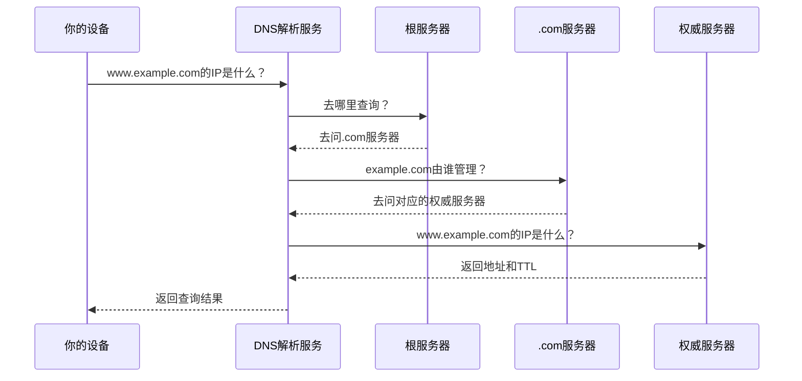

*图2-2 无相关缓存时的DNS解析过程*

**常见DNS记录类型**

| 类型 | 用途 | 示例 |
|------|------|------|
| **A** | 查询IPv4地址 | `www.example.com → 192.0.2.10` |
| **AAAA** | 查询IPv6地址 | `www.example.com → 2001:db8::10` |
| **CNAME** | 指向另一个域名，即别名 | `www.example.com → web.example.com` |
| **MX** | 指定邮件接收服务器 | `example.com → mail.example.com`，还包含优先级 |
| **TXT** | 保存文本信息 | 域名验证、邮件策略 |
| **NS** | 指定权威DNS服务器 | `example.com → ns1.example.net` |
| **HTTPS** | 提供HTTPS连接参数 | 可包含协议和ECH配置信息 |

先认识 **A、AAAA、CNAME** 即可，其余类型用到时再查。遇到CNAME时，解析服务会继续查找别名目标的地址。

**DNS污染与解析安全**

```text
正常解析：域名 → 正确地址 → 尝试连接目标网站
受到干扰：域名 → 错误地址或错误结果 → 可能无法访问
```

传统DNS常用UDP/TCP 53端口，本身不加密。假响应可能来自路径干扰，也可能是解析服务返回的替代结果。

| 做法 | 主要作用 | 注意事项 |
|------|----------|----------|
| **选择可信DNS服务** | 使用可靠的解析来源 | 仅更换服务地址，未必能避免路径中的干扰 |
| **使用加密DNS** | 保护设备到解析服务的查询链路 | 需要客户端支持并正确配置 |
| **通过代理解析** | 将查询交给远端或代理内置DNS | 需与客户端分流规则配合 |
| **验证DNSSEC** | 验证支持该机制的域名记录来源与完整性 | 不加密查询，也不是所有域名都支持 |
| **临时修改hosts** | 手动指定地址，辅助诊断 | 地址变化后需更新，不适合长期固定动态网站 |

**解析正确也可能打不开网站**：还要排查IP封锁、线路或网站限制。

### 2.1.3 常用公共DNS服务

公共DNS帮助用户查询域名。以下是常见服务公布的IPv4地址：

| 服务 | 常用地址 | 主要特点 |
|------|----------|----------|
| [Cloudflare](https://developers.cloudflare.com/1.1.1.1/ip-addresses/) | `1.1.1.1`、`1.0.0.1` | 提供普通解析和加密DNS |
| [Google](https://developers.google.com/speed/public-dns/docs/using) | `8.8.8.8`、`8.8.4.4` | 提供普通解析和加密DNS |
| [Quad9](https://quad9.net/service/service-addresses-and-features/) | `9.9.9.9`、`149.112.112.112` | 这组地址提供恶意域名拦截和DNSSEC验证 |
| [OpenDNS](https://www.opendns.com/setupguide/) | `208.67.222.222`、`208.67.220.220` | 提供内容过滤等功能 |
| [阿里云公共DNS](https://www.alidns.com/) | `223.5.5.5`、`223.6.6.6` | 提供普通解析及DoH、DoT接入 |
| [腾讯DNSPod](https://www.dnspod.cn/products/publicdns) | `119.29.29.29` | 提供公共递归解析 |

**怎么选？**

- **先看能否稳定查询**，再比较实际响应速度和网页访问体验。
- **没有适用于所有人的“最快DNS”**：结果受地区、运营商和缓存影响。
- **有过滤、日志设置需求**：可了解NextDNS等定制服务，按官方说明配置。

**加密DNS协议速查**

| 方式 | 如何传输？ | 常用端口 |
|------|------------|----------|
| **DoH** | 通过HTTPS传递DNS查询 | 通常443 |
| **DoT** | 通过专用TLS连接传递DNS查询 | TCP 853 |
| **DoQ** | 通过QUIC传递DNS查询 | UDP 853 |
| **DoH over HTTP/3** | 用HTTP/3承载DoH，与DoQ不同 | 通常UDP 443 |

**配置时注意：**

- 通常需填写服务域名或HTTPS地址，仅填IP不等于启用加密DNS。
- 浏览器内置DNS可能与系统DNS走不同路径。
- 加密DNS只保护查询链路，后续连接的目标IP仍可能被观察。

DNSCrypt是另一种加密DNS方案，需兼容的客户端和服务端。

## 2.2 HTTP/HTTPS协议基础

### 2.2.1 HTTP协议详解

**HTTP是什么？**

HTTP（超文本传输协议）规定浏览器如何请求资源、网站如何返回结果。

```text
浏览器：请给我这个网页。 → HTTP请求
网站：处理结果和网页内容在这里。 → HTTP响应
```

**HTTP请求与响应**

下面是HTTP/1.1的简化示例。先看方法、路径和状态码，不必记住所有字段。

```http
GET /hello.txt HTTP/1.1
Host: www.example.com
Accept: text/plain

```

| 内容 | 含义 |
|------|------|
| `GET` | 获取资源 |
| `/hello.txt` | 资源路径 |
| `HTTP/1.1` | 协议版本 |
| `Host` | 要访问的主机名 |

服务器可能这样回答：

```http
HTTP/1.1 200 OK
Content-Type: text/plain; charset=utf-8
Content-Length: 13

Hello, world!
```

- **`200 OK`**：请求成功。
- **`Content-Type`**：内容是UTF-8纯文本。
- **`Content-Length: 13`**：正文长13字节。
- **空行后的内容**：响应正文，这里是`Hello, world!`。

**常见HTTP方法**

| 方法 | 主要用途 | 常见例子 |
|------|----------|----------|
| **GET** | 获取资源 | 打开网页、下载图片 |
| **POST** | 提交数据供服务器处理 | 提交表单、调用接口 |
| **PUT** | 创建或完整替换指定资源 | 上传并替换文件 |
| **DELETE** | 请求删除指定资源 | 删除一条记录 |
| **HEAD** | 获取响应头，不返回正文 | 检查资源信息 |
| **OPTIONS** | 查询通信选项 | 跨域请求的预检 |
| **CONNECT** | 请求代理建立隧道 | 通过HTTP代理访问HTTPS |

**缓存另看规则**：GET不一定能缓存，POST也不是绝对不能缓存。

**常见HTTP状态码**

| 类别 | 表示什么？ | 常见状态码 |
|------|------------|------------|
| **1xx** | 中间信息，处理还在继续 | `100 Continue` |
| **2xx** | 成功 | `200 OK` |
| **3xx** | 跳转或缓存相关处理 | `301`永久跳转、`302`临时跳转、`304`可使用缓存 |
| **4xx** | 请求或访问条件有问题 | `401`需要认证、`403`拒绝访问、`404`未找到、`429`请求过多 |
| **5xx** | 服务器或网关处理失败 | `500`内部错误、`502`网关错误、`503`服务暂不可用 |

**状态码是线索**：`403`可能是网站权限限制，`502`可能是代理或其他网关连接上游失败。

**HTTP版本速查**

| 版本 | 主要特点 | 常见传输方式 |
|------|----------|--------------|
| **HTTP/1.1** | 起始行和头字段以文本形式表达 | TCP；HTTPS访问时加上TLS |
| **HTTP/2** | 二进制分帧，同一连接可同时处理多个请求 | 通常TCP，浏览器访问通常使用TLS |
| **HTTP/3** | 在QUIC上承载HTTP | UDP上的QUIC，集成TLS 1.3安全机制 |

这些版本都有方法和状态码；上面的文本示例只对应HTTP/1.1。

### 2.2.2 HTTPS加密通信

**可以先理解为：HTTPS = HTTP + TLS安全保护。**

| 提供的保护 | 通俗解释 |
|------------|----------|
| **加密** | 减少通信内容被中途偷看的风险 |
| **完整性校验** | 检测传输中的数据是否被篡改 |
| **身份验证** | 检查连接的服务器是否对应所访问的域名 |

这些保护依赖正确配置和证书验证。HTTP/3的TLS 1.3安全机制集成在QUIC中。

**TLS版本**

- **TLS 1.3**：2018年发布，简化握手，移除多种旧机制。
- **TLS 1.2**：仍用于兼容性场景。
- **SSL、TLS 1.0 / 1.1**：已过时，不适合新的安全部署。

**HTTPS连接怎样建立？**

以常见的TLS 1.3完整握手为例：

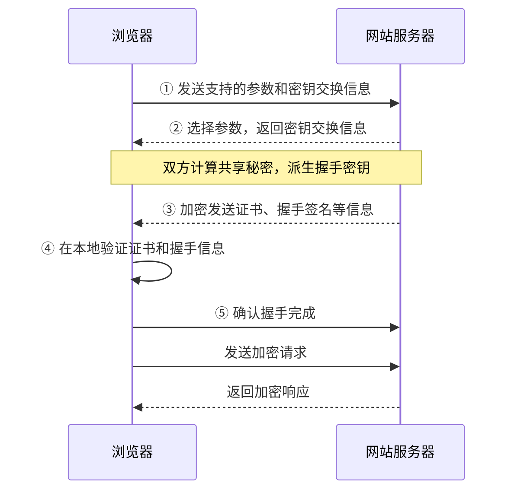

*图2-3 TLS 1.3完整握手的简化过程*

**先记目的：确认身份、协商密钥、加密传输。** 证书在浏览器本地验证，握手中的计算和验证会交错进行。

**HTTPS也有保护边界：**

- 钓鱼网站也可能有有效证书，不能仅凭“连接安全”判断网站可信。
- 目标IP、连接时间和流量大小仍可能被观察。
- 域名等握手信息是否隐藏，还取决于ECH等机制。

### 2.2.3 证书与CA

**证书是什么？**

网站证书可以理解为“域名与公钥的身份证明”，由CA（证书颁发机构）签名。常见CA有Let's Encrypt、DigiCert、GlobalSign、Sectigo。

| 证书中的信息 | 用途 |
|--------------|------|
| **域名或IP** | 说明证书对应哪个服务 |
| **公钥** | 用于验证握手签名等操作 |
| **有效期** | 限定证书的使用时间 |
| **签发者与签名** | 帮助客户端验证证书来源 |

**证书链**

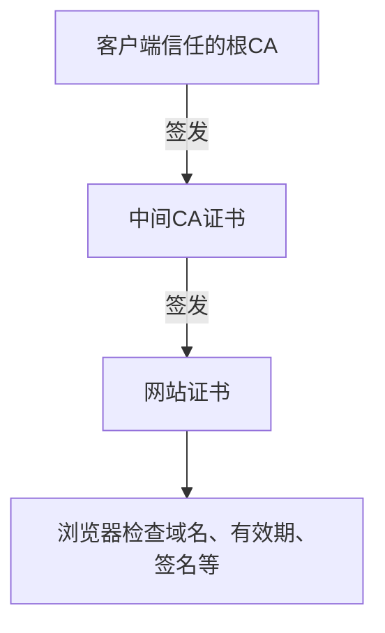

*图2-4 简化的证书链*

- 服务器通常发送网站证书及所需的中间证书。
- 根CA是否可信，由浏览器或系统的信任库决定。
- 遇到证书告警，应检查域名、系统时间和证书配置，避免直接跳过验证。

**常见证书类型**

| 类型 | 主要验证什么？ |
|------|----------------|
| **DV：域名验证** | 申请者是否控制该域名 |
| **OV：组织验证** | 域名控制权和组织身份 |
| **EV：扩展验证** | 按更严格流程核实组织身份 |

**DV、OV、EV主要区别在身份核验，加密不因此变强。** EV也不再普遍显示绿色地址栏。

## 2.3 TCP/UDP传输协议

### 2.3.1 TCP协议详解

**TCP是什么？**

TCP（传输控制协议）提供可靠、有序的数据传输。可以把它理解为“带编号、确认和补发机制的运输”。

**TCP三次握手：建立连接**

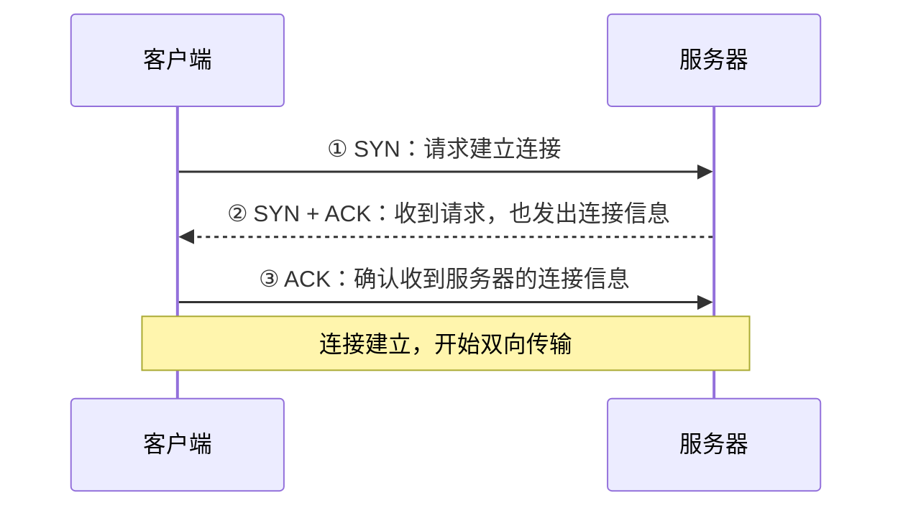

*图2-5 TCP三次握手*

**第三次的作用**：确认客户端收到服务器的连接信息，并帮助避免旧请求造成错误建连。

**TCP四次挥手：关闭连接**

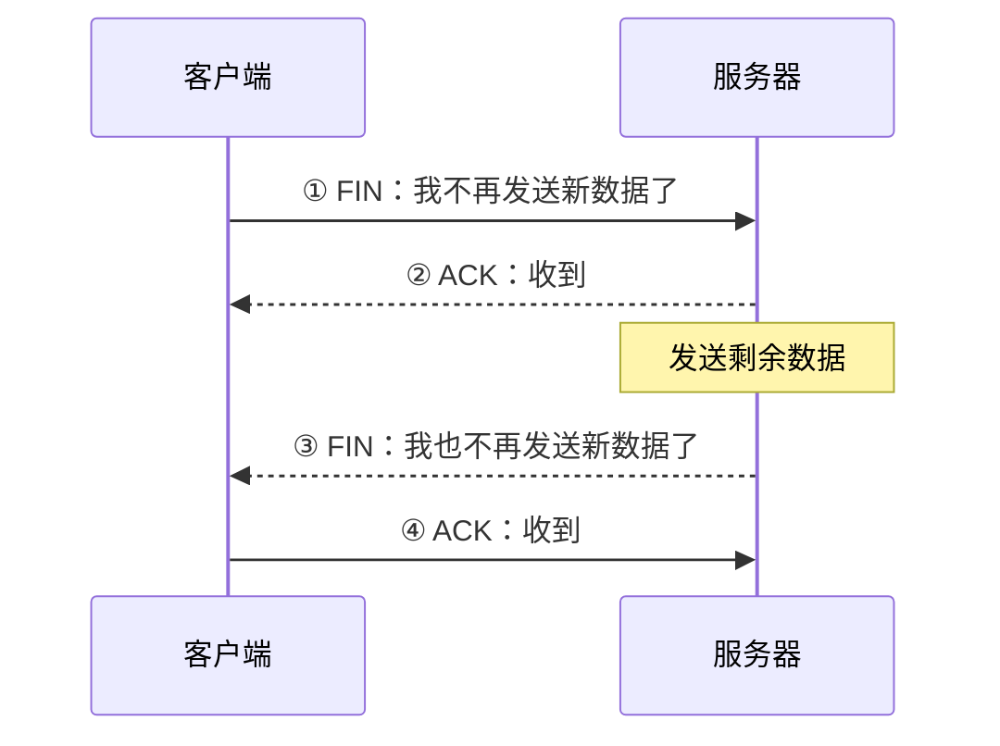

*图2-6 TCP正常关闭的一种典型过程*

两个发送方向分别关闭。实际ACK与FIN可能合并，异常时也可能用RST终止，不总是四个报文。

**TCP的主要特性**

| 特性 | 解决什么问题？ |
|------|----------------|
| **确认与重传** | 数据丢了，尝试补发 |
| **流量控制** | 避免发送太快，让接收端来不及处理 |
| **拥塞控制** | 根据网络拥堵情况调整发送速度 |
| **有序交付** | 将数据按顺序交给应用 |
| **队头阻塞** | 前面的数据缺失时，后面的数据通常要等待 |

**常见用途**：网页、文件传输、邮件、SSH远程终端。

**补充**：TCP不保留消息边界，发送两次的数据可能一次读到，应用需自行划分消息。持续网络故障也会使TCP连接失败。

### 2.3.2 UDP协议详解

**UDP是什么？**

UDP（用户数据报协议）按一个个数据报发送消息，本身不建立TCP式连接，也不负责确认、重传或排序。

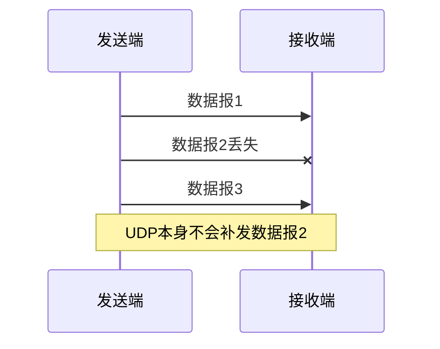

*图2-7 UDP数据报传输示意*

**常见用途**

- **语音、视频、游戏**：应用按实时性需求处理丢包，过期数据可能直接丢弃。
- **DNS查询**：传统DNS常用UDP，但也会使用TCP。
- **QUIC**：在UDP之上增加可靠传输、加密和拥塞控制，HTTP/3使用它。

**TCP与UDP对比**

| 特性 | TCP | UDP本身 |
|------|-----|---------|
| **建立连接** | 需要握手 | 不需要TCP式握手 |
| **传输单位** | 字节流 | 数据报，保留消息边界 |
| **丢包处理** | 确认、重传 | 不自动重传 |
| **顺序保证** | 有 | 无 |
| **拥塞控制** | 有 | 无，由上层按需实现 |
| **加密** | 本身不加密 | 本身不加密 |
| **开销** | 内置机制较多 | 基础头部和内置机制较少 |

**UDP不一定更快，上层也可以实现可靠传输**，例如QUIC。其不同流可减少跨流等待，但同一流仍需按序交付；实际速度取决于网络和协议实现。

### 2.3.3 端口的概念

**什么是端口？**

IP类似楼的地址，端口类似楼里不同服务的入口编号。

```text
IP地址：连接哪里？        192.0.2.10
端口号：连接哪个服务？    443
合起来：                 192.0.2.10:443

IPv6带端口时加方括号：   [2001:db8::10]:443
```

- **取值范围**：0—65535，其中0为保留值。
- **TCP与UDP端口分开**：TCP 443和UDP 443可以提供不同的服务。
- **端口可以修改**：看到443不一定就是HTTPS，要结合服务配置判断。

**端口范围**

| 范围 | 分类 | 常见用途 |
|------|------|----------|
| **0—1023** | 系统端口 | HTTP、HTTPS、SSH等基础服务 |
| **1024—49151** | 用户端口 | 可登记给应用服务使用 |
| **49152—65535** | 动态或私有端口 | 常用于临时通信，不分配给固定服务 |

系统实际的临时端口范围和权限要求，可能与上述IANA分类不同。

**常用端口速查**

| 服务 | 常见端口 | 说明 |
|------|----------|------|
| HTTP | TCP 80 | 明文网页 |
| HTTPS | TCP 443；HTTP/3常用UDP 443 | 加密网页 |
| 备用Web入口 | TCP 8080、8443 | 常见约定，需看配置 |
| DNS | UDP/TCP 53 | 传统DNS |
| DoT / DoQ | TCP 853 / UDP 853 | 加密DNS |
| SSH | TCP 22 | 加密远程登录 |
| FTP | TCP 21 | 控制连接，数据另用其他端口 |
| Windows远程桌面 | TCP/UDP 3389 | RDP服务 |
| MySQL / PostgreSQL | TCP 3306 / 5432 | 数据库服务 |
| Redis / MongoDB | TCP 6379 / 27017 | 常见数据库入口 |
| SOCKS代理 | TCP 1080 | 常见接入端口；UDP转发需另行协商 |

**代理端口看实际配置**，不能把某个教程中的端口当作所有客户端的默认值。

## 2.4 代理的概念与分类

### 2.4.1 代理服务器基础

**代理是什么？**

代理是帮客户端连接目标、转发数据的中间服务。

```text
直接访问：你 → 目标网站
使用代理：你 → 代理服务器 → 目标网站
```

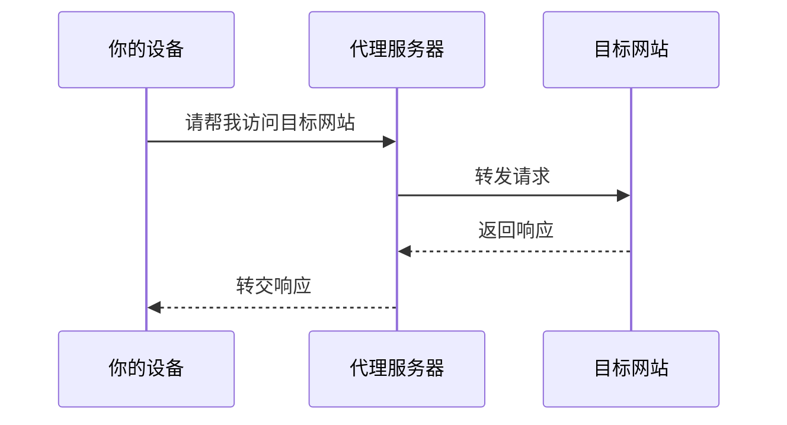

*图2-8 代理转发请求与响应的过程*

**代理可以做什么？**

| 作用 | 例子 |
|------|------|
| **连接中转** | 通过另一个网络出口访问资源 |
| **统一管理** | 企业控制允许访问的网站 |
| **缓存内容** | 在协议和授权允许时复用缓存 |
| **分配请求** | 反向代理把访问分给多台后端服务器 |

**先记住两点：**

- 目标通常看到代理出口IP，但代理知道客户端IP；账号、Cookie等也可能关联身份。
- 使用代理不等于自动加密。是否加密要看协议和配置，普通HTTPS隧道代理也通常无法读取或缓存网页正文。

### 2.4.2 代理类型分类

代理可以从协议、角色、接管方式等不同角度分类。

**按接入协议分类**

| 类型 | 主要特点 | 注意事项 |
|------|----------|----------|
| **HTTP代理** | 转发HTTP请求，也可用CONNECT建立隧道 | CONNECT可转发代理允许的TCP连接 |
| **SOCKS代理** | 先协商目标，再转发数据 | SOCKS4主要支持TCP；SOCKS5还定义认证、IPv6和UDP转发 |
| **专用加密代理** | 按专用协议认证、加密、转发 | 如Shadowsocks、Trojan，客户端与服务端需兼容 |

实际能代理哪些应用及TCP、UDP连接，要看应用、客户端和服务端是否共同支持。

**按部署角色分类**

| 类型 | 代表谁？ | 常见场景 |
|------|----------|----------|
| **正向代理** | 客户端 | 帮用户访问外部网站 |
| **反向代理** | 后端服务 | 网站统一入口、负载均衡 |

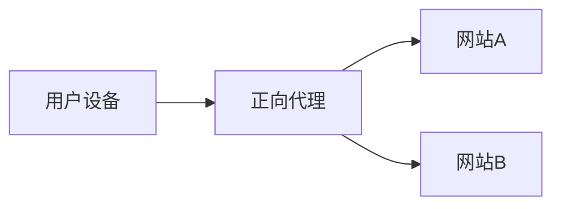

*图2-9 正向代理：帮用户访问外部服务*

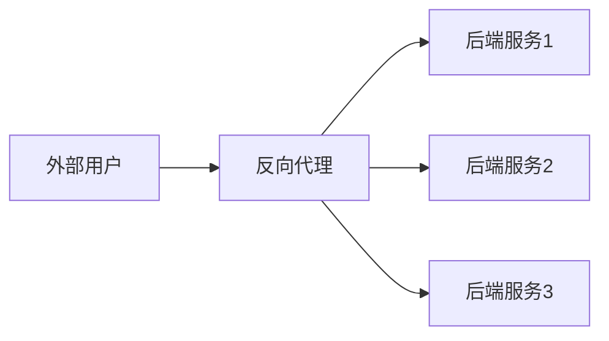

*图2-10 反向代理：帮网站接收并分发请求*

Squid常用于正向HTTP代理，Nginx、HAProxy常用于反向代理，实际角色以配置为准。

**按流量接管方式分类**

| 类型 | 如何接入？ |
|------|------------|
| **显式代理** | 在应用或系统中填写代理地址和端口 |
| **透明接管** | 由网关或本机转发机制自动接管流量，应用通常无需直接设置代理 |

透明接管并不自动获得HTTPS明文。若网关实施HTTPS解密检查，还涉及证书信任等额外配置。

**“透明、匿名、高匿代理”是什么意思？**

这些常见叫法主要描述是否向目标暴露来源信息。

| 叫法 | 通常想表达的含义 |
|------|------------------|
| **透明代理** | 可能把原始客户端IP传给目标 |
| **匿名代理** | 不直接传递原始IP，但可能暴露代理标识 |
| **高匿代理** | 尽量不在HTTP头中暴露原始IP或明显代理标识 |

**这些叫法不保证匿名**，也与“透明接管”含义不同。

- `Forwarded`、`X-Forwarded-For`可传递来源信息，`Via`可标记中间节点。
- 普通CONNECT隧道代理通常无法修改HTTPS内部的HTTP头；账号、Cookie等仍可能识别用户。

### 2.4.3 科学上网常用代理协议

| 协议或方案 | 主要特点 | 先注意什么？ |
|------------|----------|--------------|
| **HTTP / HTTPS代理** | 浏览器和许多应用支持 | HTTPS代理可加密到代理的连接；与“通过代理访问HTTPS网站”含义不同 |
| **SOCKS5** | 通用代理，定义TCP及UDP转发 | 本身不提供通用流量加密，UDP需完整实现支持 |
| **Shadowsocks** | 轻量加密代理，可转发TCP、UDP | 使用受维护的实现和兼容的现代协议规范 |
| **VMess / VLESS** | 常见于多协议代理平台 | VMess含自身加密；VLESS常见部署配合TLS、REALITY等传输保护 |
| **Trojan** | 通常在TLS中认证和转发 | 正确验证证书，配置认证信息 |
| **Hysteria 2 / TUIC** | 基于QUIC的代理方案 | 依赖UDP可达性，实际速度要看线路和配置 |

**分清三类名称：协议规定通信方式，核心负责实现，客户端提供界面。** 例如VLESS是协议，Xray是代理核心。

各协议的配置将在第4章介绍，这里先认识名称和用途。

## 2.5 加密技术基础

### 2.5.1 加密的重要性

**加密主要保护内容；配合认证和完整性校验，还能验证身份、检测篡改。**

代理场景中要分清两层保护：

| 保护方式 | 保护哪一段？ |
|----------|--------------|
| **加密代理隧道** | 你的设备 ↔ 代理服务器 |
| **网站HTTPS** | 浏览器 ↔ 目标网站，普通代理只转发密文 |

**加密不等于匿名**：连接IP、时间、数据量等信息仍可能被观察，登录账号也可能暴露身份。

### 2.5.2 对称加密

**原理：加密和解密使用同一把秘密密钥。**

```text
发送端：明文 + 密钥 → 密文
接收端：密文 + 同一密钥 → 明文
```

- **优点**：速度快，适合保护大量通信数据。
- **关键问题**：双方怎样安全地获得并保管密钥？
- **常见做法**：使用认证加密，同时检测数据是否被篡改。

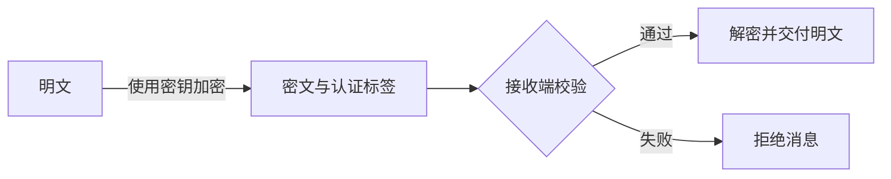

*图2-11 认证加密的简化过程*

**常见算法**

| 算法或构造 | 密钥长度 | 特点 |
|------------|----------|------|
| **AES** | 128 / 192 / 256位 | 需搭配安全工作模式；AES-GCM很常见，有硬件加速时效率高 |
| **ChaCha20-Poly1305** | 256位 | 结合加密与认证，常用于TLS等协议 |
| **XChaCha20-Poly1305** | 256位 | 使用更长的nonce，只适用于明确支持它的协议或库 |
| **DES / 3DES** | 历史方案 | 已不适合新的安全部署 |

**AEAD** 指带关联数据的认证加密。密钥及nonce等参数应由成熟协议实现管理，避免自行拼装。

### 2.5.3 非对称加密

**公钥密码使用一对密钥：公钥可以公开，私钥必须保密。** 不同算法分别用于加密、签名或密钥协商。

| 用途 | 怎样工作？ | 解决什么问题？ |
|------|------------|----------------|
| **公钥加密** | 用接收者公钥加密，由接收者私钥解密 | 保护内容 |
| **数字签名** | 用私钥签名，用公钥验证 | 验证来源与完整性，不隐藏内容 |
| **密钥协商** | 双方交换公开信息，各自计算共享秘密 | 建立后续通信所需的密钥 |

**签名示意**

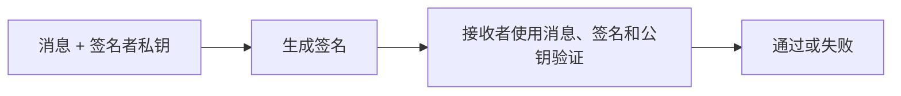

*图2-12 数字签名与验证*

**签名不是“用私钥加密”**，也不隐藏内容；证书可帮助确认公钥属于谁。

**常见名称速查**

| 算法 | 主要用途 |
|------|----------|
| **RSA** | 配合不同方案用于公钥加密或签名 |
| **X25519** | 密钥协商 |
| **ECDSA** | 数字签名 |
| **Ed25519** | 数字签名，与X25519用途不同 |

公钥算法通常不直接加密大量数据，实际会结合对称加密。

### 2.5.4 混合加密（HTTPS的方式）

**思路：用公钥密码确认身份、协商密钥，再用对称加密传输数据。**

以常见的TLS 1.3证书认证与临时密钥交换为例：

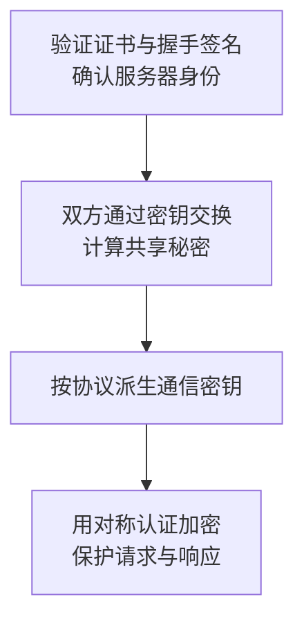

*图2-13 TLS中认证、密钥交换与数据加密的关系（概念示意）*

**不要混淆这三件事：**

- **证书和签名**：解决“对方是谁”。
- **密钥协商**：解决“双方怎样获得共享秘密”，并不直接发送最终通信密钥。
- **数据加密**：解决“怎样保护实际传输的内容”。

TLS 1.3已移除旧式RSA密钥传输，RSA证书仍可用于受支持的签名认证。

### 2.5.5 哈希算法

**哈希把数据转换为摘要，可以把摘要理解为用于比较内容的“指纹”。**

```text
文件 → SHA-256计算 → 摘要
下载后再次计算 → 与官方发布的摘要比较
```

- **相同输入**：使用同一算法，得到相同摘要。
- **内容改变**：摘要通常会明显变化。
- **不能解密**：哈希不是可逆加密，但简单密码仍可能被逐个猜测验证。

**常见算法**

| 算法 | 输出或特点 | 使用建议 |
|------|------------|----------|
| **SHA-256** | 256位摘要 | 常用于文件校验、签名等 |
| **SHA-512** | 512位摘要 | 常用于支持它的安全协议 |
| **SHA-3** | 一组哈希算法，如SHA3-256 | 按具体协议和工具选择 |
| **BLAKE2 / BLAKE3** | 高性能哈希，输出按具体算法或接口确定 | 在支持它们的工具中使用 |
| **MD5 / SHA-1** | 已有实用碰撞攻击 | 不用于抵抗恶意篡改的新安全设计 |

**校验值也要可信**：若文件和摘要一起被替换，两者一致也不能证明来源可靠。

**存密码用专用方案**：如Argon2id、scrypt、bcrypt，配合独立盐和合理资源成本；不能只快速计算一次SHA-256。

### 2.5.6 加密强度对比

先按用途选择，不能仅用密钥位数比较不同算法。

| 用途 | 常见方案 | 重点 |
|------|----------|------|
| **通信内容保护** | AES-GCM、ChaCha20-Poly1305 | 使用协议支持的认证加密，性能与设备有关 |
| **密钥协商** | X25519等 | 配合身份认证，按协议派生密钥 |
| **身份认证** | Ed25519、ECDSA、RSA-PSS等 | 核对参数、证书和客户端支持 |
| **文件摘要** | SHA-256等 | 从可信来源获取预期摘要 |
| **密码存储** | Argon2id、scrypt等 | 独立盐、合理的计算或内存成本 |

**选择时记住：**

- 优先使用仍受维护的协议和实现，保持证书验证与安全更新。
- AES-128不能仅因位数少就判断为不安全。
- 名称相近不代表可以互换，例如XChaCha20-Poly1305不能直接替代TLS中的ChaCha20-Poly1305。
- RC4、DES、3DES、RSA-1024及旧式非认证流加密，不适合作为新的通信安全配置。

---

## 本章小结

先掌握下面五点，再逐步熟悉细节：

1. **IP与DNS**：IP是地址，DNS帮助根据域名查地址。
2. **HTTP与HTTPS**：HTTP规定请求和响应；HTTPS增加身份验证与加密保护。
3. **TCP与UDP**：TCP内置确认、重传和顺序保证；UDP把更多机制交给上层。
4. **代理**：通过中间服务转发连接，协议、加密和接管范围要分别看。
5. **加密与哈希**：加密保护内容，签名验证来源，哈希帮助比较完整性。

**排查连接时，可以依次问：**

```text
域名解析是否正确？
    ↓
目标地址和端口能否连接？
    ↓
HTTPS证书和握手是否正常？
    ↓
HTTP返回了什么状态码？
```

下一章将把这些基础知识应用到代理和隧道的工作原理中。

---

**动手练习**

| 想观察什么？ | 可以怎么做？ |
|--------------|--------------|
| **域名对应的IPv4** | `nslookup -type=A example.com` |
| **域名对应的IPv6** | `nslookup -type=AAAA example.com` |
| **网络往返时间** | `ping example.com`，注意不回应不等于网站无法访问 |
| **HTTP请求和响应** | 打开浏览器开发者工具的“网络”面板，刷新网页 |
| **网站证书** | 从浏览器的站点信息入口查看域名、签发者和有效期 |
| **本机TCP监听端口** | Windows PowerShell运行`Get-NetTCPConnection -State Listen` |

命令行DNS查询可能与浏览器内置DNS路径不同；`ping`使用ICMP，也不能代替网页或端口连接测试。

**延伸阅读**

以下供需要查细节时参考，初学时不必逐篇阅读。

- **地址**：[RFC 791：IPv4与传统地址分类](https://www.rfc-editor.org/rfc/rfc791.html)、[RFC 4632：CIDR](https://www.rfc-editor.org/rfc/rfc4632.html)、[RFC 4291：IPv6地址架构](https://www.rfc-editor.org/rfc/rfc4291.html)。
- **DNS**：[RFC 1034](https://www.rfc-editor.org/rfc/rfc1034.html)、[RFC 1035](https://www.rfc-editor.org/rfc/rfc1035.html)；加密DNS参见[DoH](https://www.rfc-editor.org/rfc/rfc8484.html)、[DoT](https://www.rfc-editor.org/rfc/rfc7858.html)、[DoQ](https://www.rfc-editor.org/rfc/rfc9250.html)。
- **HTTP与TLS**：[RFC 9110：HTTP语义](https://www.rfc-editor.org/rfc/rfc9110.html)、[RFC 9114：HTTP/3](https://www.rfc-editor.org/rfc/rfc9114.html)、[RFC 8446：TLS 1.3](https://www.rfc-editor.org/rfc/rfc8446.html)。
- **传输协议**：[RFC 9293：TCP](https://www.rfc-editor.org/rfc/rfc9293.html)、[RFC 768：UDP](https://www.rfc-editor.org/rfc/rfc768.html)、[RFC 9000：QUIC](https://www.rfc-editor.org/rfc/rfc9000.html)。
- **代理协议**：[RFC 1928：SOCKS5](https://www.rfc-editor.org/rfc/rfc1928.html)、[Shadowsocks 2022官方规范](https://github.com/shadowsocks/shadowsocks-org/blob/main/docs/doc/sip022.md)。
- **密码学**：[RFC 8439：ChaCha20与Poly1305](https://www.rfc-editor.org/rfc/rfc8439.html)、[RFC 9106：Argon2](https://www.rfc-editor.org/rfc/rfc9106.html)。
- **端口**：[IANA服务名与端口注册表](https://www.iana.org/assignments/service-names-port-numbers/service-names-port-numbers.xhtml)。
