# 第3章 核心技术原理

前两章介绍了IP、DNS、HTTP、TCP/UDP和加密。本章把这些知识连起来，回答三个问题：

1. **代理怎样帮客户端连接目标？**
2. **VPN和代理究竟有什么区别？**
3. **隧道、流量承载和加密分别解决什么问题？**

先用一张表建立整体概念：

| 技术 | 主要做什么？ | 处理的对象 | 初学者先记什么？ |
|------|--------------|------------|------------------|
| **正向代理** | 代表客户端访问外部服务 | 请求、连接或数据流 | 用户主动使用，目标通常看到代理出口 |
| **反向代理** | 代表网站接收外部访问 | 到达网站入口的请求 | 用户访问的是代理入口，代理再分发给后端 |
| **VPN** | 建立一条逻辑上的专用连接 | 通常是IP包 | 由系统路由决定哪些流量进入隧道 |
| **隧道** | 把一种数据放进另一种连接传输 | 数据包、字节流或应用消息 | 封装不等于加密，两者可以组合 |
| **流量承载/伪装** | 改变连接呈现出来的特征 | 握手、协议和通信行为 | 能减少明显特征，但不保证不可识别 |
| **加密与认证** | 保护内容、验证身份、检测篡改 | 消息或连接 | 要看清楚每一层加密保护哪一段 |

## 3.1 代理服务器工作原理

### 3.1.1 正向代理与反向代理

**正向代理**位于客户端和目标服务之间，代表客户端访问外部资源。客户端通常需要主动配置代理地址，或者由系统、网关把流量交给代理。

**反向代理**位于用户和网站后端之间，代表网站接收外部访问。用户访问网站公开的入口，通常不知道后面是哪台后端服务器。

| 对比项 | 正向代理 | 反向代理 |
|--------|----------|----------|
| **代表谁？** | 代表客户端 | 代表网站或后端服务 |
| **谁主动使用？** | 用户、应用或所在网络配置 | 网站管理员部署在服务入口 |
| **请求方向** | 客户端 → 代理 → 外部网站 | 外部用户 → 代理 → 后端服务 |
| **常见用途** | 访问控制、连接中转、调试、跨网络访问 | TLS终止、负载均衡、缓存、网站发布 |
| **用户通常看到什么？** | 目标网站通常看到代理出口IP | 用户看到代理的公开域名或IP |
| **常见例子** | HTTP代理、SOCKS5、Shadowsocks | Nginx、HAProxy、CDN入口 |

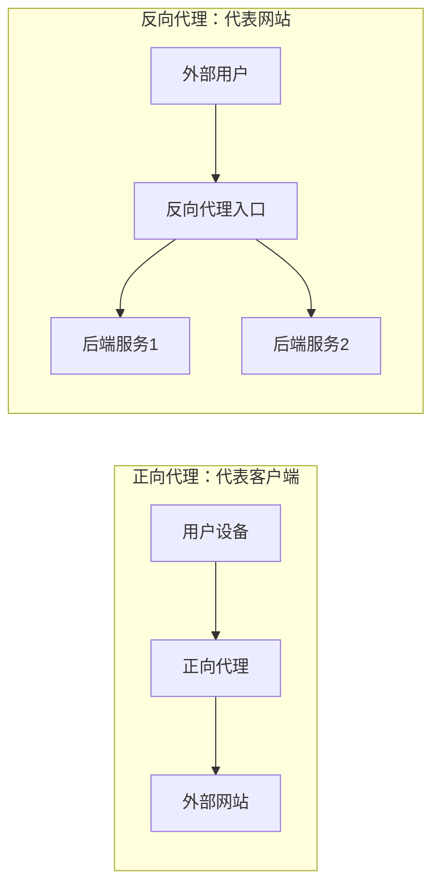

*图3-1 正向代理与反向代理的方向和角色对比*

**一句话记忆：** 正向代理是“我让代理帮我访问网站”；反向代理是“网站让代理帮它接待用户”。同一台软件可以根据配置承担不同角色，不能只看软件名称判断。

### 3.1.2 正向代理怎样连接目标

正向代理通常分为四步：

1. 客户端告诉代理目标地址和端口。
2. 代理解析目标域名，或直接使用客户端提交的IP。
3. 代理连接目标服务。
4. 代理在两端之间转发数据。

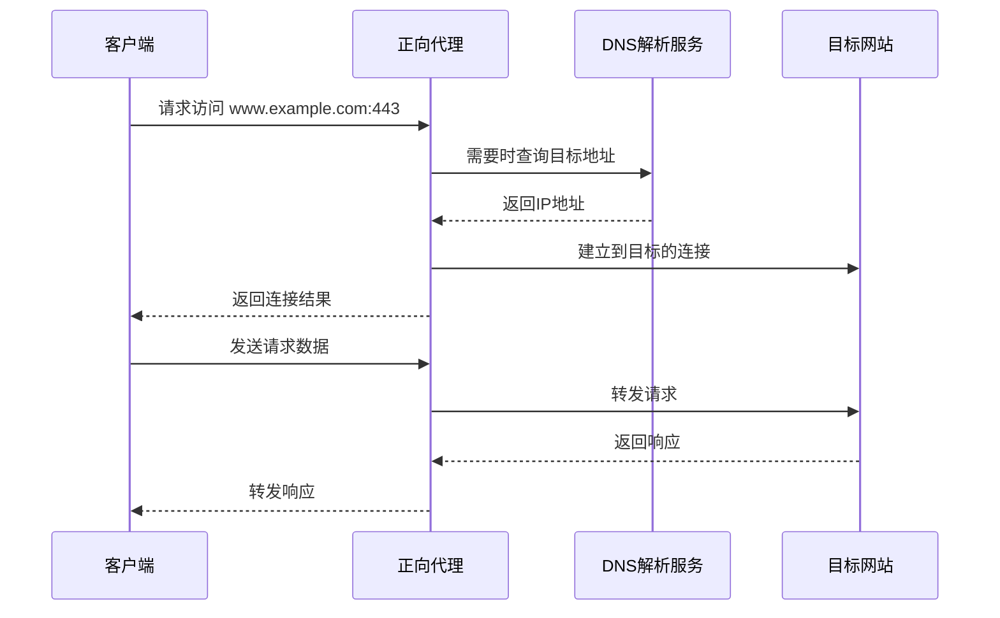

*图3-2 正向代理连接目标并转发数据*

客户端到代理、代理到目标通常是两段独立连接。代理可能看到客户端IP、目标地址、连接时间和流量大小；目标通常看到代理出口IP。账号、Cookie和设备特征仍可能把访问与用户关联起来。

### 3.1.3 HTTP代理与CONNECT隧道

**访问明文HTTP网站**时，客户端可以把完整网址交给代理：

```http
GET http://www.example.com/index.html HTTP/1.1
Host: www.example.com
```

代理连接网站后，可能转换成发给网站的普通请求：

```http
GET /index.html HTTP/1.1
Host: www.example.com
```

此时代理能够读取HTTP内容，也可能按策略进行认证、缓存或过滤。

**访问HTTPS网站**时，客户端通常先使用`CONNECT`请求代理建立一条TCP隧道：

```http
CONNECT www.example.com:443 HTTP/1.1
Host: www.example.com:443
```

代理连接成功后返回：

```http
HTTP/1.1 200 Connection Established
```

之后，浏览器在隧道内与目标网站建立TLS连接：

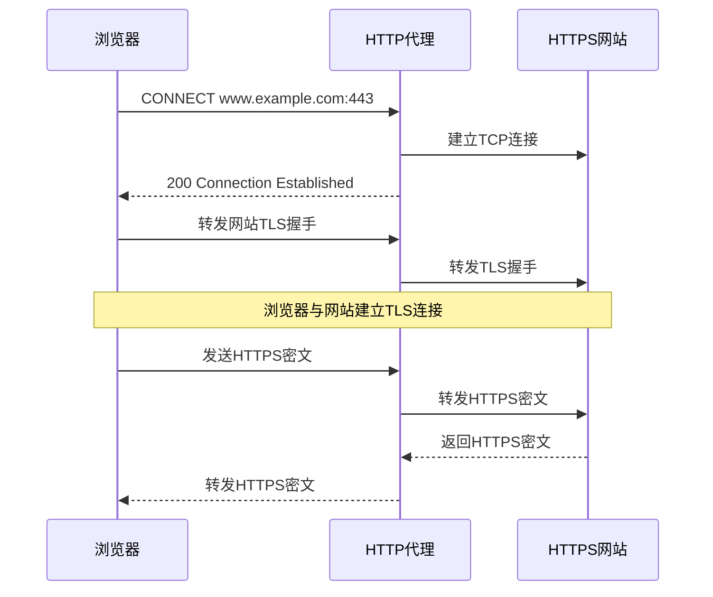

*图3-3 HTTP CONNECT建立HTTPS隧道*

**重点：** 普通CONNECT代理通常不终止网站TLS，所以不能直接读取网页正文；它仍能看到CONNECT目标和连接元数据。客户端到代理如果没有额外加密，代理请求和认证信息可能被路径上的设备观察。

代理要求认证时，可能返回`407 Proxy Authentication Required`，客户端再提交`Proxy-Authorization`。Basic认证只是编码，不是加密，应放在受保护的代理连接中使用。

### 3.1.4 SOCKS5代理

SOCKS5先协商认证方式和目标地址，再建立转发。以TCP连接为例：

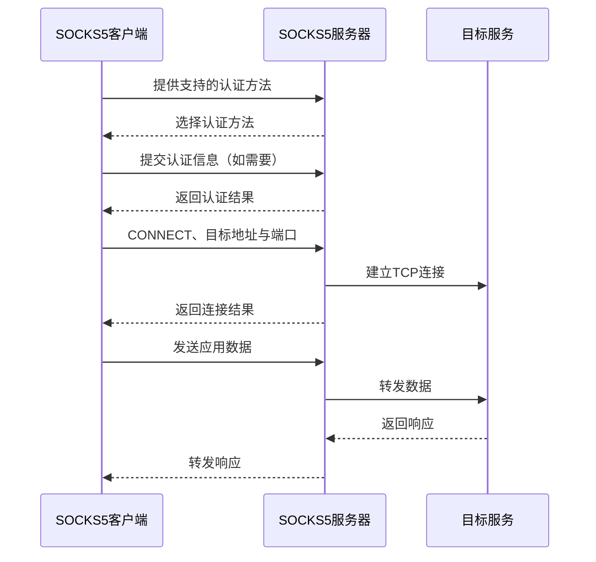

*图3-4 SOCKS5协商与TCP转发*

| SOCKS5内容 | 作用 |
|------------|------|
| **认证方法** | 协商匿名、用户名密码等方式 |
| **CONNECT** | 建立到目标的TCP连接 |
| **BIND** | 监听并等待对端连接，实际支持情况因实现而异 |
| **UDP ASSOCIATE** | 建立UDP转发关联 |
| **地址类型** | 支持IPv4、域名和IPv6 |

SOCKS5本身不提供通用的流量加密。用户名密码认证也不等于加密；是否安全，要看外层连接是否受到保护。

**SOCKS5 UDP转发**需要先用TCP控制连接建立关联，再通过协商出的UDP中继地址发送数据：

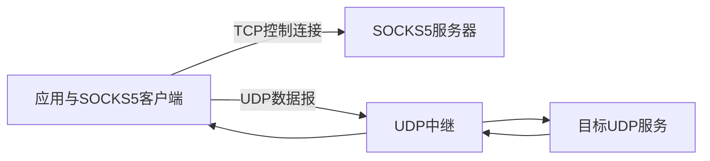

*图3-5 SOCKS5的TCP控制连接与UDP数据路径*

应用、客户端和服务器都要支持UDP；防火墙、NAT和数据报大小也会影响结果。域名如果在本地提前解析，DNS查询就可能不会经过代理。

### 3.1.5 本地代理与远程代理

很多客户端会在本机运行一个代理核心：应用只连接本地端口，核心再决定直连还是走远端代理。

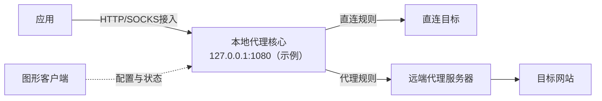

*图3-6 本地代理核心、图形客户端和远端服务器*

- **代理核心**：处理协议、路由、DNS和数据转发。
- **图形客户端**：管理节点、规则和状态，通常不是转发本身的必要组成部分。
- **系统代理**：只影响遵守系统代理设置的应用。
- **TUN等接管方式**：可以扩大接管范围，但需要额外的路由和DNS配置。

## 3.2 VPN技术

### 3.2.1 VPN的基本工作方式

VPN（Virtual Private Network，虚拟专用网络）在公共网络上建立一条逻辑上的专用连接。系统先根据路由决定哪些IP包进入VPN接口，再由VPN封装、加密并发送给对端。

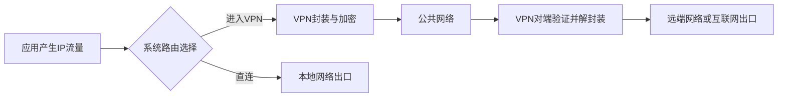

*图3-7 VPN分流与全隧道的基本路径*

VPN可以只接管某个内网网段，也可以安装默认路由，接管更大范围的流量。远端要作为互联网出口，还需要正确配置转发、回程路由、防火墙和必要的NAT。

“VPN”这个名称本身不保证加密。要确认具体方案使用了什么认证、加密和完整性保护。

### 3.2.2 VPN与代理的区别

| 对比项 | VPN | 代理 |
|--------|-----|------|
| **主要处理对象** | 通常是IP包 | 应用请求、TCP连接或UDP数据报 |
| **接入方式** | 虚拟网卡、系统路由或安全策略 | 应用代理设置、本地监听、TUN或网关接管 |
| **流量范围** | 可全隧道，也可按路由分流 | 取决于应用支持和接管配置 |
| **DNS路径** | 由系统、应用和VPN配置共同决定 | 由应用、客户端和远端解析设置决定 |
| **常见用途** | 远程办公、站点互联、统一出口 | 请求转发、访问控制、调试、灵活分流 |
| **加密范围** | 通常保护设备或网关到VPN对端 | 取决于代理协议和传输配置 |

**不要用“VPN一定全局、代理只能浏览器使用”来判断。** VPN可以分流，代理也可以通过TUN等方式接管更多应用；最终以实际路由、DNS和客户端配置为准。

### 3.2.3 常见VPN协议和代理协议

VPN协议通常处理IP包，代理协议通常处理应用请求、TCP连接或UDP数据报。下面分成两张表：

**常见的VPN协议**

| 协议或方案 | 时间节点 | 一句话理解 | 使用提醒 |
|------------|----------|------------|----------|
| **PPTP** | 1990年代；1999年形成公开规范 | 早期远程接入方案 | 安全性不足，不适合新的部署 |
| **L2TP/IPsec** | 1999年起；2000年代常见 | L2TP负责承载，IPsec负责保护 | L2TP本身不加密，要理解两者分工 |
| **OpenVPN** | 2001年至今 | 使用TLS协商，支持TCP或UDP承载 | 灵活但配置项较多，性能依实现和配置而定 |
| **IKEv2/IPsec** | 2005—2010年代逐步完善 | IKEv2协商密钥，IPsec保护IP流量 | 常见于企业和系统集成，移动切换能力看配置 |
| **WireGuard** | 2016年首次发布；2020年进入Linux主线 | 使用现代密码学，在UDP上传输加密IP包 | 配置简洁，仍依赖UDP可达性和正确路由 |

**常见的代理协议**

| 协议或方案 | 时间节点 | 一句话理解 | 使用提醒 |
|------------|----------|------------|----------|
| **HTTP/HTTPS代理** | 1990年代起；CONNECT规范持续演进 | 转发HTTP请求，或用CONNECT建立TCP隧道 | HTTPS代理连接与“通过代理访问HTTPS网站”是两层不同含义 |
| **SOCKS5** | 1996年发布RFC 1928 | 协商目标后转发TCP，也定义UDP关联 | 协议本身不提供通用加密，UDP需要完整实现支持 |
| **Shadowsocks** | 2012年出现；2022规范更新 | 使用预共享密钥进行认证加密和流量转发 | 使用双方兼容且仍受维护的实现与规范 |
| **VMess / VLESS** | VMess约2015年；VLESS约2020年 | 多协议代理平台中常见的代理协议 | VLESS常配合TLS、REALITY等机制提供传输保护 |
| **Trojan** | 2019年前后出现 | 通常在TLS连接中完成认证和代理转发 | 需要正确配置证书验证和认证信息 |
| **Hysteria 2 / TUIC** | 2022年前后发展 | 基于QUIC承载代理通信 | 依赖UDP可达，实际速度取决于线路和拥塞控制 |

**协议、核心和客户端不是一回事：**

- **协议：**规定通信双方如何协商、认证和传输数据，例如SOCKS5、VLESS、WireGuard。
- **代理核心或实现：**负责真正处理协议和路由，例如Xray、sing-box、mihomo、V2Ray。
- **图形客户端：**提供节点导入、规则设置和状态查看界面，背后通常调用一个或多个核心。

协议名称也不能直接决定速度。吞吐量、延迟和稳定性还受到线路、MTU、设备性能、软件版本和流量类型影响。

### 3.2.4 WireGuard入门

WireGuard用公钥标识对端，通过握手建立会话密钥，再在UDP中传送受保护的IP包。

**AllowedIPs有两个作用：**

- **发送时**：根据目标IP选择哪个对端承载数据。
- **接收时**：检查解密后的内层源IP是否属于该对端允许使用的范围。

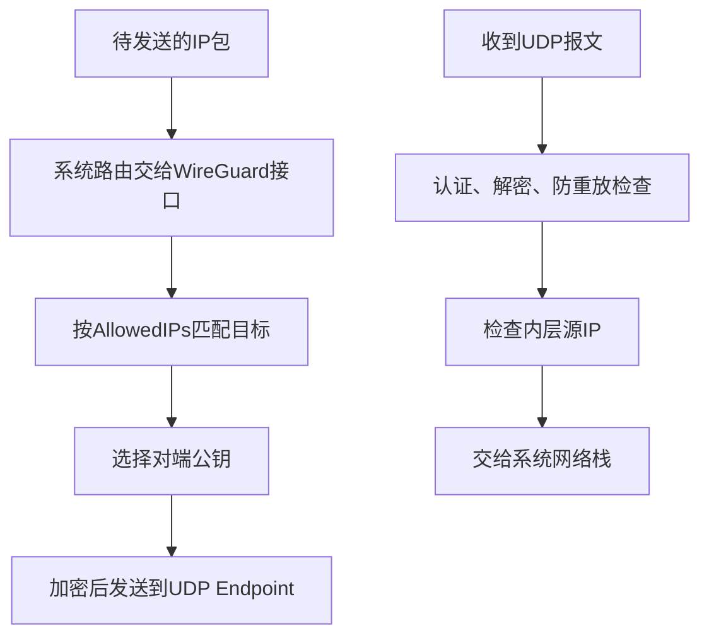

*图3-8 WireGuard发送与接收方向的处理*

一个只访问远端内网的分流示例：

```ini
[Interface]
PrivateKey = <客户端私钥>
Address = 10.77.0.2/32

[Peer]
PublicKey = <服务器公钥>
Endpoint = vpn.example.com:51820
AllowedIPs = 10.77.0.0/24
```

这里的`AllowedIPs`只把`10.77.0.0/24`交给对端。若改为`0.0.0.0/0`，通常会安装IPv4默认路由，形成更广泛的接管。IPv6需要另外配置地址、路由和`AllowedIPs`。

`PersistentKeepalive`可帮助NAT后的设备维持映射，但会增加定期流量；是否需要设置取决于网络环境。

## 3.3 隧道技术

### 3.3.1 什么是隧道

隧道就是“把一种数据放进另一种连接里传输”。

```text
原始数据：        [内层IP头][TCP/UDP头][应用数据]

放入隧道后：      [外层IP头][外层传输头][隧道信息][受保护的原始数据]
```

内层描述原本要发送的内容，外层负责把它送到隧道对端。**封装负责“装进去”，加密负责“保护内容”，两者不是同一件事。**

| 现象 | 常见原因 |
|------|----------|
| 隧道连不上 | 外层地址、端口、路由或防火墙有问题 |
| 隧道能连但网页卡住 | MTU不匹配、丢包、DNS或上层连接问题 |
| 速度变慢 | 多了一层封装、加密开销或绕远路由 |

隧道会增加额外头部，内层可用空间通常小于路径MTU。TCP套TCP还可能叠加重传和队头阻塞，应谨慎选择承载方式。

### 3.3.2 常见隧道类型

| 类型 | 把什么放进去？ | 是否自带加密？ | 常见用途 |
|------|----------------|----------------|----------|
| **IP-in-IP** | 一个IP包放进另一个IP包 | 否 | 跨网络传送IP流量 |
| **GRE** | 多种网络层协议或数据 | 否 | 路由器之间的隧道，常与IPsec组合 |
| **TLS隧道** | 字节流或应用协议 | TLS提供相应保护 | 受保护的远程连接 |
| **SSH转发** | TCP连接或SOCKS请求 | SSH提供相应保护 | 远程管理、端口转发 |

### 3.3.3 SSH端口转发

下面的命令都使用`-N`，表示只建立转发，不执行远端命令。

**本地转发（**`-L`**）**：本地端口 → SSH服务器 → 目标服务。

```bash
ssh -N -L 127.0.0.1:15432:db.internal.example:5432 user@ssh.example.com
```

访问本机`127.0.0.1:15432`时，由远端SSH服务器连接`db.internal.example:5432`。

**远程转发（**`-R`**）**：SSH服务器端口 → SSH客户端 → 客户端本地服务。

```bash
ssh -N -R 127.0.0.1:18080:127.0.0.1:8080 user@ssh.example.com
```

最终能否监听以及监听范围，受SSH服务器配置限制。

**动态转发（**`-D`**）**：在本地提供SOCKS接入。

```bash
ssh -N -D 127.0.0.1:1080 user@ssh.example.com
```

OpenSSH的动态转发主要建立TCP连接，不等于完整支持SOCKS5 UDP转发。

### 3.3.4 加密代理的隧道过程

以加密代理为例，数据大致经过以下步骤：

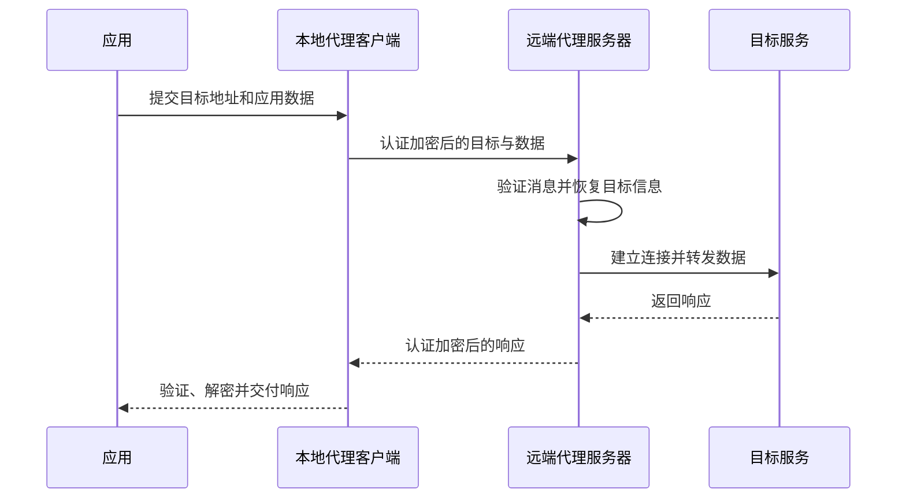

*图3-9 加密代理客户端、服务器和目标服务*

具体字段和密钥派生由协议规范决定。应用HTTPS与代理协议的加密是两层不同保护，不能因为“有一层加密”就忽略另一层的端点。

## 3.4 流量特征与承载方式

### 3.4.1 为什么会观察流量特征

加密通常隐藏应用内容，但网络路径上的设备仍可能观察：

| 观察内容 | 可能得到的信息 |
|----------|----------------|
| **端点信息** | IP、端口、服务器所属网络 |
| **握手信息** | TLS版本、扩展、ALPN、未受保护的名称字段 |
| **统计特征** | 包长、方向、时间间隔、连接频率 |
| **主动响应** | 服务器对正常或异常输入的回应方式 |

这些信息只能作为判断线索。单个端口、证书或指纹不能单独证明某个连接属于某种应用。

**伪装/承载的目标**是减少明显差异，让连接遵守某种常见协议的格式或行为。它不能保证不可识别，也不能替代正确的认证和安全更新。

### 3.4.2 常见承载方式

| 承载方式 | 可以怎样理解？ | 注意事项 |
|----------|----------------|----------|
| **TLS** | 在TLS连接里传输数据 | 证书、域名、握手和后续行为都要正确配置 |
| **WebSocket** | 先HTTP升级，再建立双向长连接 | WebSocket本身不加密，通常与TLS一起使用 |
| **gRPC** | 使用HTTP/2的RPC消息承载数据 | 需要服务端、路径和客户端实现匹配 |
| **QUIC/HTTP/3** | 在UDP上承载加密、多路复用连接 | 依赖UDP可达性，性能取决于线路和拥塞控制 |
| **简单混淆** | 添加类似HTTP/TLS的表面格式 | 若协议状态机不完整，仍可能暴露差异 |

使用真实协议承载时，需要遵守协议的握手、错误处理、超时和连接行为。仅“看起来像”某种协议，不能保证表现一致。

### 3.4.3 CDN与反向代理中转

CDN或反向代理可以作为公开入口，再把受支持的请求转发到源站：

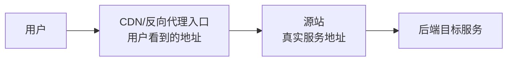

*图3-10 CDN或反向代理的回源关系*

**它能改变什么？** 用户连接的是入口地址，源站地址可能不直接暴露；入口还可以提供TLS终止、缓存或负载分配。

**它不能自动解决什么？**

- 普通HTTP CDN不一定支持任意TCP、UDP或长连接。
- WebSocket、gRPC、带宽和连接时长要看服务商支持及条款。
- 源站若直接暴露或配置不当，真实地址仍可能被发现。
- 中转会增加回源距离和一跳开销，速度不一定更快。

### 3.4.4 两个常见例子

**Trojan：TLS连接中的认证与转发**

Trojan通常在TLS连接中检查认证信息：通过认证的连接进入代理处理，未通过的连接则按实现和配置回落或拒绝。

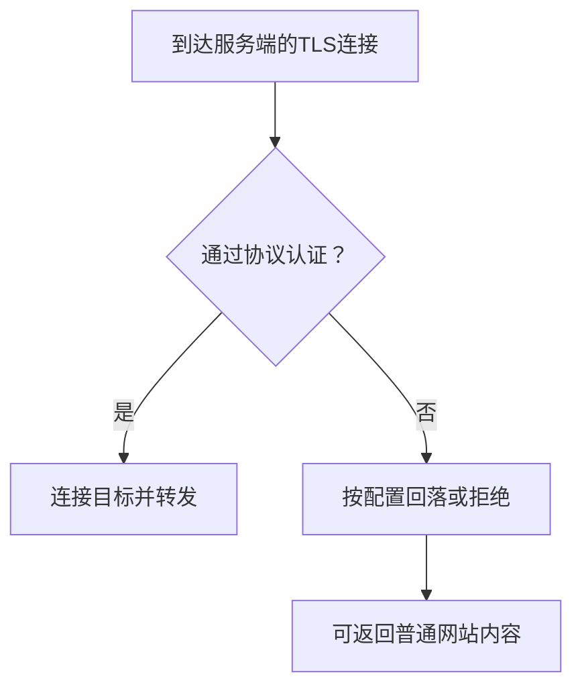

*图3-11 Trojan认证后的分流处理*

**WebSocket + TLS + Nginx**

Nginx可以提供普通网站，同时把指定路径的WebSocket连接转给本机代理服务。这里的职责分别是：Nginx处理外层TLS和HTTP路由，WebSocket承载双向数据，代理协议负责认证和转发。

```nginx
location = /proxy-ws {
    proxy_pass http://127.0.0.1:10000;
    proxy_http_version 1.1;
    proxy_set_header Upgrade $http_upgrade;
    proxy_set_header Connection "upgrade";
}
```

路径只是路由条件，不是凭据；认证仍由代理协议或服务端配置负责。

**REALITY**是Xray生态中的传输安全机制，VLESS、REALITY和XTLS Vision承担不同职责。具体配置依赖版本、密钥、SNI、shortId和目标服务要求；服务端IP、连接时间和流量元数据仍可能被观察。

## 3.5 加密传输机制

### 3.5.1 先看加密边界

“端到端”必须先说清楚是哪两个端点。普通HTTPS代理中，网站TLS通常仍是浏览器到目标网站；代理隧道则是客户端到远端代理服务器。

| 保护层 | 两端是谁？ | 中间节点通常能看到什么？ |
|--------|------------|--------------------------|
| **网站HTTPS** | 浏览器 ↔ 目标网站 | 目标地址、时间、流量大小等元数据；通常不能读取正文 |
| **代理隧道** | 本地客户端 ↔ 远端代理 | 外层端点和流量元数据；隧道内容由协议保护 |
| **外层TLS在CDN终止** | 客户端 ↔ CDN，CDN ↔ 源站 | CDN可处理它终止的HTTP消息；内层独立加密另行判断 |

**加密不等于匿名**：登录账号、Cookie、设备特征和服务商日志仍可能关联身份。

### 3.5.2 认证加密（AEAD）

AEAD同时完成两件事：

- **加密**：保护内容不被直接读取。
- **认证**：检查内容有没有被篡改。

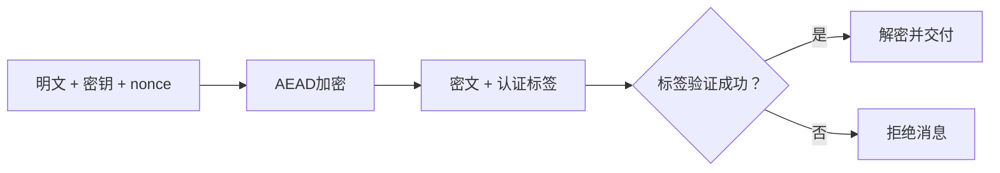

*图3-12 AEAD的基本过程*

| 构造 | 常见用途 | 初学者注意事项 |
|------|----------|----------------|
| **AES-GCM** | TLS及其他安全协议 | 性能受设备硬件加速影响 |
| **ChaCha20-Poly1305** | TLS、代理和移动设备 | 由协议规定密钥、nonce和消息格式 |
| **XChaCha20-Poly1305** | 明确支持它的协议或库 | 不能直接替代其他协议中的ChaCha20-Poly1305 |
| **DES/3DES** | 历史系统 | 不适合新的安全部署 |

nonce通常不需要保密，但同一密钥下必须遵守协议规定的唯一性和使用次数限制。认证成功前，不应把未验证内容交给应用。

### 3.5.3 密钥派生与管理

不同输入要用不同的密钥处理方式：

| 场景 | 常见机制 | 作用 |
|------|----------|------|
| **用户口令 → 密钥** | Argon2id、scrypt、PBKDF2 | 增加猜测成本，仍需要强口令 |
| **共享秘密 → 会话密钥** | HKDF等 | 按用途和上下文派生不同密钥 |
| **随机预共享密钥** | 安全随机数生成器 | 直接生成协议要求长度的秘密材料 |
| **用户标识** | UUID或协议凭据 | 用于匹配和认证，不自动提供加密 |

私钥、预共享密钥和认证凭据都应当保密。泄露后应撤销或更换，并同步更新通信两端；配置备份和日志也可能泄露这些信息。

以Shadowsocks 2022为例，方法名称和密钥长度必须匹配：

| 方法 | 原始密钥长度 |
|------|--------------|
| `2022-blake3-aes-128-gcm` | 16字节 |
| `2022-blake3-aes-256-gcm` | 32字节 |
| `2022-blake3-chacha20-poly1305` | 32字节 |

```bash
openssl rand -base64 32
```

命令生成的是32个随机字节的Base64表示。具体字段格式以所用实现和协议规范为准。

### 3.5.4 防重放攻击

重放攻击是把以前捕获的有效消息再次提交。攻击者不需要解密，原有认证标签也可能仍然有效。

| 防护方式 | 作用 |
|----------|------|
| **时间窗口** | 拒绝过旧或时间异常的消息 |
| **已用标识记录** | 拒绝重复的盐、请求ID或随机数 |
| **序号和滑动窗口** | 接受合理范围内的新消息，拒绝重复或过旧消息 |
| **挑战与会话绑定** | 把消息绑定到当前交互，减少跨会话复用 |

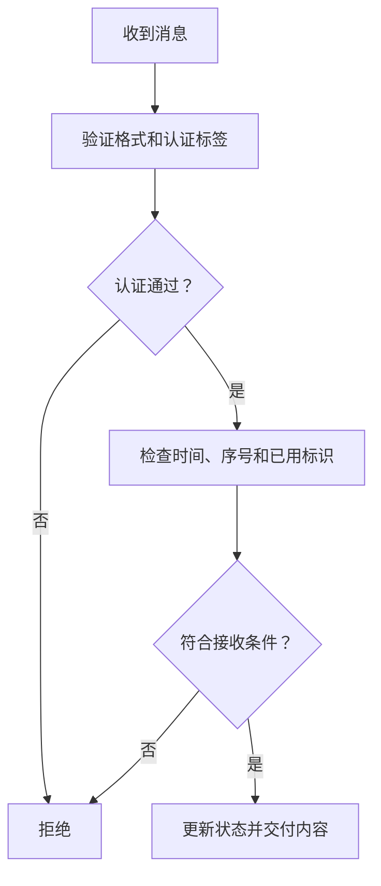

*图3-13 认证与防重放检查*

AEAD只证明消息完整、并由持有密钥的一方生成，不会自动记住“这条消息以前是否处理过”。TLS 1.3和QUIC的0-RTT早期数据也有重放风险，应用需要限制其可执行的操作。

### 3.5.5 完美前向保密（PFS）

前向保密关注一个问题：**长期身份密钥以后泄露，过去的会话还能不能被解密？**

常见做法是使用临时Diffie–Hellman密钥交换：长期密钥负责认证，临时密钥负责生成本次会话的流量密钥。

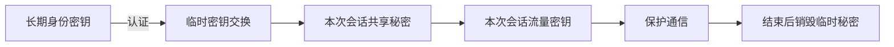

*图3-14 长期身份认证与临时会话密钥的分工*

前向保密需要正确的协议、实现和密钥销毁。终端已被控制、会话密钥直接泄露，属于另一类风险。Shadowsocks 2022的预共享密钥模式不提供传统意义上的前向保密；如果其中继续承载正确验证的HTTPS，网站TLS层仍需单独判断。

---

## 本章小结

1. **正向代理**代表客户端访问外部服务；**反向代理**代表网站接收用户访问。
2. **HTTP CONNECT和SOCKS5**先协商目标，再建立连接或转发数据；协议本身是否加密要单独确认。
3. **VPN**通常处理IP包，流量范围由系统路由和安全策略决定，也可以分流。
4. **隧道**负责封装和传输，封装本身不等于加密；额外头部会影响MTU。
5. **承载和伪装**改变连接呈现方式，但不能保证不可识别或自动匿名。
6. **AEAD、防重放、密钥派生和PFS**解决的是不同问题，不能相互替代。

排查一次连接时，可以按这个顺序思考：

```text
应用是否把请求交给了正确的代理？
        ↓
代理或VPN能否连接到下一跳？
        ↓
DNS、路由、端口和MTU是否正常？
        ↓
TLS/协议认证是否通过？
        ↓
目标服务返回了什么结果？
```

## 动手思考

1. 正向代理和反向代理分别代表哪一方？用户在两种场景中连接的第一台服务器是谁？
2. 通过HTTP CONNECT访问HTTPS时，代理能看到目标网站正文吗？它还能看到哪些信息？
3. SOCKS5的TCP控制连接和UDP中继分别做什么？
4. WireGuard把`AllowedIPs`改为`0.0.0.0/0`后，流量范围会发生什么变化？
5. 为什么“封装了”不等于“加密了”？GRE和TLS隧道有什么区别？
6. 为什么AEAD认证成功，仍然不能单独防止重放？

## 延伸阅读

- [RFC 9110：HTTP语义](https://www.rfc-editor.org/rfc/rfc9110.html)：CONNECT及代理相关语义。
- [RFC 1928：SOCKS5](https://www.rfc-editor.org/rfc/rfc1928.html)与[RFC 1929：用户名与密码认证](https://www.rfc-editor.org/rfc/rfc1929.html)：代理协商、UDP关联与认证。
- [WireGuard协议说明](https://www.wireguard.com/protocol/)与[wg-quick手册](https://git.zx2c4.com/wireguard-tools/about/src/man/wg-quick.8)：握手、对端和系统路由配置。
- [OpenSSH ssh手册](https://man.openbsd.org/ssh)：本地、远程和动态转发。
- [RFC 6455：WebSocket](https://www.rfc-editor.org/rfc/rfc6455.html)：升级握手和双向消息通道。
- [RFC 5116：AEAD接口](https://www.rfc-editor.org/rfc/rfc5116.html)与[RFC 5869：HKDF](https://www.rfc-editor.org/rfc/rfc5869.html)：认证加密和密钥派生。
- [RFC 8446：TLS 1.3](https://www.rfc-editor.org/rfc/rfc8446.html)与[RFC 9001：QUIC中的TLS](https://www.rfc-editor.org/rfc/rfc9001.html)：握手、0-RTT和传输保护。
- [Shadowsocks 2022官方规范](https://github.com/shadowsocks/shadowsocks-org/blob/main/docs/doc/sip022.md)：密钥、消息格式和重放防护。
