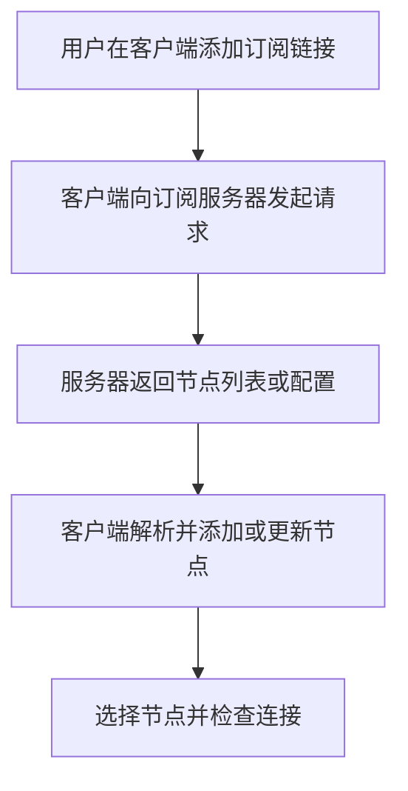
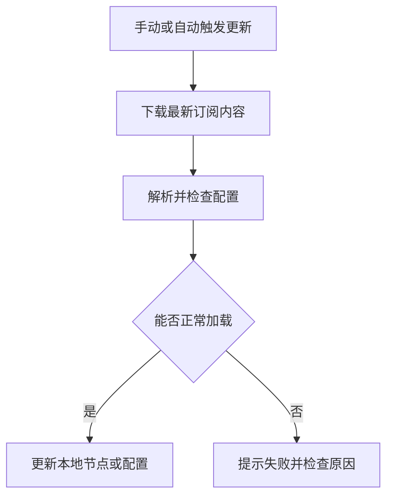
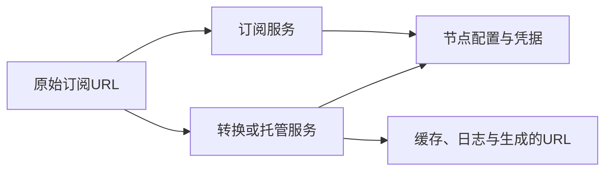

# 第7章 订阅与节点管理

订阅可以帮助客户端批量导入和更新节点。本章介绍订阅格式、更新与凭据保管，并说明如何测试、选择和维护节点。具体客户端的导入操作可参阅第5章。

## 7.1 订阅链接原理

### 7.1.1 什么是订阅

**订阅定义：**

订阅通常是一个URL链接，访问后返回多个代理节点的配置信息。把这个链接添加到客户端后，就可以批量导入节点，并通过“更新订阅”获取最新的节点信息，无需逐个手动添加。

**订阅工作流程：**



*图7-1 从添加订阅到使用节点的基本流程*

订阅负责获取和更新配置，实际流量通过选中的代理节点转发。导入成功后，还需要检查节点能否正常连接。

### 7.1.2 订阅链接格式

订阅链接是获取内容的地址，客户端能否导入，取决于这个地址返回的内容格式。常见的有Base64编码的节点列表，以及Clash系客户端使用的YAML配置。

**Base64编码的节点列表：**

先把多个节点的分享链接按行排列，再对整份文本进行Base64编码，就得到一种常见的订阅内容：

```text
原始内容（每行一个节点链接）：
ss://YWVzLTEyOC1nY206dGVzdA@ss.example.com:8388#Demo-SS
trojan://test@trojan.example.com:443#Demo-Trojan

整份文本经过Base64编码后（省略后续内容）：
c3M6Ly9ZV1Z6TFRFeU9DMW5ZMjA2ZEdWemRBQHNzLmV4YW1wbGUuY29t...

订阅链接：
https://sub.example.com/sub?token=demo-token
访问该链接，服务器返回上面的Base64编码内容。
```

客户端下载后，先解码，再逐行识别节点。也有订阅直接返回未编码的链接列表，具体以服务方说明和客户端支持为准。示例中的域名与凭据仅用于演示。

Base64是编码，不是加密，解码后仍可读取节点密码等信息。另外，整份列表的编码与单个节点链接内部的编码是两层不同的处理。

**Shadowsocks分享链接：**

下面以常见的SIP002链接为例，`@`前的部分由`aes-128-gcm:test`进行Base64URL编码得到：

```text
ss://YWVzLTEyOC1nY206dGVzdA@ss.example.com:8388#Demo
```

| 字段 | 示例值 |
|------|--------|
| 加密方法 | `aes-128-gcm` |
| 密码 | `test` |
| 服务器 | `ss.example.com` |
| 端口 | `8388` |
| 节点备注 | `Demo` |

Shadowsocks 2022等格式的编码规则有所不同，实际使用时建议由客户端生成或导出链接。

**VMess分享链接：**

常见的v2rayN风格VMess链接，把一段JSON配置进行Base64编码，再加上`vmess://`前缀。下面的解码示例用于认识订阅内容，日常导入时由客户端自动处理，无需手动填写这些字段：

```json
{
  "v": "2",
  "ps": "VMess-Demo",
  "add": "vmess.example.com",
  "port": "443",
  "id": "b18c6e28-5eb5-4bf7-b9be-d039f4978031",
  "aid": "0",
  "scy": "auto",
  "net": "ws",
  "type": "none",
  "host": "vmess.example.com",
  "path": "/proxy-ws",
  "tls": "tls",
  "sni": "vmess.example.com"
}
```

其中，`ps`是节点备注，`add`和`port`是服务器地址与端口，`id`是用户UUID，`net`和`tls`描述传输与TLS设置。`aid: "0"`是该分享格式中的历史兼容字段。

**Clash系订阅格式（YAML）：**

Clash系客户端常用YAML组织配置，节点列在`proxies`下。下面以mihomo为例，展示两个节点的写法，仅用于认识文件结构，无需手动创建文件。域名与密钥均为示例。

```yaml
proxies:
  - name: A-01
    type: ss
    server: a.example.com
    port: 8388
    cipher: 2022-blake3-aes-128-gcm
    password: "<节点A的Base64编码16字节随机密钥>"
    udp: true

  - name: B-01
    type: ss
    server: b.example.com
    port: 8388
    cipher: 2022-blake3-aes-128-gcm
    password: "<节点B的Base64编码16字节随机密钥>"
    udp: true
```

上面是 **代理集合**，只提供节点；**完整配置** 还会包含本地监听、DNS、代理组和分流规则。两者的加载入口不同，导入时应选择客户端支持的格式与入口，不能仅凭订阅URL的名称判断。

### 7.1.3 订阅更新机制

服务方可能新增、删除节点，或调整服务器地址与认证参数。更新订阅就是重新获取这些信息，并让客户端加载最新配置。

**更新流程：**



*图7-2 订阅更新的基本流程*

**常见更新方式：**

| 方式 | 触发时机 |
|------|----------|
| 手动更新 | 用户点击“更新订阅” |
| 定时更新 | 按设置的间隔自动获取，例如每24小时一次 |
| 启动更新 | 客户端启动时检查是否需要更新 |

是否支持上述方式、默认间隔是多少，都以客户端设置为准。更新订阅是获取最新节点信息，客户端中的延迟测试则用于检查现有节点，两者作用不同。

更新时对节点增删、重命名及手动修改的处理，取决于客户端实现。直接修改下载的配置，可能在下次更新时被覆盖；自定义内容宜放在客户端支持的覆写配置中。

更新失败时，部分客户端会继续使用旧缓存，但首次导入时可能没有可用配置。建议保留上一份有效配置，并检查下载结果是否为空、是否误返回登录页。

### 7.1.4 订阅链接安全性

订阅链接通常带有访问令牌，拿到链接的人可能获取节点密码并使用相应服务，因此应像账号密码一样保管。

**使用时注意：**

1. **使用HTTPS链接**：保护下载过程，减少内容被窃听或篡改的风险。
2. **不要公开分享完整链接**：截图、日志和求助信息中应隐藏令牌；转换后的链接也可能包含原始订阅信息。
3. **确认订阅与转换服务的来源**：接收链接的服务可能取得节点凭据。完整配置还会影响DNS、规则和监听设置，导入前应检查内容。
4. **泄露后及时重置**：撤销或重置订阅令牌；已经下载的节点凭据仍可能有效，必要时还需更换节点密码、UUID或密钥。



*图7-3 获取和转换订阅的服务都可能接触凭据*

订阅服务可以看到请求来源IP、时间及令牌等信息。通过代理更新会改变它看到的来源IP，但仍可通过令牌关联账号；HTTPS也不会阻止接收链接的服务记录它。若通过代理下载订阅，还应确保首次导入或节点失效时有可用的下载路径。

## 7.2 节点管理实践

### 7.2.1 分清测试指标

订阅更新成功只说明客户端取得并解析了配置，不代表每个节点都可用。先检查节点是否完成连接，再用实际需要访问的服务做受控测试；一次延迟测试不能证明带宽、稳定性或目标网站可访问。

| 检查项目 | 能说明什么 | 不能据此推断什么 |
|----------|------------|------------------|
| 配置加载 | 格式被客户端接受 | 节点已连通 |
| 延迟或握手 | 测试时刻可与指定目标建立连接 | 所有网站可访问、长期稳定 |
| 实际请求 | 指定服务在当前规则下可用 | 其他服务也会走同一出口 |
| 一段时间内的失败率 | 在相同条件下的稳定性趋势 | 不同网络或时段的表现 |

测试前记录客户端版本、接入网络、测试目标、时间和实际命中的分流策略；否则很容易把规则错误、DNS问题或目标服务故障误判为节点故障。避免对服务方或目标站点进行高频、无授权的探测。

### 7.2.2 选择与故障切换

按实际任务选择节点：先看目标服务是否可达和连接是否稳定，再比较延迟、吞吐与流量额度。节点名称、地区标签和客户端显示的延迟都只是线索，不应替代实测。对需要固定出口的账号或业务，切换节点前还应确认服务条款和登录风险。

当当前节点失败时，先确认订阅是否过期、客户端是否正确加载配置，再检查网络、DNS、分流规则和节点握手。保留一个已验证的备用节点与上一份可用配置；若使用客户端的自动切换功能，确认其健康检查目标、频率和失败判定符合自己的需求，并观察切换后的实际出口。不要在故障中反复导入未知来源的订阅。

### 7.2.3 变更、到期与凭据泄露

更新订阅后，对比节点增删和策略组引用，检查自定义覆写是否仍生效。节点被重命名时，基于名称的分流或自动选择可能失去目标；变更前备份有效配置，变更后测试常用业务，并记录回退方式。

订阅到期或节点无法连接时，通过服务方的正式渠道确认状态，不把重新安装客户端当作第一步。若订阅链接或节点凭据泄露，撤销或重置订阅令牌，并按服务方能力轮换已暴露的密码、UUID或密钥；仅更换订阅URL，不一定使已下载的节点凭据失效。

## 本章小结

订阅帮助客户端批量获取和更新节点。导入时需要选择客户端支持的格式，妥善保管订阅链接，并保留一份有效配置，以便更新失败时恢复。节点选择还需结合实际请求、稳定性和分流结果，而非只看一次延迟。

日常使用时，通过客户端完成导入、更新和节点选择即可。本文的格式示例帮助理解客户端收到的内容，无需逐个手写节点配置。下一章将介绍分流规则，说明不同网站的连接如何选择直连或代理。

---

**实践任务：**

1. 在所用客户端中找到订阅入口，确认服务方提供的格式受到支持。
2. 手动更新一次订阅，确认节点列表正常加载，再选择节点检查能否访问所需网站。
3. 检查客户端的自动更新设置，并了解如何备份和恢复当前有效配置。
4. 分享排障截图前，确认订阅令牌、节点密码等敏感信息已隐藏。
5. 记录一个常用节点和一个备用节点的测试条件、结果与切换后的实际出口。

**延伸阅读：**

- [Shadowsocks SIP002分享链接规范](https://shadowsocks.org/doc/sip002.html)
- [第5章 客户端工具使用指南](../第二部分-主流协议与工具篇/第05章-客户端工具使用指南.md)
