# 第8章 分流规则详解

分流规则把连接交给直连、代理或拒绝等策略处理。规则是否有效，取决于客户端掌握的目标信息、规则的排列顺序，以及所选出口的能力。本章从域名和IP匹配讲起，介绍GeoIP数据、规则集及日常调试方法。

本章配置统一以mihomo为例。其他核心即使使用相似名称，语法、数据格式和执行条件也可能不同。除8.6.1的完整示例外，代码均为配置片段；其中的`Proxy`是自定义策略组，统一在完整示例中定义。合并片段时，应加入已有的同名配置区，不能在一个YAML文件中重复创建多个顶层`rules`或`rule-providers`。

## 8.1 规则分流基础

### 8.1.1 什么是分流

分流是在客户端已接管的连接中，按条件选择处理方式。例如，将家庭存储设备交给本地网络访问，将某项业务交给指定代理组，并拒绝已确认不需要的目标。

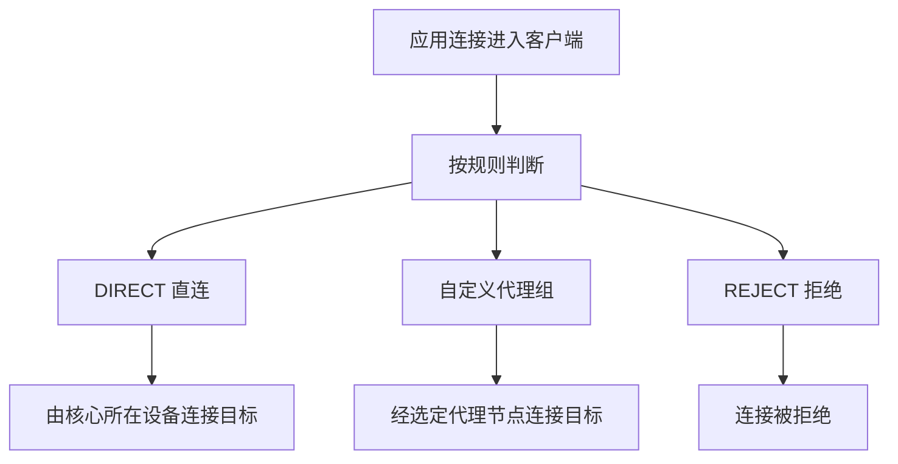

*图8-1 分流决定已接管连接的处理方式*

合理分流可以减少不必要的代理流量、适配内网访问，并为不同业务选择合适的出口。实际延迟、吞吐和稳定性仍取决于网络路径与服务状态，不能仅凭“境内”或“境外”标签判断。

分流只作用于进入客户端的流量。系统代理通常只影响遵循代理设置的应用；TUN等接管方式也需要正确配置路由、DNS和IPv6。若应用绕过客户端，规则列表不会自动接管它。银行、支付等业务的连接安全还依赖HTTPS、证书校验和终端环境，不能由一条直连规则保证。

### 8.1.2 分流工作原理

在规则模式下，mihomo通常从上到下检查规则，使用首条匹配且可用于当前连接的策略。规则类型没有自动的精确度优先级：排在前面的`DOMAIN-SUFFIX`可以先于后面的`DOMAIN`生效。

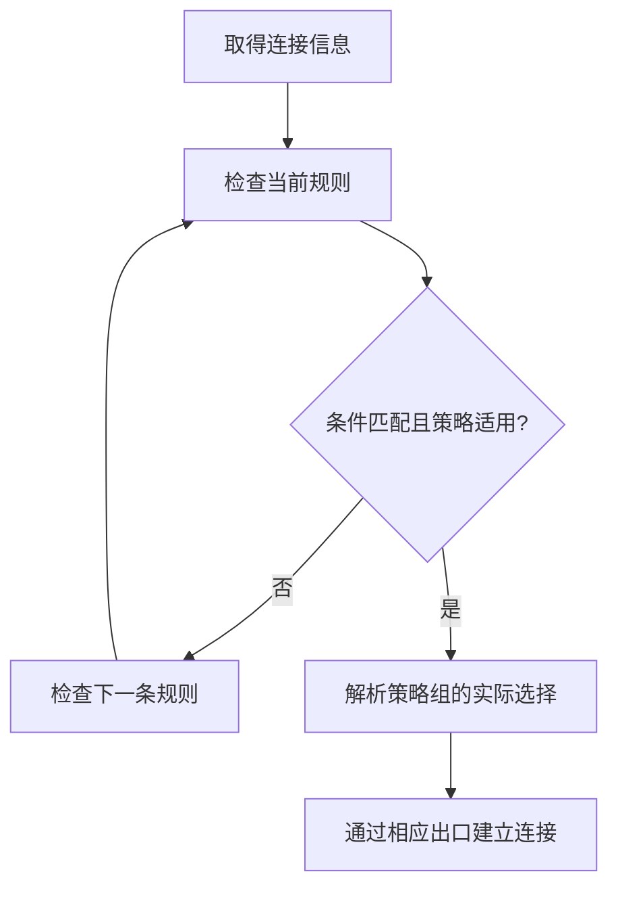

*图8-2 规则按列表顺序检查，策略组还需落实到实际出口*

例如，需要让`sync.example.org`直连、同一域名下的其他服务走代理时，应写成：

```yaml
rules:
  - DOMAIN,sync.example.org,DIRECT
  - DOMAIN-SUFFIX,example.org,Proxy
  - MATCH,Proxy
```

如果交换前两行，`sync.example.org`也会先命中后缀规则。`MATCH`无需条件，应放在列表末尾；它之前尚未处理的连接会进入兜底策略。

“特殊例外在前、一般分类在后”是编排方法，不是引擎自动执行的排序。调整规则时应先保证含义正确，再考虑匹配开销。mihomo对UDP还有策略能力判断：若候选代理不支持UDP，可能继续向下匹配。因此，规则命中、出口支持当前协议和连接成功，需要分别确认；这也不等于连接失败后会自动尝试所有后续规则。

### 8.1.3 规则类型概览

下表列出常用的mihomo规则。表中涉及的`Proxy`和`work`需分别定义为策略组和规则集；示例不是可直接拼接的完整规则列表。

| 类型 | 匹配对象 | 示例 |
|------|----------|------|
| `DOMAIN` | 完整目标域名 | `DOMAIN,api.example.org,Proxy` |
| `DOMAIN-SUFFIX` | 根域名及其子域名 | `DOMAIN-SUFFIX,example.org,Proxy` |
| `DOMAIN-KEYWORD` | 域名中的连续字符串 | `DOMAIN-KEYWORD,example,Proxy` |
| `IP-CIDR` | 目标IP所属网段 | `IP-CIDR,192.168.1.0/24,DIRECT,no-resolve` |
| `IP-CIDR6` | IPv6目标网段 | `IP-CIDR6,fc00::/7,DIRECT,no-resolve` |
| `GEOIP` | 数据库中的IP分类 | `GEOIP,CN,DIRECT` |
| `GEOSITE` | 域名分类数据 | `GEOSITE,github,Proxy` |
| `SRC-IP-CIDR` | 客户端看到的来源IP | `SRC-IP-CIDR,192.168.1.20/32,Proxy` |
| `SRC-PORT` / `DST-PORT` | 来源端口 / 目标端口 | `DST-PORT,443,Proxy` |
| `NETWORK` | 传输层协议 | `NETWORK,UDP,Proxy` |
| `PROCESS-NAME` | 发起连接的进程名称 | `PROCESS-NAME,curl.exe,Proxy` |
| `RULE-SET` | 外部或内联规则集 | `RULE-SET,work,Proxy` |
| `MATCH` | 所有剩余连接 | `MATCH,Proxy` |

目标端口为443不能证明连接一定是HTTPS，来源IP也可能受到NAT或转发方式影响。进程规则依赖平台、权限和接管方式；路由器通常无法取得其他设备上应用的真实进程名称。mihomo还支持逻辑规则，用于组合域名、进程和协议等条件，使用时应查阅对应版本文档。

`GEOSITE`使用域名分类数据，`GEOIP`使用IP分类数据。两者的数据文件和分类名称不能混用；某个`GEOSITE`标签是否存在，也取决于加载的数据源。

### 8.1.4 策略类型

规则最后通常填写预定义策略、节点名称或策略组名称。名称必须与配置一致，空格和字符差异也可能造成引用失败。

| 策略 | 含义 | 使用条件 |
|------|------|----------|
| `DIRECT` | 由核心直接连接目标 | 核心所在设备具备相应网络路径 |
| `REJECT` | 拒绝该连接 | 适合明确需要阻止的目标 |
| 节点名称，如`A-01` | 使用指定节点 | 已在`proxies`或可用代理集合中提供 |
| 组名称，如`Proxy` | 按组内选择机制确定出口 | 已在`proxy-groups`中定义 |

`Proxy`、`自动选择`或带地区旗帜的名称都不是“自动代理”的内置关键字。一个名为`Proxy`的组也可以包含`DIRECT`；最终是否经过代理，要查看组内实际选择。`url-test`按探测结果选择节点，并不保证业务访问时始终最快，相关管理方法见第7章。

## 8.2 域名规则编写

### 8.2.1 DOMAIN（完整域名匹配）

`DOMAIN,域名,策略`匹配完整域名，不自动包含子域名。填写域名时不带`https://`、端口、路径或查询参数。

```yaml
rules:
  - DOMAIN,api.example.org,Proxy
  - DOMAIN,sync.example.org,DIRECT
```

第一条匹配`api.example.org`，不匹配`example.org`或`v2.api.example.org`。同一主机上的`/login`和`/video`路径也不能由`DOMAIN`区分，因为这里匹配的是连接目标域名。

这类规则适合处理明确例外，例如把某个自有服务固定到特定出口。例外应放在可能覆盖它的后缀、关键词或规则集之前。

### 8.2.2 DOMAIN-SUFFIX（域名后缀匹配）

`DOMAIN-SUFFIX,example.org,Proxy`匹配`example.org`及其子域名，边界以域名标签分隔符为准，不是任意字符串的结尾匹配。

| 目标域名 | 是否匹配`example.org`后缀 |
|----------|--------------------------|
| `example.org` | 是 |
| `www.example.org` | 是 |
| `a.b.example.org` | 是 |
| `notexample.org` | 否 |
| `example.org.attacker.test` | 否 |
| `example.net` | 否 |

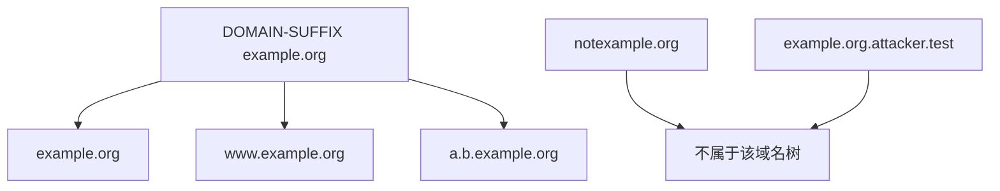

*图8-3 后缀规则覆盖一个域名树，并保留域名边界*

下面把一个本地服务域名树交给直连。它要求本地网络能够解析并访问这些服务：

```yaml
rules:
  - DOMAIN-SUFFIX,home.arpa,DIRECT
```

`home.arpa`用于家庭网络命名；实际使用还需相应的本地DNS记录。`.local`涉及mDNS，不能仅增加后缀规则就让普通DNS或远端代理正确解析。

`DOMAIN-SUFFIX,cn,DIRECT`覆盖范围很大，`.cn`也不证明服务器位置、访问速度或可信程度。应优先根据已确认的服务需求编写规则，而不是把顶级域名直接当作网络质量分类。

### 8.2.3 DOMAIN-KEYWORD（域名关键词匹配）

`DOMAIN-KEYWORD,关键词,策略`检查目标域名中是否出现指定字符串。它不验证域名所有权，也不要求关键词位于标签边界。

```yaml
rules:
  - DOMAIN-KEYWORD,example,Proxy
```

这既可能匹配`example.org`，也可能匹配`myexample.net`和`example.org.attacker.test`。若本意是处理某个组织的域名，维护明确的域名或后缀列表通常更容易控制范围。

不宜用`DOMAIN-KEYWORD,ad,REJECT`作为通用广告过滤规则：`download.example.org`也包含`ad`，可能被误拦截。对于已经确认的独立广告域名，可以精确处理，例如：

```yaml
rules:
  - DOMAIN,ads.example.test,REJECT
```

`example.test`是演示域名，实际应用时应换成核实过的目标。域名级拒绝会影响该域名承载的全部连接；广告与正文共用域名时，可能连带破坏登录、图片或播放功能。HTTPS页面内部的路径和元素过滤通常需要浏览器内容过滤工具，不能由此类连接规则代替。

### 8.2.4 域名规则实战

一个服务往往同时使用主站、API、登录、静态资源和内容分发域名。只给主页增加规则，可能出现“页面能开，图片或视频失败”的现象。

以下为Google与YouTube部分域名的分流片段，用于说明同一业务可能涉及多个目标，不能视为完整清单或长期不变的服务定义：

```yaml
rules:
  - DOMAIN-SUFFIX,google.com,Proxy
  - DOMAIN-SUFFIX,googleapis.com,Proxy
  - DOMAIN-SUFFIX,googleusercontent.com,Proxy
  - DOMAIN-SUFFIX,gstatic.com,Proxy
  - DOMAIN-SUFFIX,youtube.com,Proxy
  - DOMAIN-SUFFIX,ytimg.com,Proxy
  - DOMAIN-SUFFIX,googlevideo.com,Proxy
```

不同地区入口、第三方登录或新增功能仍可能使用其他域名。长期维护时，可以采用来源明确的服务规则集，再根据连接记录补充本地例外。

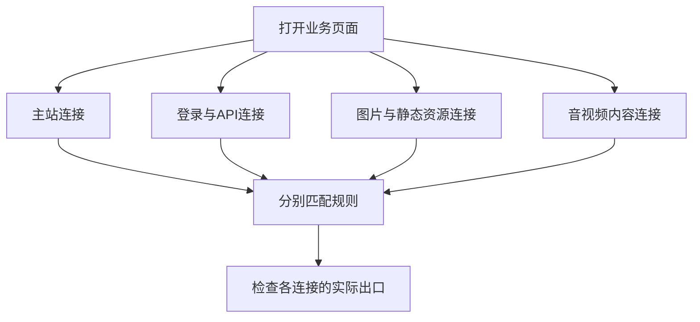

*图8-4 一个页面可能产生多类连接，每条连接分别进行分流*

需要让某些常用站点直连时，也应使用明确的域名，例如`DOMAIN-SUFFIX,bilibili.com,DIRECT`。这表达的是用户的路由选择，不保证整个业务只使用这一域名，也不保证当前网络下直连效果更好。

## 8.3 IP-CIDR规则

### 8.3.1 IP-CIDR基础

CIDR使用“网络地址/前缀长度”描述地址范围。IPv4共有32位，`192.168.1.0/24`表示前24位固定，包含`192.168.1.0`至`192.168.1.255`这256个地址。

| IPv4前缀 | 子网掩码 | 包含地址数 | 说明 |
|----------|----------|------------|------|
| `/32` | `255.255.255.255` | 1 | 单个IPv4地址 |
| `/24` | `255.255.255.0` | 256 | 固定前24位 |
| `/16` | `255.255.0.0` | 65,536 | 固定前16位 |
| `/8` | `255.0.0.0` | 16,777,216 | 固定前8位 |

IPv4前缀长度为`n`时，地址数为`2^(32-n)`。这里统计的是范围内的地址数，不是特定子网中可分配给主机的数量；CIDR也无需沿用A、B、C类网络的分类方法。

IP规则判断地址是否落入网段，不识别域名归属。同一个CDN地址可能服务多个站点，将它交给某个出口会同时影响其他共用该地址的连接。

### 8.3.2 IP-CIDR规则编写

基本形式为`IP-CIDR,网段,策略`，需要时在末尾添加`no-resolve`：

```yaml
rules:
  - IP-CIDR,192.168.1.0/24,DIRECT,no-resolve
  - IP-CIDR,10.20.0.0/16,DIRECT,no-resolve
```

上例仅适用于这些网段确实可从核心所在设备直达的网络。企业VPN或其他隧道也可能使用私有地址，不能看到私有地址就认定应绕过所有隧道。

**`no-resolve`控制的是匹配阶段是否为该规则触发解析。** 对仅有域名、尚无目标IP的连接，不带该参数的目标IP规则可以触发DNS解析，再检查解析得到的IP。带该参数时，这条规则不主动发起解析；如果连接信息中已经有目标IP，仍会进行网段匹配。

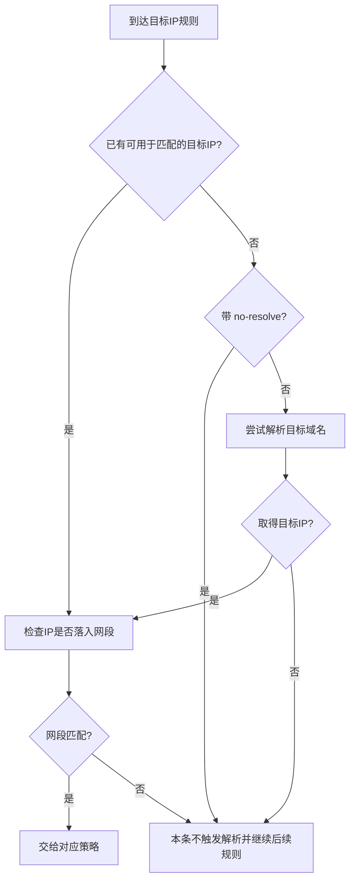

*图8-5 `no-resolve`避免由本条规则主动解析，不排除匹配已经取得的IP*

目标IP可以来自应用直接提交的地址、接管连接时取得的信息，或此前规则触发的解析。该参数不会关闭应用、系统DNS、其他规则或实际建连时所需的解析，也不能单独保证DNS查询走哪条网络路径。

因此，是否添加`no-resolve`取决于规则目的：仅处理已知IP时可添加；希望域名连接也按解析后的IP分类时，则需要允许解析并配置合适的DNS路径。若所有IP分类规则都禁止主动解析，某些只有域名的连接可能直接进入兜底策略。

### 8.3.3 IPv6规则

IPv6共有128位，同样使用CIDR表示范围。mihomo支持`IP-CIDR6`写法；在当前mihomo中，它是`IP-CIDR`的别名。为了便于阅读，本章用`IP-CIDR6`标识IPv6示例，其他核心的支持情况需单独确认。

```yaml
rules:
  - IP-CIDR6,::1/128,DIRECT,no-resolve
  - IP-CIDR6,fc00::/7,DIRECT,no-resolve
```

第一条处理核心所在设备的IPv6回环地址；第二条适合本机已有路由可达的唯一本地地址网络。常见特殊范围如下：

| 地址范围 | 含义 | 分流时需要注意 |
|----------|------|----------------|
| `::1/128` | 回环 | 指向核心所在设备 |
| `fc00::/7` | 唯一本地地址（ULA） | 常见本地分配使用`fd00::/8`，仍需实际路由 |
| `fe80::/10` | 链路本地单播 | 通常需要指定接口作用域，不适合作为普通远端代理目标 |
| `ff00::/8` | 组播 | 不能当作普通互联网单播连接处理 |
| `::/128` | 未指定地址 | 不是通常意义上的远端服务目标 |
| `2001:db8::/32` | 文档示例地址 | 不能作为真实服务地址或实际内网网段使用 |

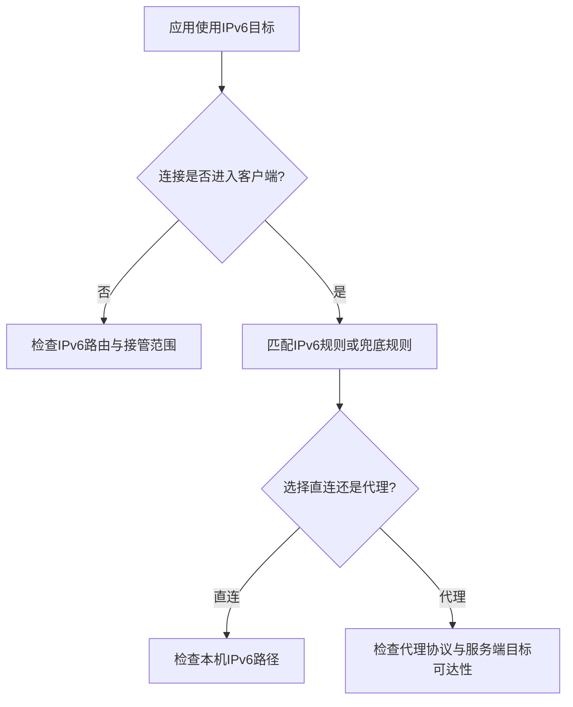

*图8-6 IPv6分流要同时确认接管范围、规则与出口能力*

仅增加IPv6规则，不能修复未进入客户端的连接。使用代理访问IPv6目标，也不必然要求本机到代理服务器的连接本身使用IPv6；这取决于代理协议、节点地址和服务端能力。

### 8.3.4 实用IP规则

对已确认需要本地访问的网段，可以采用下面的片段。若实际只使用其中一个子网，收窄到该子网更便于控制范围。

```yaml
rules:
  - IP-CIDR,127.0.0.0/8,DIRECT,no-resolve
  - IP-CIDR,10.0.0.0/8,DIRECT,no-resolve
  - IP-CIDR,172.16.0.0/12,DIRECT,no-resolve
  - IP-CIDR,192.168.0.0/16,DIRECT,no-resolve
  - IP-CIDR6,::1/128,DIRECT,no-resolve
  - IP-CIDR6,fc00::/7,DIRECT,no-resolve
```

不要把所有特殊用途地址都归为“保留地址直连”。运营商共享地址`100.64.0.0/10`、链路本地地址、组播、文档地址等各有用途，应按实际场景决定接管和路由方式。

`198.18.0.0/15`原本用于网络设备基准测试，其中的地址也常被代理核心用作fake-IP池。fake-IP模式下，合成地址需要由核心恢复为对应域名并参与后续处理，不能把它当作真实服务器IP进行国家分类，或增加一条宽泛的直连规则来“放行”。

对于Telegram等可能直接使用IP的应用，单靠域名规则可能不足。可以采用维护中的IP规则集，例如8.5.3的`telegramcidr`，而不是长期复制一份硬编码清单。规则集的地址覆盖和更新仍需核查；识别到某项服务的IP范围，也不代表已覆盖其所有网页、文件和语音业务。

## 8.4 GeoIP数据库使用

### 8.4.1 GeoIP原理

GeoIP把IP地址或网段映射到数据库定义的国家、地区或其他分类。规则引擎查询本地数据，再把查询结果用于分流。

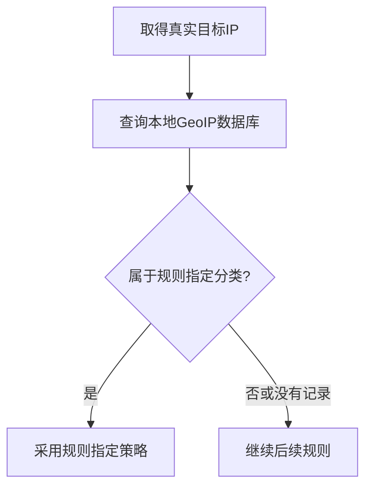

*图8-7 GeoIP依据本地数据分类，不是对服务器位置的实时测量*

数据库记录可能来自地址分配、测量或社区整理，并存在更新延迟。CDN、任播和地址转移也会影响分类结果。GeoIP不能证明服务商身份、目标可信程度或实际机房位置，更不能保证某个流媒体账号可访问相应地区内容。

按目标IP分类与按代理出口地区选择是两件事。例如，`GEOIP,US,Proxy`检查的是目标地址的数据库分类，不会自动把`Proxy`切换为美国节点。业务服务看到的出口位置还取决于最终节点及服务方自己的判断。

### 8.4.2 GEOIP规则

基本形式为`GEOIP,分类代码,策略`，可按需要添加`no-resolve`：

```yaml
rules:
  - GEOIP,CN,DIRECT
  - MATCH,Proxy
```

这份片段表达“将数据库归入CN的目标直连，其他目标交给代理组”。没有`no-resolve`，意味着到达此处的域名连接可以触发目标IP解析；DNS路径应另行配置。如果改成`GEOIP,CN,DIRECT,no-resolve`，则只利用已经取得的目标IP进行这一判断，不能假定所有域名连接仍会被分类。

常见国家或地区代码包括`CN`、`HK`、`TW`、`US`、`JP`、`SG`和`GB`。实际可用分类及其范围以数据源为准。

mihomo另外支持特殊分类`LAN`，但它不是ISO国家代码，覆盖范围也不只包含常见私有单播地址，还涉及回环、链路本地、组播和未指定地址等判断。需要精确控制内网访问时，明确列出实际网段通常更容易审查。`PRIVATE`也不是跨核心、跨数据库通用的国家代码，不能未经核对就照搬。

### 8.4.3 GeoIP数据库来源

选择Geo数据时，需要同时确认来源、文件格式、支持的分类及加载位置。

| 来源或项目 | 主要用途 | 使用时关注 |
|------------|----------|------------|
| MaxMind GeoIP / GeoLite | 提供地理位置等数据产品 | 产品类型、许可、账户及下载要求；参见[官方文档](https://dev.maxmind.com/geoip/) |
| [MetaCubeX/meta-rules-dat](https://github.com/MetaCubeX/meta-rules-dat) | 发布多种社区整理的Geo数据与规则产物 | 选择与核心匹配的文件，阅读其上游来源和处理说明 |
| 其他社区数据项目 | 提供特定分类或加工后的地址集 | 维护状态、分类含义、构建方式与许可证 |

社区仓库可能使用或加工MaxMind及其他来源的数据，但不能因此将该仓库称为MaxMind官方发布渠道。

**MMDB与DAT模式**

mihomo的`geodata-mode: false`使用MMDB作为GeoIP数据；`true`使用DAT。`geox-url.mmdb`和`geox-url.geoip`分别对应这两种格式，不能把MMDB文件填到`geoip`字段中。

以下片段合并到主配置顶层，使用MetaCubeX发布的MMDB数据，并开启定时更新：

```yaml
geodata-mode: false
geo-auto-update: true
geo-update-interval: 24
geox-url:
  mmdb: "https://raw.githubusercontent.com/MetaCubeX/meta-rules-dat/release/country.mmdb"
```

`geo-update-interval`的单位是小时；8.5中的规则集`interval`则以秒为单位。仅修改下载地址不等于启用定时更新。

如需改用DAT模式，可用下面的片段替换上面的Geo数据配置。`geosite`为域名分类数据，使用`GEOSITE`时需要相应文件：

```yaml
geodata-mode: true
geo-auto-update: true
geo-update-interval: 24
geox-url:
  geoip: "https://raw.githubusercontent.com/MetaCubeX/meta-rules-dat/release/geoip.dat"
  geosite: "https://raw.githubusercontent.com/MetaCubeX/meta-rules-dat/release/geosite.dat"
```

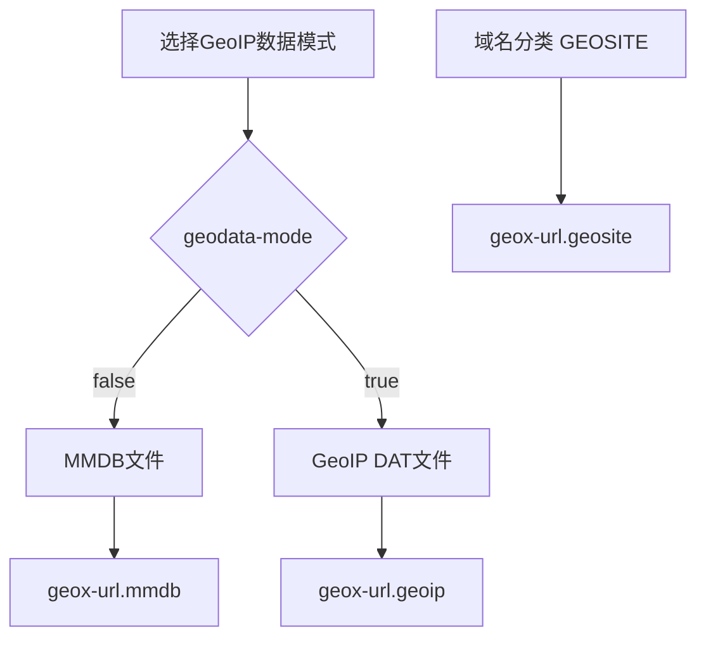

*图8-8 GeoIP的两种数据模式与GEOSITE域名数据分别配置*

GUI客户端可能自行管理数据目录和更新。实际目录应从客户端设置、日志或mihomo的`-d`启动参数确认，不应假定所有客户端都使用`~/.config/clash`。手动替换时，还应核对文件格式、客户端使用的文件名及重新加载方式。

首次获取与后续更新都需要可用的下载路径。准备好本地数据、选择网络中可访问的可信发布地址，并保留可恢复的配置与数据，可以减少启动时对远程资源的依赖。下载失败时，应查看实际加载状态，不能仅凭开启了自动更新就认定已使用新数据。

### 8.4.4 GeoIP vs IP-CIDR

两者都基于IP判断，但提供分类信息的方式不同。

| 维度 | `GEOIP` | `IP-CIDR` |
|------|---------|-----------|
| 判断依据 | 数据库中的分类 | 明确写出的地址前缀 |
| 表达范围 | 适合国家、地区等较大分类 | 适合已知主机或网段 |
| 准确性的边界 | 分类可能过期或与业务预期不同 | 前缀匹配明确，但网段归属与用途也可能变化 |
| 维护方式 | 更新数据库并核对分类变化 | 维护前缀清单，或采用IP规则集 |
| 与域名的关系 | 需要真实目标IP；可能触发解析 | 同样需要目标IP；也可能触发解析 |
| 执行开销 | 依赖数据库、实现与缓存 | 依赖规则组织与数据结构 |

明确的本地网段适合用CIDR表达；按大范围分类管理目标时，GeoIP更便于维护。服务级分流通常还需要域名信息，因为共享IP难以区分同一CDN上的不同业务。

规则数量少也不必然代表更快。一个`RULE-SET`引用可以包含大量条目，数据库和规则集的匹配效率则取决于实现；不要仅按主配置行数判断性能。

## 8.5 自定义规则集

### 8.5.1 规则集（Rule Providers）

规则集把一组匹配条件与主配置分开管理。主配置通过`RULE-SET`引用集合，并在引用处指定策略。集合自身负责描述“匹配谁”，引用规则负责决定“交给谁”。

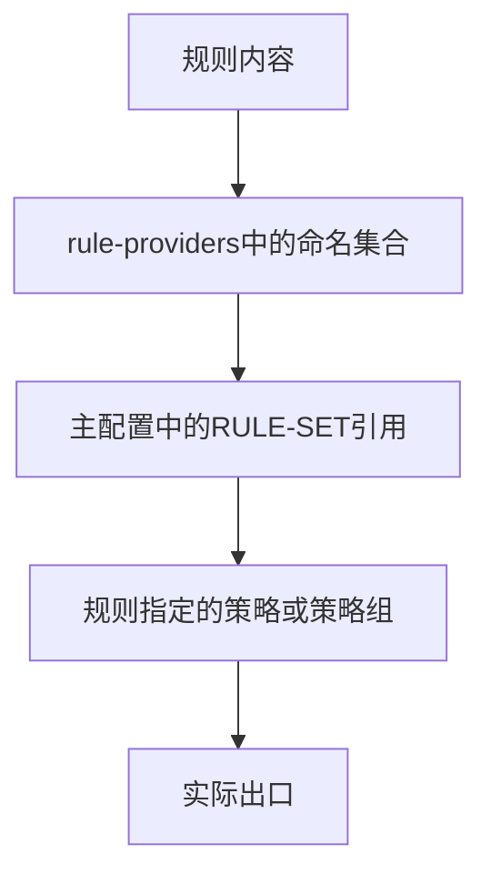

*图8-9 规则集、引用规则和处理策略各有职责*

以下mihomo片段使用内联规则集，不需要下载外部文件：

```yaml
rule-providers:
  work:
    type: inline
    behavior: domain
    payload:
      - "+.work.example.org"
      - "api.example.org"

rules:
  - RULE-SET,work,Proxy
  - MATCH,DIRECT
```

这使`work.example.org`及其子域名、精确域名`api.example.org`走`Proxy`，其余连接直连。它只是展示引用机制，实际兜底选择应根据需求确定。

定义规则集并不会让它自动生效；需要在`rules`中引用，且该引用之前不能已有覆盖目标的规则。一个集合也可以在不同配置中复用，由各自的引用规则决定策略。

### 8.5.2 规则集类型

mihomo规则集有三个独立的维度，不能把它们混为一种“格式”：

| 字段 | 可选值 | 作用 |
|------|--------|------|
| `type` | `http`、`file`、`inline` | 内容来自远程、本地文件或主配置内联 |
| `behavior` | `domain`、`ipcidr`、`classical` | 内容按哪类匹配规则解释 |
| `format` | `yaml`、`text`、`mrs` | 文件的存储编码；默认`yaml` |

`inline`直接使用`payload`，不需要外部文件。下面三种内容分别展示`behavior`，每个代码块都是一份独立规则文件。

**domain：域名集合**

```yaml
payload:
  - "api.example.org"
  - "+.work.example.org"
```

裸域名`api.example.org`表示精确匹配；`+.work.example.org`表示根域名及其子域名。不能把裸域名条目一律解释为`DOMAIN-SUFFIX`。规则集还支持Clash风格的域名通配表达式，但它与路由规则`DOMAIN-WILDCARD`的语法不是同一套规则，混用时容易扩大或缩小匹配范围。

**ipcidr：IP前缀集合**

```yaml
payload:
  - "192.168.1.0/24"
  - "fd12:3456:789a::/48"
```

这里存放前缀，不写`IP-CIDR`、策略或`no-resolve`。是否允许为了这次匹配触发解析，在引用规则上控制，例如`RULE-SET,office-net,DIRECT,no-resolve`，其中`office-net`需定义为该IP规则集。

**classical：带类型的规则集合**

```yaml
payload:
  - DOMAIN-SUFFIX,work.example.org
  - DOMAIN,api.example.org
  - IP-CIDR,192.168.1.0/24,no-resolve
  - DST-PORT,8443
```

`classical`允许混合多种条件，但每一项不写处理策略，策略统一由外层`RULE-SET`指定。它不是完整配置文件，也不支持在条目中嵌套`RULE-SET`或`SUB-RULE`。若要给不同条目分配不同出口，应拆成多个集合或直接在主配置中编写。

**文件编码与扩展名**

上面示例使用`format: yaml`，以`payload`列表组织内容。`format: text`则每行一个条目，不带`payload:`和列表符号。例如，域名文本文件可以写成：

```text
api.example.org
+.work.example.org
```

扩展名不能决定格式：某个`.txt`文件完全可能实际包含YAML。应检查响应正文，并让`behavior`与`format`匹配真实内容；网页预览或下载失败后的HTML错误页都不能作为规则文件加载。

MRS是mihomo支持的二进制规则集格式，目前用于`domain`和`ipcidr`，不适用于`classical`。例如，将YAML域名集合转换为MRS：

```shell
mihomo convert-ruleset domain yaml work.yaml work.mrs
```

引用转换结果时使用`behavior: domain`和`format: mrs`。不要仅改文件扩展名来完成转换。

### 8.5.3 常用规则集推荐

选择规则集时，应先看分类范围和维护方式，再决定是否符合自己的分流目标。下列项目可作为来源，但项目中的全部分类不必一起启用。

| 项目 | 可参考的内容 | 配置前的检查 |
|------|--------------|--------------|
| [Loyalsoldier/clash-rules](https://github.com/Loyalsoldier/clash-rules) | 域名分类、广告域名及部分IP集合 | 核对各文件的真实格式、分类解释和更新状态 |
| [MetaCubeX/meta-rules-dat](https://github.com/MetaCubeX/meta-rules-dat) | Geo数据及多种规则产物 | 选择对应核心、规则行为和存储格式 |
| 自有业务规则仓库 | 内部域名、已确认的业务例外 | 维护责任、访问权限和变更记录 |

下面是Loyalsoldier三个发布文件的mihomo配置片段。它们虽然以`.txt`结尾，正文却是带`payload`的YAML，因而明确使用`format: yaml`。

```yaml
rule-providers:
  google:
    type: http
    behavior: domain
    format: yaml
    url: "https://raw.githubusercontent.com/Loyalsoldier/clash-rules/release/google.txt"
    path: ./ruleset/google.yaml
    interval: 86400
    proxy: DIRECT

  telegramcidr:
    type: http
    behavior: ipcidr
    format: yaml
    url: "https://raw.githubusercontent.com/Loyalsoldier/clash-rules/release/telegramcidr.txt"
    path: ./ruleset/telegramcidr.yaml
    interval: 86400
    proxy: DIRECT

  cncidr:
    type: http
    behavior: ipcidr
    format: yaml
    url: "https://raw.githubusercontent.com/Loyalsoldier/clash-rules/release/cncidr.txt"
    path: ./ruleset/cncidr.yaml
    interval: 86400
    proxy: DIRECT

rules:
  - RULE-SET,google,Proxy
  - RULE-SET,telegramcidr,Proxy,no-resolve
  - RULE-SET,cncidr,DIRECT
  - MATCH,Proxy
```

`interval: 86400`表示每86,400秒更新一次。`path`是本地缓存路径，各集合不应共用同一路径；相对路径以核心数据目录为基准，GUI客户端的实际目录需从设置或日志确认。

此处`google`和Telegram规则在IP大分类之前，体现“服务需求优先于一般分类”的选择。`cncidr`未添加`no-resolve`，因此可以对走到这里的域名连接触发解析；若希望只匹配已有目标IP，可添加该参数，但应接受部分域名连接转入兜底的结果。

`proxy: DIRECT`指定规则下载采用直连，不代表它在所有网络中都可访问。可以改成已经可用的节点或策略组，例如`Proxy`。首次启动时，节点、规则集和DNS之间应避免循环依赖，不能要求尚未加载的资源先为自己的下载提供出口。

这些列表表达的是维护者定义的分类，不承诺覆盖某项服务的所有连接，也不提供匿名性或抗封锁保证。远程更新会改变后续连接的处理结果，应保存本地例外并关注变更。若启用广告拦截集合，建议先检查误拦截情况，而不是直接把所有未知连接视为广告。

### 8.5.4 自建规则集

对少量自有规则，本地文件便于查看和维护。假设核心数据目录下已有`ruleset`子目录，先将下面内容保存为`ruleset/work.yaml`：

```yaml
payload:
  - "+.work.example.org"
  - "api.example.org"
```

再把以下片段合并到主配置的对应位置：

```yaml
rule-providers:
  work:
    type: file
    behavior: domain
    format: yaml
    path: ./ruleset/work.yaml

rules:
  - RULE-SET,work,Proxy
  - MATCH,DIRECT
```

本地文件修改后，应通过客户端支持的方式重新加载配置或更新规则集，再验证实际命中情况，不能假定所有界面都会立即感知文件变化。

多人共享时，可以把同一文件发布到受控HTTPS地址，再把`type`改为`http`，增加`url`和更新间隔。应使用原始文件地址，并检查响应内容；不要把包含内部业务名称或访问令牌的私有规则随意发布到公共仓库。

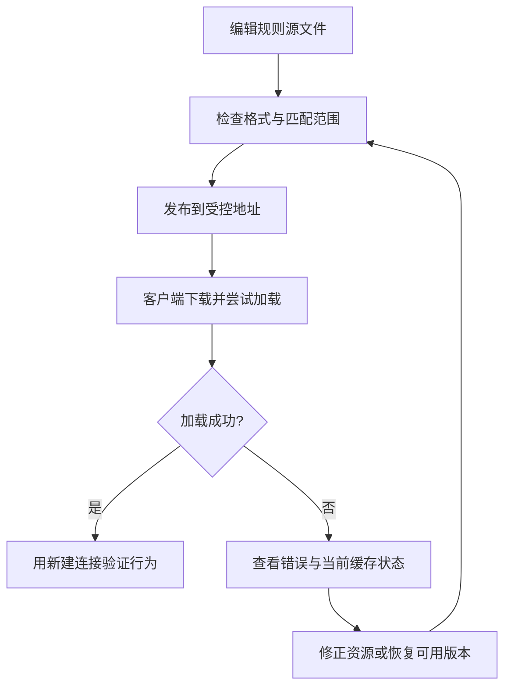

*图8-10 规则更新既要验证文件加载，也要验证新连接的处理结果*

下载失败时，是否能继续使用旧缓存取决于缓存是否存在、内容是否有效及核心的加载状态。首次启动且没有有效缓存时尤其需要关注错误，不能把“有缓存机制”理解为任何失败都不影响分流。

GUI客户端可能在订阅刷新时替换整份主配置。自定义规则应放入客户端支持的覆写、合并或独立配置机制中，并验证更新后的有效配置，避免只修改了随后会被覆盖的临时文件。

## 8.6 常用规则推荐

### 8.6.1 完整规则配置示例

下面是一份独立的mihomo配置，定义了两个Shadowsocks节点、三个策略组、三个内联规则集及最终规则。它展示“本地访问、明确例外、拒绝列表、业务分类、兜底”的组织方式，不依赖远程规则集或Geo数据库。

使用前，必须替换节点服务器、端口与密钥，并按自己的业务需求调整域名和网段。示例中的`example.com`节点地址与`.test`拒绝目标均用于演示。Shadowsocks 2022的`2022-blake3-aes-128-gcm`要求Base64编码的16字节随机密钥，不能把占位文字直接当作密码。

```yaml
mixed-port: 7890
allow-lan: false
mode: rule
log-level: info
ipv6: true

dns:
  enable: false

proxies:
  - name: A-01
    type: ss
    server: a.example.com
    port: 8388
    cipher: 2022-blake3-aes-128-gcm
    password: "<节点A的Base64编码16字节随机密钥>"
    udp: true

  - name: B-01
    type: ss
    server: b.example.com
    port: 8388
    cipher: 2022-blake3-aes-128-gcm
    password: "<节点B的Base64编码16字节随机密钥>"
    udp: true

proxy-groups:
  - name: Proxy
    type: select
    proxies:
      - A-01
      - B-01

  - name: Work
    type: select
    proxies:
      - Proxy
      - DIRECT

  - name: Default
    type: select
    proxies:
      - Proxy
      - DIRECT

rule-providers:
  blocked:
    type: inline
    behavior: domain
    payload:
      - "+.ads.example.test"

  work:
    type: inline
    behavior: domain
    payload:
      - "+.github.com"
      - "+.githubusercontent.com"
      - "+.githubassets.com"

  direct-sites:
    type: inline
    behavior: domain
    payload:
      - "+.bilibili.com"
      - "+.qq.com"

rules:
  # 本地服务与可直达的私有网段
  - DOMAIN-SUFFIX,home.arpa,DIRECT
  - IP-CIDR,127.0.0.0/8,DIRECT,no-resolve
  - IP-CIDR,10.0.0.0/8,DIRECT,no-resolve
  - IP-CIDR,172.16.0.0/12,DIRECT,no-resolve
  - IP-CIDR,192.168.0.0/16,DIRECT,no-resolve
  - IP-CIDR6,::1/128,DIRECT,no-resolve
  - IP-CIDR6,fc00::/7,DIRECT,no-resolve

  # 放在拒绝集合之前的明确例外
  - DOMAIN,status.ads.example.test,DIRECT
  - RULE-SET,blocked,REJECT

  # 按业务需求选择出口
  - RULE-SET,work,Work
  - RULE-SET,direct-sites,DIRECT

  # 处理所有剩余连接
  - MATCH,Default
```

本例只开启本机混合代理端口，未启用TUN，也不会自动修改系统代理。应用需要主动使用`127.0.0.1:7890`，或通过客户端设置接入。启用`ipv6: true`不等于已经接管系统中的全部IPv6流量。

`dns.enable: false`表示不启用mihomo内置DNS模块，核心需要本地解析时使用系统解析。应用可能通过HTTP代理或SOCKS传入域名，也可能自行解析后只传入IP；后者若没有其他域名恢复机制，域名规则便可能无法匹配。代理端是否解析目标域名还取决于出口实现。本例便于演示连接规则，不提供完整的DNS接管或查询隐私方案。

规则中的私有网段直连只适用于本机已有相应路径的情况。本地服务若以域名提交且此前没有取得目标IP，带`no-resolve`的IP规则也不会主动解析；因此需要同时保留合适的本地域名规则和可用的本地DNS。

`Work`和`Default`都可以选择`Proxy`或`DIRECT`，便于分别调整业务与兜底出口。新配置未恢复已有选择时，`select`组通常从首个成员开始；GUI也可能恢复历史选择，使用前应检查实际值。`Proxy`只包含两个已定义节点，不会因节点不可用而自动改为直连。

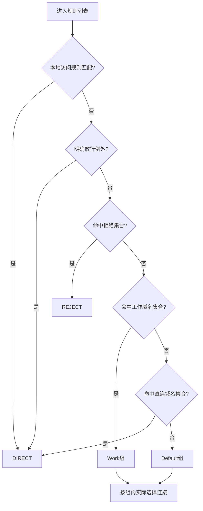

*图8-11 完整示例的规则顺序与策略分支*

下面的检查表按“客户端已取得对应域名或真实IP”的前提列出预期命中。实际出口仍需结合组内选择确认。

| 测试目标 | 预期命中 | 处理策略 |
|----------|----------|----------|
| 域名`nas.home.arpa` | 本地域名后缀 | `DIRECT` |
| IP `192.168.1.10` | 私有IPv4网段 | `DIRECT` |
| 域名`status.ads.example.test` | 明确放行例外 | `DIRECT` |
| 域名`banner.ads.example.test` | `blocked`集合 | `REJECT` |
| 域名`api.github.com` | `work`集合 | `Work` |
| 域名`www.bilibili.com` | `direct-sites`集合 | `DIRECT` |
| 域名`www.example.net` | `MATCH` | `Default` |

增加GeoIP或远程规则集时，先使用8.4、8.5的片段补齐数据配置，再明确它们在本列表中的位置。不要在未理解覆盖范围时同时堆叠多个重复分类，也不要让新集合越过本地例外或业务选择。

### 8.6.2 简化版规则

规则较少时，可以先直接维护一份清单。下面仅替换8.6.1的`rules`区，保留其节点与策略组定义；原有内联规则集不再被引用时，可以删除对应定义。

```yaml
rules:
  - DOMAIN-SUFFIX,home.arpa,DIRECT
  - IP-CIDR,192.168.1.0/24,DIRECT,no-resolve
  - IP-CIDR6,::1/128,DIRECT,no-resolve
  - DOMAIN,ads.example.test,REJECT
  - DOMAIN-SUFFIX,github.com,Proxy
  - DOMAIN-SUFFIX,bilibili.com,DIRECT
  - MATCH,Proxy
```

这份清单明确处理少数目标，其他连接走`Proxy`，并不按国家分类。它保留的本地网段较窄，实际使用时应替换为自己的网段；涉及更多业务域名时，再逐步扩展或引入规则集。

简化配置的价值在于容易解释每条规则的目的。扩大分类范围、改变兜底策略或引入自动更新时，都应重新检查重叠规则和实际出口，而不只是确认文件能够加载。

### 8.6.3 规则调试技巧

排查应从“连接是否进入客户端”开始，再检查匹配和出口。规则命中只说明路由判断发生过，不表示DNS、代理认证、目标连接或应用请求已经成功。

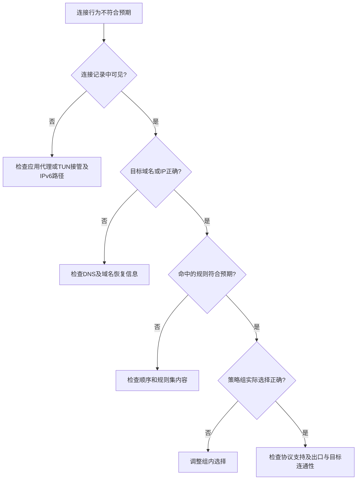

*图8-12 从接管、目标信息、规则命中到实际出口逐层排查*

**检查有效配置与连接记录**

确认当前运行的是规则模式，并查看客户端最终加载的配置，而不只是编辑器中的文件。订阅、覆写和合并机制可能改变最终规则顺序。

使用客户端自带的连接记录或可信的本地管理界面，关注目标域名、目标IP、TCP或UDP、命中的规则、策略链及实际节点。不同客户端的字段名称和日志格式不一致，日志保存目录也由运行方式决定。

需要更多细节时，可暂时将主配置顶层的日志级别改为：

```yaml
log-level: debug
```

调试后恢复`info`或其他合适级别，避免长期积累不必要的连接信息。若使用管理API，应限制监听范围、设置认证并使用可信界面；本章完整示例未开放管理API。

**检查DNS与连接路由的边界**

域名规则需要可用的域名信息。显式HTTP代理、支持远程解析的SOCKS请求、fake-IP映射及嗅探等机制取得信息的方式不同。嗅探也不保证总能恢复域名，不能假定所有IP连接都可自动归入域名规则。

DNS配置中的`nameserver-policy`选择解析服务，主配置中的`rules`选择业务连接出口，它们不是同一层规则。只填写DNS监听地址不会自动让系统或浏览器使用它。若让DNS连接遵循路由，还需考虑代理节点域名的解析与启动依赖，避免出现循环。

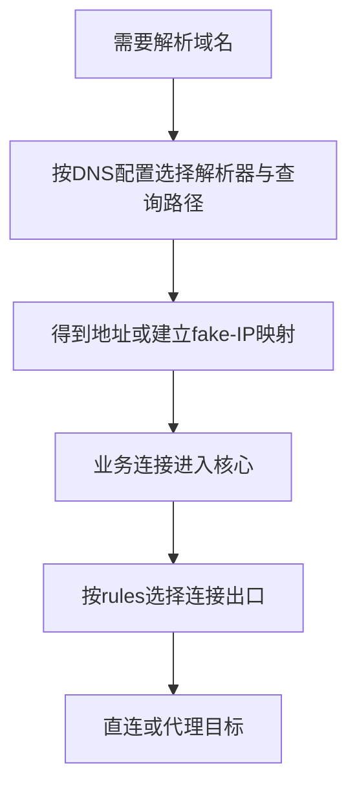

*图8-13 DNS查询路径与业务连接路径相关，但由不同配置控制*

图中表示常见先解析再连接的情况；显式代理也可能先收到域名，再由匹配阶段、本地出口或代理服务端按需要解析。调试时要确认实际路径，不能只根据浏览器地址栏中的域名推断客户端持有的信息。

**验证配置与新连接**

替换完整示例中的节点参数后，可在核心数据目录执行配置检查：

```shell
mihomo -t -d . -f config.yaml
```

使用GUI时，优先采用其内置的配置校验和重新加载功能。校验通过只能说明该版本核心接受配置及所需资源，不证明节点认证、业务连通或分流效果正确。

测试时使用新建连接。修改规则或切换策略组通常不会把已建立的TCP连接迁移到新出口，浏览器复用连接也可能使旧路径继续存在。必要时关闭对应连接或重启测试应用，再观察记录，不必每次都重启整个核心。

若需要明确让一个测试请求进入本例的HTTP代理端口，可在Windows中使用：

```powershell
curl.exe --proxy http://127.0.0.1:7890 https://www.example.org/
```

其他系统一般使用`curl`。该请求用于观察单次显式代理连接，不覆盖浏览器、UDP或TUN场景，也不能单凭网页响应判断所有应用都已接管。

| 现象 | 优先检查 |
|------|----------|
| 完全没有相应连接记录 | 应用是否使用代理、TUN路由和绕过设置、IPv6接管 |
| 精确域名例外没有生效 | 前面是否有更宽的后缀、关键词、规则集或`MATCH` |
| IP或GeoIP规则未命中 | 是否已有真实目标IP、是否带`no-resolve`、数据库是否加载 |
| 规则集无法更新 | URL正文和格式、下载出口、缓存路径、认证与启动依赖 |
| 已命中代理规则却无法访问 | 组内实际节点、UDP能力、认证、服务端与目标的网络路径 |
| 网页能开但部分资源失败 | 登录、API、CDN等其他连接的命中与出口 |
| 改规则后行为似乎未变 | 有效配置是否更新、应用是否仍复用旧连接 |

本章涉及的完整语法可参阅mihomo官方文档中的[路由规则](https://wiki.metacubex.one/config/rules/)、[规则集配置](https://wiki.metacubex.one/config/rule-providers/)、[规则集内容](https://wiki.metacubex.one/config/rule-providers/content/)、[通用设置](https://wiki.metacubex.one/config/general/)及[DNS设置](https://wiki.metacubex.one/config/dns/)。具体功能仍应与正在使用的核心版本核对。

---

## 本章小结

分流首先依赖连接被客户端接管，以及客户端拥有足够的目标信息。域名规则区分精确匹配、后缀边界和关键词范围；IP规则检查真实地址前缀，`no-resolve`只限制由当前规则主动触发的解析。

规则按列表顺序组织，没有自动的精确度排序。把需要优先处理的例外放在一般分类之前，明确兜底策略，并检查策略组最终选择，才能让规则意图与实际出口一致。

GeoIP与远程规则集可以降低清单维护成本，但其分类、来源、更新和格式都需要管理。有效配置校验、连接记录和新连接测试分别回答不同问题，应配合使用。

至此，第三部分“高级配置篇”结束。下一部分介绍服务器搭建，适合有自建需求的读者继续学习；使用现成订阅的读者可以按需阅读后面的安全与故障排查章节。

---

**实践任务：**

1. 用一个精确域名和一个后缀规则构造例外，交换顺序后解释命中差异。
2. 比较只有域名和已有目标IP的连接，观察`no-resolve`对IP规则匹配的影响。
3. 创建一份本地域名规则集，分别验证裸域名与`+.`条目的匹配范围。
4. 在完整示例中检查节点、策略组、规则集引用，并记录各测试目标的实际策略链。
5. 为一个真实业务查看主站、登录和资源连接，补充必要规则，并用新连接验证。
