# 第4章 常见代理协议详解

代理协议规定客户端与服务器怎样认证、描述目标并转发数据；传输方式决定这些数据如何承载；客户端内核则把接入、DNS、路由和出口选择组合起来。本章分别介绍这些层次，并通过配置示例说明它们之间的关系。

**小白先看这张图：**

| 你想解决的问题 | 先看哪一节？ | 代表方案 |
|----------------|--------------|----------|
| 给浏览器或应用设置代理 | 4.1、4.2 | Shadowsocks、VLESS、Trojan |
| 让整台设备或内网走一条隧道 | 4.4 | WireGuard |
| 按域名、IP或应用分流 | 4.3 | Clash/mihomo |
| 网络丢包或延迟较高 | 4.2 | Hysteria 2 |
| 比较方案再做选择 | 4.5 | 协议综合对比 |

本章示例中的域名、IP地址、UUID、密钥和文件路径均需替换为实际值。配置格式分别以Shadowsocks Rust、Xray-core、Hysteria 2、mihomo和Linux的wg-quick为准；同一协议在不同实现中的字段不一定相同。示例主要展示通信所需的配置，公网部署还需完成软件安装、凭据生成、证书准备及相应的防火墙设置。

## 4.1 Shadowsocks系列（SS/SSR）

### 4.1.1 Shadowsocks诞生背景

Shadowsocks由clowwindy于2012年发布，采用本地客户端与远端服务器协作转发的结构。应用通常通过本地SOCKS5接口提交请求，客户端把目标地址和应用数据封装、加密后发往服务器，再由服务器连接目标。

SOCKS5是应用接入本地客户端的一种方式，Shadowsocks则是客户端与远端服务器之间使用的协议。它们处于不同的通信环节。部分实现还提供透明代理或TUN接入，因此Shadowsocks并不等于“给SOCKS5连接加上一个密码”。

Shadowsocks经过多代发展，既有早期流加密方法，也有AEAD加密方法及Shadowsocks 2022。选择软件时，需要同时核对协议代际、加密方法、TCP/UDP能力和具体实现的支持情况。

### 4.1.2 Shadowsocks工作原理

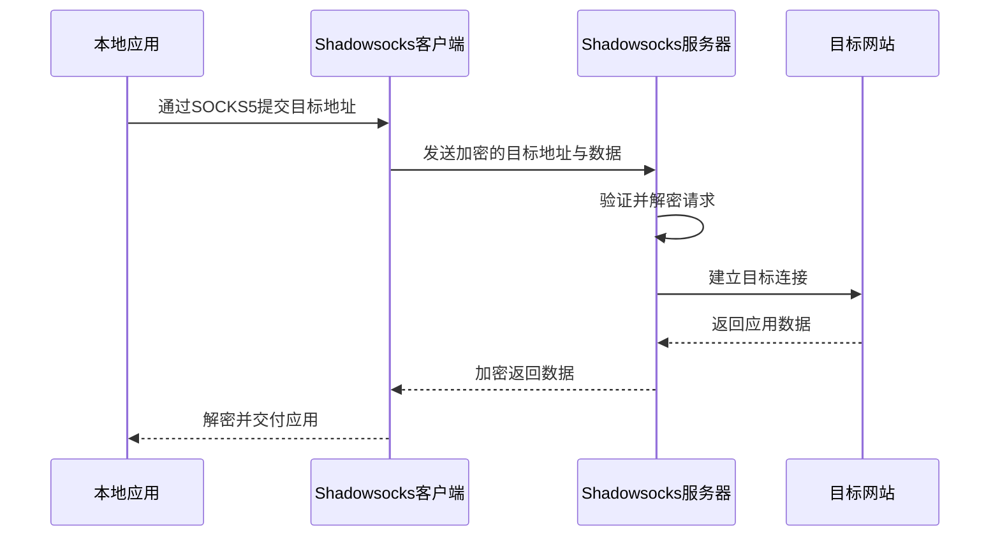

*图4-1 Shadowsocks转发一次TCP连接的基本过程*

客户端到服务器、服务器到目标是不同的通信段。Shadowsocks保护前一段；访问HTTPS网站时，应用与网站之间还有独立的TLS保护。若目标应用本身使用明文协议，服务器到目标的通信仍可能是明文。

目标地址通常采用“地址类型、地址、端口”的表示方式，类型可为IPv4、域名或IPv6。地址并不是固定跟在盐值后面的明文字段。以AEAD 2017的TCP格式为例，其结构可简化为：

```text
盐值 | 加密的块长度及认证标签 | 加密的数据块及认证标签 | 后续加密块……
                                      └─ 首块包含目标地址与端口
```

盐值参与派生本次通信所用的子密钥，目标地址和载荷位于加密内容中。TCP的两个方向分别维护加密状态；UDP则以数据报为单位封装。Shadowsocks 2022又增加了会话、时间和重放防护等机制，不能用上面的简图替代其完整报文规范。

### 4.1.3 加密方法详解

AEAD即“带关联数据的认证加密”，在保护内容机密性的同时检验数据是否被篡改。能否抵御重放、是否具备前向保密，以及凭据泄露后的影响，还取决于协议结构和实现。

| 协议或方法类别 | 常见方法 | 配置与使用要点 |
|---------------|----------|----------------|
| Shadowsocks 2022 | `2022-blake3-aes-128-gcm` | 使用Base64编码的16字节随机密钥 |
| Shadowsocks 2022 | `2022-blake3-aes-256-gcm` | 使用Base64编码的32字节随机密钥 |
| Shadowsocks 2022的可选方法 | `2022-blake3-chacha20-poly1305` | 使用32字节随机密钥，需核对两端支持情况 |
| AEAD 2017 | `aes-128-gcm`、`aes-256-gcm`、`chacha20-ietf-poly1305` | 兼容范围较广，应使用足够强的随机凭据 |
| 早期流加密方法 | `aes-256-cfb`、`rc4-md5`等 | 缺少现代协议所需的认证保护，不用于新部署 |

Shadowsocks 2022使用BLAKE3参与密钥派生，并改进认证与重放防护。其预共享密钥仍需妥善保管；这一协议不提供前向保密，不能把更换方法名称理解为长期密钥泄露后历史通信仍然安全。

AES-GCM与ChaCha20-Poly1305的性能差异受CPU指令、实现、设备功耗和负载影响。应先确认双方支持的方法，再在实际设备上比较吞吐和资源占用，而不是按桌面端、移动端给出固定的速度排序。

### 4.1.4 ShadowsocksR (SSR)

ShadowsocksR是基于早期Shadowsocks发展出的分支。它在加密方法之外增加了名为`protocol`和`obfs`的配置项，前者涉及认证或封装，后者用于改变外层流量的表现形式。

| 配置项 | 历史上常见的取值 | 含义 |
|--------|------------------|------|
| `protocol` | `origin`、`auth_aes128_sha1`、`auth_chain_a`等 | 选择SSR的协议处理方式 |
| `obfs` | `plain`、`http_simple`、`tls1.2_ticket_auth`等 | 选择外观混淆方式 |
| 参数项 | `protocol_param`、`obfs_param` | 提供对应机制需要的附加参数 |

名称中出现HTTP或TLS，不代表连接已经成为完整、可验证的HTTP或TLS会话。填写某个网站的域名，也不会自动获得该网站的证书、网络路径或身份。

SSR主要涉及既有服务的兼容。不同分支的维护情况和实现能力需要单独核对，不能将现代Shadowsocks的AEAD或2022方法直接填入旧SSR配置并假定可用。接入已有SSR服务时，应使用服务端明确提供的协议、混淆和加密组合，并了解所用客户端的维护状况。

### 4.1.5 SS vs SSR对比

| 比较项 | Shadowsocks | ShadowsocksR |
|--------|-------------|--------------|
| 协议演进 | 包含AEAD 2017和2022等规范 | 源自早期Shadowsocks，另有协议与混淆扩展 |
| 主要参数 | 方法、密钥、服务器地址与端口 | 还需匹配`protocol`、`obfs`及相关参数 |
| 外层承载 | 可由支持的实现配合插件 | 使用SSR自己的混淆机制，具体支持因分支而异 |
| 兼容判断 | 核对方法及协议代际 | 核对完整参数组合和具体实现 |
| 选用依据 | 客户端支持、维护情况与实际网络表现 | 既有服务的兼容需求与软件维护情况 |

混淆层数不能直接换算为安全性或可达性。新部署应优先考虑有明确规范、持续维护且两端支持的实现；迁移既有服务时，则需要同时更新客户端与服务端，不能仅修改配置中的协议名称。

### 4.1.6 实战配置案例

以下使用支持Shadowsocks 2022的Shadowsocks Rust，以`2022-blake3-aes-128-gcm`建立TCP与UDP转发。

先在可信环境生成一个16字节随机密钥，并将Base64结果填入两端的`password`字段：

```bash
openssl rand -base64 16
```

服务端保存为`ss-server.json`：

```json
{
  "server": "0.0.0.0",
  "server_port": 8388,
  "password": "<同一个Base64编码的16字节随机密钥>",
  "method": "2022-blake3-aes-128-gcm",
  "mode": "tcp_and_udp"
}
```

客户端保存为`ss-client.json`：

```json
{
  "server": "ss.example.com",
  "server_port": 8388,
  "local_address": "127.0.0.1",
  "local_port": 1080,
  "password": "<同一个Base64编码的16字节随机密钥>",
  "method": "2022-blake3-aes-128-gcm",
  "mode": "tcp_and_udp"
}
```

分别启动服务端与客户端：

```bash
ssserver -c ss-server.json
```

```bash
sslocal -c ss-client.json
```

`ssserver`和`sslocal`是Shadowsocks Rust的程序名称。其他实现可能采用不同命令或服务管理方式。服务端需要放行TCP和UDP的8388端口；本地应用则连接`127.0.0.1:1080`，并具备相应的SOCKS5 TCP或UDP接入能力。

可用支持SOCKS5的curl检查TCP访问，其中`--socks5-hostname`表示把目标域名交给代理链路处理：

```bash
curl --socks5-hostname 127.0.0.1:1080 https://www.example.com/
```

此检查只覆盖一次TCP请求，不能据此确认UDP转发、全部应用接管或其他域名的解析路径。配置文件包含密钥，应限制读取权限；长期运行时可交由操作系统服务管理器管理。

### 4.1.7 Shadowsocks插件系统

SIP003定义了Shadowsocks客户端与外部插件之间的接口。插件通常在本机接收Shadowsocks的TCP字节流，转换为另一种承载，再由远端插件还原。

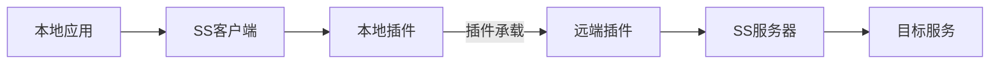

*图4-2 Shadowsocks与外部传输插件的组合*

常见插件及其边界如下：

- **v2ray-plugin** 可提供WebSocket等承载，并可配合TLS。使用WebSocket经反向代理或CDN转发时，需匹配路径、Host、证书与服务商支持条件。
- **simple-obfs** 提供历史上的HTTP或TLS外观混淆。其TLS外观不等于真实TLS握手，不能替代证书校验与现代加密协议。
- **kcptun** 以UDP承载可靠字节流。重传与拥塞控制可能改变特定链路的表现，也会增加流量和调参成本。

SIP003插件通常处理TCP，原生Shadowsocks UDP不会自动进入同一插件通道。部署前应分别确认TCP与UDP的路径。插件也不会自动让任意协议获得CDN支持，是否可转发取决于外层协议及中间服务的能力。

## 4.2 V2Ray/Xray协议族

### 4.2.1 V2Ray项目简介

V2Ray是模块化的代理平台，能够把入站接入、路由判断、出站连接、DNS和多种传输方式组合使用。Xray-core起源于V2Ray的分支，此后独立发展。两者保留了一些共同概念，但支持的功能、配置字段和版本演进已有差异。

VMess、VLESS和Trojan是代理协议；WebSocket、gRPC等是承载方式；TLS、REALITY等负责相应的安全握手与保护。这些名称不处在同一层次，也不能任意排列组合。

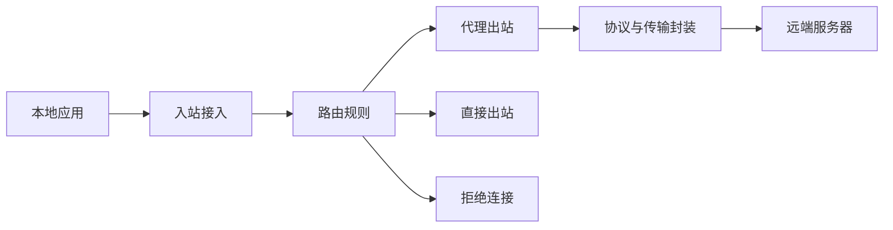

*图4-3 代理核心中的入站、路由与出站*

一个本地SOCKS入站可以根据路由选择不同出站；一个远端代理入站也可以把解封装后的请求交给直接出站。入站与出站的名称描述的是数据进入或离开该核心的方向。

本节JSON示例使用Xray-core的配置格式，包括`settings.users`、简化的出站字段，以及`streamSettings.method`。部分版本还支持`clients`、`vnext`或`network`等旧式字段。应使用与本机版本相配的文档，不能把Xray配置原样视作V2Fly或其他核心的通用配置。

### 4.2.2 VMess协议

VMess由V2Ray设计，提供用户认证、目标描述和数据转发。现代部署使用VMess AEAD认证；载荷可使用AES-GCM或ChaCha20-Poly1305等方法，具体取决于实现及配置。

其请求可以概念性地划分为以下几部分，这不是逐字节的报文布局：

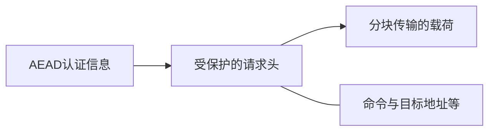

*图4-4 VMess请求的逻辑组成*

认证机制依赖时间信息，因此两端应维持准确的系统时钟；允许的偏差与重放检查由具体实现决定。UUID属于接入凭据，不是公开的节点标签。VMess本身的共享凭据机制也不提供前向保密；叠加TLS时，TLS保护的是其自身会话所承载的数据。

以下是Xray服务端的VMess入站片段，尚需加入监听、传输安全及出站配置：

```json
{
  "protocol": "vmess",
  "settings": {
    "users": [
      {
        "id": "b18c6e28-5eb5-4bf7-b9be-d039f4978031"
      }
    ]
  }
}
```

对应的客户端VMess出站协议片段为：

```json
{
  "protocol": "vmess",
  "settings": {
    "address": "vmess.example.com",
    "port": 443,
    "id": "b18c6e28-5eb5-4bf7-b9be-d039f4978031",
    "security": "auto"
  }
}
```

这里的`settings.security`控制VMess载荷加密，不等于`streamSettings.security`所选择的TLS等外层保护。片段中的UUID仅供展示，部署时应重新生成。

旧教程中的`alterId`属于历史认证机制。现代配置不应通过增大该值来增强安全；兼容客户端若仍保留该字段，通常以`0`表示使用AEAD。是否能够连接，还需核对双方的认证机制、传输和TLS设置。

### 4.2.3 VLESS协议

VLESS以较精简的结构描述用户、命令和目标，并通过扩展机制支持不同功能。常见的VLESS配置使用`encryption: "none"`和`decryption: "none"`，表示不启用VLESS自身的加密层，需要由TLS或REALITY等提供客户端到服务器的保护。

Xray还提供了 **VLESS Encryption** 扩展，可通过`xray vlessenc`生成配对参数。它与设置为`none`的传统用法不同，使用包括ML-KEM-768与X25519在内的密钥协商机制。配置时应遵循所用版本的配对结果，核对认证、填充及会话参数，不能只把`none`替换为某个算法名。该扩展的存在也意味着，不能笼统地把所有VLESS连接描述为“协议本身永远不加密”。

| 比较项 | VMess | VLESS |
|--------|-------|-------|
| 接入认证 | 基于共享凭据与时间相关认证 | 常见用法以用户标识认证，扩展可增加相应机制 |
| 载荷保护 | 可配置协议内载荷加密 | `none`模式依靠外层保护，也可使用VLESS Encryption |
| 外层承载 | 依所用核心选择传输与TLS | 依所用核心选择传输、TLS或REALITY等 |
| 配置核对重点 | AEAD兼容、时间同步、载荷加密与传输 | 加密模式、外层安全、flow与传输的匹配 |

**VLESS、TLS与Vision**

TLS用于认证服务器并保护传输。Xray的`xtls-rprx-vision`是配套的流控与转发优化机制，包含填充及对适用流量的处理。它需要双方和传输组合支持，不能简化为“发现HTTPS就直接取消加密”，也没有适用于所有场景的固定提速比例。

下面给出一组VLESS over raw TCP、TLS与Vision的完整最小配置。服务端域名为`proxy.example.com`，证书必须覆盖该域名，且相应的TCP 443端口可达。

服务端`xray-server.json`：

```json
{
  "inbounds": [
    {
      "listen": "0.0.0.0",
      "port": 443,
      "protocol": "vless",
      "settings": {
        "users": [
          {
            "id": "b18c6e28-5eb5-4bf7-b9be-d039f4978031",
            "flow": "xtls-rprx-vision"
          }
        ],
        "decryption": "none"
      },
      "streamSettings": {
        "method": "raw",
        "security": "tls",
        "tlsSettings": {
          "certificates": [
            {
              "certificateFile": "/etc/xray/fullchain.pem",
              "keyFile": "/etc/xray/privkey.pem"
            }
          ]
        }
      }
    }
  ],
  "outbounds": [
    {
      "protocol": "freedom"
    }
  ]
}
```

客户端`xray-client.json`：

```json
{
  "inbounds": [
    {
      "listen": "127.0.0.1",
      "port": 1080,
      "protocol": "socks",
      "settings": {
        "udp": true
      }
    }
  ],
  "outbounds": [
    {
      "protocol": "vless",
      "settings": {
        "address": "proxy.example.com",
        "port": 443,
        "id": "b18c6e28-5eb5-4bf7-b9be-d039f4978031",
        "encryption": "none",
        "flow": "xtls-rprx-vision"
      },
      "streamSettings": {
        "method": "raw",
        "security": "tls",
        "tlsSettings": {
          "serverName": "proxy.example.com"
        }
      }
    }
  ]
}
```

使用`xray uuid`生成实际用户标识。分别在两端检查配置后启动对应文件：

```bash
xray run -test -config xray-server.json
xray run -config xray-server.json
```

```bash
xray run -test -config xray-client.json
xray run -config xray-client.json
```

客户端应保持证书链与主机名校验。旧配置里的`security: "xtls"`和`xtlsSettings`不用于上述组合；本例的安全层仍是TLS，Vision通过`flow`指定。

**VLESS与REALITY**

REALITY提供另一种握手与身份验证机制，使用预先配置的密钥材料，并以符合要求的TLS目标作为握手行为的一部分。它常与VLESS和Vision组合，使代理端点无需按普通TLS服务器的方式配置该域名的证书私钥。

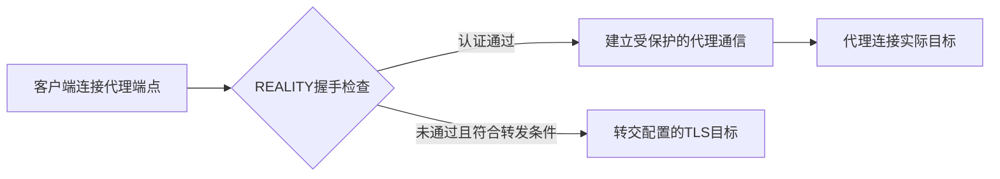

*图4-5 REALITY握手的概念性处理路径*

REALITY不会隐藏代理端点的IP，也不能保证所有探测、流量统计和访问限制都失效。目标选择需要满足所用版本的要求，例如TLS 1.3、相应的HTTP/2支持与域名匹配，并从代理服务器实际检查连通性。不能仅凭网站知名度认定其适合。

如需把前面的TLS配置改为REALITY，应保留VLESS用户及Vision设置，并分别用下面的对象 **替换两端的整个`streamSettings`**。`cover.example.com`只是目标占位域名，必须换成经验证符合要求的实际目标。

服务端替换对象：

```json
{
  "method": "raw",
  "security": "reality",
  "realitySettings": {
    "target": "cover.example.com:443",
    "serverNames": [
      "cover.example.com"
    ],
    "privateKey": "<服务端X25519私钥>",
    "shortIds": [
      "6ba85179e30d4fc2"
    ]
  }
}
```

客户端替换对象：

```json
{
  "method": "raw",
  "security": "reality",
  "realitySettings": {
    "fingerprint": "chrome",
    "serverName": "cover.example.com",
    "password": "<与服务端私钥对应的X25519公钥>",
    "shortId": "6ba85179e30d4fc2"
  }
}
```

通过`xray x25519`生成配对材料，私钥留在服务端，将对应公钥填入此处客户端的`password`字段。字段名随实现而异，例如mihomo使用`reality-opts.public-key`。实际部署时还应生成自己的short ID，确保服务端`shortIds`包含客户端选择的值。

连接地址仍是代理服务器的地址；`serverName`则需匹配允许的握手域名，二者用途不同。REALITY目标也不是最终访问的网站，它参与的是客户端到代理端点的握手与未认证连接处理。

### 4.2.4 Trojan协议

Trojan通常先建立经过证书校验的TLS连接，再在连接内发送认证信息、目标地址和应用数据。服务器根据配置处理有效代理请求，并可将非代理请求交给另一个服务。

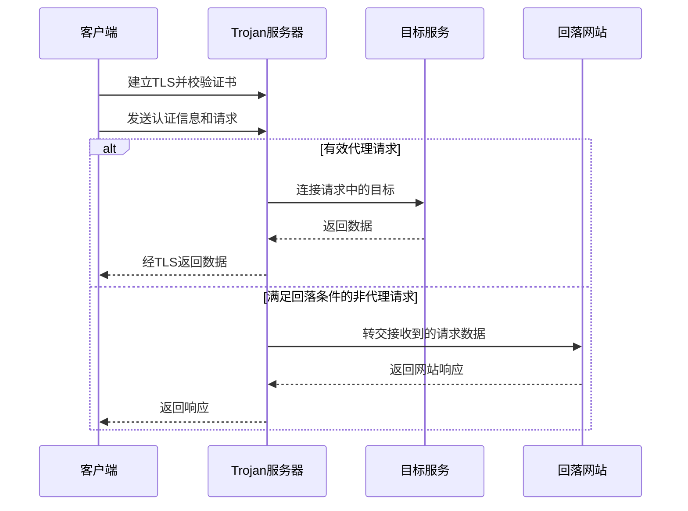

*图4-6 Trojan的代理请求与回落处理*

TLS提供加密与服务器身份验证。回落网站有助于服务器提供普通网站响应，但不会消除连接时序、长度、TLS内嵌TLS等流量特征，也不构成无法识别的保证。具体实现对无效请求的关闭或回落行为可能不同。

原始Trojan协议在TLS内的请求头可简化表示为：

```text
hex(SHA224(password)) | CRLF | CMD | ATYP | DST.ADDR | DST.PORT | CRLF | 载荷
        56字节          2字节   命令      目标地址与端口              2字节
```

其中密码摘要采用56个ASCII十六进制字符表示，命令用于区分TCP连接和UDP关联等操作。UDP还使用相应的数据报封装，不能把TCP请求头当作所有UDP报文的完整格式。

以下是原始`trojan-gfw/trojan`实现的服务端JSON示例，不是Xray或Trojan-Go的通用配置。它要求证书文件已经准备好，并在本机`127.0.0.1:8080`运行用于回落的HTTP网站：

```json
{
  "run_type": "server",
  "local_addr": "0.0.0.0",
  "local_port": 443,
  "remote_addr": "127.0.0.1",
  "remote_port": 8080,
  "password": [
    "<替换为随机生成的强凭据>"
  ],
  "ssl": {
    "cert": "/etc/trojan/fullchain.pem",
    "key": "/etc/trojan/privkey.pem"
  }
}
```

客户端需连接该服务器，使用相同凭据，并校验证书及其覆盖的域名。Trojan-Go以及其他核心可能增加WebSocket、多路复用或其他扩展；这些扩展需要两端兼容，启用后不应再假定任意原始Trojan客户端都能连接。Xray的Trojan实现还有自己的TLS及多路复用建议，应按该实现文档配置。

### 4.2.5 传输方式详解

传输方式描述代理数据如何被封装和发送。它与协议内认证、外层安全机制相互配合，但支持范围受核心及版本限制。

| 传输方式 | 基本机制 | 主要配置与部署条件 |
|----------|----------|--------------------|
| raw TCP | 直接使用TCP字节流 | 可配合TLS或支持的REALITY组合，结构较简单 |
| WebSocket | 通过HTTP升级后的双向连接传输 | 路径与Host需匹配，中间反向代理或CDN须支持WebSocket |
| gRPC | 使用基于HTTP/2的RPC流 | 需核对服务名、TLS和反向代理的gRPC支持 |
| XHTTP | 按实现定义以HTTP请求和响应承载数据 | 模式、上下行及中间节点要求需按版本配置 |
| mKCP | 在UDP上提供可靠传输 | 依赖UDP可达性，重传及带宽参数会影响开销 |
| 基于QUIC的其他承载 | 在UDP上提供安全的流或数据报能力 | 必须核对具体协议，不能仅凭“QUIC”判定互通 |

Xray已移除旧的`network: "h2"`、`httpSettings`对应传输及旧`quicSettings`传输，应按现有实现选择XHTTP等支持的方案。这不代表HTTP/2或QUIC标准被淘汰，也不代表V2Fly等其他核心具有相同配置变化。

以Xray的WebSocket加TLS为例，以下仅为 **客户端`streamSettings`片段**：

```json
{
  "method": "websocket",
  "security": "tls",
  "tlsSettings": {
    "serverName": "proxy.example.com"
  },
  "wsSettings": {
    "path": "/proxy-ws",
    "host": "proxy.example.com"
  }
}
```

服务端或TLS终止反向代理需配置对应的证书、Host和路径。若后端使用明文WebSocket，明文段应处于受控网络中，并与TLS终止位置相匹配。

上述WebSocket片段不能直接替换前面带Vision的raw配置；改用其他传输时，需要同时调整不适用的`flow`及服务端配置。gRPC、XHTTP与REALITY等组合也应逐项核对支持情况。

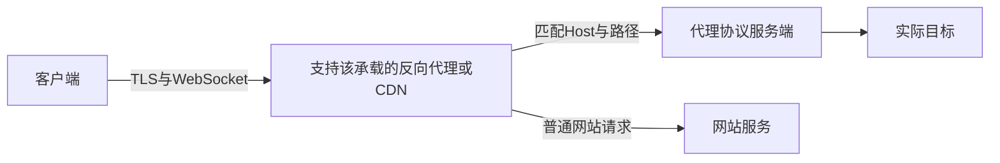

*图4-7 使用HTTP承载时的反向代理关系*

图中前端若终止TLS，就能看到解密后的HTTP承载数据和请求元数据。接入CDN意味着增加一个参与通信的服务方，仍需考虑服务条款、转发限制、源站暴露以及内层协议的保护。不同传输的性能应在同一线路、同一负载下比较，不能从协议名称推导固定的速度或隐蔽性排名。

### 4.2.6 Hysteria协议

Hysteria 2是基于QUIC的代理协议，与Hysteria 1在协议和配置上均有区别。它使用TLS 1.3保护QUIC连接，以HTTP/3机制完成认证，并通过协议定义的流和数据报承载TCP与UDP代理业务。

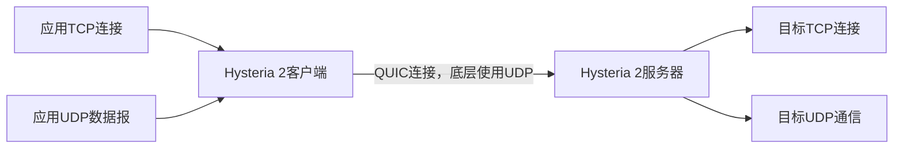

*图4-8 Hysteria 2的应用业务与底层承载*

底层使用UDP并不意味着TCP应用变成了无连接应用。客户端和服务器仍需为TCP代理提供可靠的字节流。QUIC的流控制、重传与拥塞控制会影响实际表现；连接恢复、迁移或0-RTT能否使用，也取决于实现和连接状态，不能保证移动网络切换后所有业务都不断线。

以下为Hysteria 2 YAML配置。服务端`hy2-server.yaml`：

```yaml
listen: :443
tls:
  cert: /etc/hysteria/fullchain.pem
  key: /etc/hysteria/privkey.pem
auth:
  type: password
  password: "<两端相同的随机强凭据>"
```

客户端`hy2-client.yaml`：

```yaml
server: hy2.example.com:443
auth: "<两端相同的随机强凭据>"
tls:
  sni: hy2.example.com
  insecure: false
socks5:
  listen: 127.0.0.1:1080
```

服务端证书需覆盖`hy2.example.com`，防火墙需放行UDP 443。分别启动：

```bash
hysteria server -c hy2-server.yaml
```

```bash
hysteria client -c hy2-client.yaml
```

这些示例保留默认拥塞控制，不填写未经测量的上下行带宽。按实现要求配置带宽时，应以实际可持续速率为依据；过高估计可能增加排队、丢包和其他业务的竞争压力。旧版的`auth_str`、`up_mbps`、`down_mbps`等字段不用于这组Hysteria 2配置。

Hysteria 2适合在UDP可用的链路上评估，尤其可以与TCP方案对比丢包和高时延条件下的表现。若网络对UDP限速或阻断，它也可能无法连接或表现较差。吞吐、重传开销和交互时延需要分别观察，没有适用于所有线路的固定流量倍数或提速比例。

## 4.3 Clash内核与规则

### 4.3.1 Clash简介

Clash是一类基于规则的多协议代理核心所沿用的项目名称。原版Clash及Clash for Windows客户端已于2023年停止维护；客户端图形界面、代理核心和订阅服务是不同的组成部分，不能仅凭软件名称判断其实际能力。

mihomo由Clash.Meta发展而来，是延续这一配置体系的独立项目。本节统一以mihomo为例，介绍节点、代理组、DNS和路由规则。其他核心或图形客户端可能只支持其中一部分配置，也可能自动生成或覆盖某些字段。

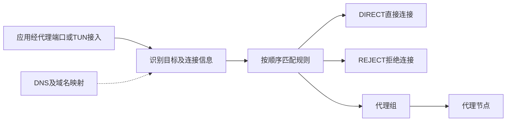

*图4-9 mihomo处理连接的基本路径*

mihomo可以接入多种代理协议，但“支持Trojan”不等于支持所有Trojan-Go扩展，“支持VLESS”也不代表所有版本的扩展均可使用。导入节点前，应核对核心版本、字段和扩展支持。

### 4.3.2 Clash配置文件结构

一份基本配置包含接入端口、DNS、节点、代理组和规则。下面是mihomo的完整配置骨架，节点凭据需替换；SS-A对应前面的Shadowsocks 2022服务，VLESS-B对应前面的VLESS、TLS与Vision服务。

```yaml
mixed-port: 7890
allow-lan: false
bind-address: 127.0.0.1
mode: rule
log-level: info

dns:
  enable: true
  listen: 127.0.0.1:1053
  enhanced-mode: fake-ip
  fake-ip-range: 198.18.0.1/16
  default-nameserver:
    - 223.5.5.5
  nameserver:
    - https://dns.alidns.com/dns-query
  proxy-server-nameserver:
    - https://dns.alidns.com/dns-query

proxies:
  - name: SS-A
    type: ss
    server: ss.example.com
    port: 8388
    cipher: 2022-blake3-aes-128-gcm
    password: "<Base64编码的16字节随机密钥>"
    udp: true

  - name: VLESS-B
    type: vless
    server: proxy.example.com
    port: 443
    uuid: b18c6e28-5eb5-4bf7-b9be-d039f4978031
    encryption: none
    flow: xtls-rprx-vision
    network: tcp
    tls: true
    servername: proxy.example.com
    skip-cert-verify: false
    udp: true

proxy-groups:
  - name: Proxy
    type: select
    proxies:
      - Auto
      - SS-A
      - VLESS-B

  - name: Auto
    type: url-test
    proxies:
      - SS-A
      - VLESS-B
    url: https://www.gstatic.com/generate_204
    interval: 300
    tolerance: 50

rules:
  - DOMAIN-SUFFIX,lan,DIRECT
  - DOMAIN-SUFFIX,example.org,Proxy
  - IP-CIDR,127.0.0.0/8,DIRECT,no-resolve
  - IP-CIDR,10.0.0.0/8,DIRECT,no-resolve
  - IP-CIDR,172.16.0.0/12,DIRECT,no-resolve
  - IP-CIDR,192.168.0.0/16,DIRECT,no-resolve
  - IP-CIDR6,::1/128,DIRECT,no-resolve
  - IP-CIDR6,fc00::/7,DIRECT,no-resolve
  - MATCH,Proxy
```

`mixed-port`接受HTTP和SOCKS接入，普通应用可按支持情况使用`127.0.0.1:7890`。监听回环地址并关闭局域网接入，适合单机使用。配置中的`udp: true`声明节点的相关转发能力，但应用接入方式仍需支持UDP；HTTP代理设置不会自动接管应用的所有UDP流量。

**DNS与fake-ip**

`dns.enable`启用的是核心内置解析服务，`listen`指定其监听地址。系统需要通过DNS转发、TUN接管或其他集成方式，把查询交给该服务；浏览器自带DoH也可能使用独立路径。仅把内置DNS监听在1053端口，不会改变操作系统的解析配置。

fake-ip模式维护域名与合成IP之间的映射。当应用连接该IP时，核心可利用映射还原域名并执行规则。

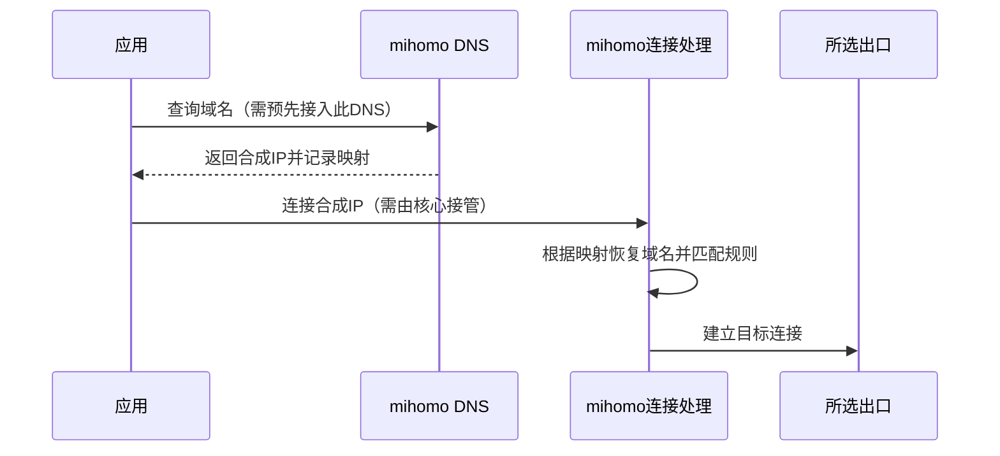

*图4-10 fake-ip依赖DNS查询与后续连接共同进入核心*

示例中的`198.18.0.0/16`位于专用测试地址范围，用作合成地址，不是目标网站的真实地址。若应用获得合成IP后绕过核心直接连接，通常无法正常访问；部署时需保证DNS映射与连接接管配套，并按需要排除不适合fake-ip的本地服务。

`default-nameserver`用于解析上游DNS服务自身的域名等引导查询，`proxy-server-nameserver`专门处理代理节点域名。这样可以明确节点地址的解析来源，避免为了连接节点而先依赖该节点。DoH保护到解析服务的传输，但解析服务仍能看到查询；选用某个公共DNS也不能保证结果必然正确或所有查询都经过代理。

### 4.3.3 代理组类型详解

代理组决定新连接使用哪个出口。四种常用类型各有明确用途：

| 类型 | 选择机制 | 适用边界 |
|------|----------|----------|
| `select` | 用户或控制接口指定成员 | 适合固定出口或人工选择 |
| `url-test` | 定期比较到指定URL的探测结果 | 反映探测路径的可用性与响应时间，不测量最大带宽 |
| `fallback` | 按成员优先顺序选择可用出口 | 适合主备切换，探测间隔影响故障发现时间 |
| `load-balance` | 按散列、会话缓存或轮转分配连接 | 分散多条连接，不聚合单条连接的带宽 |

下面的`proxy-groups`条目可按需合并到前面的配置中，成员均引用已有的SS-A与VLESS-B：

```yaml
proxy-groups:
  - name: Manual
    type: select
    proxies:
      - SS-A
      - VLESS-B

  - name: Test
    type: url-test
    proxies:
      - SS-A
      - VLESS-B
    url: https://www.gstatic.com/generate_204
    interval: 300
    tolerance: 50

  - name: Backup
    type: fallback
    proxies:
      - SS-A
      - VLESS-B
    url: https://www.gstatic.com/generate_204
    interval: 300

  - name: Balance
    type: load-balance
    proxies:
      - SS-A
      - VLESS-B
    url: https://www.gstatic.com/generate_204
    interval: 300
    strategy: consistent-hashing
```

`url-test`中的`tolerance`用于减少因小幅探测差异而频繁切换，单位为毫秒。探测URL应能通过各候选出口正常访问；某个探测站点响应快，并不意味着所有业务都更快。

`fallback`在探测确认故障后可以为后续连接选择备用节点，但原有TCP连接通常不能无缝迁移。视频、下载或长连接应用可能仍需重连。

负载均衡的`consistent-hashing`根据目标信息作一致性散列，`sticky-sessions`按源与目标等信息维护会话选择，`round-robin`轮转分配连接。节点集合变化、故障及缓存失效都可能改变出口。账号登录等依赖出口一致性的业务宜使用固定选择，不能把散列策略视为永不变更的身份保证。

### 4.3.4 规则类型详解

规则按书写顺序匹配，通常由第一个命中的规则决定策略。`MATCH`用于最终兜底，应放在具体规则之后。

| 规则类型 | 示例 | 说明 |
|----------|------|------|
| `DOMAIN` | `DOMAIN,www.example.org,Proxy` | 完整域名匹配 |
| `DOMAIN-SUFFIX` | `DOMAIN-SUFFIX,example.org,Proxy` | 匹配该域及其子域 |
| `DOMAIN-KEYWORD` | `DOMAIN-KEYWORD,example,Proxy` | 关键词匹配，范围可能大于预期 |
| `IP-CIDR` | `IP-CIDR,192.168.0.0/16,DIRECT,no-resolve` | 匹配IPv4网段 |
| `IP-CIDR6` | `IP-CIDR6,fc00::/7,DIRECT,no-resolve` | 匹配IPv6网段，此处为唯一本地地址范围 |
| `DST-PORT` | `DST-PORT,22,Proxy` | 按目标端口匹配，不判断实际应用协议 |
| `PROCESS-NAME` | `PROCESS-NAME,example-app.exe,Proxy` | 按进程名匹配，依赖系统、权限及接管方式 |
| `RULE-SET` | `RULE-SET,WorkDomains,Proxy` | 引用已定义的规则集 |
| `GEOIP` | `GEOIP,CN,DIRECT` | 依赖IP归属数据库，结果并非地理位置保证 |
| `MATCH` | `MATCH,Proxy` | 匹配此前尚未命中的连接 |

`no-resolve`用于避免为了匹配某条IP规则而额外触发域名解析，并不表示系统内不会发生其他解析。域名匹配能否生效，也取决于核心是否得到原始域名、DNS映射或可用的嗅探信息。

规则集可以来自内联内容、本地文件或HTTP下载。以下是可与4.3.2配合使用的内联域名规则集；`rules`仅展示引用位置，合并时应保留必要的本地网络规则：

```yaml
rule-providers:
  WorkDomains:
    type: inline
    behavior: domain
    payload:
      - "+.example.org"

rules:
  - RULE-SET,WorkDomains,Proxy
  - MATCH,Proxy
```

这里的`+.example.org`用于匹配该域及其子域。使用外部规则文件时，需核对`behavior`、`format`与文件内容是否一致，并确认更新来源可信。普通域名列表、YAML的`payload`列表和完整配置文件并非同一种格式。

### 4.3.5 实用配置案例

可把通用出口、工作服务和媒体服务分别交给不同代理组。下面保留4.3.2中的接入端口、DNS与`proxies`，**替换其整个`proxy-groups`和`rules`，并新增`rule-providers`**。合并后每个顶层字段只保留一份。

```yaml
rule-providers:
  WorkDomains:
    type: inline
    behavior: domain
    payload:
      - "+.example.org"

proxy-groups:
  - name: Auto
    type: url-test
    proxies:
      - SS-A
      - VLESS-B
    url: https://www.gstatic.com/generate_204
    interval: 300
    tolerance: 50

  - name: Backup
    type: fallback
    proxies:
      - SS-A
      - VLESS-B
    url: https://www.gstatic.com/generate_204
    interval: 300

  - name: Proxy
    type: select
    proxies:
      - Auto
      - Backup
      - SS-A
      - VLESS-B

  - name: Work
    type: select
    proxies:
      - VLESS-B
      - SS-A

  - name: Media
    type: select
    proxies:
      - SS-A
      - VLESS-B

rules:
  - DOMAIN-SUFFIX,lan,DIRECT
  - IP-CIDR,127.0.0.0/8,DIRECT,no-resolve
  - IP-CIDR,10.0.0.0/8,DIRECT,no-resolve
  - IP-CIDR,172.16.0.0/12,DIRECT,no-resolve
  - IP-CIDR,192.168.0.0/16,DIRECT,no-resolve
  - IP-CIDR6,::1/128,DIRECT,no-resolve
  - IP-CIDR6,fc00::/7,DIRECT,no-resolve
  - RULE-SET,WorkDomains,Work
  - DOMAIN-SUFFIX,netflix.com,Media
  - DOMAIN-SUFFIX,youtube.com,Media
  - MATCH,Proxy
```

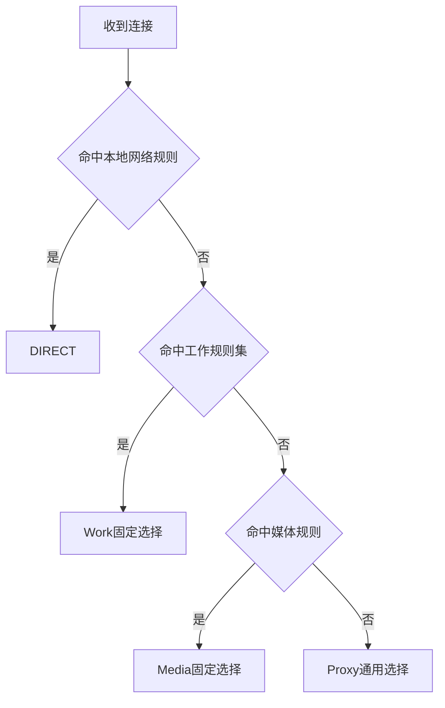

*图4-11 按规则顺序划分连接用途*

媒体域名仅用于展示规则组织方式，不是完整的服务域名清单，也不保证地区内容可用。实际服务可能使用额外的登录、静态资源或第三方域名；调试时应结合连接日志观察，并避免用过宽的关键词规则代替准确的匹配。

该示例把未匹配连接交给Proxy，便于理解其默认出口。若需要按网络归属分流，应另行引入并维护适当的数据集，同时处理IPv6、DNS和规则顺序，不能只凭域名后缀判断服务所在地区。

## 4.4 WireGuard现代VPN

### 4.4.1 WireGuard优势

WireGuard工作在网络层，将IP包通过加密隧道交给对等端。它采用固定的现代密码套件，通过公钥标识对等端，配置项较少，并在多个操作系统中提供内核或用户态实现。

与应用代理相比，WireGuard更适合连接主机、内网或整段网络；应用通常无需逐个配置SOCKS或HTTP代理。移动端地址变化后，对等端可以根据有效认证报文更新通信端点，但实际恢复时间仍受网络可达性、NAT状态和上层连接影响。

性能需要结合操作系统实现、CPU、MTU、线路与负载测量。不能脱离测试条件，给WireGuard、OpenVPN或IPsec指定统一的吞吐量和CPU占用。

### 4.4.2 WireGuard配置实战

以下以Linux的wg-quick为例，先建立一个只访问隧道网段的最小配置。假设服务器的UDP 51820端口可达，且`10.77.0.0/24`不与两端已有网络冲突。

两端各自生成密钥，在各自受保护的目录中执行：

```bash
umask 077
wg genkey > wg-private.key
wg pubkey < wg-private.key > wg-public.key
```

只交换公钥，私钥分别留在本机。配置文件中也包含私钥，应限制读取权限。下面的占位字符串需要替换为实际密钥。

服务端`/etc/wireguard/wg0.conf`：

```ini
[Interface]
PrivateKey = <服务器私钥>
Address = 10.77.0.1/24
ListenPort = 51820

[Peer]
PublicKey = <客户端公钥>
AllowedIPs = 10.77.0.2/32
```

客户端`/etc/wireguard/wg0.conf`：

```ini
[Interface]
PrivateKey = <客户端私钥>
Address = 10.77.0.2/32

[Peer]
PublicKey = <服务器公钥>
Endpoint = wg.example.com:51820
AllowedIPs = 10.77.0.0/24
PersistentKeepalive = 25
```

客户端的`AllowedIPs`将目标为`10.77.0.0/24`的流量指向该对等端。服务端的`AllowedIPs`则将`10.77.0.2/32`关联到此客户端，同时限制它通过隧道提交的源地址。多个客户端应使用各自的密钥和明确分配的隧道地址。

`PersistentKeepalive = 25`让客户端在需要时定期发送保活报文，适用于维持NAT或状态防火墙映射。它不等于通用NAT穿透，也不能让被网络阻断的UDP端口自动可达。

配置保存后，在具备相应权限的两端分别运行：

```bash
wg-quick up wg0
wg show wg0
```

可从客户端访问服务器的`10.77.0.1`，并检查最新握手和收发计数。使用systemd的Linux系统可按需启用开机启动：

```bash
systemctl enable wg-quick@wg0
```

停止隧道使用：

```bash
wg-quick down wg0
```

`Address`等字段由wg-quick处理，并不属于`wg setconf`可直接读取的全部原生格式。上述配置只建立隧道网络，尚未把服务器设置为互联网出口，也没有替换系统DNS。

### 4.4.3 分流配置（部分流量走WireGuard）

分流首先是路由选择问题。wg-quick通常根据`AllowedIPs`安装路由，WireGuard再根据相应前缀选择对等端。更复杂的策略可以结合路由表和系统策略路由，但需要同时检查系统路由与对等端允许的地址范围。

假设服务器还能访问远端内网`10.88.0.0/24`，客户端可以把其Peer中的一行改为：

```ini
AllowedIPs = 10.77.0.0/24, 10.88.0.0/24
```

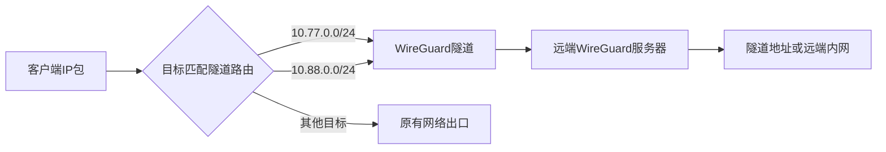

*图4-12 按目标网段进行WireGuard分流*

访问服务器自身的隧道地址只需相应的输入防火墙规则；访问服务器背后的内网则还需要服务器开启IP转发、放行转发流量，并让远端网络知道如何返回`10.77.0.2`。可以配置回程路由，或在确有需要时使用范围明确的源地址转换。实际出口接口和防火墙体系应以服务器环境为准。

如果要把默认IPv4流量交给服务器，可将客户端改为：

```ini
AllowedIPs = 0.0.0.0/0
```

这时服务器必须具备相应的互联网出口、IPv4转发、转发防火墙及回程路由或源地址转换。仅增加默认前缀不会完成这些设置。DNS及IPv6也需单独设计：`0.0.0.0/0`只覆盖IPv4，原生IPv6连接仍可能走原有网络；要同时承载IPv6，需有可用的IPv6隧道与出口，再配置相应地址和`::/0`。

`0.0.0.0/1`与`128.0.0.0/1`合起来同样覆盖全部IPv4地址，并不表示“仅国外地址”。按网络归属分流需要维护相应CIDR数据或采用更高层的路由规则，WireGuard本身不识别域名归属和国家地区。

### 4.4.4 WireGuard与科学上网

WireGuard适合可信设备之间的远程接入、站点互联，以及网络允许UDP隧道时的出口连接。它保护设备到对等端之间的IP包；服务器访问互联网时，服务器仍是流量路径中的信任节点。

标准WireGuard协议具有自己的握手和数据报特征，并不以伪装HTTP或TLS为目标。网络若限制UDP或特定隧道协议，连接可能受到影响。外部封装也会增加部署、MTU和排障成本，不能仅因采用加密就推导出流量无法识别。

选择WireGuard时，应先确认业务需要网络层互联还是应用层代理，再评估路由、DNS、IPv6与防火墙配置。它与规则代理可以配合使用，但需明确谁负责接管、谁负责路由，以避免循环转发或同一流量重复进入隧道。

## 4.5 其他协议对比

### 4.5.1 协议综合对比

协议的速度、连接成功率和流量特征会受到线路、实现和配置影响。下面的星级只用于 **入门时快速扫读**，不是绝对排名，也不代表匿名保证。

| 协议/组合 | 速度 | 安全性 | 特征适配 | 配置难度 | 推荐度 | 备注 |
|-----------|------|--------|----------|----------|--------|------|
| **VLESS + REALITY** | ★★★★★ | ★★★★★ | ★★★★★ | ★★★★ | ✅✅✅ 强推荐 | 组件较多，需核对版本和参数 |
| **Trojan + TLS** | ★★★★ | ★★★★★ | ★★★★ | ★★★★ | ✅✅ 推荐 | 依赖证书、域名和正确回落 |
| **Hysteria 2** | ★★★★★ | ★★★★ | ★★★★ | ★★★★ | ✅ 特定场景推荐 | 弱网可试，依赖UDP |
| **VLESS + TLS** | ★★★★ | ★★★★★ | ★★★★ | ★★★ | ✅✅ 推荐 | 证书和传输配置要匹配 |
| **VMess + TLS** | ★★★★ | ★★★★ | ★★★ | ★★★ | ★ 兼容优先 | 适合已有服务，先确认维护状态 |
| **Shadowsocks 2022** | ★★★★ | ★★★★ | ★★★ | ★★ | ✅ 轻量方案 | 配置简单，需保管预共享密钥 |
| **ShadowsocksR** | ★★★ | ★★★ | ★★★ | ★★★★ | ⚠️ 兼容优先 | 主要用于已有SSR服务 |
| **WireGuard** | ★★★★★ | ★★★★★ | ★★ | ★★ | ✅✅ 网络互联推荐 | 网络层VPN，特征与UDP可达性需评估 |

**怎样读这张表？**

- 想让浏览器或指定应用走代理：优先看VLESS、Trojan、Shadowsocks。
- 想让整台设备或内网互联：优先看WireGuard。
- 网络丢包较多且UDP可用：可以测试Hysteria 2。
- 已经有旧服务：先看兼容性和维护状态，不要只看星级。

Xray、V2Ray和mihomo是运行这些协议的核心或平台，不是表中的协议名称。一个核心支持某协议，也不代表它支持该协议的所有扩展。

### 4.5.2 选择建议

先看用途，再看协议，最后看实际线路。不要只按“最快”或“最隐蔽”选择。

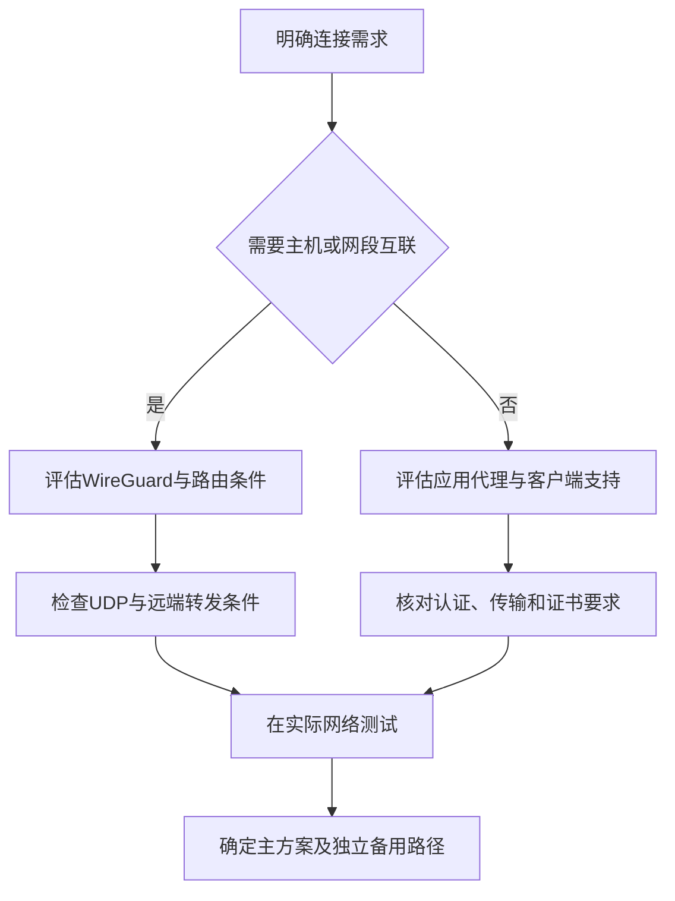

*图4-13 从连接需求到协议选型的基本顺序*

- **应用代理**：先确认客户端支持的协议、传输和UDP能力。
- **VLESS/Trojan**：需要核对证书、域名、认证和传输组合。
- **REALITY**：需要理解密钥、`serverName`和目标要求，不能当成“无需维护”。
- **Hysteria 2**：先确认UDP可达，再比较丢包、时延和持续速度。
- **WireGuard**：先确认路由、DNS、IPv6、转发和回程路径。
- **备用方案**：尽量使用不同的服务器、IP或上游线路；同一端点上的多个协议可能一起失效。

### 4.5.3 协议组合策略

多个服务可以部署在同一服务器上，但应先规划监听地址、TCP/UDP和TLS终止位置。同一个IP的TCP 443与UDP 443可以分别被不同服务使用；多个独立TCP服务通常不能同时占用同一个监听地址与端口。

下面展示一种可行的端口分工，而非可直接运行的完整部署配置：

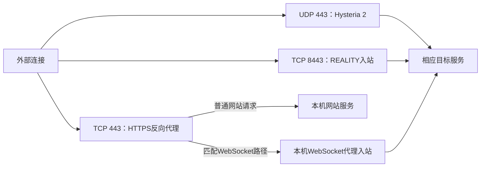

*图4-14 按传输协议、端口与HTTP路径分配服务*

TCP 443前端终止TLS后，可以根据实际HTTP请求把网站流量与WebSocket代理分开。后端协议、路径和头部需对应，不能把原始Trojan或REALITY数据直接挂到Nginx的`/trojan`、`/reality`路径下：这些原始连接并不是带有该URL路径的HTTP请求。

TLS直通、按SNI分流和核心自身的回落机制属于其他架构，需要各自满足握手与后端协议条件。它们与HTTP路径反向代理的处理层次不同，不能把其中一层的配置直接搬到另一层。

如果将前面的示例同时部署到一台服务器，必须相应调整冲突的TCP监听端口，并同步更新客户端。各节中的本地代理端口也只需为实际运行的客户端分配，避免多个程序同时监听`127.0.0.1:1080`。

## 本章小结

Shadowsocks、VMess、VLESS和Trojan描述了不同的代理通信方式；Hysteria 2基于QUIC承载代理业务；WireGuard提供网络层隧道。V2Ray、Xray和mihomo则把协议、传输、DNS与路由组合成可使用的工具。

配置时，应先确认实现与版本，再核对两端认证材料、加密模式、传输方式和监听地址。TLS证书、REALITY参数、Shadowsocks密钥以及WireGuard公钥各自有明确用途，不能因字段名称相似而混用。

分流与自动选择解决的是路径安排问题。其效果取决于接入范围、DNS路径、规则顺序与出口能力；协议名称、探测延迟和混淆层数都不能单独证明匿名性、吞吐量或可达性。

下一章将介绍各平台客户端的使用方法，以及如何把这些配置落实到日常连接中。

---

**实践任务：**

1. 选择一种实现，核对一组服务端与客户端的凭据、端口、传输和加密设置，并完成配置检查。
2. 在可控环境运行一个代理连接，分别检查TCP访问、DNS解析位置以及所需的UDP功能。
3. 使用mihomo为指定测试域名编写规则，并通过连接日志验证命中的策略与实际出口。
4. 建立仅访问隧道网段的WireGuard连接，说明增加远端内网或默认路由前还需完成哪些配置。
5. 在相同线路和负载下比较两个方案，记录测试条件、时延、吞吐及失败情况，分析差异来自协议还是环境。

**延伸阅读：**

- [Shadowsocks协议文档](https://shadowsocks.org/doc/)与[Shadowsocks 2022规范](https://shadowsocks.org/doc/sip022.html)
- [Shadowsocks Rust项目与配置说明](https://github.com/shadowsocks/shadowsocks-rust)
- [V2Fly文档](https://www.v2fly.org/)与[Xray配置文档](https://xtls.github.io/config/)
- [REALITY项目说明](https://github.com/XTLS/REALITY)
- [Trojan协议规范](https://trojan-gfw.github.io/trojan/protocol)
- [Hysteria 2文档](https://v2.hysteria.network/)与[协议规范](https://github.com/apernet/hysteria/blob/master/PROTOCOL.md)
- [mihomo配置文档](https://wiki.metacubex.one/config/)
- [WireGuard协议说明](https://www.wireguard.com/protocol/)、[wg手册](https://git.zx2c4.com/wireguard-tools/about/src/man/wg.8)与[wg-quick手册](https://git.zx2c4.com/wireguard-tools/about/src/man/wg-quick.8)
