# 第5章 客户端工具使用指南

客户端把协议、DNS、路由和操作系统的网络接入方式组合起来。选择工具时，除了界面和协议名称，还应确认软件的维护情况、所用核心、配置格式，以及哪些应用的流量能够进入客户端。本章按平台介绍安装、导入、连接与验证的方法。

图形客户端、代理核心与服务器配置是三个不同的组成部分。图形界面负责管理配置和呈现状态，核心负责实际处理连接，远端服务器则提供对应的代理服务。更新其中一个组成部分后，仍需核对其余部分的兼容性。

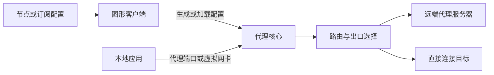

*图5-1 图形客户端、代理核心与服务器之间的关系*

**先区分接入范围与路由模式**

系统代理、TUN和“规则／全局”控制的是不同环节，不能互相替代。

| 设置 | 决定什么 | 主要边界 |
|------|----------|----------|
| 系统代理 | 向遵循该设置的应用提供代理地址 | 应用可能忽略设置，UDP通常不因此被接管 |
| 应用内代理 | 由应用明确连接HTTP或SOCKS代理 | 只影响相应应用及其支持的业务 |
| TUN或移动端VPN接口 | 通过虚拟网络接口接收匹配路由的IP包 | 范围受路由、应用列表、IPv6及系统限制影响 |
| 规则模式 | 对已进入核心的连接逐条匹配规则 | 需要可用的域名、IP等匹配信息 |
| 全局代理模式 | 将已进入核心的连接交给所选代理策略 | 不会让原本绕过客户端的应用自动进入核心 |
| 直连模式 | 将已进入核心的连接直接发往目标 | 核心和虚拟接口仍可能继续运行 |

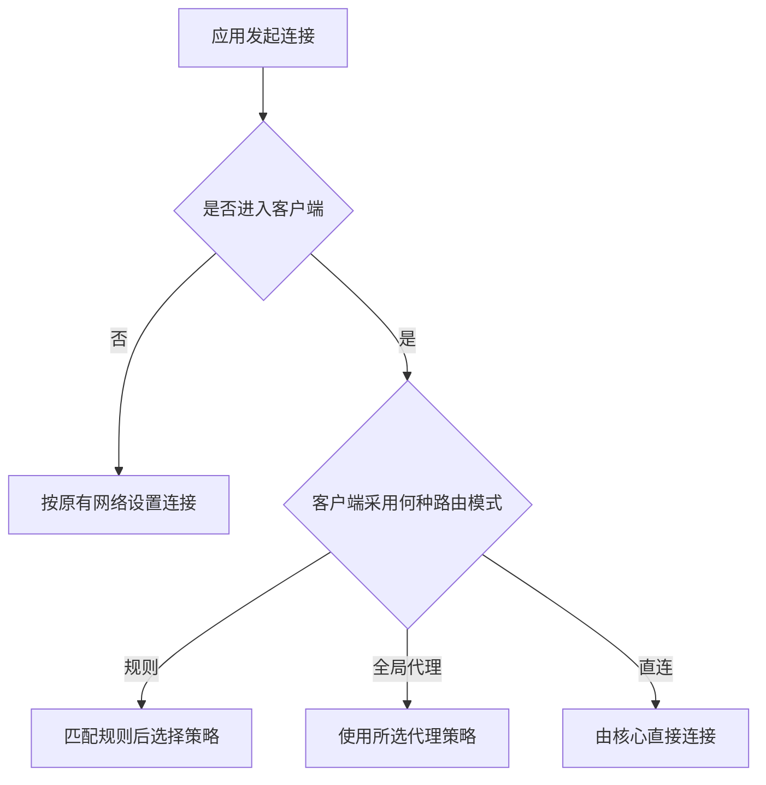

*图5-2 接入方式与核心路由模式分别影响不同环节*

本章操作按功能说明，不固定某一版本的按钮位置。安装前应从项目主页、官方文档或开发者发布页进入下载渠道；根据CPU架构与系统版本选择稳定发布包。导入后先检查配置、启动核心，再启用接入方式，最后用日志与实际请求验证。

## 5.1 Windows平台

### 5.1.1 Clash 客户端与替代方案

Clash for Windows（CFW）已于2023年停止维护。现行Clash系客户端通常使用mihomo，但它们各自管理配置、系统代理、服务和覆写，不能把旧CFW设置文件原样视为通用格式。

常见的图形客户端包括：

| 客户端 | 项目来源 | 使用特点 |
|--------|----------|----------|
| Clash Verge Rev | [clash-verge-rev/clash-verge-rev](https://github.com/clash-verge-rev/clash-verge-rev) | 提供mihomo配置管理、系统代理、TUN与配置增强 |
| FlClash | [chen08209/FlClash](https://github.com/chen08209/FlClash) | 提供跨平台配置管理、代理组、连接日志与TUN接入 |
| Clash Party | [mihomo-party-org/clash-party](https://github.com/mihomo-party-org/clash-party) | 沿袭Mihomo Party的项目体系，提供配置覆写与订阅管理等功能 |

Clash Verge Rev是对原Clash Verge项目的延续，下载时应核对完整项目名。Mihomo Party与Clash Party也应按对应项目的发布页区分，不依据旧文章中的仓库地址或相近图标判断来源。NekoRay原项目已声明不再维护，不再作为新安装的主要示例。

**安装与首次连接**

以Clash Verge Rev为例，可按以下顺序完成基本使用：

1. 从项目发布页选择与系统、CPU匹配的稳定安装包，安装后确认应用能够启动，内置核心可正常运行。
2. 在配置管理页导入本地mihomo YAML，或添加该客户端支持的订阅地址。完整配置、节点列表和分享链接并非同一格式，应选择对应导入入口。
3. 更新并选中要使用的配置，检查核心是否报告不支持的字段、重复名称或缺失的规则资源。
4. 在代理组中选择出口，先使用系统代理接入支持它的应用，并保持规则模式。
5. 发起一次测试请求，检查连接记录中的规则、策略和出口；需要覆盖更多应用时，再按文档配置TUN及其服务组件。

安装包可能已经包含核心，不能把首次启动时下载核心视为所有版本的固定步骤。系统代理与TUN也不必无条件同时开启，应根据接入需要和客户端文档选择，避免与其他VPN或代理服务重复接管。

**从CFW迁移**

迁移前备份订阅地址、自定义规则、必要的节点参数和覆写逻辑。订阅地址常包含访问令牌，应像凭据一样保存；向他人提交日志或截图时，应去除这些内容。

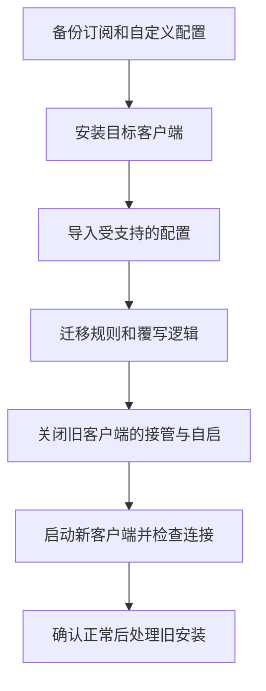

*图5-3 迁移客户端时先保存配置，再切换网络接管*

CFW的Mixin、脚本API、目录布局和Premium专有功能可能需要重写。应把自定义内容放进目标客户端支持的覆写或合并机制中，并检查最终交给核心的配置；直接修改订阅下载文件，往往会在下次更新时被覆盖。

### 5.1.2 v2rayN

[v2rayN](https://github.com/2dust/v2rayN)是图形化配置管理器，支持Xray、sing-box等核心，并提供Windows、Linux与macOS版本。核心选择会影响可用协议、扩展、DNS和路由行为，它不只是一个性能开关。

**安装与导入**

从项目发布页及“发布文件介绍”选择安装包。便携包通常解压后运行，安装包和不同界面构建的文件布局可能不同；所需运行时与附带核心也应以该发布包的说明为准。

导入服务器常见有三种方式：

- **订阅**：在订阅或分组管理中添加地址，更新后检查节点数量及错误信息。
- **分享链接或二维码**：通过剪贴板、图片或应用支持的扫码方式导入，不一定需要摄像头。
- **手动填写**：选择协议后填写地址、端口、认证材料、传输与TLS参数，再检查生成的配置。

例如，VLESS加REALITY节点除了地址和UUID，还需匹配服务端的flow、握手域名、公钥和short ID。分享链接若丢失扩展字段，列表里出现节点名称也不代表配置完整。参数含义可参照第4章，字段名称则以当前客户端为准。

**接入与路由**

选中节点后，确认对应核心启动成功，再启用系统代理或配置TUN。路由预设只处理进入核心的连接；使用按地址归属分流的预设时，还需确认规则数据可用、DNS设置匹配，并检查IPv6的处理。

TCP连通测试、经代理的HTTP延迟测试和下载测速测量的对象不同。TCP端口可达不能证明代理认证成功；延迟较低也不能证明持续吞吐较高。排查时应先验证一次完整请求，再比较性能。

### 5.1.3 Qv2ray与旧客户端迁移

[Qv2ray原项目](https://github.com/Qv2ray/Qv2ray)已在2021年宣布停止维护，其旧插件和核心路径设置主要用于理解既有安装。新环境应选择有适配当前系统与核心版本的客户端，而不是按旧教程继续安装整套插件。

迁移时，可先导出受支持的分享链接，或记录服务器地址、认证参数和传输设置，再在新客户端中建立节点。GUI数据库、插件目录和整份旧配置不一定可以直接导入；由旧界面生成的JSON也可能含有新核心已移除的字段。

保留旧环境用于核对参数时，应先关闭其系统代理、TUN和开机启动。切换后如无法联网，先检查系统代理是否仍指向已退出的旧程序，再检查新核心日志与监听端口，不宜同时启动多个客户端尝试覆盖设置。

### 5.1.4 Windows平台对比

| 工具 | 主要配置体系 | 适合的管理方式 | 需要留意 |
|------|--------------|----------------|----------|
| Clash Verge Rev | mihomo配置与客户端覆写 | 管理完整YAML、代理组及规则 | 最终配置与覆写顺序、TUN服务状态 |
| FlClash | mihomo配置与客户端设置 | 跨设备使用相近的配置管理流程 | 各平台权限、接入方式及功能差异 |
| Clash Party | 以实际选择的核心与配置为准 | 订阅管理、配置覆写 | 核心选择、客户端扩展及配置兼容 |
| v2rayN | 节点管理与所选核心配置 | 逐项编辑节点、切换核心和路由 | 核心支持范围及生成配置 |
| Qv2ray原项目 | 历史V2Ray与插件体系 | 核对或迁移既有环境 | 已停止维护，不用于新安装示例 |

选择时应优先考虑配置来源是否匹配、所需协议能否完整表达，以及维护和排障是否方便。界面风格、程序体积或单次延迟不宜作为安全性和综合性能的替代指标。

## 5.2 macOS平台

### 5.2.1 ClashX系列与现行替代方案

ClashX与ClashX Pro是旧教程中常见的macOS客户端名称。原有仓库与分发地址不能作为现行安装流程的可靠依据；新环境可根据系统版本和架构，选择Clash Verge Rev、FlClash等项目的macOS发布包。

Apple Silicon设备应选用arm64或适配的通用构建，Intel设备应选用x64构建。安装DMG中的应用后，将其放入“应用程序”目录，再按系统提示处理首次启动与必要的网络权限。来源无法确认时，应重新核对项目发布页和签名信息，而不是关闭整个系统的软件验证机制。

Clash系配置可按5.1.1的顺序导入。启用系统代理后，应检查当前使用的Wi-Fi或以太网服务是否采用了正确的本地地址与端口；不同网络服务可能保留不同的代理设置。

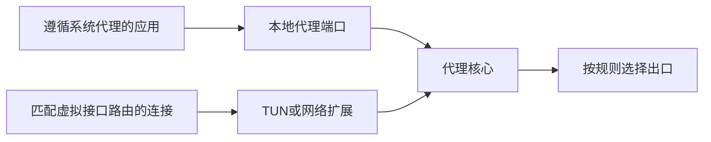

*图5-4 macOS中系统代理与虚拟接口的两种接入路径*

虚拟接口可以覆盖更多不使用系统代理的应用，但仍需处理路由排除、DNS与IPv6。客户端退出后，应确认系统代理已恢复；系统提示安装辅助服务或网络扩展时，也应核对其用途与所属应用。

### 5.2.2 Surge

[Surge](https://nssurge.com/)提供代理路由、连接记录、DNS管理与网络调试功能。macOS与iOS产品具有共同的配置概念，但授权、系统接入方式和部分功能存在差异。价格与许可范围应以官方购买页面为准。

Surge使用分节的纯文本配置，主要由`[General]`、`[Proxy]`、`[Proxy Group]`和`[Rule]`组成。它不是mihomo YAML，即使支持同一种代理协议，也不能直接互换整份配置。

下面以支持Shadowsocks 2022的Surge版本为例，连接第4章的SS服务。部署时需替换域名和密钥：

```ini
[General]
loglevel = notify
dns-server = system

[Proxy]
SS-A = ss, ss.example.com, 8388, encrypt-method=2022-blake3-aes-128-gcm, password=<Base64编码的16字节随机密钥>, udp-relay=true

[Proxy Group]
Proxy = select, SS-A, DIRECT

[Rule]
IP-CIDR,127.0.0.0/8,DIRECT,no-resolve
IP-CIDR,10.0.0.0/8,DIRECT,no-resolve
IP-CIDR,172.16.0.0/12,DIRECT,no-resolve
IP-CIDR,192.168.0.0/16,DIRECT,no-resolve
DOMAIN-SUFFIX,example.org,Proxy
FINAL,Proxy
```

加载配置后，在Proxy组选择SS-A，再通过请求列表检查实际使用的策略。示例使用系统DNS，并未提供完整的DNS接管方案；局域网名称解析、IPv6和虚拟接口设置应根据所选接入方式补充。

Surge Mac可通过系统代理或增强模式接入流量。增强模式使用虚拟接口，覆盖范围与支持的IP协议、排除路由等有关。它并不会让ICMP等任意协议都通过远端代理转发。

模块用于增加规则、HTTP处理或脚本等功能，加载前需要理解其作用范围。按域名拒绝连接与解密HTTPS是不同操作：前者通常不需要安装根证书，后者会改变TLS信任关系。日常代理也不需要开启MITM。

### 5.2.3 V2RayX / V2RayU

V2RayX与V2RayU是分别开发的macOS客户端，不能仅按名称将后者理解为前者的通用增强版。它们常见于较早的V2Ray配置资料，原有界面字段与捆绑核心不一定覆盖当前协议扩展。

维护既有安装时，应核对应用实际运行的核心版本、CPU架构、节点参数及监听端口。只替换核心二进制也可能遇到命令行或配置格式不兼容，需先保留可恢复的配置并检查启动日志。

新环境可评估v2rayN的macOS版本，或使用[sing-box的Apple平台客户端](https://sing-box.sagernet.org/clients/apple/)。前者侧重节点与核心管理，后者加载sing-box配置；分享链接、节点订阅、Xray JSON与sing-box JSON并非相同格式，应按目标客户端的导入能力迁移。

### 5.2.4 macOS平台推荐

| 需求 | 可评估的工具 | 选择依据 |
|------|--------------|----------|
| 使用mihomo YAML与代理组 | Clash Verge Rev、FlClash | 配置来源、系统兼容和覆写管理 |
| 管理不同协议节点与核心 | v2rayN | 当前macOS发布包和核心支持情况 |
| 使用sing-box原生配置 | sing-box的macOS客户端 | 配置版本及网络扩展支持 |
| 需要连接分析与HTTP调试 | Surge | 调试功能、平台差异与许可范围 |

先让一种接入方式正常工作，再增加增强模式、复杂DNS或调试模块，便于从日志判断变化的影响。不同工具并存时，应由一个工具负责同一范围的网络接管。

## 5.3 Android平台

### 5.3.1 Clash for Android与替代客户端

原Clash for Android（CFA）的发布渠道已不再适合作为新安装入口。Clash系Android客户端包括[Clash Meta for Android](https://github.com/MetaCubeX/ClashMetaForAndroid)和FlClash等独立项目，应分别核对包名、发布来源及内置核心。

本节以FlClash的常见操作为例：

1. 从项目发布页选择适合设备架构的APK。多数手机使用arm64-v8a，其他设备应按实际架构选择。
2. 在配置管理中导入受支持的订阅或mihomo YAML，更新后选中配置，并检查是否成功加载。
3. 选择代理组与节点，启动服务，允许Android创建VPN连接。
4. 发起请求并查看连接记录，确认应用流量、规则与出口符合预期。
5. 如需分应用控制，再调整允许或排除的应用列表，并重新验证。

Android的VPN授权用于让应用通过`VpnService`创建虚拟网络接口，不代表它使用了WireGuard或某一种固定VPN协议。状态栏的钥匙或VPN图标说明系统存在VPN连接，也不能单独证明远端代理已认证成功。

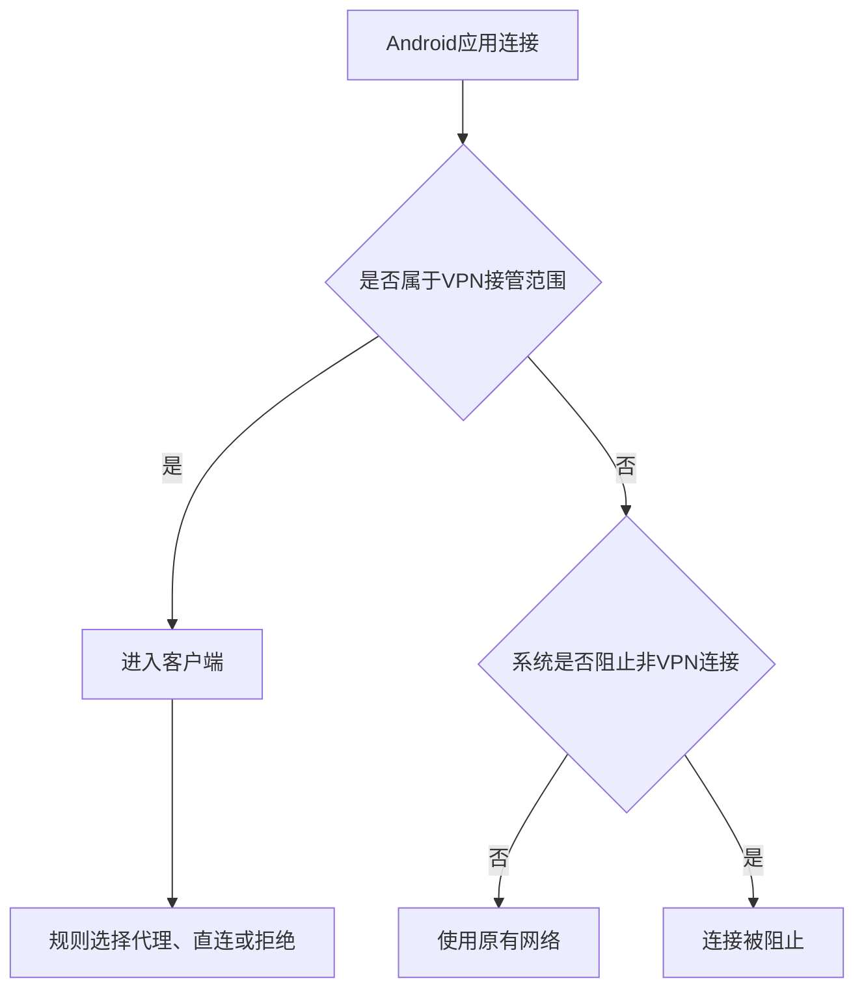

*图5-5 分应用接管与系统阻断设置共同决定连接结果*

允许列表通常用于仅接管指定应用，排除列表用于让指定应用绕过该VPN。被排除的应用是否还能直连，还受“阻止不使用VPN的连接”等系统设置影响。一个用户或工作资料中通常只能有一个处于活动状态的常规VPN服务，其他VPN或使用同一接口的广告过滤工具可能与之冲突。

DNS模式也需要与接管方式配合。fake-ip便于保留域名映射，但不适合所有应用和本地服务；选择真实IP响应模式时，同样应检查解析路径与规则匹配。不能仅凭模式名称判断性能、隐私或兼容性。

### 5.3.2 v2rayNG

[v2rayNG](https://github.com/2dust/v2rayNG)是Android上的代理客户端，项目支持Xray与V2Fly相关核心。实际安装包包含的核心及其版本决定可用功能，不能将其描述为自动支持所有V2Ray协议与扩展。

安装时优先从项目发布页或其明确列出的商店入口下载。跨来源更新若遇到签名不一致，应核对安装来源，先备份配置；不要把名称相同的APK视为同一个发行版本。

**导入与连接**

可在服务器管理中使用剪贴板导入、二维码导入、订阅管理或手动添加。保存后逐项检查服务器地址、端口、认证、传输和TLS设置，再选中该节点启动VPN连接。订阅更新入口及图标可能随版本变化，应以当前应用的功能名称为准。

连接失败时，可按以下顺序定位：

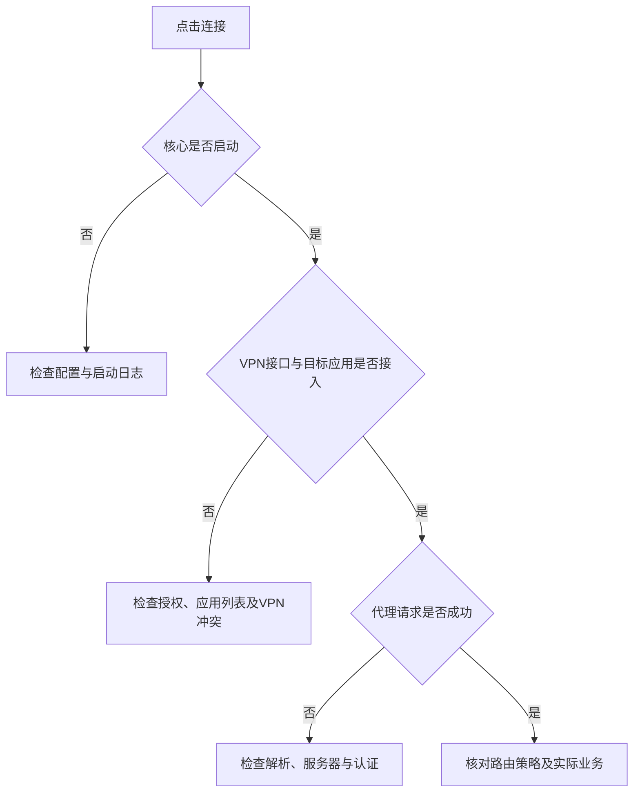

*图5-6 从本地启动到远端请求逐层排查Android连接*

路由预设和分应用代理控制不同环节。先确认目标应用已进入VPN，再检查它命中的域名或IP规则。修改核心、规则数据或DNS后，应重新查看连接记录，避免仅依据列表中的测试延迟判断结果。

如果锁屏后连接反复中断，可检查应用的后台运行限制、电池策略与服务状态，并按设备说明给予必要的后台权限。网络切换、服务被系统回收和远端故障需要分别判断，不能都归因于“节点不稳定”。

### 5.3.3 SagerNet与sing-box客户端

SagerNet旧应用与sing-box是不同项目。SagerNet项目曾公开征求维护者，旧应用的插件、订阅转换和配置说明不能直接当作sing-box客户端的现行用法。

[sing-box for Android（SFA）](https://sing-box.sagernet.org/clients/android/)由项目提供，主要用于管理和运行本地或远程sing-box配置，并通过Android VPN接口实现透明接入。它适合需要使用sing-box原生DNS、路由和出站配置的用户。

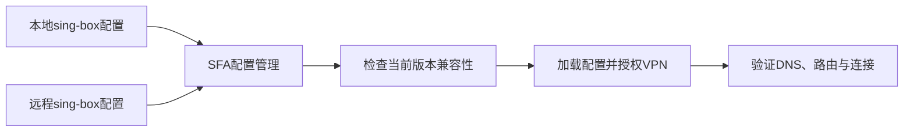

*图5-7 sing-box原生配置在Android客户端中的加载流程*

导入远程配置前，应确认其内容是目标版本支持的sing-box配置。Clash YAML、Xray JSON或一串节点链接不能仅通过修改文件扩展名变为这种配置。sing-box的DNS、路由及部分出站字段存在版本迁移要求，升级时应阅读相应的迁移文档。

### 5.3.4 Android平台对比

| 工具 | 主要管理对象 | 适合的配置来源 | 核对重点 |
|------|--------------|----------------|----------|
| FlClash | mihomo配置、代理组与规则 | 兼容的订阅或YAML | 核心版本、覆写及分应用设置 |
| Clash Meta for Android | Clash系配置与mihomo相关能力 | 对应项目支持的配置 | 发行来源和内置核心版本 |
| v2rayNG | 节点、路由与所选核心 | 受支持的链接、订阅或手动参数 | 协议扩展、核心与VPN接管 |
| SFA | sing-box原生配置 | 本地或远程sing-box配置 | 配置版本和平台功能支持 |

选择时可先按现有配置格式缩小范围，再验证实际协议与接管能力。节点测试、分应用接入、系统DNS和后台存活都需要单独检查，无法用一组统一星级概括。

## 5.4 iOS平台

### 5.4.1 Shadowrocket (小火箭)

[Shadowrocket](https://apps.apple.com/app/id932747118)提供节点管理、规则路由与连接记录等功能。应从App Store的正式产品页核对应用和开发者；其开发者为Shadow Launch Technology Limited。应用的可用性、价格及系统要求随商店地区和版本变化，应以账号所在商店的实际页面为准。

**添加与连接**

在应用中选择相应入口，导入分享链接、二维码、订阅，或手动填写服务器参数。订阅节点加载后，还需选定服务器和全局路由方式，再开启连接并允许系统添加VPN配置。

“配置”“代理”“直连”等路由选项决定进入客户端的连接如何处理，不等于安装应用后全机流量已经得到相同保护。首次使用应检查连接记录中的目标、规则与策略，并用实际业务验证。

**节点订阅、完整配置与规则集**

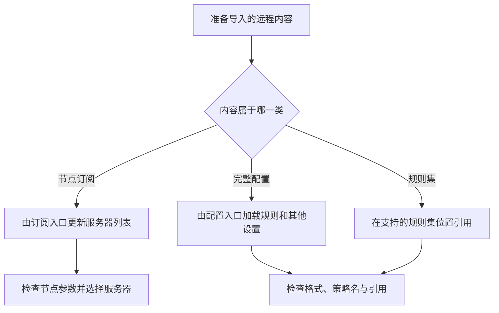

*图5-8 不同远程内容应进入对应的配置入口*

只有域名或分流条目的文本列表不是完整配置，不能直接当作整份配置导入。其他工具的规则集也可能具有不同的字段和策略名，需要确认格式支持。

下面是Shadowrocket配置的`[Rule]`片段，用于说明规则顺序。它需要合并到应用已有的有效配置中，`PROXY`使用所选代理策略：

```ini
[Rule]
IP-CIDR,127.0.0.0/8,DIRECT,no-resolve
IP-CIDR,10.0.0.0/8,DIRECT,no-resolve
IP-CIDR,172.16.0.0/12,DIRECT,no-resolve
IP-CIDR,192.168.0.0/16,DIRECT,no-resolve
DOMAIN-SUFFIX,example.org,PROXY
FINAL,PROXY
```

按需连接可以根据网络条件尝试自动建立或断开连接，具体触发规则由应用与系统支持决定。设置后应分别测试Wi-Fi、移动网络和网络切换场景，不能把开关开启等同于持续连接保证。

### 5.4.2 Surge

Surge iOS通过系统网络扩展接入流量，配置概念可参照5.2.2，但不能把macOS的进程匹配、命令行或网关功能原样套用到iOS。购买与授权范围也需按平台确认。

日常使用可以先加载有效配置，选择代理策略，启动连接，再在请求列表中检查域名、规则、出口和错误。需要HTTP调试时，再针对具体功能增加模块或脚本。

**HTTPS调试与MITM**

MITM在客户端与目标之间终止并重新建立TLS，使工具能够处理原本加密的HTTP内容。它需要系统或应用信任工具生成的本地CA，并将目标列入解密范围。


*图5-9 MITM使端到端TLS变为两段由调试工具衔接的连接*

这与普通HTTPS隧道转发不同：工具此时能够读取选定连接的明文。只应对需要调试且有权处理的目标启用相应范围，并保护包含CA私钥的配置。调试结束后，可关闭解密并按需移除额外的证书信任。

某些应用使用证书固定或独立的信任机制，会拒绝这种连接；开启MITM并不保证能解密所有应用。安装根证书也不是使用代理、分流或按域名拒绝连接的必要步骤。

### 5.4.3 Quantumult X (圈X)

[Quantumult X](https://apps.apple.com/app/id1443988620)提供节点、策略、过滤规则及HTTP重写等功能，开发者为Cross Utility Ltd。其配置语法与Surge、Shadowrocket和mihomo不同，应使用该项目文档或应用内示例。

配置中的`[server_remote]`用于远程节点资源，`[filter_remote]`用于远程过滤资源，`[rewrite_remote]`用于远程重写资源。这些入口不能仅因内容都来自URL而相互替代。

以下片段假设已经导入并命名了Node-A和Node-B两个节点，用于展示手动策略、备用策略及本地过滤规则，不是一份包含节点的完整配置：

```ini
[policy]
static = Select, Node-A, Node-B, Backup
available = Backup, Node-A, Node-B

[filter_local]
ip-cidr, 127.0.0.0/8, direct
ip-cidr, 10.0.0.0/8, direct
ip-cidr, 172.16.0.0/12, direct
ip-cidr, 192.168.0.0/16, direct
host-suffix, example.org, Select
final, Select
```

`static`由用户选择成员，`available`依据可用性与顺序选择成员。应用还提供网页响应延迟等测试策略，测量结果依赖测试地址和路径，不代表最大下载速率。切换出口也不能保证已有连接自动迁移。

导入重写或脚本时，应先确认它适用的域名、协议及权限，并观察是否影响正常请求。对HTTPS内容进行读取和改写通常还涉及相应的解密设置；仅加载一条URL规则，并不会自动获得明文内容。

### 5.4.4 iOS平台对比

| 工具 | 主要使用方式 | 需要核对 |
|------|--------------|----------|
| Shadowrocket | 管理节点、订阅和分流配置 | 订阅与配置格式、路由策略及协议扩展 |
| Surge | 规则路由、请求分析与HTTP调试 | 平台差异、许可及调试范围 |
| Quantumult X | 策略管理、过滤资源与重写 | 资源类型、配置语法及节点引用 |
| sing-box的iOS客户端 | 加载sing-box原生配置 | 商店可用性、系统要求及配置版本 |

应用的购买价格不包含远端代理服务，也不能说明某一节点是否可用。应根据配置兼容、所需功能和维护方式选择工具，再分别验证TCP、所需UDP、DNS与IPv6的路径。

## 5.5 Linux平台配置

### 5.5.1 命令行工具

Linux可以直接运行代理核心，也可以通过图形客户端生成和管理配置。发行版软件包、上游发布包与容器镜像可能包含不同版本，应先核对来源、CPU架构及配置格式。

**运行mihomo**

从[mihomo项目发布页](https://github.com/MetaCubeX/mihomo/releases)或可信的软件源安装适合本机的二进制，将程序放入可执行路径。以下命令假设`mihomo`已经安装，且以普通用户运行本地代理。

```bash
mihomo -v
mkdir -p "$HOME/.config/mihomo"
```

将第4章的mihomo配置保存为`$HOME/.config/mihomo/config.yaml`，替换节点凭据，并限制文件读取权限：

```bash
chmod 600 "$HOME/.config/mihomo/config.yaml"
mihomo -t -d "$HOME/.config/mihomo"
```

配置检查通过后，前台运行：

```bash
mihomo -d "$HOME/.config/mihomo"
```

前台运行便于查看启动日志，按Ctrl+C结束。本地HTTP与SOCKS接入可使用配置中的混合端口`127.0.0.1:7890`。命令行运行核心不会自动设置桌面代理；TUN还需相应权限、路由和DNS配置，不能仅依赖上述启动命令。

**其他核心**

Shadowsocks Rust可使用第4章的客户端配置，以`sslocal -c ss-client.json`运行。其命令和支持的方法不能与Shadowsocks-libev的`ss-local`混用，旧libev版本也不应直接加载Shadowsocks 2022配置。

Xray可使用前章的客户端文件，先执行`xray run -test -config xray-client.json`，再运行核心。V2Fly与sing-box应使用各自的安装说明和配置检查方式，不能仅替换程序名称后沿用Xray文件。

长期运行时，可使用发行包提供的systemd服务，或为确定的配置建立服务单元。启用前应确认实际的执行程序、运行用户和配置路径；普通代理监听通常不需要让整个图形界面以root身份运行。

### 5.5.2 图形化工具

Clash Verge Rev、FlClash和v2rayN提供Linux构建，可按项目发布说明选择deb、rpm、AppImage或其他受支持包。系统最低版本、图形依赖和架构需要分别确认。

使用deb或rpm包时，可由发行版包管理器处理对应依赖。AppImage通常需要授予该文件执行权限，部分系统还需兼容库；应使用具体文件名操作，避免把目录中所有下载文件一并标记为可执行。

Linux桌面环境对系统代理、托盘和自动启动的支持不同。客户端中的“系统代理”开关未必影响所有桌面、浏览器和命令行程序，必要时应在桌面网络设置或应用内配置代理。

Qv2ray原项目不再维护，运行Windows版CFW的Wine方案也不作为新安装流程。优先使用相应项目提供的原生Linux版本，能够减少代理设置与系统权限之间的额外兼容问题。

### 5.5.3 浏览器代理设置

Linux中的桌面代理、浏览器代理与终端环境变量通常是不同的配置入口。Firefox可在自身网络设置中选择系统代理或手动代理；其他浏览器如何采用桌面设置，应以其版本和运行环境为准。

**终端程序的代理变量**

假设mihomo的混合端口为7890，可在当前shell中设置：

```bash
export http_proxy='http://127.0.0.1:7890'
export https_proxy='http://127.0.0.1:7890'
export all_proxy='socks5h://127.0.0.1:7890'
```

`https_proxy`的值仍可使用`http://`，因为这里描述的是本地代理的接入协议，HTTPS目标通常通过CONNECT隧道访问。`socks5h`表示由代理侧处理目标域名，但并非所有工具都支持该写法或这些环境变量。

HTTP变量应指向HTTP或混合端口，SOCKS变量应指向SOCKS或混合端口。第4章Xray示例的1080是SOCKS端口，不能仅因为端口能够连接，就把它写为HTTP代理。

环境变量通常只影响当前shell及其后续启动、且愿意读取变量的程序，不是全系统接管。先临时验证，再决定是否写入shell启动文件。撤销上述设置可执行：

```bash
unset http_proxy https_proxy all_proxy
```

如果还设置了大写变量，也应检查相应值，并按工具说明处理。

**明确指定路径进行检查**

```bash
curl --proxy http://127.0.0.1:7890 https://www.example.com/
curl --socks5-hostname 127.0.0.1:7890 https://www.example.com/
curl --noproxy '*' https://www.example.com/
```

前两条分别检查HTTP与SOCKS接入，第三条让curl绕过应用层代理设置。若系统启用了TUN，第三条请求仍可能被虚拟接口接管，不能把它当作物理出口直连的证明。

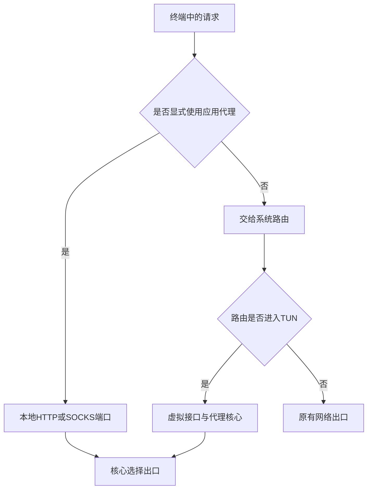

*图5-10 应用代理检查与系统路由检查不能相互替代*

**proxychains的使用边界**

proxychains-ng可为部分动态链接程序拦截网络调用。以Debian或Ubuntu提供的`proxychains4`包为例，安装后按其文档编辑`/etc/proxychains4.conf`，选择代理链方式并配置`[ProxyList]`。例如混合端口可作为SOCKS代理：

```text
[ProxyList]
socks5 127.0.0.1 7890
```

在没有另行配置应用代理变量的终端中，可测试：

```bash
proxychains4 curl https://www.example.com/
```

这种方式主要处理受支持的TCP调用，不是通用的UDP、ICMP或全进程接管方案。静态链接程序、受限制的进程或浏览器沙箱可能不适用。DNS行为还取决于proxychains的DNS配置和程序自身的解析方式，支持应用内代理时通常更容易明确路径。

## 5.6 路由器端配置

### 5.6.1 支持的路由器固件

路由器能否运行代理，首先取决于具体型号、硬件修订、CPU架构、内存、存储与固件支持，而不是仅看品牌或芯片系列。

| 固件体系 | 基本定位 | 部署前需要确认 |
|----------|----------|----------------|
| OpenWrt | 支持多种设备的开源路由系统 | 设备支持表、具体版本、软件源及内核模块兼容 |
| Asuswrt-Merlin | 面向部分华硕设备的固件项目 | 精确型号、固件分支及扩展来源 |
| Padavan及其分支 | 针对特定设备的第三方固件体系 | 具体分支维护情况和功能构建，不能假定都内置代理 |

路由器原有系统若已提供所需能力，不一定需要刷机。需要更换固件时，应先查阅项目的设备支持说明，备份当前配置，并确认恢复方法。相同型号的不同硬件版本也可能使用不同固件。

代理会额外消耗CPU、内存与连接跟踪资源。除持续吞吐外，还应考虑并发连接、规则集大小、DNS缓存和UDP处理能力，不能从无线标称速率推导代理性能。

### 5.6.2 OpenWrt安装代理

[OpenClash](https://github.com/vernesong/OpenClash)是面向OpenWrt的LuCI管理插件，用于管理mihomo及相关配置与流量接管。LuCI插件、运行核心和防火墙规则各有作用，安装管理界面不等于透明代理已经生效。

**核对系统与软件包体系**

先在LuCI系统信息页查看固件版本、目标架构与可用空间，也可通过SSH查看：

```bash
ubus call system board
```

OpenWrt 25.12及更新版本使用apk，24.10等较早版本使用opkg；衍生固件应以实际环境为准。两种包管理器使用不同的包格式，这里的OpenWrt `.apk`也不是Android安装包。

| 环境 | 更新软件索引 | 本地包格式 |
|------|--------------|------------|
| 使用opkg的固件 | `opkg update` | `.ipk` |
| 使用apk的固件 | `apk update` | `.apk` |

不能因为系统名都是OpenWrt，就混用软件源、内核模块和包格式。常见的Firewall4使用nftables，旧版或特定构建可能采用iptables；安装依赖时需要匹配当前防火墙体系。

**安装与加载配置**

1. 根据OpenClash项目说明，从发布页获取对应包管理体系的安装包，核对版本、来源与依赖要求。它不一定存在于固件默认软件源中，不能假定一条安装包名的命令即可完成部署。
2. 在LuCI的软件包管理中上传并安装匹配的包，或按项目文档使用相应包管理器安装已核对的本地文件。
3. 进入OpenClash管理页，按固件架构准备受支持的核心，确认核心版本和运行依赖正常。
4. 导入兼容配置，检查节点、代理组、规则集与DNS引用，再按需求选择接管方式。
5. 先限制到一台测试设备，检查该设备的网关、DNS、IPv4及IPv6路径，确认正常后再扩大范围。
6. 保存配置备份，记录停止服务及恢复原有DNS与防火墙设置的方法。

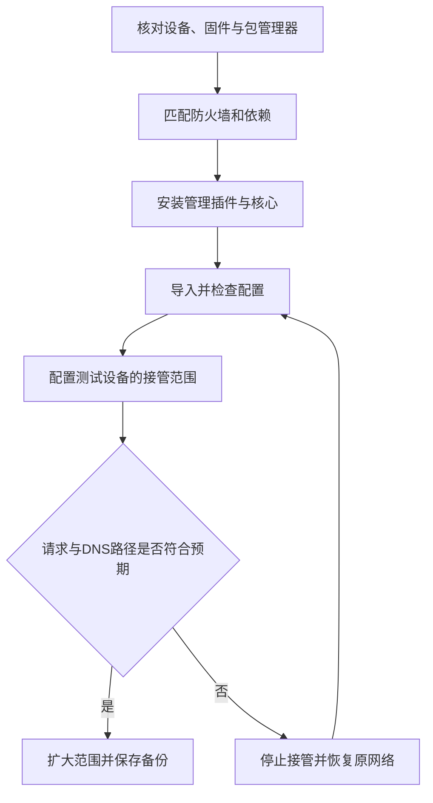

*图5-11 路由器部署先验证单台设备，再扩大接管范围*

更换DNS组件或接管方式前，应了解现有DHCP、dnsmasq、上游DNS与防火墙之间的关系。多个组件同时劫持DNS、维护fake-ip或安装透明代理规则，可能产生循环与冲突。

### 5.6.3 路由器代理优势

路由器端代理可以集中维护规则与出口，并覆盖部分不便安装客户端的设备。它的实际范围取决于设备是否以该路由器为网关、是否位于纳入接管的网络，以及对应协议是否被处理。

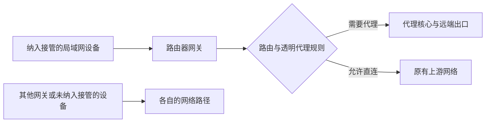

*图5-12 路由器代理只影响经过它且符合接管条件的流量*

连接同一Wi-Fi并不保证所有业务自动经过代理。访客网络、其他VLAN、独立VPN、应用自带解析、IPv6默认路由和UDP处理均可能形成不同路径。路由器自身发起的连接也可能使用不同的规则，需要单独验证。

集中部署能够减少终端配置，但也使路由器成为共同故障点。应保留本地管理通路和可恢复的配置，并通过日志与设备实测确认效果。后续的软件、规则和服务器变更仍需维护。

## 本章小结

客户端使用可以按同一个顺序展开：确认软件与核心来源，选择匹配的配置格式，核对服务器参数，启用适当的接入方式，再验证DNS、规则与实际出口。系统代理、虚拟接口和路由模式分别控制不同环节，应按需要组合。

| 平台 | 常见工具体系 | 首先确认 |
|------|--------------|----------|
| Windows | Clash Verge Rev、FlClash、Clash Party、v2rayN | 配置兼容、核心与系统代理或TUN状态 |
| macOS | Clash Verge Rev、FlClash、v2rayN、sing-box、Surge | 架构、系统版本与网络扩展 |
| Android | FlClash、Clash Meta for Android、v2rayNG、SFA | VPN授权、分应用范围与后台状态 |
| iOS | Shadowrocket、Surge、Quantumult X、sing-box | 商店可用性、配置类型与平台限制 |
| Linux | 原生命令行核心及对应图形客户端 | 监听协议、应用接入和系统路由 |
| 路由器 | 适配固件的管理插件与代理核心 | 包管理器、防火墙、网关与DNS路径 |

检查连接时，应分别确认核心是否启动、应用是否接入、认证是否成功、规则是否命中，以及所需的UDP与IPv6是否按预期处理。节点列表中的延迟、VPN图标或一个能打开的网页，都只说明其中一部分状态。

下一章将进一步介绍浏览器代理设置与插件方案。

---

**实践任务：**

1. 在自己的平台选择一个工具，记录其官方来源、核心版本和配置格式，完成节点或配置导入。
2. 分别使用系统代理或应用内代理、虚拟接口接入，观察两个应用的连接记录，说明接管范围的差异。
3. 验证一次请求的DNS路径、命中规则和实际出口，并检查需要使用的UDP与IPv6业务。
4. 备份订阅和自定义配置，演练停止接管与恢复原有网络，确认客户端退出后系统代理状态正常。
5. 如使用路由器，先在一台测试设备上完成网关、DNS与访问验证，再决定是否扩大接管范围。

**延伸阅读：**

- [Clash Verge Rev使用文档](https://www.clashverge.dev/)与[FlClash项目](https://github.com/chen08209/FlClash)
- [Clash Party项目](https://github.com/mihomo-party-org/clash-party)
- [v2rayN使用文档](https://github.com/2dust/v2rayN/wiki)与[v2rayNG项目](https://github.com/2dust/v2rayNG)
- [sing-box图形客户端与配置文档](https://sing-box.sagernet.org/clients/)
- [Surge官方手册](https://manual.nssurge.com/)
- [Quantumult X官方示例](https://github.com/crossutility/Quantumult-X)
- [Android VPN机制说明](https://developer.android.com/develop/connectivity/vpn)
- [OpenWrt软件包管理文档](https://openwrt.org/docs/guide-user/additional-software/apk)与[OpenClash项目](https://github.com/vernesong/OpenClash)
