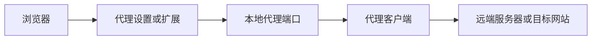
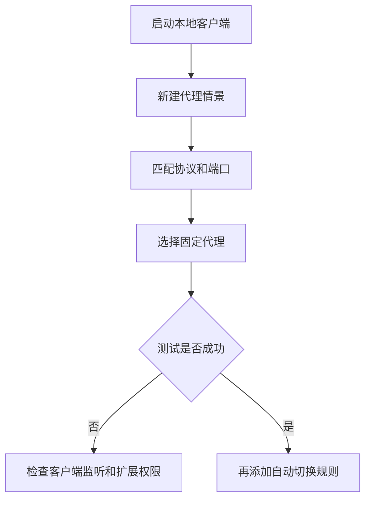
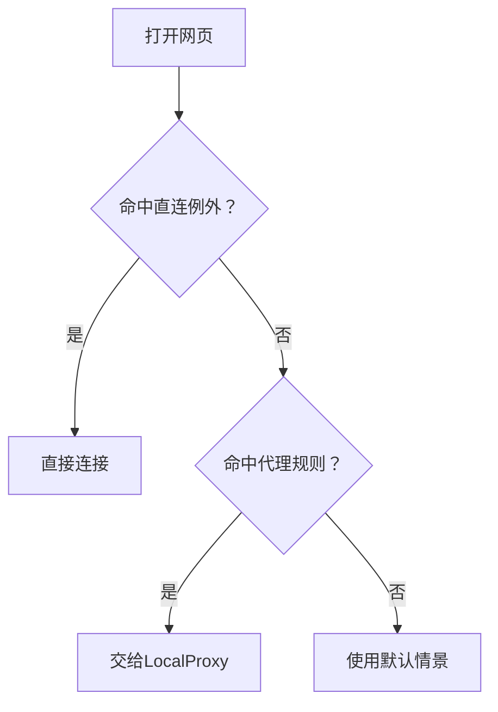
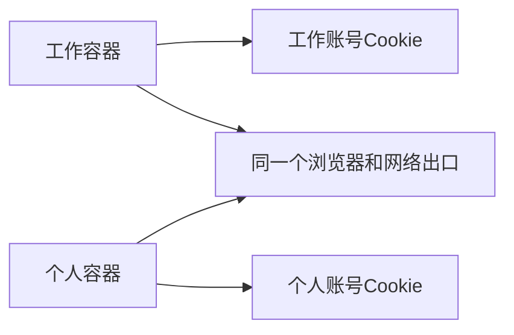

# 第6章 浏览器与插件方案

浏览器代理主要解决一个问题：**网页请求从哪里出去**。隐私设置解决的是另一个问题：**浏览器在本机保存什么、网站能收集什么**。

先记住这一条链路：



扩展只是选择本地代理入口，**不会凭空创建远程节点**。配置前先确认本地客户端正在运行，并记下它的地址、端口和协议。

**小白先看这里**

| 需求 | 直接看 | 关键提醒 |
|---|---|---|
| 让浏览器使用本地代理 | 6.1 | 地址、端口、协议必须对应 |
| 按网站自动切换 | 6.2 | 先验证固定代理，再添加规则 |
| 减少广告和跟踪 | 6.3 | 内置保护加一个可信拦截器即可 |
| 不在本机留下浏览记录 | 6.4.1 | 无痕模式不会隐藏IP |
| 工作和个人账号分开 | 6.4.2 | 容器隔离Cookie，不会分配不同IP |

## 6.1 浏览器代理设置

| 浏览器 | 代理来源 | 最简单的配置方式 |
|---|---|---|
| Chrome | 通常跟随系统 | 系统代理或代理扩展 |
| Edge | 通常跟随系统 | 系统代理或代理扩展 |
| Firefox | 可独立设置 | 浏览器“网络设置” |
| Safari | 跟随macOS网络服务 | macOS系统代理 |

**排查顺序：** 启动本地客户端 → 确认监听地址和协议 → 配置浏览器 → 打开测试网站 → 查看客户端连接记录。

### 6.1.1 Chrome

Chrome通常使用系统代理。Windows、macOS和Linux都可以在系统网络设置中填写代理地址和端口。

以常见的本地端口为例：

| 本地服务 | 协议 | 地址 | 端口 |
|---|---|---|---:|
| mihomo混合端口 | HTTP或SOCKS | `127.0.0.1` | `7890` |
| SOCKS专用端口 | SOCKS5 | `127.0.0.1` | `1080` |

系统设置里的“HTTPS代理”通常表示“访问HTTPS网站时使用哪个代理”，不是浏览器与本地代理之间自动建立TLS。填写时以客户端实际监听协议为准。

也可以只启动一个带代理参数的Chrome实例：

```powershell
chrome.exe --proxy-server="socks5://127.0.0.1:1080"
```

如果Chrome已经打开，新的参数可能不会生效。测试时关闭原窗口，或使用单独的用户目录。

### 6.1.2 Firefox

Firefox可以不依赖系统代理，适合需要单独控制浏览器代理的用户。

路径：**设置 → 常规 → 网络设置 → 设置**。

| 选项 | 怎么填 | 适用场景 |
|---|---|---|
| 不使用代理 | 直接连接 | 临时关闭代理 |
| 使用系统代理 | 跟随系统设置 | 客户端已接管系统代理 |
| 手动代理 | 填HTTP或SOCKS地址、端口 | 精确控制 |
| 自动代理配置URL | 填PAC地址 | 按规则自动切换 |

手动使用SOCKS5时，常见填写方式如下：

```text
SOCKS主机：127.0.0.1
端口：1080
SOCKS v5：勾选
使用SOCKS v5时代理DNS查询：按需勾选
```

“代理DNS查询”只影响SOCKS请求的域名解析，不能代表浏览器所有服务都经过代理。若只是入门使用，先完成网页访问测试，再处理DNS等高级问题。

### 6.1.3 Edge

Edge基于Chromium，设置方法与Chrome基本相同。

1. 启动本地代理客户端。
2. 打开 **设置 → 系统和性能 → 打开计算机的代理设置**。
3. 填写代理地址和端口，保存后访问测试网站。

也可以临时启动：

```powershell
msedge.exe --proxy-server="http://127.0.0.1:7890"
```

### 6.1.4 Safari

Safari使用macOS当前网络服务的代理设置：**系统设置 → 网络 → 当前网络 → 详细信息 → 代理**。

使用HTTP或混合端口时，可填写：

```text
网页代理（HTTP）：127.0.0.1   7890
安全网页代理（HTTPS）：127.0.0.1   7890
```

使用SOCKS专用端口时，只填写SOCKS代理项。不要把所有代理类型都勾上，除非本地客户端确实同时提供这些接口。

## 6.2 SwitchyOmega与ZeroOmega

### 6.2.1 它们是做什么的？

SwitchyOmega、ZeroOmega都是浏览器代理切换扩展，主要功能是：

- 保存多个代理配置；
- 手动切换“直连”和“代理”；
- 按网站规则自动选择代理。

它们**不提供远端服务器**，也不等于VPN。必须先有一个正在运行的HTTP或SOCKS代理服务。

原版SwitchyOmega主要基于旧的Manifest V2扩展平台，现代Chrome安装时优先选择仍在维护、来源明确的ZeroOmega或其他可信替代品。安装前核对项目主页、开发者和扩展权限。

### 6.2.2 最基础的配置

1. 打开扩展选项，新建“代理服务器”情景模式，例如命名为`LocalProxy`。
2. 协议选HTTP或SOCKS5，服务器填`127.0.0.1`，端口填本地客户端实际端口。
3. 保存后，在浏览器工具栏选择`LocalProxy`。
4. 打开测试网站，确认客户端连接记录中出现请求。
5. 固定代理确认正常后，再配置自动切换。



### 6.2.3 自动切换规则

自动切换通常包含“规则”和“默认情景”两部分：

| 设置 | 示例 | 含义 |
|---|---|---|
| 规则 | `*.example.org` → `LocalProxy` | 命中这些网站时使用代理 |
| 例外 | `localhost` → 直接连接 | 本机服务不走代理 |
| 默认情景 | 直接连接 | 没有命中规则时的处理方式 |

初学者可以先写少量规则，确认有效后再导入规则列表。规则列表格式必须匹配扩展要求，AutoProxy、PAC、IP网段列表不是同一种格式，不能直接混用。

**规则顺序很重要：** 先写明确的直连例外，再写需要代理的网站，最后设置默认情景。



### 6.2.4 常见情景模式

| 模式 | 作用 | 什么时候用 |
|---|---|---|
| 直接连接 | 不使用扩展代理 | 临时关闭代理 |
| 系统代理 | 跟随操作系统 | 客户端已设置系统代理 |
| 代理服务器 | 固定使用一个HTTP或SOCKS接口 | 最适合初次测试 |
| 自动切换 | 按规则选择情景 | 日常分流 |
| PAC | 由脚本返回代理或直连 | 有脚本需求的进阶用户 |

一个最简单的PAC示例：

```javascript
function FindProxyForURL(url, host) {
  if (host === "example.org" || dnsDomainIs(host, ".example.org")) {
    return "PROXY 127.0.0.1:7890";
  }
  return "DIRECT";
}
```

`PROXY`要对应HTTP代理，使用SOCKS时改成浏览器支持的SOCKS写法。PAC中的`DIRECT`表示直连，添加代理失败后的直连回退前，要确认这是否符合自己的需求。

### 6.2.5 导入、导出与安全

扩展的“导入/导出”可以备份情景模式和规则，但通常**不包含**本地客户端节点、系统证书和完整网络设置。恢复后仍要重新检查代理地址、端口和默认情景。

备份文件可能包含代理认证、规则地址或内部域名，不要上传到公开仓库。安装扩展时注意三点：

1. 从官方商店或项目主页进入下载页面；
2. 查看扩展权限，避免同时安装多个代理管理扩展；
3. 代理设置异常时，先停用扩展，再检查浏览器代理、系统代理和证书。

## 6.3 浏览器指纹与跟踪防护

### 6.3.1 什么是浏览器指纹？

网站可以根据浏览器和设备的组合特征识别访问者，例如：

| 信息 | 例子 |
|---|---|
| 基本环境 | 浏览器版本、语言、时区、屏幕尺寸 |
| 图形特征 | Canvas、WebGL、字体表现 |
| 网络信息 | 出口IP、WebRTC连接信息 |
| 会话信息 | Cookie、登录账号 |

代理只能改变部分网络路径，**不会自动改变语言、时区、屏幕尺寸和账号**。清除Cookie也不能让网站忘记已经收到的账号或访问记录。

### 6.3.2 小白够用的防护方式

| 方法 | 作用 | 备注 |
|---|---|---|
| 浏览器内置跟踪保护 | 限制已知跟踪器和跨站存储 | 先用默认或严格模式测试兼容性 |
| uBlock Origin | 拦截广告、脚本和跟踪请求 | 只从项目主页或官方商店安装 |
| Privacy Badger | 识别并限制部分跟踪器 | 不能阻止所有指纹采集 |
| HTTPS模式 | 优先使用加密连接 | HTTPS失败时仍需检查提示 |

不建议一次安装很多功能重复的隐私扩展。扩展越多，权限越多，网站出问题时也越难排查。

### 6.3.3 WebRTC和专业隐私浏览器

WebRTC用于网页视频通话和实时通信，网络路径可能与普通网页代理不同。需要视频会议时，不要为了“防泄漏”直接关闭它；不需要实时通信时，再根据浏览器设置评估限制。

| 浏览器 | 特点 | 适合谁 |
|---|---|---|
| Tor Browser | 默认整合Tor网络和抗指纹设置 | 有明确匿名需求的用户 |
| Brave | 内置广告、跟踪拦截和HTTPS升级 | 想少装扩展的日常用户 |
| Firefox Focus | 移动端快速清除浏览数据 | 临时、轻量浏览 |

Tor Browser不等于“登录任何账号都匿名”，Brave的Tor窗口也不能完全替代Tor Browser。使用Tor时尽量保留默认设置，不要随意安装扩展或用外部程序打开下载文件。

## 6.4 隐私浏览模式

### 6.4.1 无痕模式

| 浏览器 | Windows/Linux | macOS |
|---|---|---|
| Chrome、Edge | `Ctrl + Shift + N` | `Command + Shift + N` |
| Firefox | `Ctrl + Shift + P` | `Command + Shift + P` |
| Safari | — | `Command + Shift + N` |

无痕模式主要减少本机保存的历史记录、临时Cookie和表单数据。它**不会**自动改变网络出口。

| 项目 | 无痕模式的效果 |
|---|---|
| 浏览历史、临时Cookie | 通常在关闭窗口后清除 |
| 下载文件、书签 | 仍可能保留在设备上 |
| 出口IP | 不改变 |
| 网站看到的账号和提交内容 | 仍然能看到 |
| 网络管理员或运营商 | 仍可能观察连接 |

一句话：**无痕是“少留在本机”，不是“匿名上网”。**

### 6.4.2 Firefox容器

Firefox Multi-Account Containers可以把不同用途的Cookie和站点数据分开：



| 适合做什么 | 不能做到什么 |
|---|---|
| 工作、个人账号同时登录 | 不会自动分配不同IP |
| 减少不同账号共享Cookie | 不会自动改变浏览器指纹 |
| 为网站设置固定容器 | 不等于虚拟机或独立设备 |

### 6.4.3 隐私搜索与HTTPS模式

| 工具或功能 | 主要作用 | 注意事项 |
|---|---|---|
| DuckDuckGo | 强调减少个人追踪的搜索服务 | 仍会收到你的搜索词 |
| Startpage | 提供隐私取向的搜索入口 | 具体代理功能以当前说明为准 |
| SearXNG | 聚合多个搜索来源，可自托管 | 公共实例需要信任运营者 |
| 浏览器HTTPS-Only/HTTPS优先 | 尽量把HTTP升级为HTTPS | 不能修复无效证书 |

HTTPS Everywhere已经停止维护，现代浏览器的HTTPS优先或HTTPS-Only功能可以承担大部分相同需求。HTTPS保护传输过程，但不隐藏你主动提交的账号、搜索词和表单内容。

## 本章小结

1. 先让本地客户端运行，再让浏览器连接它；协议、地址和端口必须匹配。
2. Chrome和Edge通常跟随系统代理，Firefox可以独立设置，Safari使用macOS系统代理。
3. SwitchyOmega或ZeroOmega只负责切换代理配置，不提供远端节点。
4. 自动切换要先验证固定代理，再添加规则；规则顺序和默认情景要明确。
5. 无痕模式主要减少本机记录，容器主要隔离Cookie，二者都不会自动隐藏IP。
6. 隐私防护宜从浏览器内置设置和一个可信拦截器开始，按实际需求逐步增加工具。

**实践任务：**

1. 为Chrome、Firefox或Edge配置一个本地HTTP或SOCKS代理，并用客户端日志确认请求进入。
2. 在扩展中建立“固定代理”和“直接连接”两个情景，分别测试访问结果。
3. 添加一条只匹配`example.org`及其子域的规则，测试根域、子域和相似域名。
4. 对比普通窗口、无痕窗口和Firefox容器：检查Cookie、下载文件和出口IP是否变化。

**延伸阅读：**

- [Firefox连接设置](https://support.mozilla.org/zh-CN/kb/连接设置)
- [ZeroOmega项目](https://github.com/zero-peak/ZeroOmega)
- [Chromium代理机制](https://chromium.googlesource.com/chromium/src/+/HEAD/net/docs/proxy.md)
- [uBlock Origin项目](https://github.com/gorhill/uBlock)
- [Tor Browser用户手册](https://tb-manual.torproject.org/)
- [Firefox Multi-Account Containers](https://github.com/mozilla/multi-account-containers)
