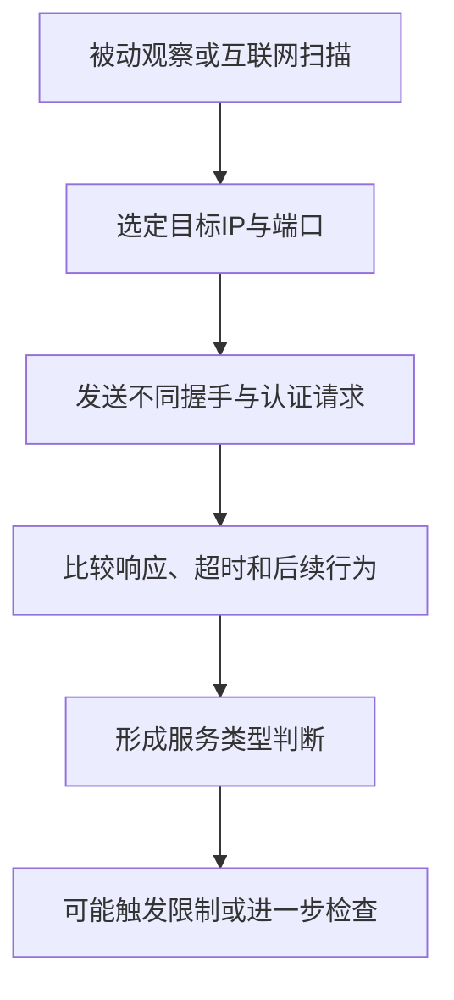
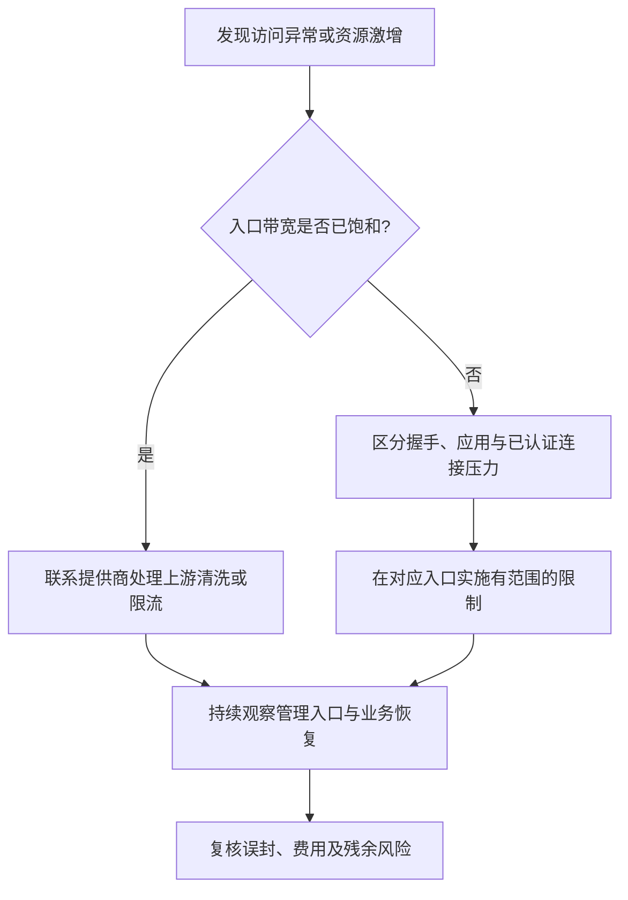
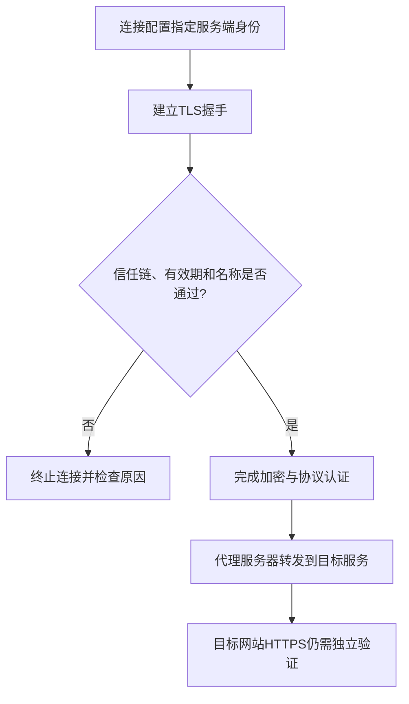
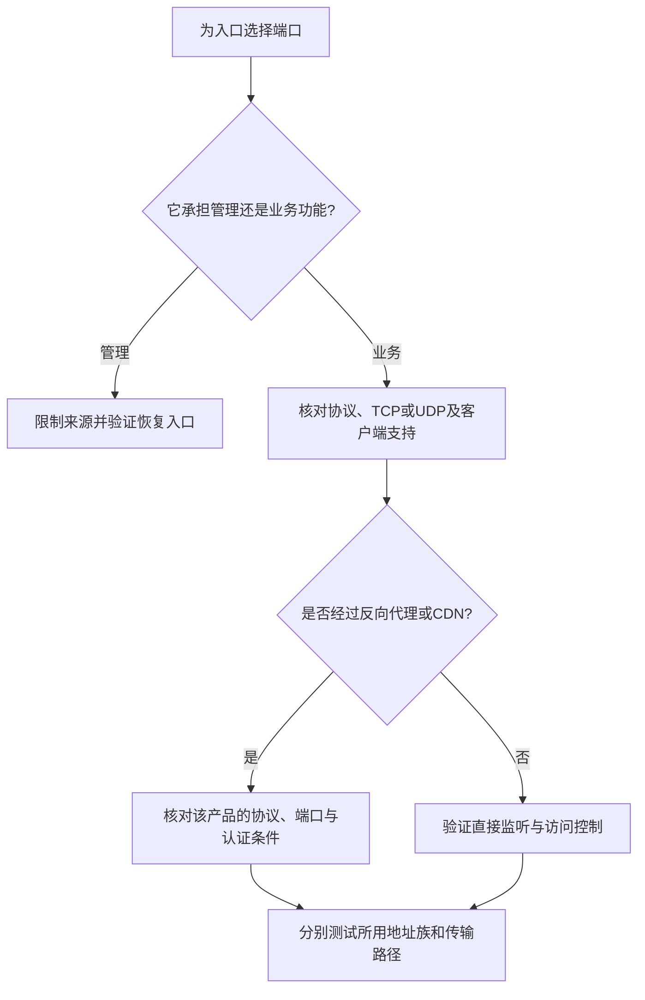
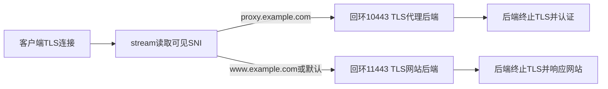
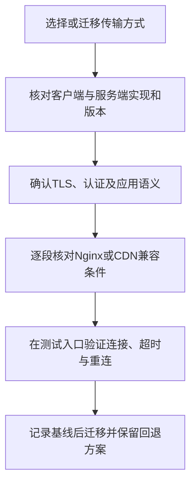
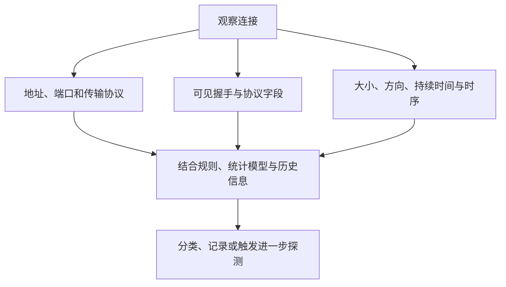
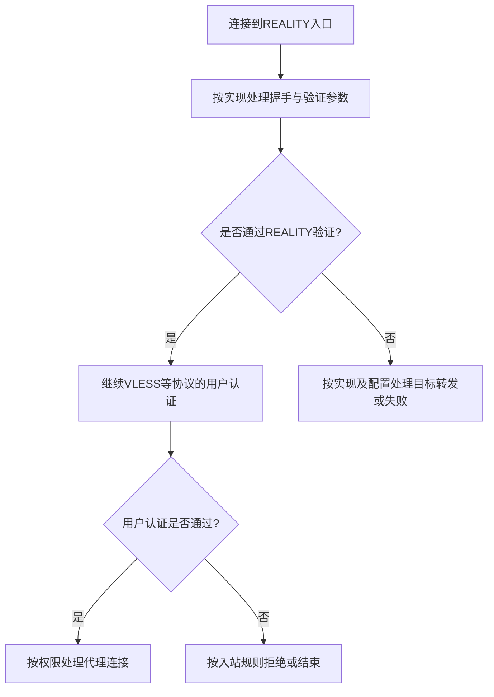
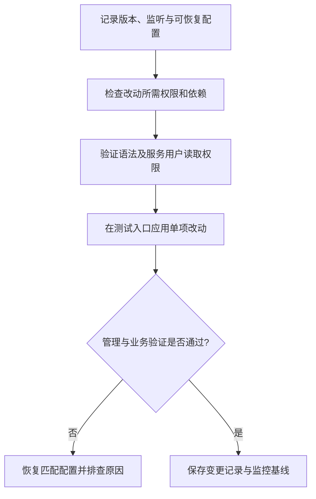
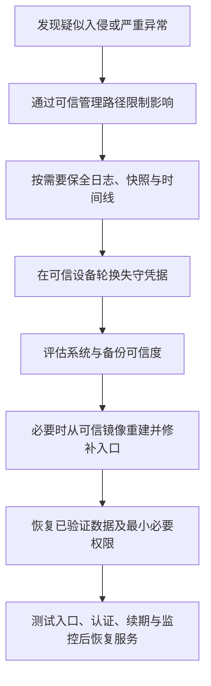

# 第14章 网络安全防护

网络安全防护需要先明确保护对象：代理凭据、管理入口、服务器数据和运行中的连接，面临的威胁并不相同。加密可以保护通信内容，访问控制可以限制入口，备份可以支持恢复；单独更换端口、增加回落网站或套用某种传输方式，都不能代替这些基础工作。

本章沿用第10—13章的Linux与systemd环境。Nginx示例面向支持相应模块的版本，V2Ray兼容示例采用`v5.53.0`，涉及Xray的版本差异以`v26.10.21`为例。配置中的`proxy.example.com`、证书路径和服务名均需按实际部署替换。修改管理入口或防火墙前，应保留有效SSH会话和云控制台恢复路径。

## 14.1 常见攻击方式

### 14.1.1 主动探测攻击

主动探测是观察者向目标服务发起连接，根据握手、认证失败、回落和超时等行为判断服务类型。它可以与被动流量分析配合，也可以来自普通互联网扫描；不能把每一次扫描或连接失败都归因于同一审查系统。



*图14-1 主动探测依靠多种可观察行为，识别与封锁并非必然连续发生*

TLS并不自动消除可识别特征。目标IP、连接时序、握手参数以及服务对异常请求的响应仍可能被观察；WebSocket和gRPC使用标准应用协议，也不意味着承载的代理流量与浏览器访问完全相同。

回落机制用于把特定的不匹配流量交给另一个服务。VLESS或Trojan的回落触发条件、TLS终止位置和后端协议均与实现有关，不能笼统地写成“任何错误密码都返回正常网页”。如果前端已经完成TLS握手，转发给后端的可能是解密后的字节，后端就不应再次要求相同的TLS握手。

防护重点是使用受维护实现、独立高熵凭据和正确的协议认证，限制管理接口，并核对异常连接的实际行为。VMess等协议中的时间验证和重放防护属于协议机制，不能把某个固定秒数当作所有实现的统一安全边界；服务器仍应保持可靠的时间同步。

### 14.1.2 DDoS攻击

分布式拒绝服务攻击可能耗尽带宽、连接状态、CPU或应用资源。处置前先区分瓶颈，否则应用层封禁可能来不及生效，简单限速也可能先影响正常使用者。

| 类型 | 常见受影响资源 | 主要应对位置 |
|------|----------------|--------------|
| SYN Flood | 握手队列、连接状态和处理能力 | 内核、边界设备与上游防护 |
| UDP Flood、反射放大 | 入站带宽、包处理能力 | 提供商网络、清洗与访问控制 |
| HTTP请求洪泛 | Web处理、认证、后端和数据库 | 兼容的反向代理、WAF与应用限制 |
| 高成本长连接 | 文件描述符、内存、核心与出口资源 | 已认证用户配额、并发限制与容量规划 |

Linux的SYN cookies用于缓解特定的SYN队列压力，不会增加线路容量，也不能处理所有TCP或UDP攻击。可以先读取现状，不反复向系统配置文件追加同一参数：

```bash
sysctl net.ipv4.tcp_syncookies
ss -s
ip -s link
```

Fail2Ban依赖可识别的失败日志和本地封禁，适合减少部分重复认证尝试，无法替代上游流量清洗。对所有来源共用的极低连接速率限制，还可能让少量连接就耗尽全站额度；增加一条匹配后放行的规则，也不代表超额流量已经被拒绝。



*图14-2 DDoS处置应先定位资源瓶颈，再选择能够覆盖该路径的防护*

**CDN的保护范围**

Cloudflare等CDN的普通反向代理主要面向支持的HTTP与HTTPS业务。兼容的WebSocket或gRPC连接还受端口、TLS、HTTP版本、功能开关、连接限制和服务条款约束；不能把直连VLESS、REALITY、任意UDP服务或SSH直接当作普通网站接入。通用TCP、UDP代理属于另外的产品能力和套餐范围。

接入时应同时验证客户端到边缘、边缘到源站两段连接。Cloudflare源站TLS可采用`Full (strict)`验证证书，不使用只加密到边缘的方式来承载敏感连接。源站还需限制直接访问，核对历史DNS、AAAA记录和其他同机服务是否暴露地址；CDN不会自动消除已经泄露的源站IP。

浏览器质询可能使代理客户端失败，不能把整站质询无条件套到代理入口。Cloudflare对WebSocket的WAF检查主要发生在初始升级请求阶段，连接建立后不会持续检查其所有消息。官方文档也说明，反向代理上的gRPC不能依赖Cloudflare Access完成认证，应另行验证访问控制方式。隐藏邮箱、地理位置请求头和强制HTTPS均不能充当DDoS防护开关。

### 14.1.3 暴力破解与凭据泄露

暴力破解只是凭据失守的一种原因。共享订阅、截图、公开配置仓库、恶意客户端和被盗面板令牌，往往能够直接提供有效秘密，不需要攻击者逐个猜测。

SSH应沿用第10章已经验证的密钥认证与管理来源限制。修改端口可以减少部分背景扫描，但不能增强密钥本身。使用systemd journal的Debian或Ubuntu环境，可先检查实际服务日志：

```bash
sudo journalctl -u ssh.service --since '1 hour ago' -n 100 --no-pager
sudo fail2ban-client status sshd
```

服务名和日志位置取决于发行版；没有`/var/log/auth.log`不等于没有认证日志。Fail2Ban还需要正确的过滤器、日志后端、实际SSH端口以及IPv4和IPv6封禁路径；不能假定代理核心的任意错误都能被SSH过滤器识别。

| 凭据 | 生成与保管原则 |
|------|----------------|
| VLESS、VMess账号 | 使用核心工具或可信随机源生成独立UUID，避免多人共用 |
| Trojan等口令 | 使用实现支持的高熵随机秘密，不依靠固定词组加符号 |
| Shadowsocks密钥 | 按加密方法规定生成；2022方法使用对应长度的随机密钥 |
| 面板与API凭据 | 独立任务、必要权限、受限存储，避免放进普通日志 |
| 订阅链接 | 视作可获取连接秘密的凭据，泄露后检查实际节点凭据 |

UUID的安全性依赖随机生成与保密，不是只要符合格式就比密码安全。轮换应由泄露、人员变化或明确的管理策略驱动，并核对旧凭据确实失效；机械地每月替换全部凭据会增加分发风险，也不能挽回已经泄露的数据。撤销订阅链接不一定撤销已下载的UUID或密码。面板中的用户启停与删除操作见第13章，订阅入口与节点凭据是否失效需分别验证。

### 14.1.4 中间人攻击与身份验证

中间人攻击要获得明文，通常还需要让客户端接受错误的服务端身份，或攻陷实际终端。DNS劫持、恶意网关可以改变连接路径，但在域名、信任链和证书验证正确时，单独返回攻击者IP并不足以通过TLS认证。自签名证书本身也不等于攻击，关键在于是否通过可信渠道预先建立了正确的信任。



*图14-3 代理入口认证与目标网站HTTPS认证分别保护不同的连接*

普通域名证书应核对Subject Alternative Name（SAN）中的名称、有效期和信任链，不能只看证书Common Name。连接目标使用IP时，也不能随意填入另一个域名来绕过身份校验。排障应修复时间、证书链、名称或可信根问题，不启用`allowInsecure`、`skip-cert-verify`等跳过验证选项作为长期方案。Xray `v26.10.21`已拒绝将`allowInsecure`设为`true`；其他实现和版本的行为需要分别核对。

证书固定是预先信任特定证书或公钥，并按客户端实现核对固定值；它需要可信的初始分发和续期、换钥方案。Xray配置中的`fingerprint: "chrome"`用于选择TLS ClientHello特征，**不是证书SHA-256摘要，也不实现证书固定**。不同软件的固定字段、对象及校验顺序可能不同，不能把浏览器显示的任意指纹直接复制到`fingerprint`。

HSTS作用于支持它的HTTP客户端。确认网站已正确提供HTTPS后，可以先在该HTTPS站点的Nginx `server`块中采用较短有效期测试：

```nginx
add_header Strict-Transport-Security "max-age=300" always;
```

验证访问及证书续期后再考虑延长有效期。`includeSubDomains`会影响全部子域，预加载还涉及额外条件和较长的撤销周期，不能未经检查就启用。HSTS通常不能修复首次访问风险，也不会自动约束普通代理核心的TLS连接。

DoH、DoT可以保护客户端到所选解析器的查询链路，但仍需验证解析器身份，并信任其处理查询。它们不替代代理或网站的证书验证，也不能阻止被攻陷终端读取明文。

### 14.1.5 流量分析

加密后仍可观察到端点、连接持续时间、方向、大小和时序。观察者有时可以据此推断服务类别或与其他记录关联；推断精度取决于观察位置、训练条件、同时可见的流量和用户行为，不能写成“加密后仍一定能知道观看的具体视频”。

| 措施 | 可能改变的特征 | 代价与边界 |
|------|----------------|------------|
| 协议支持的填充 | 某些报文或请求的长度分布 | 增加流量，不保证改变全部统计特征 |
| 多路复用 | 连接数量和部分时序 | 影响隔离、队头阻塞和拥塞，不能等同匿名保护 |
| 延迟或额外流量 | 一部分时间与体积分布 | 增加时延、成本和可识别行为，需有具体实现依据 |
| Tor等匿名网络 | 分离部分观察位置和通信关系 | 仍受终端、登录身份及流量关联等因素影响 |

不要把任意“VPN套Tor再套VPN”作为隐私上限。增加中间层也增加信任方、故障点和配置错误；是否有收益应从威胁模型判断。代理保护的是特定通信路径，浏览器登录、Cookies和应用标识仍可以识别同一使用者，相关实践将在第15章讨论。

## 14.2 端口与入口分流

### 14.2.1 端口选择策略

端口号表达约定用途，不提供密码学保护。TCP 443常用于HTTPS，但端口本身不会让任意字节变成HTTPS；8443也不会因为不是443就天然更不安全。高端口可能减少部分常规扫描，却仍可被完整扫描，也可能受到网络出口策略限制。

| 入口 | 选择依据 |
|------|----------|
| SSH与面板 | 限定管理来源或受保护通道，保留恢复路径 |
| 公网HTTPS | 依据证书、客户端支持和网络策略选择，通常使用TCP 443 |
| HTTP验证入口 | 仅在HTTP-01等实际需要时开放TCP 80，配置正确的验证路径 |
| QUIC或其他UDP协议 | 分别确认UDP监听、云侧与主机规则，不由同号TCP规则替代 |
| 回落与内部后端 | 优先绑定回环或受控内部网络，不额外暴露公网 |

Cloudflare支持2053、2083、2087、2096、8443等部分HTTPS端口，但这是HTTP代理的端口范围，不是任意协议均可穿透的许可。gRPC还有独立要求，不能从通用端口列表推导所有功能都可使用。



*图14-4 端口选择服从入口职责和实际协议，不以端口号代替安全设计*

### 14.2.2 HTTP路径分流与协议回落

**Nginx终止TLS后按HTTP路径分流**

本例采用第12章中Nginx终止TLS、V2Ray提供本地WebSocket后端的结构，以下片段按V2Ray `v5.53.0`说明，不代表第12章的安装版本。后端监听`127.0.0.1:10000`、路径为`/v2ray`、后端不再启用TLS，并保留独立VMess认证。公网TLS由Nginx终止，网站与代理升级请求共享一个TCP 443入口。以下是`http`上下文中的配置片段，应合并到现有配置，不能另起一个服务争抢同一监听地址。

```nginx
map $http_upgrade $guide_connection_upgrade {
    default upgrade;
    '' close;
}

server {
    listen 443 ssl;
    server_name proxy.example.com;

    ssl_certificate /etc/proxy-certs/proxy.example.com/fullchain.pem;
    ssl_certificate_key /etc/proxy-certs/proxy.example.com/privkey.pem;
    ssl_protocols TLSv1.2 TLSv1.3;

    root /var/www/proxy-site;
    index index.html;

    location = /v2ray {
        proxy_pass http://127.0.0.1:10000;
        proxy_http_version 1.1;
        proxy_set_header Upgrade $http_upgrade;
        proxy_set_header Connection $guide_connection_upgrade;
        proxy_set_header Host $host;
        proxy_buffering off;
        proxy_read_timeout 300s;
    }

    location / {
        try_files $uri $uri/ =404;
    }
}
```

`proxy_pass`未附加URI，保留请求路径；客户端和后端必须与之匹配。Upgrade等逐跳头不会自动传递，所以需要显式设置。读取超时是两次上游读取之间的超时，不是连接总寿命；应按真实空闲时间和心跳能力调试。

本例不要求开启HTTP/2，也不自动提供IPv6监听或HTTP-01验证站点。域名与证书申请可参阅第12章，IPv6监听和证书验证入口需按实际部署另行确认。确认后端与证书均就绪，再执行：

```bash
sudo nginx -t
sudo systemctl reload nginx.service
sudo ss -lntp 'sport = :443'
sudo ss -lntp 'sport = :10000'
```

从正常客户端验证认证连接，并检查错误路径、错误凭据和空闲连接。秘密路径只能减少误入，不能代替账号认证；普通HTTP请求到达代理路径时也不保证会得到一个真实聊天应用页面。

**由代理核心终止TLS并回落**

第12章的VLESS或Trojan回落是另一种拓扑：核心占用公网端口，符合回落条件的内容再交给本地Web服务。它不能与上例的Nginx公网443配置同时照搬使用。不同入站和版本的回落支持范围不同，应核对触发条件、解密后的协议与后端能力。

路径分流处理的是可解析的HTTP请求。直接Trojan或VLESS字节不会因为写了`/trojan`、`/vmess`就变成HTTP路径。`xver`表示传递PROXY protocol的版本；只有后端显式支持并配置该协议时才能启用，不需要传递时保持关闭。错误的PROXY头会破坏后端握手，它也不提供新的加密或认证。

### 14.2.3 SNI分流与ECH

Nginx `stream`层的`ssl_preread`可以在不终止TLS的情况下读取可见ClientHello中的SNI，将原始连接转发给相应后端。后端必须自行终止TLS；不能把完整TLS字节流交给只监听明文HTTP的端口。

下面是与15.2.2**二选一**的拓扑片段。需要安装并加载stream及ssl_preread模块；`stream`与`http`同属Nginx主配置下的上下文，不能把它放进仅从`http`包含的站点文件。

```nginx
stream {
    map $ssl_preread_server_name $guide_tls_backend {
        proxy.example.com 127.0.0.1:10443;
        www.example.com   127.0.0.1:11443;
        default           127.0.0.1:11443;
    }

    server {
        listen 443;
        ssl_preread on;
        proxy_connect_timeout 5s;
        proxy_timeout 300s;
        proxy_pass $guide_tls_backend;
    }
}
```

部署前先准备好两个TLS后端：10443处理代理入口，11443处理网站及默认流量，各自持有正确证书或对应的认证配置。这个示例不发送PROXY protocol；后端看到的网络对端通常是本机转发者，不能据此直接对真实使用者按IP计数或封禁。



*图14-5 SNI透传分流不解密连接，所有目标后端仍需正确处理TLS*

SNI是路由提示，不是访问授权，任意客户端都可以填写名称。ECH（Encrypted Client Hello，RFC 9849）用于加密内部ClientHello的敏感信息，包括实际目标SNI；启用后，中间层可能只能读到外层公开名称，不能继续假定按内部名称分流。实际使用还需要客户端、服务端和配置获取链路支持，应把ECH终止及路由位置纳入设计，而不是要求用户关闭证书验证。ECH不隐藏目标IP，也不覆盖连接时序等全部元数据。

## 14.3 传输封装及其边界

### 14.3.1 WebSocket传输

经典WebSocket通过HTTP/1.1 Upgrade建立双向连接，见14.2.2。它提供一种可由兼容HTTP基础设施转发的传输方式；路径名叫`/chat`、添加浏览器User-Agent，并不会使代理核心具备真实浏览器的全部握手与业务行为。

对于V2Ray `v5.53.0`客户端，以下是已完成账号配置的VMess outbound中使用的`streamSettings`片段，**不能单独作为完整配置启动**：

```json
{
  "streamSettings": {
    "network": "ws",
    "security": "tls",
    "tlsSettings": {
      "serverName": "proxy.example.com",
      "allowInsecure": false
    },
    "wsSettings": {
      "path": "/v2ray"
    }
  }
}
```

客户端实际连接Nginx公网地址和443端口，并验证`proxy.example.com`证书；服务端回环WS后端则不重复启用TLS。若改成另一种核心或客户端，应核对其字段和支持状态，不能把这段JSON直接用于sing-box或Mihomo。

Xray `v26.10.21`仍接受WebSocket，但会输出弃用提示并指向XHTTP；这不等于其他项目同时移除了WebSocket，也不意味着现有部署可以只改一个`network`字段完成迁移。连接稳定性还受CDN重启、空闲超时和重连策略影响。

### 14.3.2 HTTP/2与XHTTP

HTTP/2提供二进制分帧、多路复用等能力，但它不是统一的“代理混淆协议”。ALPN协商出`h2`，不代表对端接受任意代理请求；普通网站、gRPC和特定核心的HTTP传输还各自定义了应用语义。

在Xray `v26.10.21`中，旧`network: "h2"`、`"http"`及相应旧式HTTP传输已移除，不能继续使用旧`httpSettings`示例。该版本提供XHTTP，具体模式、上下行路径、TLS和代理兼容性需按其文档配置。这里不把Xray的移除状态推及V2Ray，也不把XHTTP当成其他核心的通用字段。

Nginx提供HTTP/2服务与代理核心选择哪种传输是两件事。Nginx `1.25.1`起可以使用`http2 on`，较早版本语法不同；`proxy_pass`与`grpc_pass`也不能互相替代。部署前检查`nginx -v`、`nginx -V`和对应版本模块文档。

### 14.3.3 gRPC传输

gRPC通常通过HTTP/2承载RPC，代理实现可以用它封装数据流。两端仍需匹配服务名、模式、TLS、ALPN及账号；伪装成`UserService`不会自动形成正常用户服务，也不构成认证。

以Cloudflare的gRPC反向代理为例，官方要求端点使用443、TLS、HTTP/2及相应ALPN和Content-Type，并按要求启用代理和gRPC功能。还应验证源站证书及访问控制，不能只凭“支持HTTP/2”判断能用。普通浏览器交互式质询不适合直接用于这类客户端。

Xray `v26.10.21`对gRPC仍保留兼容，但会输出弃用提示并指向XHTTP对应模式。维护现有gRPC部署时先确认两端版本与连接行为，规划迁移后再调整；不把`multiMode: true`作为普遍的安全或性能开关。



*图14-6 传输兼容性需要逐段验证，标准名称相同不等于端到端配置相同*

### 14.3.4 mKCP与伪装头

mKCP是一类基于UDP的传输实现。部分实现提供`none`、`srtp`、`utp`、`wechat-video`、`dtls`、`wireguard`等历史头部选项；它们可能改变部分报文外观，但不会因此实现完整的微信视频、DTLS或WireGuard协议状态与安全属性。

Xray本章版本仍有mKCP相关配置。是否使用应依据两端支持、网络丢包、带宽成本和实际测试，不采用“国内推荐wechat-video、国外推荐dtls”的固定规则。UDP拥塞、重传和参数设置还可能增加流量或延迟；伪装头不能代替加密与认证，也不能绕过普通HTTP CDN的协议限制。

## 14.4 DPI及流量特征防护

### 14.4.1 DPI的观察范围

深度包检测（DPI）可以结合端口、协议字段、可见握手、流量大小和时序判断连接类型。TLS加密后的应用内容不能由普通旁路观察者直接读取，但未加密元数据、端点和统计特征仍可能参与分类；被动分类与主动探测也应分开理解。



*图14-7 分类可以综合多个信号，消除某一个字段不等于消除可识别性*

加密、封装、指纹调整和匿名性是不同问题。某个网络下暂时连接成功，只证明该次测试路径可用，不能据此保证长期抗封锁、无法识别或匿名。排障还应区分证书失败、配置错误、路由故障、拥塞和访问限制。

### 14.4.2 TLS指纹与uTLS

TLS ClientHello包含版本、密码套件、扩展、支持组等信息。JA3、JA4等指纹方法会归纳其中部分特征，帮助分类；同一指纹也可能由多种应用共享，不能只凭指纹就认定某个连接必然是代理。

uTLS是在Go TLS实现基础上提供ClientHello控制与指纹调整能力的库。在支持它的客户端中，选择`chrome`等指纹会调整部分握手外观，并不把整个软件变成Chrome：HTTP行为、连接复用、版本变化及其他流量特征仍可能不同。

以Xray `v26.10.21`客户端为例，`tlsSettings`或`realitySettings`中的`fingerprint`应使用该版本支持的值，并与实际传输、ALPN和扩展兼容。它不是证书固定选项，也不能替代服务端身份验证。盲目随机切换指纹还可能降低兼容性或形成新的异常行为。

### 14.4.3 填充与性能选项

填充需要协议或实现真正添加可被对端正确处理的数据。TCP Fast Open用于连接建立优化，`tproxy`用于透明代理相关行为，两者均不是填充开关；设置它们不会自动统一报文长度或随机化时序。

| 层次 | 需要确认的问题 |
|------|----------------|
| 协议支持 | 填充字段作用于握手、请求、数据块还是其他位置 |
| 两端解析 | 对端是否理解相同封装及长度规则 |
| 中间路径 | 代理、CDN和MTU是否限制报文大小或请求形式 |
| 资源成本 | 增加的流量、CPU、时延和失败率是否可接受 |
| 验证方法 | 在同一测试条件下比较实际分布，而非只看选项名称 |

某些XHTTP、Vision或其他协议实现会在特定阶段处理填充，但配置不能跨协议照搬。填充不会天然统一全部网络包大小，也不必然改变时序；手工追加任意随机字节可能直接破坏认证或协议解析。对生产连接的抓包、TLS密钥日志和调试输出也应按敏感数据管理。

### 14.4.4 REALITY的安全边界

REALITY是Xray生态中的传输安全机制，通常与VLESS、Vision等组合使用，不能仅把它等同于某种完整代理协议。典型部署不需要为代理入口自行申请网站证书，但仍需要正确配置服务端密钥、客户端验证参数、允许的名称和用户身份。

目标地址应按所用版本要求，从VPS实际验证TLS 1.3、HTTP/2、名称与证书等兼容条件，不能长期复制某个“大站推荐名单”。客户端连接实际代理服务器地址，由对应实现完成握手验证；它不是先登录目标网站再自动获得代理权限。



*图14-8 REALITY握手验证与代理用户认证是不同环节，异常处理取决于实际实现*

本章版本的配置使用`target`等字段，旧配置可能保留`dest`名称；客户端公钥相关字段也应按版本核对。服务端私钥不能分发给客户端，short ID不能替代UUID，空short ID更不是通用的安全推荐。第13章介绍面板配置的核对流程；具体字段名称仍应以当前核心和面板文档为准。

REALITY不隐藏代理服务器IP，不自动保护面板，不阻止带宽耗尽，也不能保证无法识别。异常流量到目标的转发还可能消耗服务端和目标资源，应核对版本提供的限制、监控和资源边界。

## 14.5 服务器安全加固

### 14.5.1 最小权限与配置变更

服务进程需要读取配置和密钥，不意味着它应能修改自身程序、systemd单元或全部配置目录。第12章的手动systemd示例使用root；若改为专用服务用户，应另行配置必要的读取权限，并由root维护程序和服务文件。不要把二进制与配置目录递归改为服务用户所有，否则进程失守后可能修改启动内容并长期驻留。

| 对象 | 所有权与访问原则 |
|------|------------------|
| 核心程序、部署脚本和服务单元 | 由root维护，服务用户不可写 |
| 含秘密的配置 | root所有，按必要服务组只读，常用模式为0640 |
| 运行状态与缓存 | 仅授权服务用户写入明确的专用目录 |
| 私钥副本 | 仅授权服务读取，不向所有本地用户开放 |
| 日志、报告与备份 | 按敏感信息限制读取，设置容量与保留策略 |

例如，若为第12章的V2Ray原生服务另行创建了`v2ray`组，并授予服务用户该组的读取权限，可核对并设置单个文件，而不是递归接管整个目录：

```bash
sudo chown root:v2ray /usr/local/etc/v2ray/config.json
sudo chmod 0640 /usr/local/etc/v2ray/config.json
sudo -u v2ray /usr/local/bin/v2ray test -format json \
  -c /usr/local/etc/v2ray/config.json
```

这不适用于所有面板管理的文件，应先确认唯一管理者与实际路径。证书申请与续期可参考第12章，部署副本权限和续期后的重载或重启操作需匹配实际服务用户，不通过扩大整个`/etc/letsencrypt`树的权限解决读取失败。容器内的root、宿主机权限、挂载目录和能力也需要分别核对。

systemd的`User`、`NoNewPrivileges`、`ProtectSystem`和目录限制应按服务需求逐项验证。只有直接绑定低端口且确实需要时才授予`CAP_NET_BIND_SERVICE`；使用回环高端口、由Nginx监听443的核心通常不需要该能力。透明代理、TUN或自动更新功能可能需要其他权限，不能照抄一组沙箱选项后忽略启动失败。

检查实际监听和运行服务，再决定是否停用：

```bash
sudo ss -lntup
systemctl list-units --type=service --state=running
systemctl list-unit-files --state=enabled
systemctl list-timers --all
```

启用和运行是不同状态，socket或timer也可能重新触发服务。不要仅凭名称删除网络、时间同步、日志或云代理组件；更新受维护的软件与系统包后，检查服务是否需要重启、内核是否需要重启，并验证管理及业务连接。



*图14-9 权限加固需要与可用性验证和回退方法一起完成*

### 14.5.2 完整性检查与审计

AIDE根据可信基线比较文件变化。它能发现受监控对象的差异，但不能单独证明系统从未被入侵；若攻击者控制了本机检查程序和数据库，结果也可能被篡改。基线应在已知可信状态建立，并保存受保护的独立副本，软件升级后的变化需要核对来源。

在使用发行版软件包的Debian或Ubuntu环境，可先安装所需工具；包安装可能启动审计服务，应纳入变更安排：

```bash
sudo apt update
sudo apt install aide auditd
```

Debian的`aideinit`包装程序依据实际配置确定输入和输出数据库，并可能提示是否替换基线。先检查配置、覆盖路径和已有数据库，再初始化：

```bash
sudo aideinit
```

不要固定复制某个`aide.db.new`文件覆盖基线，也不要发现差异就自动接受。后续检查使用该发行包提供的检查任务或已核实配置路径的`aide --check`；确认是否有预置timer，避免重复安排。证书续期、日志和缓存等正常变化应通过适当规则处理，而不是全部忽略。

auditd用于记录所选文件和系统操作，不能代替防火墙或完整性检查。下例仅用于**x86-64原生进程、实际存在第12章V2Ray配置目录**的Linux测试机；保存为`/etc/audit/rules.d/proxy-config.rules`：

```text
-a always,exit -F arch=b64 -F dir=/usr/local/etc/v2ray/ -F perm=wa -k proxy_config
```

这是系统调用形式的目录审计规则，用于写入和属性变更，避免沿用已弃用的`-w`形式。若需要覆盖32位兼容进程或其他架构，应核对内核支持后补齐对应规则；跨挂载点和目录替换也需单独验证。不要把只读配置目录与高频日志目录一起无范围审计。

检查现有策略，确认允许在线更新后再加载：

```bash
sudo auditctl -s
sudo auditctl -l
sudo augenrules --load
sudo auditctl -l
sudo ausearch -k proxy_config -ts today -i
```

`augenrules --load`会加载整套持久规则，不只是上面新增的一行，必须先审阅其他规则。启用不可变审计策略时不能在线修改，不应为照搬示例清空现有规则。测试可使用受控的临时文件变更，避免改坏真实配置；同时关注丢失事件、磁盘空间和日志权限。审计结果可能包含用户名、路径和命令参数，日志管理见第16章。

### 14.5.3 自动化安全检查

自动化检查应明确检查了什么、哪些项目失败，以及报告由谁查看。端口和资源快照不会自动判断系统是否安全；“没有输出”也不能替代对退出状态的检查。

下面是Debian或Ubuntu systemd主机的只读巡检脚本，依赖`coreutils`中的`timeout`、`iproute2`、`procps`与APT工具。它不修改防火墙、不更新软件、不封禁来源，也不自动外发报告。报告可能包含网络地址、认证记录和软件版本，保存在受限目录。

先创建仅root可访问的报告目录：

```bash
sudo install -d -o root -g root -m 0700 /var/log/proxy-security
```

在受控工作目录保存`security-check.sh`：

```bash
#!/bin/sh
set -eu
PATH=/usr/sbin:/usr/bin:/sbin:/bin
export PATH
umask 077

if [ "$(id -u)" -ne 0 ]; then
    printf '%s\n' '请以root运行，并先准备受限报告目录' >&2
    exit 1
fi

report_dir=/var/log/proxy-security
report=$(mktemp "$report_dir/check.XXXXXXXX")
failed=0

run_check() {
    title=$1
    shift
    printf '\n[%s]\n' "$title" >> "$report"
    if timeout 20s "$@" >> "$report" 2>&1; then
        printf '%s\n' 'exit=0' >> "$report"
    else
        status=$?
        printf 'exit=%s，需人工核对\n' "$status" >> "$report"
        failed=1
    fi
}

printf '巡检时间：%s\n' "$(date -u '+%Y-%m-%dT%H:%M:%SZ')" > "$report"
run_check '监听套接字' ss -lntup
run_check '失败的服务单元' systemctl --failed --no-pager
run_check 'SSH最近一小时日志' journalctl -u ssh.service \
    --since '1 hour ago' -n 50 --no-pager
run_check '本地APT索引中的可升级包' apt list --upgradable
run_check '磁盘空间' df -h
run_check '内存' free -h

printf '\n至少一项命令失败：%s\n' "$failed" >> "$report"
printf '报告已保存：%s\n' "$report"
exit "$failed"
```

按实际路径安装并手动验证：

```bash
sudo install -d -o root -g root -m 0755 /usr/local/libexec
sudo install -o root -g root -m 0750 security-check.sh \
  /usr/local/libexec/security-check.sh
sudo /usr/local/libexec/security-check.sh
```

脚本使用唯一文件名，避免在公共`/tmp`中反复覆盖固定报告；报告目录须保持root所有且不可由普通用户写入。完成巡检后，退出码1表示至少一条命令执行失败，**不代表发现入侵**；反之退出码0只说明命令成功，报告仍可能列出失败服务、危险监听或异常日志。APT结果依赖本地索引是否新鲜，本脚本不刷新索引；`apt`命令的输出只供人工阅读，不作为稳定机器接口。

确认报告内容后再使用systemd service/timer等方式调度，另外监控任务失败、磁盘用量与报告保留期限。Fail2Ban若已安装，可单独检查实际jail；没有安装时不能把缺少命令解释成攻击。SSH日志服务名也应按系统修改。需要告警时明确接收方、凭据和脱敏范围，不在通用示例中内置邮箱或聊天机器人令牌。

### 14.5.4 备份、恢复与事件处置

备份应覆盖配置、数据库、证书、必要的解密密钥和恢复说明，并与程序版本配套。配置可能持续变化，运行中的SQLite还可能存在已提交WAL数据；把`tar /etc/x-ui`或复制主`.db`文件当作一致性备份，可能得到无法恢复或数据不完整的副本。

第13章说明面板备份与恢复流程；直接复制运行中的SQLite数据库主文件不能保证备份一致性。应使用SQLite在线备份接口或面板支持的备份功能，并验证恢复；配置与密钥另行记录来源、所有权、路径和版本。证书目录常含符号链接，恢复时必须保留有效的链接目标与权限，不能只保存`live`目录中的链接。备份输出应检查退出状态及完整性，不用`2>/dev/null`掩盖缺失文件后仍输出“备份成功”。

| 材料 | 验证重点 |
|------|----------|
| 数据库与配置 | 一致性、配套版本、导出结果与必要依赖 |
| 私钥、令牌加密密钥 | 受限保存、加密副本及独立保管的解密材料 |
| 服务与访问控制 | 单元、用户组、监听、云端规则和恢复顺序 |
| 证书与续期机制 | 链接目标、有效期、权限及续期后部署动作 |
| 异地备份 | 独立故障域、访问隔离、保留策略和可恢复测试 |

备份加密不能代替访问隔离：若同一失守账号能修改或删除所有历史副本，勒索或误操作仍可能毁掉恢复能力。保留策略应依据恢复目标和已验证副本设置，清理前生成预览，不直接照抄通配删除命令。



*图14-10 事件恢复要先控制影响并判断可信度，再决定重建和数据恢复方式*

事件处置应兼顾业务影响和证据保全，避免先清日志、盲目重启或删除文件。若怀疑系统已被控制，应从可信设备和管理平面操作；仅删除可疑进程、恢复旧配置不代表清除了持久化入口。恢复演练还应阻断真实节点同步和外发通知，避免测试环境改动正常业务。

## 本章小结

安全防护建立在正确认证、最小暴露、受维护软件、权限隔离、监控和可恢复数据之上。端口、传输封装、TLS指纹、回落和REALITY各有用途，不能互相替代，也不能导出无法识别或绝对匿名的保证。

DDoS需要在实际瓶颈所在的位置应对；CDN只保护其支持且实际经过的路径。备份与审计同样要验证执行结果、权限和恢复能力。下一章将讨论客户端、浏览器及使用行为中的隐私保护。

**实践任务：**

1. 画出实际部署的管理、业务、DNS和回落路径，列出每段的认证、TLS终止位置和公网暴露入口。
2. 在测试环境验证错误证书、错误账号和错误路径的行为，保持证书验证开启，不对第三方目标发起探测。
3. 对照所用核心版本检查传输支持状态，说明HTTP路径分流、SNI透传与协议回落的区别。
4. 核对服务用户对程序、配置、私钥与状态目录的读写权限，测试一项加固改动及回退。
5. 运行只读巡检，区分命令执行失败与报告中的安全问题，制定受限的报告保留和告警方法。
6. 在隔离环境恢复一次一致性备份，并设计凭据泄露、上游带宽耗尽与系统疑似失守时的不同处置步骤。

**参考资料：**

- [Linux内核IP sysctl参数](https://docs.kernel.org/networking/ip-sysctl.html)
- [Nginx WebSocket代理](https://nginx.org/en/docs/http/websocket.html)
- [Nginx TLS预读取模块](https://nginx.org/en/docs/stream/ngx_stream_ssl_preread_module.html)
- [Nginx HTTP/2模块](https://nginx.org/en/docs/http/ngx_http_v2_module.html)
- [Cloudflare代理端口范围](https://developers.cloudflare.com/fundamentals/reference/network-ports/)
- [Cloudflare WebSocket支持与限制](https://developers.cloudflare.com/network/websockets/)
- [Cloudflare gRPC要求与限制](https://developers.cloudflare.com/network/grpc-connections/)
- [Cloudflare源站保护](https://developers.cloudflare.com/fundamentals/security/protect-your-origin-server/)
- [V2Ray v5.53.0源码](https://github.com/v2fly/v2ray-core/tree/v5.53.0)
- [Xray v26.10.21传输支持状态](https://github.com/XTLS/Xray-core/blob/v26.10.21/infra/conf/transport_internet.go)
- [Xray v26.10.21 TLS与REALITY配置实现](https://github.com/XTLS/Xray-core/blob/v26.10.21/infra/conf/transport_security.go)
- [REALITY项目说明](https://github.com/XTLS/REALITY)
- [uTLS项目说明](https://github.com/refraction-networking/utls)
- [RFC 9849：TLS Encrypted Client Hello](https://www.rfc-editor.org/rfc/rfc9849.html)
- [RFC 9525：TLS服务端身份验证](https://www.rfc-editor.org/rfc/rfc9525.html)
- [RFC 6797：HTTP Strict Transport Security](https://www.rfc-editor.org/rfc/rfc6797.html)
- [auditctl规则说明](https://man7.org/linux/man-pages/man8/auditctl.8.html)
- [Debian aideinit说明](https://manpages.debian.org/trixie/aide-common/aideinit.8.en.html)
- [SQLite Online Backup API](https://www.sqlite.org/backup.html)
