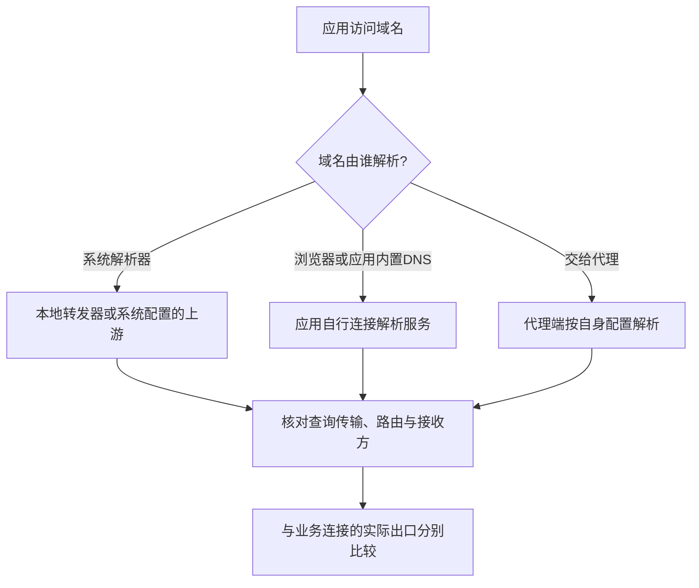
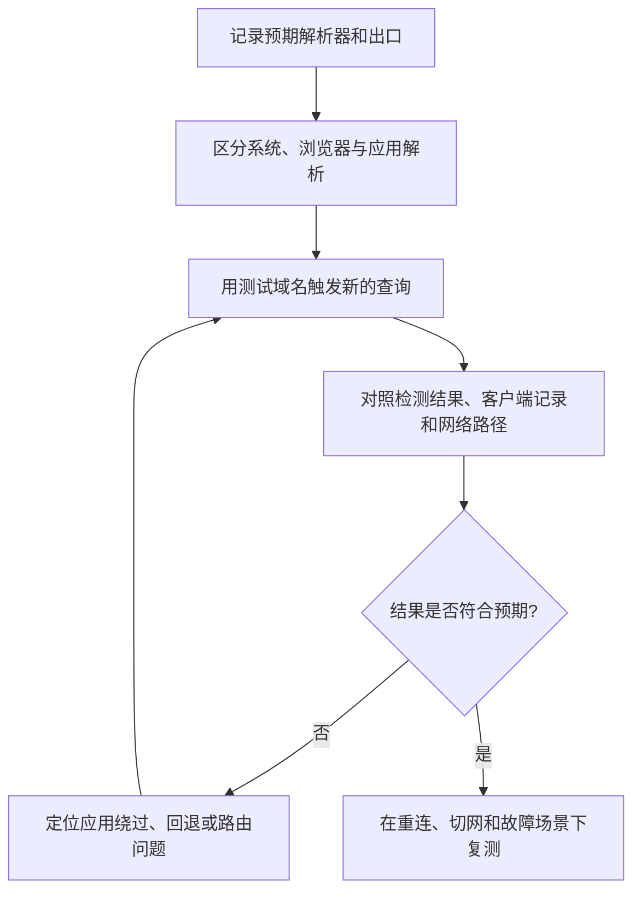
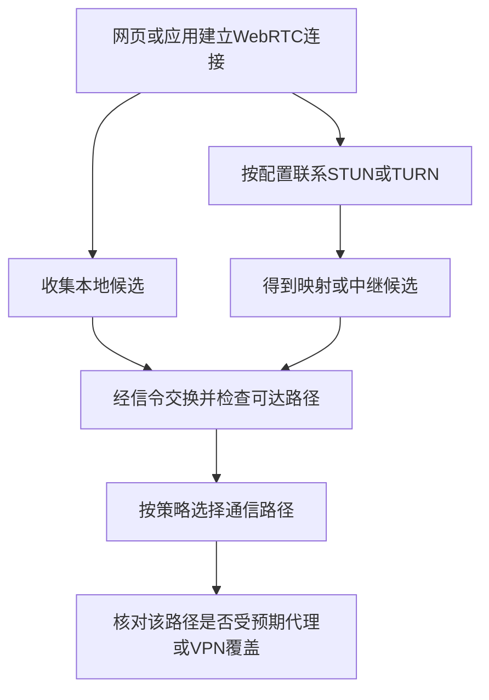
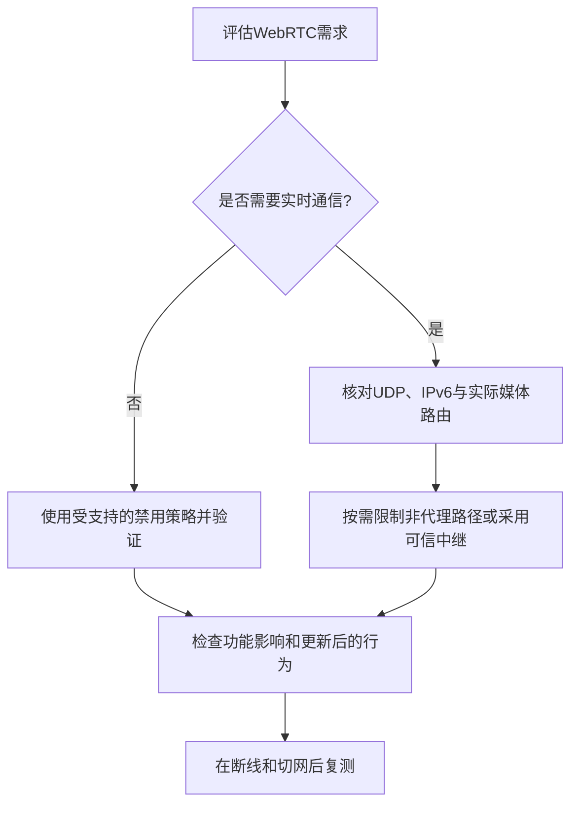
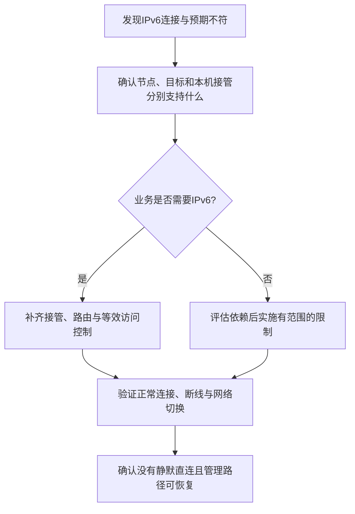
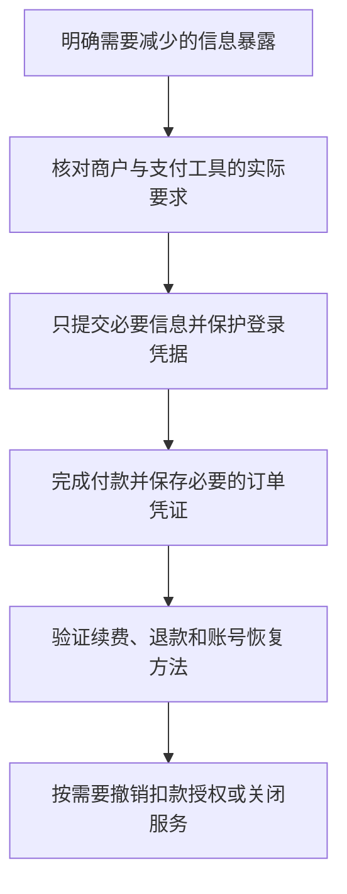
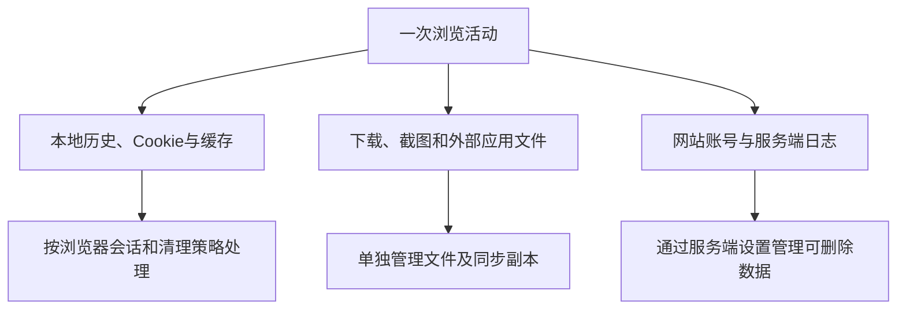
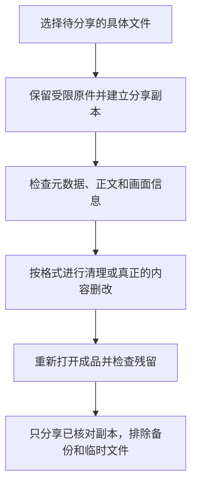
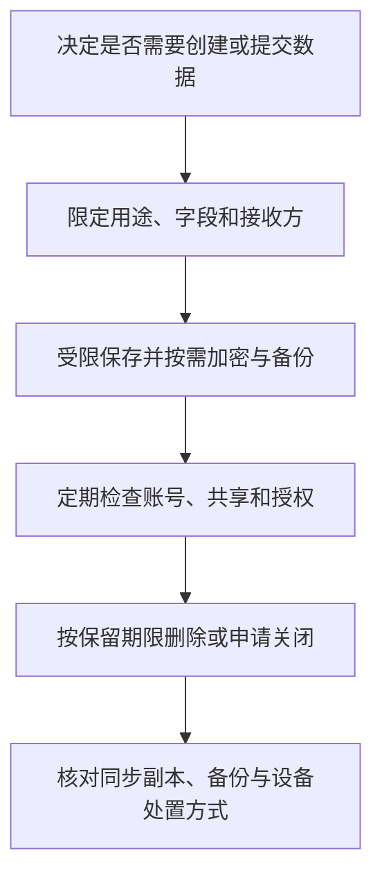

# 第15章 隐私保护实践

隐私保护首先要回答两个问题：哪些信息不希望被谁看到，以及哪些通信原本就允许直连。网络运营者、代理提供者、DNS解析器、网站、支付机构与本机其他使用者看到的信息不同；一次出口IP测试不能证明这些环节都符合预期。

本章围绕DNS、WebRTC、IPv6、支付信息和数字足迹展开。测试前先记录预期路径，区分浏览器代理、系统代理与TUN/VPN接管，避免把某个应用的测试结果推广到整台设备。涉及真实公网地址、候选地址、支付记录或文件元数据的结果，应在受控位置保存，不把完整截图或原始文件公开上传。

## 15.1 DNS泄漏防护

### 15.1.1 什么是DNS泄漏

DNS泄漏是原本应受保护或经指定路径处理的查询，实际交给了非预期的解析器或从非预期网络发出。它不只等于“用了明文DNS”，也不能通过“解析器在本地还是国外”简单判断。若分流策略明确允许某些查询直连，应按该策略评估暴露范围。

应用访问域名时，可能使用系统解析、浏览器内置DoH、应用自己的DNS模块，或把域名交给代理端解析。这些查询不一定跟随网页连接经过同一出口。



*图15-1 DNS解析与业务连接是两条需要分别验证的路径*

DNS查询通常表明某个应用请求了解析，不能单凭一条查询就断言用户实际打开了相应页面；预取、缓存刷新和后台程序也可能触发查询。反过来，没有观察到查询，也可能是命中了缓存，不能据此证明没有访问。

代理客户端与节点之间是否加密、节点到目标是否使用HTTPS，也应分别判断。不能把“用户经过代理访问网站”画成天然全程加密：如果目标是明文HTTP，代理出口到网站的内容仍可能被沿途观察。

### 15.1.2 检测DNS泄漏

检测应同时使用应用测试、客户端记录和系统网络状态，而不是只看检测网站标注的国家或运营商。在线DNS测试通常让浏览器查询一组测试域名，再观察其权威DNS收到的递归查询来源；展示的可能是上游转发器，不一定是本机直接连接的服务器。

| 检查方法 | 能说明什么 | 不能单独说明什么 |
|----------|------------|------------------|
| DNSLeakTest、BrowserLeaks DNS等测试页 | 该次浏览器测试可观察到的递归解析来源 | 整台设备、其他应用和所有网络下的DNS路径 |
| `nslookup`或`dig` | 此工具发出的查询及所联系的解析入口 | 浏览器内置DoH、应用自带解析或完整上游链路 |
| 系统DNS设置 | 系统已配置的接口和解析器 | 应用是否遵循它、是否另有回退路径 |
| 客户端连接记录与受控抓包 | 测试期间可见的连接、规则和部分DNS流量 | 加密DNS中的全部查询内容与远端内部处理 |

第三方检测服务会获得本次访问和测试相关信息。需要较少披露时，可在自己控制的测试域名与服务端上观察；不要在公开讨论中贴出完整家庭IP、公司解析器名称或内部域名。

Windows可先查看系统DNS配置，在PowerShell中执行：

```powershell
Get-DnsClientServerAddress
nslookup -type=A example.com
```

使用systemd-resolved的Linux环境，可检查：

```bash
resolvectl status
resolvectl query example.com
```

macOS可查看实际解析配置：

```bash
scutil --dns
```

`127.0.0.53`、`127.0.0.1`或局域网网关可能只是本地转发入口。它们本身不能证明查询未被保护；看到公共解析器地址，也不能证明连接采用了加密或经过代理。`nslookup`、`dig`还可能与浏览器使用不同的解析机制。



*图15-2 DNS测试需要有预期路径，并覆盖缓存、故障与网络切换的影响*

### 15.1.3 解析加密、代理与系统接管

**区分加密和路由**

DoH、DoT和DoQ保护客户端到所选解析服务之间的传输；解析器仍可处理查询，并可能记录相关信息。使用它们不代表DNS自动经过代理，也不意味着业务目标IP、连接时序和全部域名信息都不可见。

| 方式 | 常用传输 | 部署要点 |
|------|----------|----------|
| 传统DNS | UDP或TCP 53 | 这段查询通常未加密，需明确是否允许及从何处发出 |
| DoH | HTTPS，通常TCP 443，也可能使用HTTP/3 | 验证HTTPS身份，并核对代理、引导解析与回退策略 |
| DoT | TLS，通常TCP 853 | 验证解析器身份，确认端口与网络支持 |
| DoQ | 专用QUIC，通常UDP 853 | RFC 9250已定义，是否更快取决于实现与路径 |

选择解析服务时，考察查询记录、保留期限、司法管辖、过滤策略、可达性和延迟。公共DNS的速度受网络与时间影响，日志处理应结合服务政策评估；恶意域名过滤也不提供匿名保证。DNSSEC用于验证DNS数据真实性，不能代替查询加密或隐藏查询者身份。

浏览器的安全DNS可能有默认回退、网络检测、企业策略或特定站点例外。设置名称相同，也可能因平台和模式不同而采用不同策略。应与代理客户端的DNS设计一起检查，避免系统DNS、浏览器DoH与本地fake-IP同时各走一条未记录的路径。

**按应用交给代理解析**

对于支持SOCKS5的工具，可以明确选择域名解析位置。下面假定本机已有可信的SOCKS5服务监听`127.0.0.1:1080`，命令使用真正的curl程序；Windows PowerShell中可把`curl`写成`curl.exe`，避免旧环境中的命令别名。

```bash
curl --noproxy "" --socks5-hostname 127.0.0.1:1080 \
  --connect-timeout 10 --max-time 20 https://www.example.com/
```

`--socks5-hostname`将目标域名交给SOCKS端处理，`--socks5`通常先由本地解析。`--noproxy ""`用于取消本次请求的免代理名单。此命令不关闭目标HTTPS证书验证，也不配置系统其他应用的DNS；它只能验证该工具的请求路径。代理服务器如何解析，以及浏览器是否另有预取，仍需分别检查。

**核对客户端DNS模块**

第8章已给出mihomo的DNS配置示例。设置DNS上游、把系统查询送入该模块、决定上游连接出口，是三个不同步骤。以下字段按mihomo文档理解，不能直接照搬到其他核心：

| 设置 | 作用与边界 |
|------|------------|
| `dns.enable`与`dns.listen` | 启用DNS模块并监听指定地址；不会自动修改系统DNS或接管应用 |
| `enhanced-mode: fake-ip` | 为部分域名返回映射地址，便于后续识别；不提供查询加密或匿名保证 |
| `nameserver`、`fallback`及筛选策略 | 选择上游与处理结果；不是按国内外自动划分且自动选择代理的通用规则 |
| `respect-rules` | 控制DNS上游连接是否遵循路由规则，需要配套节点解析设计 |
| `proxy-server-nameserver` | 专门处理代理节点域名，防止依赖尚未建立的同一代理 |
| `default-nameserver` | 处理DNS上游自身域名的引导解析，需单独审视路径 |
| TUN的`dns-hijack` | 把匹配的DNS连接导入模块；53端口规则不覆盖所有DoH、DoT或应用内置解析 |

如果节点域名只能通过该节点建立后的DNS连接解析，就产生了启动循环。应为节点与DNS上游准备可启动的解析路径，并明确这条路径暴露哪些名称、是否加密、是否允许回退。不能只打开一个布尔选项就认定DNS方案完整。

**由系统网络管理方式维护DNS**

修改系统DNS应使用当前平台的网络管理器、VPN配置或设备管理策略，记录原值并保留回退方法。Linux的`/etc/resolv.conf`可能由NetworkManager、systemd-resolved或其他组件生成；直接编辑后用`chattr +i`锁定，会妨碍DHCP、VPN、分域解析及网络切换，不作为常规做法。

仅把DNS地址改成`1.1.1.1`或其他公共IP，通常不等于启用DoH或DoT。TUN/VPN也要核对分域DNS、多网卡、局域网解析和断线回退。对不允许直连的查询，应测试代理故障时是否停止而不是静默改走另一条路径，同时保留节点引导及本地网络确实需要的例外。

## 15.2 WebRTC泄漏预防

### 15.2.1 WebRTC的地址与连接路径

WebRTC用于实时音视频和数据通信。ICE机制会收集候选地址并尝试可达路径，STUN可用于获取网络映射信息，TURN可提供中继。系统HTTP代理、浏览器代理和完整VPN对这些连接的覆盖范围可能不同。

| 候选类型 | 含义 | 隐私判断重点 |
|----------|------|--------------|
| `host` | 本地接口候选，部分浏览器用mDNS名称代替具体地址 | 私网地址或`.local`名称不等于公网出口泄漏 |
| `srflx` | 通常通过STUN获得的映射地址 | 是否来自预期VPN或代理覆盖的网络路径 |
| `prflx` | 连接检查中发现的对端反射候选 | 需结合实际ICE连接与网络路径分析 |
| `relay` | TURN分配的中继候选 | 中继地址不等于用户原始公网地址，也不证明应用身份不可关联 |



*图15-3 WebRTC有独立的候选收集与路径选择，不能从网页HTTP出口推断媒体出口*

现代浏览器通常提供地址隐藏和路由限制，但效果受版本、权限、策略及网络配置影响。WebRTC是否绕过代理或VPN取决于实际覆盖范围，没有显示原始局域网地址也不代表没有发生其他网络连接。完整且正确覆盖UDP、IPv6和路由的VPN，与仅设置HTTP代理的情形需要分开测试。

### 15.2.2 检测WebRTC路径

BrowserLeaks WebRTC等检测页可以观察当前浏览器向页面暴露的候选信息，但测试可能联系其配置的STUN服务。测试前确认愿意向该服务披露测试流量，结果中区分网页HTTP出口、ICE候选类型和实际媒体连接。

以下JavaScript适用于支持WebRTC的现代浏览器，可在自己控制的HTTPS页面开发者工具控制台运行。它不配置外部STUN或TURN，只查看本地候选，为候选收集设置5秒等待窗口，并在结束后关闭连接；**不能据此测试公网STUN映射或完整VPN覆盖**。

```javascript
async function inspectLocalIce() {
    const connection = new RTCPeerConnection({ iceServers: [] });
    const candidates = [];
    let timer;

    try {
        connection.createDataChannel("local-check");
        const gathered = new Promise((resolve) => {
            connection.onicecandidate = (event) => {
                if (event.candidate === null) {
                    resolve();
                    return;
                }
                const candidate = event.candidate;
                candidates.push({
                    type: candidate.type,
                    protocol: candidate.protocol,
                    address: candidate.address,
                    port: candidate.port
                });
            };
            timer = setTimeout(resolve, 5000);
        });

        await connection.setLocalDescription(await connection.createOffer());
        await gathered;
        return {
            complete: connection.iceGatheringState === "complete",
            candidates
        };
    } finally {
        clearTimeout(timer);
        connection.close();
    }
}

inspectLocalIce().then((result) => {
    console.log("候选收集是否完成：", result.complete);
    console.table(result.candidates);
}).catch(() => {
    console.warn("本地候选检查未完成，请核对浏览器支持与策略");
});
```

结果为空可能源于浏览器策略、环境限制或检查失败，不是自动通过；`complete: false`表示未确认完整收集。地址字段也可能是mDNS名称。不要把候选列表或完整SDP当作无敏感信息的普通日志。

需要验证实际通话时，应使用自己控制或明确可信的STUN/TURN与通话端，观察选中的ICE候选对及客户端连接记录。只看到TURN地址不能证明终端没有联系其他网络服务；已有媒体会话、浏览器重启与网络切换后还要复测。

### 15.2.3 按需求限制WebRTC

不需要实时通信时，可以使用浏览器支持的WebRTC禁用策略。Firefox的高级配置中存在`media.peerconnection.enabled`；设为`false`会影响音视频和数据通道功能。修改前记录原值，更新后验证实际效果，不把高级配置页面视作永久稳定的跨浏览器接口。

需要通话时，优先确保UDP、IPv6和相关路由进入预期TUN/VPN，或采用经过验证的浏览器IP处理策略。Chromium扩展API提供`webRTCIPHandlingPolicy`，包括`disable_non_proxied_udp`等取值；它用于限制特定网络路径，**不等于关闭全部WebRTC或保证所有媒体走某个HTTP代理**。受管理设备还可能由组织策略控制，扩展未必能覆盖。



*图15-4 WebRTC防护应在功能需求、路由覆盖和地址暴露之间作明确选择*

`iceTransportPolicy: "relay"`是应用建立连接时可采用的中继策略，需要可用TURN服务；普通网页使用者不能假设自己已把所有网站改为该模式，中继服务本身也成为信任方。

不要只封禁UDP 3478或19302后就认定已阻止WebRTC。STUN/TURN可以采用其他端口及TCP、TLS等路径；限制两个端口可能破坏部分通话，却覆盖不了全部地址发现与媒体连接。网络级控制应与现有防火墙管理方式统一，避免无范围新增或覆盖规则。

扩展只选择来源可信、权限必要且仍受维护的产品，不按用户量推断安全，也不假定广告拦截器包含当前有效的WebRTC控制。Chromium的Manifest V3兼容性只能说明一部分扩展平台要求，不能证明隐私功能有效。Tor Browser应保留其整体防护设计，不额外堆叠扩展；其浏览器防护不覆盖设备全部应用，也不能保证绝无泄漏。

## 15.3 IPv6泄漏处理

### 15.3.1 IPv6泄漏的条件

IPv6泄漏通常是接管或限制策略没有覆盖IPv6，使原本应受保护的连接直接从本地网络发出。IPv6本身不是泄漏；如果预期允许某个服务使用本地IPv6，出现IPv6地址也不一定违背策略。

IPv4与IPv6都可以承载HTTPS。绕过代理意味着路径和源地址暴露范围发生变化，并不自动意味着内容变成明文。双栈应用还可能竞速选择可用路径，不能假定总是先IPv6或总是先IPv4。

| 环节 | 需要区分的能力 |
|------|----------------|
| 本机到代理节点 | 节点地址是否可通过IPv4或IPv6到达 |
| 代理转发目标 | 代理协议、服务端解析与出口是否支持IPv6目标 |
| 本机接管范围 | 应用代理或TUN/VPN是否实际覆盖IPv6连接 |
| DNS结果 | 是否返回AAAA，与实际连接走哪条路是两个问题 |
| 防火墙及例外 | IPv6是否有等效限制，局域网和管理例外是否明确 |

本机通过IPv4连接代理节点，仍可能由节点访问IPv6目标。反过来，节点可以通过IPv6连接，也不能证明设备的其他IPv6流量已经进入代理。

### 15.3.2 检测IPv6路径

`test-ipv6.com`等工具主要检测IPv6连通性，出口检测页则展示该次请求抵达服务端的地址。应与预期出口比较，不能规定“只要显示IPv6就是泄漏”。解析出AAAA记录也不等于成功建立过IPv6连接。

Windows PowerShell可读取接口和路由状态：

```powershell
Get-NetIPConfiguration
Get-NetRoute -AddressFamily IPv6
```

Linux可检查地址和路由：

```bash
ip -6 address show
ip -6 route show
```

对于不使用应用代理、希望测试底层网络直连能力的curl，可显式取消本次请求的应用层代理：

```bash
curl --noproxy "*" -6 --connect-timeout 10 --max-time 20 https://www.example.com/
```

该命令会尝试发出真实测试请求，应在允许直接测试的网络中使用；它不绕过内核TUN/VPN或防火墙。目标及当前网络必须提供可用IPv6路径，失败可能是没有地址、路由或目标服务，不自动证明防泄漏成功。

当curl连接SOCKS或HTTP代理时，`-6`不能作为“强制代理服务端以IPv6访问目标”的通用证明。应使用可控的仅IPv6目标与服务端日志，或检查客户端和节点实际连接，分别验证节点连接地址族与目标连接地址族。

### 15.3.3 代理、阻断与回退

需要IPv6时，补齐代理/TUN接管、路由、DNS与访问控制；不需要某类IPv6出口时，可以在明确范围内限制它，并保留系统和本地网络依赖。不得将全局禁用IPv6或把所有IPv6链默认设为DROP作为不加区分的推荐。



*图15-5 IPv6应根据业务和接管范围处理，不以关闭协议代替路径验证*

mihomo顶层`ipv6`、DNS的IPv6选项、IPv6规则和TUN路由各有职责。关闭AAAA回答不能阻止应用连接已经知道的IPv6字面地址；启用IPv6也不能保证全部流量进入TUN。V2Ray入站监听`::`只改变监听地址，不能据此接管系统IPv6，更可能意外扩大本地代理的访问范围。

Windows组件可能依赖IPv6，微软不建议无条件解绑或禁用；“优先IPv4”也不等于禁止IPv6直连。第10章列出了Linux的IPv6开关示例，调整前还需检查接口与服务依赖，保留必要的ICMPv6、邻居发现和路径MTU机制，不阻断唯一管理会话。需要限制时采用当前防火墙或VPN支持的明确策略，先记录原配置并准备恢复。

防断线直连机制还应覆盖代理崩溃、系统休眠恢复、Wi-Fi与移动网络切换、双网卡和VPN重连。不能仅在连接正常时做一次浏览器测试，就认定所有故障场景都会停止出网。

## 15.4 支付信息隐私

### 15.4.1 支付链路中的信息

支付隐私涉及商户、支付处理方、发卡机构、交易平台和账号系统，各方能够看到的字段不同。商户不一定能看到完整卡号，支付机构却可能知道真实付款人；隐藏其中一个字段，不能推出整笔购买无法关联。

购买网络服务时，注册邮箱、付款记录、登录IP、客服工单、发票、续费和退款都可能建立联系。使用代理只能改变部分网络路径，不能删除商户与支付方原有记录，也不能让登录后的实名账号自动变成匿名账号。

| 参与方 | 可能处理的信息 |
|--------|----------------|
| 服务商 | 账号、订单、服务配置、登录和支持记录 |
| 支付处理方或银行 | 付款身份、支付工具、金额、时间与收款方 |
| 交易平台或托管钱包 | 账号、充值提现、交易和必要的身份资料 |
| 公共区块链观察者 | 公开交易、金额或地址关联，具体取决于协议 |
| 邮箱与恢复服务 | 注册、账单、恢复通知及相关登录信息 |

判断支付方式时，先明确希望减少哪一方获得哪些非必要信息，而不是按“匿名程度高、中、低”给出无条件排序。

### 15.4.2 不同支付工具的能力与限制

虚拟卡或一次性卡号可以减少真实卡号向商户暴露，支持额度与订阅控制，但发卡方仍可关联持卡人，商户也可能保留姓名、地址或设备信息。可用地区、验证条件、退款和周期扣款支持应按具体产品核对，不能从“虚拟卡”名称推导开户资格或续费能力。

预付卡和礼品卡不是天然免身份验证。购买、充值、激活、兑换及商户风控可能各有要求；通用礼品卡也不一定能购买VPS。来源不明的折价卡还可能被撤销，支付成功并不保证长期可用或能够退款。

比特币采用公开账本，地址属于假名标识，交易记录可以被观察和关联。交易平台、地址复用、充值提现以及订单金额和时间都可能提供关联线索，未公开姓名的地址也可能被关联到实际身份。

Monero等协议使用隐私机制降低链上发送方、接收方或金额的直接暴露，但钱包终端、交易对手、托管平台及网络行为仍会影响实际隐私。不能保证任何使用方式都完全匿名，也不能把购买某种资产当作解决全部身份关联的步骤。

| 工具 | 主要可能收益 | 仍需评估 |
|------|--------------|----------|
| 虚拟卡或代币化支付 | 减少原卡号暴露，分开管理商户授权 | 发卡方关联、账单字段、续费和退款 |
| 预付卡或礼品卡 | 限定可支出余额 | 验证要求、来源、适用商户及失效风险 |
| 公开账本资产 | 不使用传统卡号完成部分支付 | 链上关联、托管记录、价格和手续费 |
| 具备链上隐私机制的资产 | 减少部分公开交易信息 | 端点、交易对手、获取与使用路径 |

不把跳过身份验证或使用混币服务作为通用隐私步骤。支付方式应符合服务可用条件，并保留核对订单、退款和争议处理所需的记录；这些记录应受限保存，而不是为“匿名”一律删除。

### 15.4.3 最小披露与账号恢复

选择服务前阅读隐私政策，确认需要收集的字段、保留期限和删除渠道。使用单独且可长期控制的邮箱别名、独立密码及多因素认证，有助于分隔用途并减少凭据复用风险，但不保证服务商无法关联不同账号。



*图15-6 支付隐私还要覆盖账号、续费和恢复，不能只关注付款瞬间*

长期VPS或域名服务不宜依赖随时失效、可能被他人接管的临时邮箱或公开接码平台。恢复渠道本身应可控，避免因无法接收通知而丢失服务、账单和数据。即使组合使用Tor、临时邮箱与加密货币，也不能据此判断购买行为无法关联。

## 15.5 数字足迹管理

### 15.5.1 浏览器指纹防护

浏览器指纹综合字体、屏幕、图形渲染、时区、语言及部分硬件能力，形成用于区分或关联访问的特征。它不一定是永远唯一且准确的身份标识，但可以与账号、Cookies、IP和行为共同使用。

Firefox、Brave和Tor Browser采用不同的限制、标准化或随机化策略。Firefox自145版本阶段扩展了隐私浏览和严格追踪保护模式中的相关防护；具体覆盖和默认状态仍需按当前版本核对。研究中的唯一性变化不能当作对每个使用者的固定保护率，更不能据此保证追踪减少某个百分比。

| 防护方式 | 作用 | 使用边界 |
|----------|------|----------|
| 阻止已知追踪脚本 | 减少部分已知收集行为 | 规则不能识别所有第一方或新脚本 |
| 限制或标准化API结果 | 减少可用于区分的细节 | 可能影响功能，仍有其他特征可见 |
| 按站点或会话随机化 | 降低部分跨站、跨会话关联 | 不同实现范围不同，不消除账号关联 |
| 保持一致的浏览器群体配置 | 减少罕见的自定义组合 | 依赖整体设计，随意添加扩展可能削弱效果 |

Tor Browser强调整体指纹防护，不代表所有人的指纹完全相同或绝对匿名。不要随意安装额外字体、扩展或调整高级参数来追求某个测试分数；大量独特改动本身可能增加可区分性。普通广告拦截扩展也不能替代全部指纹防护。

AmIUnique、EFF Cover Your Tracks等测试可以展示其采集到的特征与样本比较结果，但样本群体、时间和测试方法会影响结论。不存在适用于所有人的“唯一性低于20%即安全”标准，单次得分无法证明长期不可关联。测试本身也会向该服务提供一组指纹信息。

### 15.5.2 浏览器数据与会话隔离

隐私浏览主要减少本地会话留下的历史和站点数据，不隐藏网络出口，也不阻止网站识别已登录账号。会话结束后通常清理临时站点状态，但下载文件、书签、外部应用记录和网站端记录可能继续保留。



*图15-7 清理本地会话不会同时删除下载文件、云端副本和服务端记录*

需要分隔工作、个人或其他用途时，可采用独立浏览器配置文件，分别管理账号、Cookie、扩展和同步。容器标签页可以隔离部分站点存储，但不是独立设备或完整网络隔离。若仍登录同一账号、共享邮箱或复用付款信息，隔离窗口不能消除这些关联。

清理前先明确对象，选择对应站点或数据类型。不要默认勾选所有保存密码、通行密钥或恢复材料；应先确认密码管理器、备份和设备同步状态。删除下载列表不等于删除文件，删除本机历史也可能不影响其他设备或云端记录。

退出某个网页不一定撤销所有登录会话。设备丢失或凭据泄露时，还要从可信设备检查会话、撤销令牌、轮换失守秘密并核对恢复渠道。Tor Browser的新身份等功能也不代表清空系统文件、修改所有已登录服务记录或保护外部程序。

### 15.5.3 系统数据、缓存与日志

系统足迹管理应区分缓存、个人文件、诊断资料和安全审计。清空Windows安全日志、删除`/var/log`或递归移除整个`/tmp`与缓存目录，会破坏排障、审计或正在运行的应用，不作为隐私维护步骤。

| 数据 | 合适的处理方式 |
|------|----------------|
| 应用缓存和临时文件 | 使用应用或系统提供的清理功能，先关闭相关任务并检查范围 |
| DNS缓存 | 排障或切换解析方案时按需刷新，不视作清除外部查询记录 |
| Shell与终端历史 | 避免在命令中输入秘密，核对本地及会话记录策略 |
| 系统与安全日志 | 按必要范围、权限和保留期限管理，见第16章 |
| 崩溃报告和遥测 | 查看实际采集与上传设置，提交前检查敏感内容 |
| 同步、备份和回收站 | 分别核对副本与恢复机制，不从单份删除推断全部消失 |

Windows PowerShell可在排障时刷新系统DNS缓存：

```powershell
Clear-DnsClientCache
```

使用systemd-resolved的Linux环境可按需执行：

```bash
sudo resolvectl flush-caches
```

这不会清除浏览器自己的全部缓存、路由器或公共解析器记录，也不会撤销已经发出的查询。macOS及其他Linux解析服务应按实际系统文档处理，不套用同一个后台进程命令。

敏感参数如果已经进入日志或Shell历史，删除当前终端显示不等于删除所有副本。应优先轮换泄露凭据，再处理受控范围内的残留。常用预防方法是使用受限配置文件、标准输入或支持安全输入的工具，避免把令牌放进URL、命令参数和截图。

### 15.5.4 文件元数据与安全分享

照片可能包含GPS、拍摄时间和设备信息；办公文件可能包含作者、批注、修订及嵌入对象。PDF还可能保留先前版本或隐藏内容。文件名、画面中的门牌、二维码、屏幕反光和正文内容同样可能泄露身份，不能只检查EXIF。

应先保留受限原件，在副本上处理并核对成品。下面采用ExifTool `13.34`可用的命令形式，针对单个JPEG示例操作；安装包应来自可信来源并保持受维护版本。`photo.jpg`和输出文件均应替换为已核对的具体路径，输出文件事先不存在。

```bash
exiftool -G1 -a -s -- photo.jpg
exiftool -all= -o photo-share.jpg -- photo.jpg
exiftool -G1 -a -s -- photo-share.jpg
```

`-o`将处理结果写入新文件，源文件保留。默认原地写入时，ExifTool通常还会生成带`_original`后缀的备份，不能误把它一起发送。全量移除可写元数据可能影响色彩配置、方向或后续编辑，应打开分享副本，确认方向、颜色和内容，而不是只看命令退出成功。

结构信息、文件系统时间和画面本身并不会因此全部消失。处理后仍需检查敏感字段及可见内容，不把递归操作整个照片库作为第一步。在线元数据清理服务会接收原文件，不适合在没有评估的情况下上传敏感资料。



*图15-8 元数据检查、内容处理和成品验证是不同步骤*

ExifTool对PDF的写入采用增量更新，旧信息可能仍保留在文件中并可恢复。因此，`exiftool -all= document.pdf`不能作为彻底清除敏感数据的通用方法。应使用理解PDF结构的清理及真正的遮盖删除功能，并核对附件、批注、隐藏层、嵌入对象与历史内容；简单画黑色矩形不代表底下文字已移除。

MAT2等工具也有格式范围和已知限制，“没有显示元数据”不等于证明不存在任何隐含信息。对重要材料应检查处理后内容、重新导出的结果以及文件可用性，必要时使用专门的文档审查流程。办公文件导出成PDF或图片，也可能保留或新增信息，不能跳过验证。

### 15.5.5 数字足迹最小化与数据生命周期

减少足迹应从收集和创建之前开始：不提供非必要字段，按用途分开账号与凭据，减少无必要的长期同步和第三方授权。别名有助于组织和减少公开披露，但需要遵守服务的实际身份要求，也不能阻止后台通过其他信息关联。

临时邮箱、一次性号码和共享接码服务不适合关键账号恢复；密码管理器中的独立密码、通行密钥及多因素认证更有助于避免账号连锁失守。保护恢复材料与保护登录凭据同样必要。



*图15-9 数据最小化覆盖创建、使用、共享、保存与退出全过程*

| 场景 | 实践重点 |
|------|----------|
| 创建账号 | 独立凭据、可控恢复渠道、最少必要资料 |
| 授权应用 | 核对权限和接收方，定期撤销不再需要的授权 |
| 保存文件 | 设备加密、访问权限、受保护且可恢复的备份 |
| 共享资料 | 最小接收范围、核对副本、必要的有效期与撤销能力 |
| 关闭服务 | 检查订阅、扣款、数据导出和服务端保留政策 |
| 转让或报废设备 | 根据介质与实现选择可验证的数据清除方法 |

文件加密、数字签名和传输加密解决不同问题。例如，GPG既可签名也可加密，仅签名不会隐藏正文；压缩归档也需明确选择实际加密方式并保护口令。设备全盘加密主要保护相应锁定状态下的数据，不能阻止已登录会话中的恶意程序读取文件。

普通删除、格式化和覆盖单个文件不保证物理介质上的所有副本都不可恢复。SSD磨损均衡、写时复制、快照、同步和备份可能保留其他副本；`shred`不能被当作跨介质的绝对安全删除方法。设备处置应参考NIST SP 800-88等资料，使用设备支持且经过验证的清除、净化或加密擦除流程，并考虑密钥副本、备份和实际实现条件。

## 本章小结

隐私保护需要把解析、连接、账号、支付与本地数据分别管理。加密DNS不等于DNS经过代理，网页出口不等于WebRTC或全部IPv6出口，隐私窗口也不删除服务端记录。

有效实践是明确预期路径、减少非必要披露，并验证切网、断线和恢复后的行为。数字足迹维护应保护审计与恢复能力，在具体副本上处理敏感内容，而不是靠批量删除日志或堆叠工具追求绝对匿名。下一章将讨论审计与日志管理。

**实践任务：**

1. 画出一个应用的DNS与业务连接路径，说明解析加密、解析器信任和代理路由分别由什么控制。
2. 对比系统DNS与浏览器测试，记录测试范围及局限；不要公开原始IP、内部域名和配置秘密。
3. 在自己控制的页面运行本地ICE检查，区分候选类型，并说明为什么它不能验证公网STUN路径。
4. 核对IPv6接管与故障回退，在允许的测试网络验证切网和重连，保留管理与恢复路径。
5. 对一个自有JPEG副本清理元数据并检查画面，说明为何PDF和办公文档还需要格式专用审查。
6. 制定一份账号、付款授权、同步副本与设备处置计划，保留必要的恢复材料和审计记录。

**参考资料：**

- [mihomo DNS设置](https://wiki.metacubex.one/config/dns/)
- [mihomo TUN设置](https://wiki.metacubex.one/config/inbound/tun/)
- [curl选项与SOCKS解析行为](https://curl.se/docs/manpage.html)
- [RFC 9250：DNS over QUIC](https://www.rfc-editor.org/rfc/rfc9250.html)
- [RFC 8828：WebRTC IP地址处理要求](https://www.rfc-editor.org/rfc/rfc8828.html)
- [MDN：ICE候选类型](https://developer.mozilla.org/en-US/docs/Web/API/RTCIceCandidate/type)
- [MDN：RTCPeerConnection配置](https://developer.mozilla.org/en-US/docs/Web/API/RTCPeerConnection/RTCPeerConnection)
- [Chrome扩展privacy API](https://developer.chrome.com/docs/extensions/reference/api/privacy)
- [微软：Windows中的IPv6配置注意事项](https://learn.microsoft.com/en-us/troubleshoot/windows-server/networking/configure-ipv6-in-windows)
- [Mozilla：Firefox指纹防护改进](https://blog.mozilla.org/en/firefox/fingerprinting-protections/)
- [Firefox指纹防护实现文档](https://firefox-source-docs.mozilla.org/toolkit/components/resistfingerprinting/resistfingerprinting/index.html)
- [Brave指纹防护说明](https://github.com/brave/brave-browser/wiki/Fingerprinting-Protections)
- [Tor Browser安全使用建议](https://support.torproject.org/tor-browser/security/using-tb-safely/)
- [Tor Browser指纹防护](https://support.torproject.org/tor-browser/features/fingerprinting-protections/)
- [比特币隐私说明](https://bitcoin.org/en/protect-your-privacy)
- [Monero隐匿地址说明](https://www.getmonero.org/resources/moneropedia/stealthaddress.html)
- [ExifTool命令说明](https://exiftool.org/exiftool_pod.html)
- [ExifTool PDF写入与信息残留限制](https://exiftool.org/TagNames/PDF.html)
- [MAT2说明与限制](https://manpages.debian.org/trixie/mat2/mat2.1.en.html)
- [NIST SP 800-88 Rev. 2：介质清理指南](https://csrc.nist.gov/pubs/sp/800/88/r2/final)
