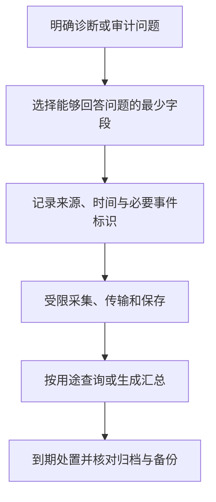
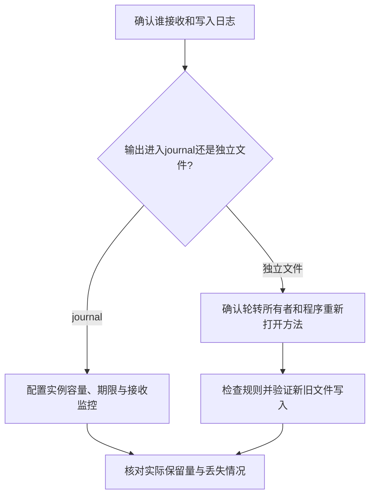
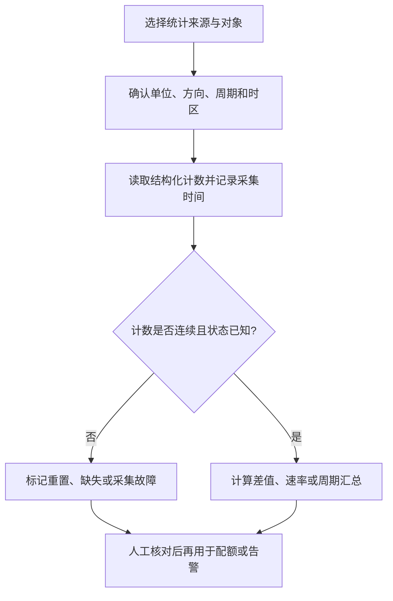
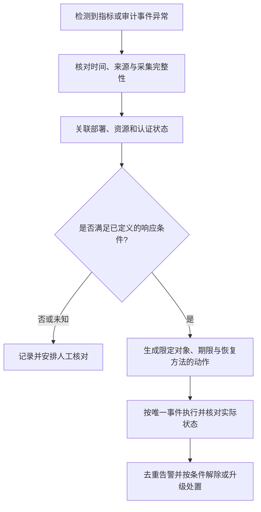
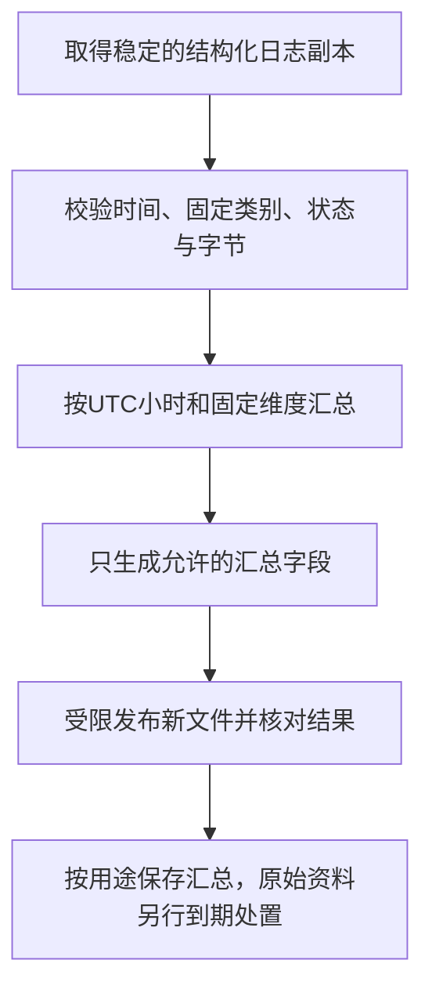
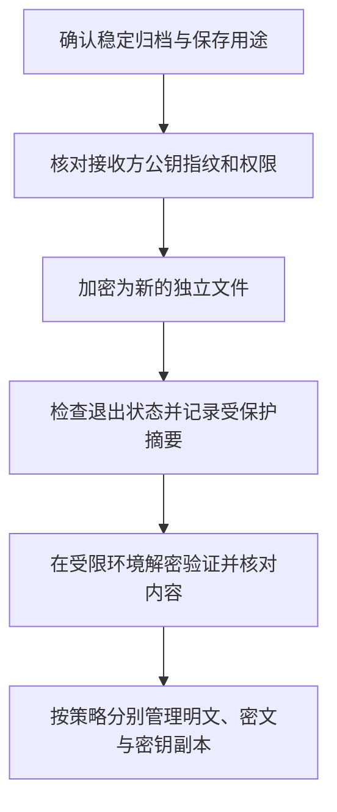
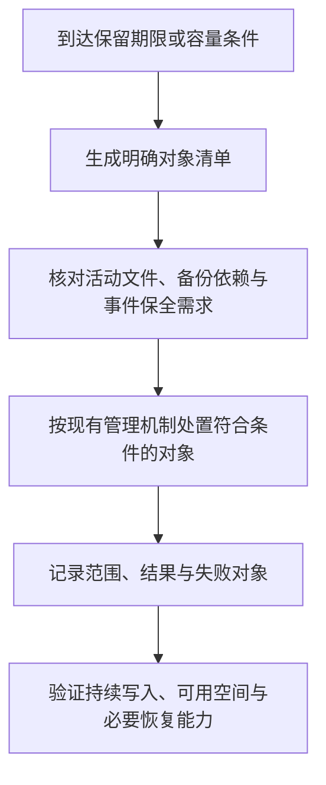

# 第16章 审计与日志管理

日志管理需要同时回答三个问题：为了什么记录、记录哪些字段，以及由谁保存多久。完全关闭诊断信息会降低故障与入侵发现能力，无限制记录又会增加隐私、存储和失守风险。合理的方案应把运行状态、用量统计、访问事件和管理审计分开处理。

本章沿用第10—15章的systemd环境。V2Ray配置采用`v5.53.0`的传统JSON格式，Xray差异以`v26.10.21`说明；两者片段均应合并到已有完整配置。Nginx日志示例使用`escape=json`，要求`1.11.8`及以上版本。路径、服务用户、网卡和部署方式必须按实际环境核对，不让多个任务同时管理同一批日志。

## 16.1 访问日志配置

### 16.1.1 日志的用途与范围

不同日志有不同的目的。运行诊断关注启动失败、上游不可达和资源耗尽；管理审计关注谁在何时修改了什么；流量计数器关注字节和统计周期。这些信息不应都通过保存每个用户访问的域名来获得。

| 数据类别 | 典型用途 | 应避免的额外采集 |
|----------|----------|------------------|
| 运行与错误日志 | 故障定位、配置加载和资源异常 | 密码、令牌、完整订阅与不必要的目标信息 |
| 访问事件 | 核对请求状态、入口与响应行为 | 无明确用途的完整URL、Cookie及请求正文 |
| 聚合指标 | 容量、错误率和用量变化 | 为统计总量而保留全部原始会话 |
| 管理审计 | 权限变更、账号停用、配置与备份操作 | 变更对象的明文密码、私钥和完整配置秘密 |



*图16-1 日志管理从用途开始，并覆盖采集到处置的完整过程*

日志中的时间、地址、账号标识和目标即使没有正文，也可能揭示使用关系。错误日志同样可能带有目标域名或连接上下文，不能只凭级别为`error`就判定没有敏感信息。提交工单前应检查具体字段和样本，避免把原始日志直接粘贴到公开讨论中。

访问日志不能完整代表用户行为：缓存、长连接、多路复用、失败请求和采集丢失会改变记录数量。审计也不能只依赖本机可写文件；若需要抵抗主机失守后的篡改，应设计独立权限与远端留存，同时评估增加的接收方和数据副本。

### 16.1.2 V2Ray与Xray日志

**显式设置访问与错误日志**

下面的`log`片段适用于本章指定的V2Ray和Xray版本：关闭核心访问日志，保留warning及更严重的运行消息，输出到控制台。

```json
{
  "log": {
    "loglevel": "warning",
    "access": "none",
    "error": ""
  }
}
```

`error`为空表示控制台输出，不表示只存内存。在本章的systemd服务中，标准输出和标准错误通常由journal接收，还可能被转发、持久保存或交给容器日志驱动。应核对服务的`StandardOutput`、`StandardError`及采集器设置，不能仅看核心配置中的文件路径。

| 选项 | 本章版本中的含义 |
|------|------------------|
| `access: "none"` | 显式关闭核心访问日志 |
| `access: ""` | 启用该配置对象时采用控制台访问输出，不等于关闭 |
| `error: ""` | 错误与运行消息使用控制台输出 |
| 文件路径 | 由核心写指定文件，需要服务用户可写及配套轮转方案 |
| `loglevel` | 控制运行消息级别；访问日志需要单独核对 |

`warning`、`error`、`info`和`debug`应按诊断需求选择。详细级别仅在限定时间、入口和接收范围内启用，操作前安排空间与退出调试的步骤。不能由一个级别名称推导所有事件都已覆盖，或所有秘密都已过滤。

V2Ray `v5.53.0`的`loglevel: "none"`不能代替显式关闭`access`；Xray `v26.10.21`在该级别下同时关闭其访问与错误日志。为避免依赖差异，确需关闭核心这两类日志时，应分别设置：

```json
{
  "log": {
    "loglevel": "none",
    "access": "none",
    "error": "none"
  }
}
```

这只涉及核心日志机制，不保证启动器、面板、操作系统、代理提供者或目标服务没有记录。Xray的DNS日志、地址遮盖等扩展也需按对应版本单独核对，不能直接作为V2Ray通用字段。

**检查实际接收位置**

第12章介绍了原生V2Ray服务部署。下面的检查示例假设已另行创建`v2ray`服务用户，并授予其读取配置的权限；第12章的手动systemd示例使用root，不能直接假定该用户已存在。确认实际服务用户和权限后，先验证完整配置和服务属性，再查看有限时间范围：

```bash
sudo -u v2ray /usr/local/bin/v2ray test -format json \
  -c /usr/local/etc/v2ray/config.json
systemctl show v2ray.service -p StandardOutput -p StandardError
sudo journalctl -u v2ray.service --since '30 minutes ago' \
  --utc -o short-iso-precise -n 100 --no-pager
```

使用Xray、容器或面板管理服务时，替换为实际命令和日志接收位置。配置检查不等于已加载；应用变更应按该服务支持的方法执行，并验证启动结果和输出位置。不要假定任何核心都提供`systemctl reload`，更不能忽略reload失败后仍声称轮转成功。

### 16.1.3 Nginx最小字段访问日志

Nginx默认或既有格式可能记录客户端IP、完整请求、Referer和User-Agent。完整请求中的查询参数或路径可能包含订阅凭据，Cookie和Authorization也不能加入普通访问日志。更稳妥的做法是在源头选择需要的字段，而不是事后靠一个正则表达式寻找全部秘密。

下面是Nginx的`http`上下文片段。它把实际路径映射为固定类别，不记录原始URI、查询参数、IP、账号、请求头或正文；日志保存在单独文件，便于按用途控制权限和轮转。

```nginx
map $uri $guide_route {
    default web;
    /v2ray proxy;
}

log_format guide_min escape=json
    '{"time":"$time_iso8601","route":"$guide_route",'
    '"method":"$request_method","status":$status,'
    '"bytes":$body_bytes_sent,"duration":$request_time}';

access_log /var/log/nginx/guide-access.jsonl guide_min;
```

本例可合并到第12章的Nginx部署，保留原来的站点、TLS与后端配置。`/v2ray`只用于本例入口分类，应替换或扩展为实际需要的固定类别；不要把`default`改为原始URL。若站点另有`access_log`覆盖、继承或并行日志，应逐层核对，防止另一份combined日志仍记录全部请求。

`escape=json`避免字符串中的引号、反斜线和控制字符破坏JSON边界，但它不负责脱敏，也不能保证所有字段都可信。`status`是HTTP响应状态，`bytes`是发送给客户端的响应正文口径，`duration`是请求处理时间；都不能直接当作代理用户的双向流量或计费依据。

WebSocket等长连接的访问记录通常在请求结束后写入，因此连接持续期间的流量不会实时反映在日志行数中。时间采用带时区偏移的ISO 8601格式，汇总时应统一时区，不能按本地显示字符串混合比较。

启用前先核对日志目录、文件的既有用途与权限。对于日志用户为`www-data`、读取组为`adm`的Debian或Ubuntu发行包示例，可在可信目录中准备这个文件；`touch`不截断已有内容，不要改成从`/dev/null`覆盖：

```bash
sudo touch /var/log/nginx/guide-access.jsonl
sudo chown www-data:adm /var/log/nginx/guide-access.jsonl
sudo chmod 0640 /var/log/nginx/guide-access.jsonl
sudo nginx -t
sudo systemctl reload nginx.service
```

其他服务用户应替换所有权设置，确认父目录不可被非授权用户写入，文件只能由必要主体读取。检查并应用配置后，在批准的测试入口验证实际字段，避免首次写入时沿用过宽的默认权限。

需要完全关闭某个已配置入口的访问记录时，可以在对应`server`或`location`内使用`access_log off;`，但仍应核对其他日志层。错误日志可能包含连接上下文；直接将其写入`/dev/null`会同时丢失诊断能力，不能与“保留受限错误日志”等同。不要为关闭日志另建一个不完整的代理`location`，破坏原有WebSocket或gRPC配置。

### 16.1.4 轮转、容量与保留

**由journal管理核心输出**

采用控制台输出的核心，可以由journal统一管理，不再对同一输出安排文件轮转。下面是默认journal实例的系统级策略示例，保存为`/etc/systemd/journald.conf.d/60-resource-limits.conf`；它会影响该实例接收的其他服务，不能当作只约束V2Ray的配置。容量与期限需按磁盘和诊断需求调整。

```ini
[Journal]
Storage=persistent
SystemMaxUse=100M
RuntimeMaxUse=25M
SystemKeepFree=1G
MaxRetentionSec=7day
MaxFileSec=1day
```

`Storage=persistent`优先使用持久存储，在某些启动或存储不可用阶段仍可能使用运行时目录。大小、时间和可用空间共同影响实际保留量，不能保证始终有完整7天；删除通常以归档journal文件为单位，也不等于对每条记录精确执行到期删除。需要按服务隔离策略时，应评估所用systemd版本支持的日志命名空间或独立采集方案。

核对覆盖配置后，按系统变更流程应用并检查：

```bash
systemd-analyze cat-config systemd/journald.conf
sudo systemctl restart systemd-journald.service
sudo journalctl --disk-usage
```

journal的限流、服务级日志速率限制和采集器队列都可能丢弃消息。应监控丢失提示和接收状态，不能把日志变少直接解释为攻击减少。

**为Nginx文件日志安排重新打开**

下面仅用于Debian或Ubuntu发行包管理的Nginx示例：已确认主进程、PID路径及`/usr/sbin/nginx`与运行实例匹配，日志用户为`www-data`、读取组为`adm`。其他安装方式须替换。先检查系统既有轮转配置，确保它不再匹配这个文件；不要重复接管同一个日志。

保存为`/etc/logrotate.d/guide-nginx`：

```text
/var/log/nginx/guide-access.jsonl {
    daily
    rotate 7
    maxsize 20M
    missingok
    notifempty
    compress
    delaycompress
    create 0640 www-data adm
    sharedscripts
    postrotate
        /usr/sbin/nginx -s reopen
    endscript
}
```

`rotate 7`保留7份轮转文件，可能少于或多于7天；`maxsize`只在logrotate被调度执行时检查，不是实时容量上限。`delaycompress`把最近一份轮转文件的压缩推迟到下次轮转，不提供一致性快照。实际保留还需考虑频率、增长速度和归档副本。

Nginx支持通过USR1重新打开日志，`nginx -s reopen`用于向匹配的主进程发送相应信号。若日志被重命名而进程没有重新打开，它可能继续写旧文件。不得用`|| true`隐藏失败，也不对未知PID文件直接拼接kill命令。

先做不执行轮转的检查：

```bash
sudo logrotate --debug /etc/logrotate.d/guide-nginx
systemctl list-timers --all 'logrotate*'
```

检查通过后，在受控环境观察一次正常轮转，确认新文件权限、持续写入和归档状态。无法重新打开文件的程序应采用其支持的日志机制；`copytruncate`在复制与截断间可能丢记录，不是无损替代。不要对正在写入的日志同时使用独立清空、压缩和删除任务。



*图16-2 轮转必须与日志写入者配合，容量限制和保留天数也需分别验证*

## 16.2 流量分析工具

### 16.2.1 接口与进程监控

vnStat从系统接口计数器保存流量统计，通常不需要保存数据包正文，适合观察接口的历史用量。它不知道每个加密代理账号的实际身份，也不能自动与云厂商账单完全一致。

在Debian或Ubuntu环境可安装工具，先核对实际网卡名称：

```bash
sudo apt update
sudo apt install vnstat iftop nethogs
ip -br link
vnstat --version
vnstat --iflist
```

下面以已确认的`ens3`为例，使用vnStat 2.x支持的命令。先检查服务和已有数据库，不沿用旧版`--create`初始化方式：

```bash
sudo systemctl enable --now vnstat.service
vnstat -i ens3
vnstat -i ens3 --hours
vnstat -i ens3 --days
vnstat -i ens3 --months
```

守护进程的接口自动加入行为取决于版本和启动选项。若确认`ens3`尚未纳入数据库，再按该版本帮助使用`vnstat --add -i ens3`，并检查守护进程是否需要重读接口；不要重复初始化已有统计。系统启动、数据库丢失、接口重建和采样间隔都会影响结果。

临时查看主机对之间的流量时，可以使用：

```bash
sudo iftop -i ens3 -n -N -P
sudo nethogs ens3
```

iftop的`-n`关闭主机名解析，`-N`关闭端口名转换，`-P`显示端口；这些选项减少额外解析与显示转换，不会隐藏IP。`-b`是关闭条形图，`-B`才是以字节每秒显示速率。nethogs的进程归属也会受到权限、容器和连接生命周期影响，不是精确的用户计费系统。

这些工具通常需要查看接口或进程的权限，终端输出可能包含真实地址、端口和进程信息。仅在必要范围运行，不把长期抓包或公开截图当作默认监控方式。

### 16.2.2 统计口径与结构化数据

| 数据来源 | 主要计量对象 | 常见偏差来源 |
|----------|--------------|--------------|
| 云提供商账单 | 产品定义的计费方向、周期和流量 | 免费额度、区域、协议与计量规则 |
| vnStat接口统计 | 系统接口接收和发送计数 | 隧道封装、同机其他服务、多个接口重复统计 |
| 代理核心或面板 | 实现定义的账号、入口及方向计数 | 采集延迟、重启、重置与跨节点汇总 |
| Nginx访问日志 | 请求状态及相应HTTP字节字段 | 长连接结束才记录、日志丢失、字段不含全部传输成本 |

GB通常按十进制计量，GiB按二进制计量；bit/s与byte/s还相差8倍。应保存原始字节数、明确方向和周期，再转换展示。月度限额尤其需要核对账期起点、时区、重置方式及厂商计费口径。

第13章说明了面板选型和统计口径。统计查询应以实际配置的管理入口和权限为准，不把示例公网HTTP地址、端口或默认账号当作部署值。监控接口、客户端用量与计费数据不是同一种权限和统计来源，不能假定`monitor`令牌可以读取全部用户信息。

不要通过搜索`accepted`行、固定取第4列来计算“流量”或“用户数”。一行可能代表事件或请求，不是字节；同一用户可能有多个地址，多个用户也可能共享NAT或CDN地址。

自动化读取vnStat时，优先使用所用版本的`--json`输出，核对模式、字段、单位与接口，不按`--oneline`的固定列号截取带单位文本。计算速率时，要比较同一计数器在两个时刻的差值，识别重置和采集间隔；缺失数据或负差值应标记异常，不能直接转成负流量或忽略后继续扣费。



*图16-3 流量分析先明确计量口径，不能从日志行数直接推导用量*

### 16.2.3 限速与限额的区别

限速限制单位时间的传输能力，限额限制某个周期的累计用量。并发连接上限、握手超时、缓冲区大小和访问事件计数也各有含义，不能互相替代。

iptables的`limit`主要按报文匹配速率工作，不接受“10mbit/s”作为通用带宽限制方式；`hashlimit`虽然可在相应模式下按字节匹配并配合丢包，但仍不是具有排队与公平调度的通用流量整形。错误链路或全局规则可能误伤SSH及所有用户。

Linux的tc通常在出口队列实施整形，入口方向则涉及监管、重定向或IFB等另外设计。服务器网卡发送方向不等于客户端所有业务的“上传”，代理用户流量还可能是本机进程产生，不经过预想的FORWARD链。

| 需求 | 优先核对的实现位置 |
|------|--------------------|
| 单账号周期配额 | 核心或面板明确支持的账号计数与停用机制 |
| 单账号速率限制 | 已核实的核心、管理层或可识别账号的调度方案 |
| 接口总出口整形 | 经过测试的tc或提供商网络能力 |
| HTTP请求速率 | Nginx等兼容入口的请求级限制，非隧道总带宽 |
| 应用并发或连接寿命 | 协议与服务实现的对应限制 |

V2Ray的`handshake`、`connIdle`、`uplinkOnly`、`downlinkOnly`是超时类参数，`statsUserUplink/Downlink`用于统计，`bufferSize`不是用户带宽上限。不能给出一组policy参数就声称实现了用户限速。

实施整形前先读取`tc -s qdisc show dev ens3`等现状，明确现有管理者、受影响方向和恢复方法。不要先删除root qdisc再试验，避免破坏云网络、容器或已有QoS。自动化限速必须有幂等状态和回退，不能在每次扫描时重复添加同一根队列。

## 16.3 异常检测机制

### 16.3.1 连接、资源与采集异常

异常是与基线或明确策略不符，不等于已经确认攻击。备份、软件更新、通话、自动重连和共享出口都可能产生高连接数或集中流量，不能仅凭“访问时间固定”或“目标单一”判断恶意。

| 信号 | 应同时观察的上下文 |
|------|--------------------|
| 新连接或失败率突增 | 是否有部署、证书过期、网络抖动或探活变更 |
| 出口用量或速率上升 | 周期、接口、备份任务与账号计量口径 |
| CPU、文件描述符或队列压力 | 进程、连接状态、并发和资源限制 |
| 错误日志突然减少 | 服务是否停止、采集是否丢失、是否触发限流 |
| 管理操作异常 | 操作主体、权限、来源与预期变更窗口 |

滚动“最近一小时”应按带时区的事件时间比较明确区间，例如当前UTC时刻之前60分钟至当前时刻，而不是grep上一个整点小时。还要处理迟到事件、时钟偏差、轮转后的多个文件和重复采集。

计数窗口、阈值、最少样本量和恢复条件应一起定义。告警可按持续时间或连续多个窗口触发，并设置恢复阈值减少反复抖动；缺失数据单独告警，不作为零次失败。第16.4.2节给出按整点小时汇总的离线示例，它不是实时滑动窗口检测器。

### 16.3.2 探测与认证失败检测

端口扫描、认证失败和正常重试应分别识别。只访问SSH一个端口达到某次数，不能据此证明扫描了多个端口；丢包重传与共享出口也可能提高计数。对已执行DROP的流量，位于其后的LOG规则通常不会再匹配，同一套规则的顺序必须核对。

Fail2Ban依赖可靠日志、时间解析、可信来源地址和实际生效的封禁动作。优先沿用第10章已验证的SSH过滤器和jail，不为所有代理协议套用`rejected.*from <HOST>`一条表达式。不同版本、传输与TLS失败可能根本不产生对应格式的日志。

自定义过滤器应先对受控样本离线测试。以已准备的SSH测试日志为例：

```bash
fail2ban-regex ./ssh-failure-sample.log /etc/fail2ban/filter.d/sshd.conf
```

该命令检查匹配，不直接修改防火墙。样本应包含成功、失败、IPv4、IPv6、无关事件及恶意构造内容，核对时间和捕获地址；日志字段来自不可信请求时，还需防止日志注入或把目标地址误当成来源。

经CDN、反向代理或端口分流后，服务可能只看到中间节点。真实IP头只应信任明确的代理来源，不能相信任意客户端提交的`X-Forwarded-For`。否则自动响应可能封禁整个CDN、共享网关或被伪造的第三方地址。

### 16.3.3 分级响应与可撤销变更

自动响应应由已确认的事件和明确权限驱动，先做只读告警，再考虑范围有限、持续时间明确的处置。不得把日志最后一列未经解析就拼接进防火墙命令，也不根据历史文件里的全部失败记录反复累加封禁。



*图16-4 自动响应需要可信证据、范围限制、去重和恢复能力*

| 控制点 | 实施要求 |
|--------|----------|
| 对象校验 | 使用明确账号或经解析验证的地址，不接受任意命令文本 |
| 权限与范围 | 专用最小权限，保留管理通道，避免跨服务误伤 |
| 幂等与并发 | 唯一事件、状态核对和到期时间，不重复追加同一动作 |
| 通知 | 明确接收方与必要摘要，不附完整日志、令牌或订阅 |
| 回退 | 记录原状态、解除条件和人工接管方法 |

接近用量限额时，应先核对账期和采集状态，再选择通知、限制或暂停。执行失败与结果未知需要区别处理，重试前读取当前状态。审计记录应说明规则版本、执行主体、目标、原因和结果，秘密字段只记录“已轮换”等状态，不保存新旧明文。

## 16.4 日志隐私平衡

### 16.4.1 按用途选择保存策略

“隐私优先”应体现为减少字段、限制读取和缩短不必要保留，而不是统一关闭所有安全记录。不同服务和事件的重要性不同，不按个人、小规模共享或商业运营简单指定同一个保留天数。

| 策略 | 适用条件与代价 |
|------|----------------|
| 不记录核心访问事件，保留有限运行消息 | 减少目标信息，仍需验证错误日志与其他采集层 |
| 源头最小字段日志 | 支持状态与容量分析，避免保留不必要身份及请求内容 |
| 短期详细调试 | 限定对象、时间和接收权限，事先安排退出与处置 |
| 运行时journal | 减少常规持久副本，但重启后诊断能力下降 |
| 独立管理审计 | 支持权限与配置追溯，需要独立保护和适当留存 |

journal的`Storage=volatile`将日志写入运行时目录，不等于整个系统从未持久记录。tmpfs可能受交换空间影响，远程转发、容器日志、崩溃转储、虚拟机快照和终端记录也可能形成副本。核心文件日志、journal与远端存储应作为一条完整链路检查。

调试开始前记录批准范围、预期结束时间和负责人员，确认磁盘空间与脱敏要求；结束后恢复原级别，再按保留策略处理资料。疑似入侵时，应先保全必要证据和时间线，而不是立即清空记录。


*图16-5 保存策略必须覆盖接收与转发链路，单个应用关闭日志并不删除其他副本*

### 16.4.2 最小字段汇总与去标识化

IP截断、时间粗化和假名化可以减少细节，但不自动实现不可逆匿名。保留IPv4的某个前缀或IPv6的某个网段，仍可能识别网络或家庭；固定哈希也可能被枚举或跨记录关联。需要关联同一来源时，可评估带密钥的假名标识与定期轮换，但必须另行保护密钥和映射关系。

处理地址应使用`ipaddress`等能理解IPv4、IPv6、压缩写法及映射地址的库，不用按冒号或点号随意截断。URI、账号、时间及其他字段也可能重新识别对象，不能只替换IP后把原始日志当作完全匿名资料分享。

更少披露的做法是生成用途明确的汇总。下面的Python 3.11及以上示例读取17.1.3的Nginx JSONL，按UTC整点小时、固定入口类别和HTTP状态类别汇总请求数及响应正文字节。它不输出原始行或额外字段，不发送通知，也不据此封禁用户。保存为`summarize-nginx.py`：

```python
from collections import defaultdict
from datetime import datetime, timezone
from pathlib import Path
import json
import os
import sys
import tempfile


def summarize(source_name, output_name):
    source = Path(source_name).resolve(strict=True)
    output = Path(output_name).absolute()
    if not output.parent.is_dir():
        raise ValueError("输出目录必须事先准备")

    groups = defaultdict(lambda: [0, 0])
    records = 0
    with source.open("rb") as reader:
        while True:
            raw = reader.readline(65537)
            if not raw:
                break
            if len(raw) > 65536:
                raise ValueError("日志行超过处理上限")
            item = json.loads(raw)
            if not isinstance(item, dict):
                raise ValueError("需要JSON对象")

            stamp = item.get("time")
            route = item.get("route")
            status = item.get("status")
            size = item.get("bytes")
            if not isinstance(stamp, str):
                raise ValueError("缺少有效时间")
            moment = datetime.fromisoformat(stamp)
            if moment.tzinfo is None or moment.utcoffset() is None:
                raise ValueError("时间必须包含时区")
            if not isinstance(route, str) or route not in {"web", "proxy"}:
                raise ValueError("入口类别不在允许范围")
            if type(status) is not int or not 100 <= status <= 599:
                raise ValueError("HTTP状态无效")
            if type(size) is not int or size < 0:
                raise ValueError("字节数无效")

            hour = moment.astimezone(timezone.utc).replace(
                minute=0, second=0, microsecond=0
            ).isoformat()
            key = (hour, route, status // 100)
            if key not in groups and len(groups) >= 20000:
                raise ValueError("汇总分组超过处理上限")
            groups[key][0] += 1
            groups[key][1] += size
            records += 1

    if records == 0:
        raise ValueError("没有可汇总的记录")

    descriptor, temporary_name = tempfile.mkstemp(
        prefix=".summary-", dir=output.parent
    )
    temporary = Path(temporary_name)
    try:
        with os.fdopen(descriptor, "w", encoding="utf-8", newline="\n") as writer:
            for (hour, route, category), (count, size) in sorted(groups.items()):
                row = {
                    "hour_utc": hour,
                    "route": route,
                    "status_class": f"{category}xx",
                    "requests": count,
                    "response_body_bytes": size
                }
                writer.write(json.dumps(row, ensure_ascii=False) + "\n")
        os.link(temporary, output)
    finally:
        temporary.unlink(missing_ok=True)
    return records, len(groups)


if __name__ == "__main__":
    if len(sys.argv) != 3:
        raise SystemExit("用法：summarize-nginx.py 输入JSONL 新输出文件")
    try:
        records, buckets = summarize(sys.argv[1], sys.argv[2])
    except (OSError, ValueError, TypeError, OverflowError):
        raise SystemExit("汇总失败，请在受控环境核对输入、权限及输出状态") from None
    print(f"已汇总{records}条记录，生成{buckets}个分组")
```

该脚本先检查输入，再在输出目录创建受限临时文件，完成写入后用硬链接发布；这要求本地文件系统支持同目录硬链接。已有输出文件不会被覆盖，失败时清理临时文件。输出目录应由可信管理者维护，不是公开可写目录。

执行前选用**已经完成轮转且不再写入**的未压缩日志，或者由日志接收系统导出的稳定副本。脚本不负责协调轮转，不解压归档，也不把读取正在变化的文件称为一致性采集。

审阅脚本后，可按第14章的方法安装至受控位置，准备报告目录：

```bash
sudo install -d -o root -g root -m 0755 /usr/local/libexec
sudo install -o root -g root -m 0750 summarize-nginx.py \
  /usr/local/libexec/summarize-nginx.py
sudo install -d -o root -g root -m 0700 /var/lib/proxy-reports
sudo python3 /usr/local/libexec/summarize-nginx.py \
  /var/log/nginx/guide-access.jsonl.1 \
  /var/lib/proxy-reports/summary-review.jsonl
```

文件名与入口类别须按实际轮转和分类修改，重复运行应使用新的明确输出名。输入不符合约定时程序停止，不把解析失败当作零次请求；错误提示不会回显原始行。



*图16-6 结构化汇总通过减少输出维度降低披露，不等于证明数据完全匿名*

汇总结果仍可能在样本很小时揭示活动时间，应按需要进一步扩大时间窗口、合并类别或限制小样本输出。请求数与HTTP字节也不代表代理账号用量，不能拿这份离线报告直接执行配额扣减。

### 16.4.3 加密、完整性与访问隔离

加密保护相应锁定状态下的内容，不替代权限和保留策略。已挂载并解锁的加密卷仍可被有权限的进程读取；主机失守时，日志内容与解密材料也可能同时暴露。存储加密应通过已核对的设备部署流程完成，不在日志教程中直接对示例块设备执行格式化命令。

归档加密前先确认日志已经关闭、轮转完成且内容稳定。压缩不等于加密；普通摘要可用于检查变化，但没有可信基准时不能单独证明来源，公钥加密也不自动证明发送者身份。需要来源验证时，可另行设计签名及受保护的采集链路。

以下使用GnuPG 2.x演示加密一个**已经核对的独立归档**，保留原件。`REPLACE_WITH_VERIFIED_FULL_FINGERPRINT`必须替换成通过可信渠道核对的接收方完整公钥指纹；只使用邮箱名称不足以确认具体密钥。所有输出文件应事先不存在。

```bash
gpg --batch --no-tty --encrypt \
  --recipient REPLACE_WITH_VERIFIED_FULL_FINGERPRINT \
  --output guide-access.jsonl.2.gz.gpg -- guide-access.jsonl.2.gz
```

确认加密成功后，再为密文生成摘要：

```bash
sha256sum guide-access.jsonl.2.gz.gpg
```

分别检查每条命令的退出状态；不要让后续摘要命令掩盖加密失败。使用不受信任的公钥、缺失接收方密钥或已有输出时，应核对原因，不为了让脚本继续而跳过身份确认或覆盖文件。

恢复演练应在受限目录进行，使用对应私钥：

```bash
gpg --batch --no-tty --output recovered-guide-access.jsonl.2.gz \
  --decrypt guide-access.jsonl.2.gz.gpg
```

确认解密成功后，再检查压缩归档：

```bash
gzip -t recovered-guide-access.jsonl.2.gz
```

解密成功与归档检查通过后，还应核对内容及所需恢复信息。密钥恢复、密码和备份权限需独立规划；没有私钥恢复方法的密文不构成可恢复备份。示例不会自动删除明文，演练得到的明文副本也应纳入保留策略。



*图16-7 加密归档必须包含恢复验证，不能先删除明文再判断是否成功*

日志传输还需验证接收端身份和加密通道，限制采集凭据用途、发送范围与接收端权限。远端管理员、本机服务用户和日常分析人员不应天然共享全部读取及删除权限；需防篡改时可评估独立账号、追加写入或受控保留存储，同时监控传输失败和队列积压。

### 16.4.4 到期处置与恢复验证

保留策略应按数据类别定义期限、容量、接收方、备份范围及例外处理。到期处置由明确任务负责，避免logrotate、采集平台、定时脚本和人工清理相互竞争。

journal清理针对journal文件，普通`journalctl -u`查询过滤不能被当作按某个服务单独删除日志的方法；vacuum主要处理归档文件，活动文件和其他副本仍需核对。文件轮转中的`maxage`也只在相应轮转检查时生效，并非持续运行的精确销毁计时器。

| 对象 | 到期处理前的核对 |
|------|------------------|
| 活动日志 | 写入者和重新打开机制，不能直接删除或截断代替轮转 |
| 已关闭归档 | 范围、权限、保留期限和是否需要暂缓删除 |
| 密文与解密材料 | 保存目的、恢复依赖及密钥生命周期 |
| 远端平台 | 平台留存、导出、索引、队列与管理员权限 |
| 备份和快照 | 独立保留周期、历史副本及实际恢复能力 |

先生成候选文件清单并核对范围，再交给已有管理机制执行。不采用每月通配删除日志目录并重启核心的做法，也不把清空当前文件当作成功轮转。日志仍被进程打开时，删除路径可能不立即释放空间，应先定位写入者，而不是继续重复删除。

覆盖文件和多遍`shred`不能保证SSD、写时复制、快照或备份中的所有副本不可恢复。设备处置沿用第15章的介质与密钥生命周期设计，运行中的日志服务则重点控制新增数据、权限、轮转和已知副本。



*图16-8 到期处置既要减少不必要副本，也要保留运行和恢复能力*

定期演练至少覆盖日志接收失败、磁盘接近满、轮转失败、时钟偏差和密文恢复。审计记录应能说明哪些数据实际产生、传输和删除过；仅有“清理成功”的一句输出，不能代替对目标范围和执行结果的核对。

## 本章小结

日志管理的基础是用途明确、字段最少、权限受限和可验证的生命周期。访问记录、运行消息、用量统计与管理审计应分别设计；控制台输出不等于不落盘，错误级别也不等于没有敏感信息。

统计与异常检测需要明确单位、时间窗口、采集状态和来源可信度。轮转配合实际写入者，加密配合恢复验证，到期处置覆盖已知副本。至此，安全与隐私篇完成了从入口防护、客户端隐私到运维记录管理的主要内容，后续章节将进一步讨论故障诊断。

**实践任务：**

1. 列出当前部署的核心、Nginx、journal、面板与远端采集位置，说明每类记录的用途、字段和保留责任。
2. 在测试入口验证最小字段JSON日志，检查查询参数、路径凭据及并行日志是否仍有记录。
3. 完成一次受控轮转，核对新文件权限、旧文件写入状态与实际保留份数。
4. 比较接口计数、核心账号统计与HTTP日志，说明单位、方向和周期差异，不以日志行数计费。
5. 用受控样本运行离线汇总，验证时区、无效输入、已有输出及小样本披露边界。
6. 对独立测试归档完成加密与恢复演练，设计采集失效、误报和清理失败的告警与回退方法。

**参考资料：**

- [V2Ray v5.53.0日志配置实现](https://github.com/v2fly/v2ray-core/blob/v5.53.0/infra/conf/synthetic/log/log.go)
- [Xray v26.10.21日志配置实现](https://github.com/XTLS/Xray-core/blob/v26.10.21/infra/conf/log.go)
- [Nginx HTTP日志模块](https://nginx.org/en/docs/http/ngx_http_log_module.html)
- [Nginx进程控制与日志重新打开](https://nginx.org/en/docs/control.html)
- [systemd journal配置](https://www.freedesktop.org/software/systemd/man/latest/journald.conf.html)
- [journalctl查询与归档清理](https://www.freedesktop.org/software/systemd/man/latest/journalctl.html)
- [logrotate配置与轮转语义](https://man7.org/linux/man-pages/man8/logrotate.8.html)
- [vnStat命令说明](https://humdi.net/vnstat/man/vnstat.html)
- [vnStat守护进程](https://humdi.net/vnstat/man/vnstatd.html)
- [iftop选项说明](https://manpages.debian.org/trixie/iftop/iftop.8.en.html)
- [Linux tc流量控制](https://man7.org/linux/man-pages/man8/tc.8.html)
- [iptables匹配扩展](https://man7.org/linux/man-pages/man8/iptables-extensions.8.html)
- [OWASP日志管理建议](https://cheatsheetseries.owasp.org/cheatsheets/Logging_Cheat_Sheet.html)
- [Python ipaddress库](https://docs.python.org/3/library/ipaddress.html)
- [GnuPG文档](https://www.gnupg.org/documentation/manuals/gnupg/)
