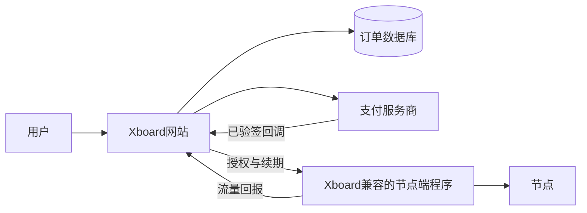
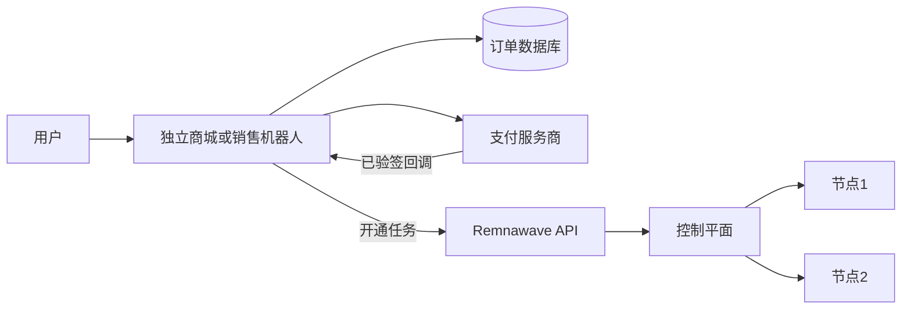
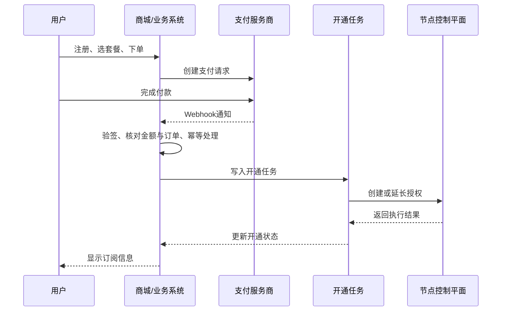

# 第13章 多用户管理方案

为多人提供服务，先决定是管理自己的节点与用户，还是搭建有注册、套餐和支付的网站。本章按这两种目标比较项目，介绍3X-UI的安装与用户管理，并给出Xboard、Remnawave的组合架构。

## 13.1 面板选择与3X-UI实操

### 13.1.1 主要项目对比

| 项目 | 定位 | 用户、套餐与订单 | 支付与自动开通 | 节点管理 | 2026年使用建议 |
|---|---|---|---|---|---|
| [3X-UI](https://github.com/MHSanaei/3x-ui) | Xray节点面板 | 用户、配额和订阅；不是商城 | 需另接业务系统 | 支持多节点 | 个人或小规模节点管理；本章实操主线 |
| [Xboard](https://github.com/cedar2025/Xboard) | 订阅销售前台 | 注册、套餐、订单较完整 | 按支付模块与后端适配 | 对接兼容节点后端 | 需要快速搭建用户网站时优先评估 |
| [Remnawave](https://github.com/remnawave/panel) | 用户与节点控制平面 | 用户与订阅管理；不是完整商城 | 搭配独立销售层 | 多节点 | 多节点运营和API集成 |
| [Remnashop](https://github.com/snoups/remnashop) | Remnawave生态的Telegram销售机器人 | 由机器人及关联服务实现 | 按所支持的支付集成配置 | 依赖Remnawave | 分离式销售层候选，先核对功能与维护情况 |
| [Marzban](https://github.com/Gozargah/Marzban) | Xray用户与节点管理 | 不是完整商城 | 需开发或集成 | 多节点 | 需要API定制的节点运维 |
| [Hiddify Panel](https://github.com/hiddify/Hiddify-Manager) | 多协议用户管理 | 不是完整销售商城 | 需额外业务层 | 按部署架构配置 | 简化配置和用户管理 |
| [V2Board](https://github.com/v2board/v2board) | 传统订阅销售前台 | 业务功能较完整 | 依赖旧版本、插件和后端 | 对接兼容后端 | 仓库最近推送于2024年，主要用于旧系统评估 |
| [X-UI（vaxilu版）](https://github.com/vaxilu/x-ui) | 早期Xray面板 | 用户管理；无完整订单系统 | 需另接 | 旧架构 | 仓库最近推送于2024年，仅作迁移参考 |

### 13.1.2 3X-UI安装与基础管理

**项目地址：** 3X-UI：<https://github.com/MHSanaei/3x-ui>；其使用的 Xray-core：<https://github.com/XTLS/Xray-core>。

**3X-UI特点：**

```
3X-UI是基于Xray-core、持续更新的独立面板

核心优势：
✓ 现代化Web管理界面
✓ 可通过面板配置多种Xray协议（以当前版本为准）
✓ 支持Reality协议（无需自有域名和证书，仍须核对目标参数）
✓ 多用户管理与单用户流量、到期设置
✓ 多节点管理（具体能力以所装版本为准）
✓ 流量统计和限制
✓ 系统状态监控
✓ 一键申请SSL证书
✓ 订阅链接生成
✓ Telegram机器人通知
✓ 定时重启任务
✓ 支持多管理员

支持协议：
- VLESS (TCP/WS/gRPC/Reality)
- VMess (TCP/WS/gRPC)
- Trojan (TCP/WS/gRPC)
- Shadowsocks
- Dokodemo-door
- Socks
- HTTP
```

**安装（3X-UI项目README）：**

```bash
bash <(curl -Ls https://raw.githubusercontent.com/mhsanaei/3x-ui/master/install.sh)
```

**需要先审阅脚本时：**

```bash
curl -fL --show-error https://raw.githubusercontent.com/mhsanaei/3x-ui/master/install.sh -o install-3x-ui.sh
bash -n install-3x-ui.sh
less install-3x-ui.sh
sudo bash ./install-3x-ui.sh
```

安装时会生成随机管理员用户名、密码与访问路径。保存安装输出，运行下面的 `x-ui` 菜单查看或重设，再从受限的管理地址登录。

**3X-UI管理命令：**

先运行 `sudo x-ui` 查看管理菜单；以下子命令按本机版本的帮助信息使用。

```bash
# 打开管理菜单，查看或重设登录信息
sudo x-ui

# 查看状态
x-ui status

# 启动/停止/重启
x-ui start
x-ui stop
x-ui restart

# 查看配置信息
x-ui settings

# 修改用户名和密码
x-ui username
x-ui password

# 修改面板端口
x-ui port

# 更新面板
x-ui update

# 卸载
x-ui uninstall
```

### 13.1.3 3X-UI添加用户与导出配置

**添加用户：**

```
步骤1：登录面板
通过已限制访问范围的管理入口或SSH隧道登录；不要直接暴露公网HTTP管理页

步骤2：添加入站
面板 → Inbounds → + 添加入站

配置项：
- 备注：用户昵称（如：user001）
- 协议：选择协议类型（VLESS/VMess/Trojan）
- 监听IP：0.0.0.0
- 端口：按防火墙和现有服务冲突情况选择
- 流量限制：按实际配额和计量周期设置
- 到期时间：设置有效期
- 传输配置：
  - TCP（直连）
  - WebSocket（CDN友好）
  - gRPC（需确认当前核心与客户端支持）

步骤3：配置TLS（如需要）
- 启用TLS：开
- 域名：your-domain.com
- 证书路径：/path/to/cert
- 密钥路径：/path/to/key

步骤4：添加用户
- UUID：自动生成或手动输入
- Email：用户标识
- 流量：单用户流量限制（可选）

步骤5：保存配置
点击保存后，确认面板与底层核心成功加载新配置
```

**导出客户端配置：**

```
方法1：扫描二维码
- 点击用户后面的二维码图标
- 手机扫描导入

方法2：复制链接
- 点击复制链接按钮
- 发送给用户

方法3：导出配置文件
- 导出JSON配置
- 用户手动导入
```

### 13.1.4 Reality入站与配额示例

**3X-UI配置Reality节点：**

```
Reality配置步骤：

1. 登录3X-UI面板
   从受限的HTTPS管理地址或安全隧道访问，不直接使用公网HTTP地址
   输入管理员账号密码

2. 添加Reality入站
   点击"入站列表" → "+添加入站"

3. 基本设置：
   - 备注：Reality-用户名
   - 协议：选择 VLESS
   - 监听IP：0.0.0.0
   - 端口：选择与现有服务不冲突且已在防火墙中明确授权的端口
   - 传输协议：TCP
   - TLS：选择 Reality

4. Reality设置：
    - 目标地址与ServerNames：按当前Xray和面板文档核对字段与目标条件
    - 私钥：在服务端生成并限制读取权限，不向客户端分发
    - ShortIds：按当前文档生成并核对客户端参数

5. 用户配置：
   - 添加用户：点击“+”
   - Email：用户标识（如user01@example.com）
   - UUID：自动生成
   - Flow：仅在所选传输和客户端都支持时设置
   - 流量限制：按实际配额及统计周期设置
   - 到期时间：设置有效期

6. 保存并启用
   - 点击保存
   - 点击二维码图标生成分享链接
   - 用户扫码或复制链接导入客户端
   - 从客户端测试握手、分流与实际请求，并核对服务端日志
```

**Reality目标核对：**

```
1. 核对当前Xray版本、面板字段和官方配置要求；旧版Dest字段可能已变化。
2. 验证候选目标的TLS行为、ServerNames与所用网络条件。
3. 保存配置后测试正常请求与异常请求的处理，不依据地理标签直接判断可用。
4. 记录目标变化后的复核方式，避免把第三方域名写成永久推荐值。
```

**流量管理功能：**

```
在入站配置中设置：

1. 总流量限制
   - 点击编辑入站
   - 设置总流量（如100GB）
   - 0是否表示不限制，按当前面板版本确认

2. 过期时间
   - 设置到期日期
   - 到期后用测试账号验证新连接是否被禁用

3. 单用户限制
   - 编辑用户设置
   - 设置单用户流量限制

4. IP连接限制
   - 防止账号共享
   - 若当前版本支持，设置并验证最大同时连接数
```

### 13.1.5 面板安全建议

**加强面板安全：** 示例使用的 UFW 项目地址：<https://launchpad.net/ufw>。更换端口不能替代认证和访问控制。修改防火墙前，保留有效SSH会话和云控制台恢复路径，并先核对实际面板端口与管理IP。

```bash
# 确认UFW已按预期管理服务器后，示意允许指定管理IP访问实际面板端口
sudo ufw allow from <管理IP> to any port <面板端口> proto tcp
```

在面板中设置独立管理员账号和强密码，按版本能力启用多因素认证、HTTPS与登录限制。管理界面优先仅监听受信任地址或通过安全隧道访问；用另一设备确认未授权来源无法打开管理入口。备份面板和底层核心配置，并定期验证恢复。

## 13.2 流量统计与限制

### 13.2.1 流量统计功能

**3X-UI流量统计：**

```
统计维度：
- 总流量：所有用户总计
- 用户流量：单个用户使用情况
- 实时流量：当前上传/下载速度
- 日/月汇总：需要时通过当前版本的导出或API自行整理

查看方式：
1. 面板首页：总览
2. Inbounds列表：每个用户的流量
3. 展开入站核对单个客户端的已用流量、总配额和到期时间
4. 需要日/月报表时，核对当前版本是否提供导出或API，再自行汇总；不要假定内置Excel/CSV报表
```

**流量重置：**

```
周期重置：
- 编辑测试客户端，核对当前版本的重置周期设置
- 到约定时间后查看该客户端计数是否按预期重置

手动重置：
- 在入站的客户端列表中选中测试用户并重置流量
- 刷新后核对计数，不直接改数据库
```

### 13.2.2 流量限制策略

**限制方式：**

```
1. 总流量限制
   设置用户月流量（如50GB）
   超出后自动禁用

2. 到期时间
   为单个客户端设定有效期，到期后用测试连接验证停用

3. IP或设备数量限制
   若当前版本提供对应功能，设定上限并验证共享场景

4. 限速
   不把限速视为默认客户端字段；需要时核对当前版本或另用带宽管理组件
```

**3X-UI流量限制配置：**

```
添加/编辑用户时设置：

总流量：
- 输入流量大小（GB）
- 如填写0，先按当前版本文档确认其含义并用测试账号验证
- 超出后自动禁用

到期时间：
- 设置有效期
- 过期后自动禁用

IP/设备限制：
- 仅在当前版本提供对应选项时设置
- 用测试账号验证限制和误封恢复流程
```

### 13.2.3 流量监控与告警

**Telegram机器人通知：** Bot API 官方文档：<https://core.telegram.org/bots/api>。按当前面板版本核对机器人设置入口和可用通知类型。

```bash
# 3X-UI支持Telegram机器人

配置步骤：
1. 创建Telegram Bot
   - 联系 @BotFather
   - 发送 /newbot
   - 设置bot名称
   - 获取Token

2. 获取Chat ID
   - 联系你的bot
   - 发送任意消息
   - 访问：https://api.telegram.org/bot<token>/getUpdates
   - 查找 "chat":{"id":数字}

3. 面板配置
   - 设置 → Telegram设置
   - 输入Bot Token
   - 输入Chat ID
   - 保存

4. 通知类型
   - 用户流量告警（80%/90%/100%）
   - 到期提醒
   - 系统告警
   - 登录通知
```

**邮件通知（外部SMTP服务或自动化系统）：** 不把邮件发送视为3X-UI的默认内置功能；需要时在独立通知系统中配置：

```
配置SMTP：
- SMTP服务器
- 端口（通常587）
- 用户名
- 密码
- 发件人地址

通知事件：
- 流量即将用完
- 账号即将到期
- 新用户添加
- 系统告警
```

## 13.3 用户配置管理

### 13.3.1 批量用户管理

**批量添加用户：** 先用少量测试账号确认面板界面或[3X-UI文档](https://docs.sanaei.dev/)中的API能力；下列是批量操作方案，不保证每个版本都有CSV导入或“批量添加”按钮。

```
方法1：面板批量添加（若当前版本提供）
- 入站 → 客户端 → 批量添加
- 设置用户数量
- 统一配置：
  - 流量限制
  - 到期时间
  - 协议类型
- 自动生成UUID

方法2：导入用户列表（若当前版本支持）
- 准备CSV文件
  格式：用户名,流量(GB),到期时间
- 按当前版本的导入格式核对列名、时区与流量单位，再导入测试账号

方法3：API批量创建
- 以当前版本的API文档为准，使用受限的管理员凭据
- 先创建测试账号并核对去重、到期和流量单位，再分批创建
```

**批量修改配置：** 若当前版本支持批量操作，可先预览影响范围；否则通过已验证的API逐批处理，不直接改运行中的数据库。

```
选择多个用户 → 批量操作：
- 重置流量
- 延长时间
- 修改配额或到期时间
- 启用/禁用
- 删除用户
```

### 13.3.2 用户分组管理

**按需求分组：** 以下是配额设计示例，不代表3X-UI必然有原生“用户组”或“模板”页面；可先在管理表中维护方案，再逐个或通过已验证的API应用。

```
免费用户组：
- 流量：10GB/月
- 有效期：1个月

标准用户组：
- 流量：50GB/月
- 有效期：1个月

VIP用户组：
- 流量：500GB/月
- 有效期：3个月

配置方案模板：
- 在管理表中保存流量、到期时间和IP限制
- 新建用户时按方案填写并复核实际生效值
```

### 13.3.3 配置导出与备份

**导出用户数据：** 优先使用当前面板提供的备份功能。SQLite 项目地址：<https://www.sqlite.org/>。若3X-UI环境使用SQLite后端，可在核对实际数据库路径和服务版本后，用SQLite在线备份接口取得一致性副本；不要直接复制运行中的主数据库文件。以下假设路径确为`/etc/x-ui/x-ui.db`，且已安装`sqlite3`：

```bash
sudo install -d -m 700 /root/backups
backup="/root/backups/x-ui-$(date +%Y%m%d-%H%M%S).db"
sudo sqlite3 /etc/x-ui/x-ui.db ".backup '$backup'"
sudo chmod 600 "$backup"
sudo sqlite3 "$backup" 'PRAGMA integrity_check;'
```

完整备份还应包括代理核心配置、证书、必要密钥与恢复说明，并记录对应面板版本。在隔离环境中恢复副本并确认用户和服务配置可用；`integrity_check`通过并不等于整套服务可恢复。不要把含订阅链接或用户凭据的备份发送到公开聊天或仓库。

**导出用户配置：**

```
导出步骤：
1. 在当前面板版本中查找备份/导出入口，记录实际导出格式
2. 用测试账号核对导出结果是否包含用户、入站和流量设置
3. 将证书、必要密钥与面板数据库/配置一并纳入恢复演练
4. 单个用户的订阅链接或二维码只是连接凭据，不等于完整备份

用途：
- 迁移到新服务器
- 数据分析
- 验证用户配置与恢复结果
```

## 13.4 订单开通、续费与到期提醒

只管理自己和少量用户时，使用3X-UI设置配额与到期时间即可。需要注册、套餐、订单和支付时，再增加销售前台与自动开通流程。

**只用3X-UI：** 管理员在面板中添加入站和客户端、设置配额与到期时间，再把订阅链接交给用户；这个流程不需要Xboard。

### 13.4.1 销售网站的两种组合

**方案A：Xboard + 与其兼容的节点端程序。** Xboard处理注册、套餐、订单和订阅页面；节点端程序运行在服务器上，接收用户授权并回报流量。这里的“节点端程序”不特指3X-UI；本书不把Xboard与3X-UI描述成安装后就能直接互连的组合。



**方案B：Remnawave + 独立销售层。** Remnawave管理用户授权与节点，销售层处理注册、订单和支付。[Remnashop](https://github.com/snoups/remnashop)是与Remnawave集成的Telegram销售机器人；若需要网站前台，可选其他兼容商城或自行实现业务API。



| 选择重点 | Xboard组合 | Remnawave + 销售层 |
|---|---|---|
| 起步成本 | 业务功能较集中 | 需集成多个组件 |
| 节点扩展 | 取决于兼容后端 | 控制平面集中管理 |
| 前台定制 | 受现有系统约束 | 可独立更换销售层 |
| 先验证什么 | 支付插件与节点后端兼容 | 身份映射、授权同步与失败重试 |

### 13.4.2 支付后自动开通

支付成功后由服务端确认订单，再创建或延长节点授权；不能只凭用户浏览器跳转页判断支付成功。



实现时分别记录订单状态与节点授权状态；对重复回调、节点离线、退款和续期失败设计重试或撤销流程。用测试订单核对授权到期时间、流量额度、订阅链接与节点上的实际生效状态。

### 13.4.3 到期提醒机制

**提醒时间节点：**

```
提醒计划：

到期前7天：
- 第一次提醒
- 邮件/Telegram通知
- 提示续费链接

到期前3天：
- 第二次提醒
- 强调即将到期

到期前1天：
- 最后提醒
- 紧急通知

到期当天：
- 账号禁用
- 发送到期通知

到期后：
- 按事先告知的保留策略处理账号和数据
```

**通知模板：**

```
邮件模板：

主题：【重要】您的账号将于3天后到期

尊敬的用户，

您的账号信息：
用户名：{username}
到期时间：{expire_date}

剩余时间：3天
剩余流量：{remain_traffic}GB

为了不影响您的使用，请及时续费。

续费入口：请从已核对的服务域名进入（不要在通知中附带订阅令牌）

如有问题，请联系客服。

---
Telegram通知：

⚠️ 到期提醒

用户：{username}
到期：{expire_date}
剩余：3天

续费入口：请从已核对的服务域名进入
```

### 13.4.4 卡密系统实现

**卡密生成：** 示例使用 Python（项目地址：<https://www.python.org/>）。仅在已获授权的系统中使用。原示例的`random`不适合生成具有访问或余额价值的凭据；下例改用系统安全随机数，并避免输出真实卡密。实际系统还需要唯一性约束、哈希存储、限速、到期、一次性兑换和事务处理。

```python
# Python示例：生成演示卡密，不直接接入支付或用户数据库
import secrets
import string

def generate_card(length=16):
    """生成访问码；长度须为4的倍数。"""
    if length <= 0 or length % 4:
        raise ValueError("length必须为正且为4的倍数")
    chars = string.ascii_uppercase + string.digits
    card = ''.join(secrets.choice(chars) for _ in range(length))
    return '-'.join([card[i:i+4] for i in range(0, len(card), 4)])

# 仅演示生成；正式系统须在数据库层保证唯一性并安全保存
demo_card = generate_card()
```

**卡密使用：**

```
用户端：
1. 登录面板/客户端
2. 输入卡密
3. 点击激活

系统处理：
1. 验证卡密有效性
2. 检查是否已使用
3. 更新用户信息：
   - 延长到期时间
   - 增加流量
4. 标记卡密已使用
5. 记录使用日志
```

### 13.4.5 自动化运维脚本

**到期用户预览：** 管理面板的数据库结构可能随版本改变。不要用未经核对的`DELETE`或`UPDATE`语句直接改运行中的数据库；先从面板导出用户数据，在副本上做只读检查。下面的Python示例假设已把导出文件整理为`username,expires_at`两列，时间为带时区的ISO 8601格式；若实际导出格式不同，应先转换字段并核对结果。

```python
# expiry_report.py：只打印7天内到期的用户，不修改面板或发送消息
import csv
from datetime import datetime, timezone, timedelta

now = datetime.now(timezone.utc)
deadline = now + timedelta(days=7)

with open('users-export.csv', newline='', encoding='utf-8-sig') as source:
    for row in csv.DictReader(source):
        expires = datetime.fromisoformat(row['expires_at'].replace('Z', '+00:00'))
        if expires.tzinfo is None:
            raise ValueError('expires_at必须包含时区')
        if now <= expires <= deadline:
            print(row['username'], expires.isoformat())
```

先在少量测试用户的导出文件上运行并逐项核对；CSV可能含个人信息或订阅凭据，应限制读取权限，处理完成后按保留策略清理副本。设置定时任务前先确认导出步骤、时区、日志路径和失败告警，避免每天重复发送同一提醒。

**执行停用与流量重置：** 报表只生成待处理清单。管理员应在面板支持的界面、API或命令行中执行变更，并先备份、预览影响范围、确认底层核心已同步；不要绕过面板直接改数据库。对大量用户，先对测试账号验证停用、计数重置和恢复流程，再逐批处理并留存审计记录。

---

## 本章小结

本章用对比表区分节点面板与销售前台，以3X-UI演示安装、入站、用户、流量和备份，再用Xboard与Remnawave组合说明订单开通和到期管理。

**核心要点：**

1. **管理面板**：
   - 根据对比表区分节点面板和订阅/订单前台
     - 以3X-UI为例完成安装、用户创建和管理入口配置
2. **流量管理**：
   - 统计分析
     - 限制策略
     - 监控告警
     - 通知渠道与敏感信息最小化
3. **用户管理**：
   - 批量操作
     - 配额方案管理
     - 导出备份
     - 配置模板
4. **到期与续费**：
   - 到期提醒
     - 停用与撤销验证
     - 合规场景下的支付及卡密设计

**最佳实践：**

```
安全建议：
✓ 限制管理入口的访问范围
✓ 设置强密码
✓ 使用HTTPS
✓ 备份并验证恢复

管理建议：
✓ 合理分配流量
✓ 设置到期时间
✓ 启用自动提醒
✓ 先预览到期名单，再通过面板停用
✓ 监控系统资源

变更建议：
✓ 先在测试用户上验证
✓ 不直接修改运行中的面板数据库
✓ 记录版本与回退方式
```

至此，第四部分"服务器搭建篇"全部完成！

---

**实践任务：**

1. 在隔离测试机按3X-UI项目README核对并安装面板，记录版本和脚本来源
2. 添加测试用户
3. 配置流量限制并核对统计口径
4. 设置到期提醒，测试停用后新连接是否被拒绝
5. 导出用户配置并验证备份可恢复
6. 用演示CSV运行只读到期报表，不直接修改数据库
